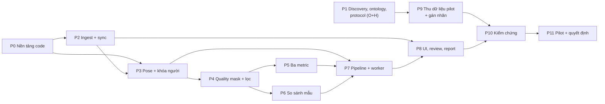

# Kế hoạch thực hiện và kiểm thử — Taiji AI MVP

**Phiên bản:** 1.0 · **Ngày:** 13/11/2026
**Đối tượng đọc:** người thực hiện dự án — A (ML/CV), B (full-stack), O (chủ dự án), H (HLV)
**Thay đổi:** 14/11/2026: P8 lập lại cho React + Vite + FastAPI (DEC-0008, task X.04); thêm test `T-API-*`, `T-WEB-*`, `T-E2E-*`; tổng ≈ 54 ngày công.
**Căn cứ:**

- `WUSHU_TAIJIQUAN_MASTER_PLAN_V3.md`: phạm vi, gate G00–G05, ngân sách dữ liệu và giờ HLV.
- `TECH_WORKFLOW_V1.md`: workflow W0–W9, stack, hợp đồng dữ liệu, công thức metric.
- `taiji_ai/`: code base đã dựng ngày 13/11/2026.

Tài liệu này chia MVP thành **12 phase** và **100 task nhỏ**. Mỗi task 0,5–2 ngày, có đầu ra và cách kiểm tra rõ ràng. Phần 14–16 là kế hoạch kiểm thử. Ước lượng thời gian là đề xuất, phải cập nhật sau Phase 3 (pose trên video thật) và sau 20 đoạn annotation đầu tiên.

---

## Mục lục

1. Nguyên tắc chia việc
2. Hiện trạng
3. Lộ trình tổng thể
4. Phase 0 — Nền tảng code
5. Phase 1 — Discovery, ontology, protocol
6. Phase 2 — Ingest và đồng bộ camera
7. Phase 3 — Pose và khóa người tập
8. Phase 4 — Quality mask và lọc
9. Phase 5 — Ba metric
10. Phase 6 — So sánh với mẫu
11. Phase 7 — Pipeline, worker, run manifest
12. Phase 8 — Giao diện, review, báo cáo
13. Phase 9 — Thu dữ liệu pilot và gán nhãn · Phase 10 — Kiểm chứng · Phase 11 — Pilot và quyết định
14. Kế hoạch kiểm thử: chiến lược và dữ liệu test
15. Danh mục test case theo module
16. Nghiệm thu theo gate, quản lý lỗi, chạy test
17. Lịch thực hiện và phân công
18. Rủi ro thực thi
19. Checklist làm việc hằng ngày và hằng tuần

---

## 1. Nguyên tắc chia việc

| Quy tắc | Nội dung |
|---|---|
| Kích thước task | 0,5–2 ngày công. Lớn hơn thì tách tiếp |
| Mỗi task phải có | Đầu ra (file/module/tài liệu), test hoặc bằng chứng chạy, người làm, phụ thuộc |
| Mã task | `P<phase>.<số>`, ví dụ `P4.03`. Test case có mã `T-<module>-<số>` (mục 15) |
| Trạng thái | Theo `AGENTS.md` §2: `TODO` → `ANALYZING` → `PLAN_READY` → `IN_PROGRESS` → `IN_REVIEW` → `DONE`; `BLOCKED` kèm lý do. Trạng thái sống nằm ở `Docs/tracking/TASK_STATUS.md` (cập nhật 2026-11-13) |
| Quy trình mỗi task | Phân tích → viết plan vào `Docs/tasks/<ID>.md` → đọc lại plan → code → tự review → ghi bug (`Docs/tracking/BUGS.md`) → đóng task + `CHANGELOG.md` |
| Thứ tự trong phase | Làm theo thứ tự số, trừ khi bảng ghi "song song" |
| Code mới | Viết kèm test cùng PR. Không merge code chưa có test với module có logic tính toán |
| Dữ liệu người tham gia | Không commit vào git. Chỉ dùng ID giả danh trong code, test và log |
| Quyết định chuyên môn | Ngưỡng, rubric và nhận xét mẫu phải có H duyệt. Kỹ sư không tự đặt |

**Definition of Done (mọi task):**

- [ ] Code chạy được, có test, `tools/check.ps1` (P0.05) pass.
- [ ] Artifact và manifest có version. Không có NaN bị điền giả, không có ngưỡng "tạm" không ghi lại.
- [ ] README hoặc docstring ghi đơn vị, quy ước tọa độ và điều kiện áp dụng.
- [ ] Cập nhật `Docs/tracking/TASK_STATUS.md` và `Docs/tracking/CHANGELOG.md`. Checklist đầy đủ nằm ở `AGENTS.md` §2 Step 5.

**Ký hiệu cột:**

- **Ai:** A, B, O, H, hoặc ghép (A+H).
- **Ngày:** ngày công ước lượng.
- **Phụ thuộc:** mã task phải xong trước.
- **Kiểm tra:** mã test case hoặc tiêu chí nghiệm thu.

---

## 2. Hiện trạng (13/11/2026)

| Hạng mục | Trạng thái | Bằng chứng |
|---|---|---|
| Môi trường | Python 3.12.10, uv 0.13.8, `.venv` khóa bằng `uv.lock` | `Docs/hardware_inventory.md` |
| GPU | RTX 3060 12 GB, onnxruntime-gpu 1.32 (CUDA 13 + cuDNN 9 qua pip) | GPU smoke test |
| Model | YOLOX-m HumanArt + RTMPose-m HALPE_26 trong `models/`, SHA-256 ở `registry.json` | `tools/fetch_models.py --verify` |
| Code đã có | `io/probe.py`, `io/frames.py`, `pose/skeleton.py`, `pose/registry.py`, `pose/rtm.py`, `store/artifacts.py`, `store/db.py`, `migrations/0001_init.sql`, `app/Home.py` | 12 test pass, ruff sạch |
| Chưa có | `track/`, `quality/`, `metrics/`, `compare/`, `pipeline/`, `report/`, các trang UI | — |
| Git | Repo đặt ở thư mục gốc `wushu/`, nhánh `main` (task X.02); chưa có commit | `.gitignore` gốc |
| Dữ liệu | UMONS-TAICHI (Kinect), tiêu chí TaiForm; chưa có video Thái cực quyền tự quay | `datasets/taiji/README.md` |
| Phụ thuộc bên ngoài | Chưa phỏng vấn HLV, chưa có ontology, chưa xin PSU-TMM100 / TaiChi-AQA / TaiChi-24 | `Docs/DATASET_REGISTRY_TAIJI.md` |

---

## 3. Lộ trình tổng thể



| Phase | Tên | Ngày công | Người chính | Phụ thuộc | Gate v3 |
|---|---|---:|---|---|---|
| P0 | Nền tảng code | 2 (còn lại) | A+B | — | — |
| P1 | Discovery, ontology, protocol | 2,5 kỹ thuật (+ khoảng 2,5 của O, giờ H) | O, H, A | — | **G00** |
| P2 | Ingest và đồng bộ camera | ~~4~~ 5,5 *(2026-11-15, DEC-0025)* | B, A | P0 | — |
| P3 | Pose và khóa người tập | 5 | A | P0, P2.03 | **G01** (cùng P1.10) |
| P4 | Quality mask và lọc | 4 | A | P3 | — |
| P5 | Ba metric | 5 | A | P4 | — |
| P6 | So sánh với mẫu | 4 | A | P4 | — |
| P7 | Pipeline, worker, manifest | 3 | B | P3–P6 | — |
| P8 | UI (React + FastAPI), review, báo cáo | 14 | B | P2, P7 | **G04** |
| P9 | Thu dữ liệu pilot, gán nhãn | 3,5 kỹ thuật + giờ H/annotator | A, O, H | P1 | **G02** |
| P10 | Kiểm chứng metric và so sánh | 4 (+1–2 nếu có PSU) | A+H | P5, P6, P9 | **G03** |
| P11 | Pilot giá trị và quyết định | 3 | O, H, A, B | P8, P10 | **G05** |
| | **Tổng kỹ thuật (A+B)** | **≈ 54** → **≈ 55,5** *(2026-11-15: P2 từ 4 lên 5,5)* | | | |

Con số này cao hơn 30–44 ngày công của v3 vì có thêm phần dựng code nền, công cụ dữ liệu, kiểm thử và giao diện React + FastAPI (DEC-0008: P8 tăng từ 9,5 lên 14 ngày). Có thể giảm khoảng 1,5 ngày nếu dùng import Kinovea/ELAN (P8.05b) thay video player đánh dấu frame (P8.05) và chỉ làm một biến thể metric hông. Muốn giảm nhiều hơn thì phải cắt phạm vi, ví dụ hoãn trang so sánh (P8.13), dải bình thường (P6.06) và E2E (P8.15).

---

## 4. Phase 0 — Nền tảng code (còn lại)

**Mục tiêu:** code base sẵn sàng cho nhiều người cùng làm.

| Mã | Task | Ai | Ngày | Phụ thuộc | Đầu ra | Kiểm tra |
|---|---|---|---:|---|---|---|
| P0.01 | ✅ Dựng cấu trúc package, `pyproject.toml`, `uv.lock` | A | — | — | `taiji_ai/` | Đã xong |
| P0.02 | ✅ Tải và đăng ký model, GPU smoke test | A | — | — | `models/registry.json` | T-POSE-01..03 |
| P0.03 | ✅ `io/probe`, `io/frames`, `store/*`, migration 0001 | A | — | — | module + test | T-IO-01..05, T-STORE-01..03 |
| P0.04 | Commit đầu tiên; quy ước nhánh và PR; file `CONTRIBUTING.md` ngắn | B | 0,25 | — | commit, `CONTRIBUTING.md` | `git log` |
| P0.05 | Script kiểm tra một lệnh `tools/check.ps1`: ruff check + format check + pytest (bỏ qua test `gpu` nếu `-NoGpu`); *mở rộng 2026-11-14 (S1–S4, `Docs/tasks/P0.05.md`)*: web checks, mypy, uv lock, repo-hygiene | B | 0,25 → 0,5 (2026-11-14) | P0.04 | `tools/check.ps1`, `tools/repo_hygiene.py` | T-TOOL-01..05 (2026-11-14) |
| P0.06 | Logging thống nhất (`logging` + file log theo run), không log đường dẫn chứa tên thật; mở rộng 2026-11-15: BUG-0011, uvicorn routing | A | 0,5 → 0,75 (2026-11-15) | — | `taiji_ai/logs.py` (đổi tên từ logging.py để tránh che stdlib) | T-CORE-01 (a..p) |
| P0.07 | ✅ Bộ sinh skeleton tổng hợp cho test (mục 14.3); mở rộng 2026-11-15: 12 kịch bản SYN-01..12, continuous truth, bảng tolerance | A | 1 → 1,5 (2026-11-15) | — | `tests/helpers/synth.py` | T-SYN-01..04 |

**Nghiệm thu P0:** ~~`tools/check.ps1` pass trên máy A và B.~~ *(2026-11-15, X.10, DEC-0015: maintainer chỉ có một máy, nên điều kiện là `tools/check.ps1` pass trên máy đó. Rủi ro còn lại: không có lần chạy trên môi trường thứ hai; X.08, CI trên runner sạch, có thể bù nếu cần.)* Bộ sinh skeleton tổng hợp tạo đủ các kịch bản ở mục 14.3.

---

## 5. Phase 1 — Discovery, ontology, protocol (v3 P00)

**Mục tiêu:** khóa phạm vi chuyên môn trước khi thu dữ liệu. Phần lớn việc do O và H làm, A hỗ trợ kỹ thuật.

| Mã | Task | Ai | Ngày | Phụ thuộc | Đầu ra | Kiểm tra |
|---|---|---|---:|---|---|---|
| P1.01 | Soạn kịch bản phỏng vấn: hỏi câu mở trước, rồi mới cho xem 3 bản phác metric | O | 0,5 | — | `discovery/interview_guide.md` | H đọc thử |
| P1.02 | Phỏng vấn 3–5 HLV, ghi workflow hiện tại và thời gian | O+H | (giờ H) | P1.01 | `discovery/notes/*.md` | ≥ 3 biên bản |
| P1.03 | Tổng hợp nhu cầu: top 3 vấn đề, metric nào giữ hoặc thay | O | 0,5 | P1.02 | `discovery/summary.md` | O + H ký |
| P1.04 | Ontology v0: bài 24 thức (variant HLV xác nhận), action, side, occurrence, view_category, cờ | A+H | 1 | P1.02 | `config/ontology_v0.yaml` | T-DATA-01 (schema) |
| P1.05 | Protocol quay 2 camera: vị trí theo trục bài, app khóa FPS, vỗ tay + flash đầu/cuối, đoạn đứng tham chiếu, checkerboard | A | 0,5 | — | `docs/capture_protocol.md` | Quay thử P1.09 |
| P1.06 | Mẫu consent: phân tích / huấn luyện / chia sẻ, thời hạn lưu, rút lại; quy trình cho người chưa thành niên | O | 0,5 | — | `docs/consent_form.md` | O duyệt pháp lý |
| P1.07 | Định nghĩa sơ bộ 3 metric và điều kiện view (từ Phụ lục B của TECH_WORKFLOW), H góp ý | A+H | 0,5 | P1.03 | `docs/metric_definitions_v0.md` | H ký |
| P1.08 | Điền nhân sự thật, lịch HLV, đơn giá; khóa mục tiêu pilot (thời gian / chất lượng review) | O | 0,5 | P1.03 | `docs/pilot_targets.md` | — |
| P1.09 | Quay thử 1 take trọn bài bằng 2 camera theo protocol *(2026-11-17, DEC-0062: tách thành P1.09a, tập dượt không có người tập (đèn, vỗ tay, checkerboard, định dạng điện thoại, khoảng cách; không cần chờ duyệt consent; cùng buổi với bước tập dượt của P2.07), và P1.09b, take thử với người tập `S00-P00-T01` sau khi O ghi ngày duyệt pháp lý (P1.06 AC2), phiếu đã ký, `P00` đã đăng ký và hàng D08 đã cập nhật; mỗi phần khoảng 0,5 ngày cộng thời gian buổi quay của mọi người; tác nhân không mở hình hay tiếng của người tập, chỉ đọc số, người xem và nghe tại máy; tắt thẻ vị trí và sao lưu đám mây trên điện thoại trước khi quay; protocol 1.1 và các số đo ghi vào `Docs/capture_devices.md`)* | A+H | 0,5 + 0,5 | P1.05, P1.06 *(thêm P1.06 ngày 2026-11-15, DEC-0017; P1.09a chỉ cần P1.05)* | 2 video thử + metadata | Dùng cho P2 và P3 |
| P1.10 | Gửi yêu cầu dữ liệu PSU-TMM100, TaiChi-AQA, TaiChi-24 (do O quyết định gửi) *(2026-11-15, DEC-0018: O quyết định không gửi; dùng dữ liệu đang có và tìm bộ tải tự do, task X.14)* | O | 0,25 | — | Email/form đã gửi, ghi ngày | `DATASET_REGISTRY` cập nhật |

**Gate G00:**

- Có nhu cầu cụ thể (P1.03), ontology v0 (P1.04), protocol (P1.05) và video thử (P1.09).
- Có lịch chuyên gia khả thi (P1.08).
- Nếu chưa có 2 HLV đồng hành thì thu nhỏ về POC đo hình học.

---

## 6. Phase 2 — Ingest và đồng bộ camera (W1, W2)

**Mục tiêu:** đưa video từ điện thoại vào hệ thống với timestamp chính xác, rồi đồng bộ được hai camera.

| Mã | Task | Ai | Ngày | Phụ thuộc | Đầu ra | Kiểm tra |
|---|---|---|---:|---|---|---|
| P2.01 | Schema Pydantic `RecordingManifest`, `SyncManifest` (`schemas/`); *2026-11-15: thêm `ProxyManifest`, `IngestMeta`, quy ước ánh xạ thời gian* | B | 0,5 → 0,75 | P0 | `schemas/recording.py`, `schemas/sync.py` | T-SCH-01 (a..i) |
| P2.02 | `ingest_recording(path, meta)`: copy read-only, SHA-256, probe, `pts.parquet`, cờ VFR, ghi DB; *2026-11-15: sửa BUG-0046 (`is_vfr`), giới hạn kích thước/thời lượng, CLI `taiji ingest`* | B | 1 → 1,25 | P2.01 | `io/ingest.py`, `cli.py` | T-IO-06..09, T-IO-12..19 (*12..19 chi tiết ở bảng test, 2026-11-16*) |
| P2.03 | Tạo proxy H.264 720p, giữ timestamp nguồn; kiểm tra sai lệch proxy ↔ nguồn ≤ 1 frame tại 10 điểm | B | 0,5 | P2.02 | `io/proxy.py` | T-IO-10, T-IO-11 |
| P2.04 | Tách audio mono 16 kHz; tìm offset bằng tương quan chéo envelope ở cửa sổ đầu và cuối take; tính drift | A | 1 | P2.02 | `io/audio_sync.py` | T-SYNC-01..03 |
| P2.05 | Kiểm chứng bằng mốc flash: dò frame có độ sáng nhảy vọt; tính residual (ms, frame) | A | 0,5 | P2.04 | `io/flash.py` | T-SYNC-04 |
| P2.06 | Quy tắc dùng sync: residual ≤ 1 frame thì cho ghép metric, lớn hơn thì chỉ hiển thị song song; *2026-11-15: ghi `sync.json`, dòng DB, CLI `taiji sync`* | A | 0,25 → 0,5 | P2.05 | `sync.json.usable_for_metrics`, `pipeline/sync_take.py` | T-SYNC-05 (a..d) |
| P2.07 | Chạy ingest + sync trên 2 video thử của P1.09; ghi báo cáo ngắn; *2026-11-15: thêm buổi tập dượt kỹ thuật không có người (DEC-0025)* | A+B | 0,25 | P2.03, P2.06, P2.08, P1.09 | `Docs/reports/p2_ingest_trial.md` | Residual thực tế |
| P2.08 | *(thêm 2026-11-15, DEC-0025)* Đăng ký người tập: mã giả danh + cờ consent, audit log, CLI `taiji participant`; từ chối `consent_analysis = 0` | A | 0,5 | P2.01, P1.06 | `store/participants.py` | T-DATA-05 (a..e) |

**Nghiệm thu P2:**

- Ingest không làm thay đổi file gốc (SHA trước = sau).
- Video VFR được nhận diện đúng.
- Proxy ↔ nguồn lệch ≤ 1 frame.
- Hai video thử có `sync.json` với residual đo được.

---

## 7. Phase 3 — Pose và khóa người tập (W4, W5)

**Mục tiêu:** từ một đoạn video, tạo chuỗi pose thô của **đúng một người tập**, kèm timestamp thật.

| Mã | Task | Ai | Ngày | Phụ thuộc | Đầu ra | Kiểm tra |
|---|---|---|---:|---|---|---|
| P3.01 | Kiểm chứng thứ tự 26 khớp trên output thật: vẽ chỉ số lên 5 frame, đối chiếu tên | A | 0,25 | P0 | ảnh kiểm tra + xác nhận `halpe26/1` | T-POSE-04 |
| P3.02 | `run_pose(segment)`: đọc frame theo PTS trong `[start−1s, end+1s]`, detector chạy mỗi N frame, giữa các lần đó lấy bbox từ keypoint frame trước (nới 10–15%) | A | 1 | P3.01, P2.02 | `pose/runner.py` | T-POSE-05..07 |
| P3.03 | Lưu `pose_raw.npz`: mọi người phát hiện được (bbox, kp, score, t_sec, frame_index) | A | 0,5 | P3.02 | artifact + schema | T-POSE-08 |
| P3.04 | Chọn người mục tiêu ở frame đầu: mặc định bbox lớn nhất gần tâm, cho phép chỉ định bbox | A | 0,5 | P3.03 | `track/target.py` | T-TRK-01 |
| P3.05 | Ghép frame-to-frame bằng Hungarian (`1−IoU` + khoảng cách keypoint chuẩn hóa) | A | 1 | P3.04 | `track/target.py` | T-TRK-02..03 |
| P3.06 | Trạng thái mất dấu: quá `max_lost` thì `target_lost`, không nhảy sang người khác; nối lại có ngưỡng | A | ~~0,5~~ 1 *(2026-11-16: thêm file `track.parquet` và hợp đồng dữ liệu `track/1`)* | P3.05 | `track.parquet` có `status` | T-TRK-04..06 |
| P3.07 | Benchmark trên 5 clip thật (P1.09): RTF, peak VRAM, N = 1/5/10, ảnh hưởng của N tới keypoint *(2026-11-16: P1.09 chưa có nên dùng 5 đoạn 30 s của D20, DEC-0038; chạy lại trên clip điện thoại ở X.27)* | A | ~~0,5~~ 1 *(2026-11-16: thêm công cụ `tools/bench_pose.py`, test và báo cáo)* | P3.06 | `reports/p3_pose_benchmark.md` | Số đo thật |
| P3.08 | Rà lỗi pose trên clip thật: tay che thân, xoay thân, đứng một chân, quay lưng; ghi failure cases *(2026-11-16: dùng 4 video D20, DEC-0039; hai lần chạy N = 1 và N = 5, 11 luật chọn frame + mẫu mù, A điền trước và H xác nhận; ảnh chỉ ở máy, báo cáo chỉ có số và ID; lặp lại trên clip P1.09 ở X.28)* | A+H | ~~0,5~~ 1 + 0,75 giờ H *(2026-11-16: thêm công cụ chọn frame, test và hai lần chạy)* | P3.07 | `reports/p3_failure_cases.md` | Danh sách có ảnh *(ảnh ở `data/reports/p3_08/`, không vào git)* |
| P3.09 | So sánh nhanh detector YOLOX vs YOLO11 (chỉ đo, không đổi stack): recall, độ ổn định bbox, tốc độ *(2026-11-16: luật quyết định viết trước khi đo; YOLO11 là AGPL nên chỉ dùng offline trong môi trường cô lập, xuất ONNX bằng dòng lệnh `yolo`, không import vào mã của ta; recall trên 250 frame đã gán nhãn của P3.08 và trên 5 clip; xem `Docs/tasks/P3.09.md`)* | A | ~~0,5~~ 1 đến 1,5 | P3.07 | phụ lục của P3.07 | Quyết định ghi lại |

**Gate G01** (cùng với P1):

- Ít nhất một nhóm metric tạo được giá trị quan sát trên đoạn HLV chọn (kiểm tra sơ bộ ở P5).
- Pose chạy lặp lại được, có RTF và VRAM.
- Nếu pose lỗi nặng ở một view, ghi giới hạn và chỉnh protocol quay.

---

## 8. Phase 4 — Quality mask và lọc (W6)

**Mục tiêu:** tạo ba lớp `raw`, `mask` và `filtered`, không bao giờ "bịa" dữ liệu.

| Mã | Task | Ai | Ngày | Phụ thuộc | Đầu ra | Kiểm tra |
|---|---|---|---:|---|---|---|
| P4.01 | `apply_mask`: score < τ thì NaN, lý do `low_conf`; frame thiếu khớp thiết yếu thì `frame_invalid` *(2026-11-16: hàm trên mảng cộng `mask_track` cho `TargetTrack`; bốn lý do loại `low_conf`, `non_finite`, `not_tracked`, `frame_invalid`; τ_kp và danh sách khớp thiết yếu là giá trị W6, dạng tham số, P3.08 chỉ đánh giá; chưa ghi file `pose_masked.npz`: định dạng file của ba lớp quyết cùng lúc sau P4.07)* | A | 0,5 | P3.06 | `quality/mask.py` | T-QLT-01..02 |
| P4.02 | Nội suy gap ngắn (≤ 150 ms theo thời gian thật, không theo số frame), cờ `interpolated`; gap dài giữ NaN *(2026-11-17: độ dài gap là khoảng giữa hai điểm neo `t[sau] − t[trước]`, nối nếu ≤ 0,150 s + 1e-9 s; không ngoại suy; gap có ô `not_tracked` không bao giờ được nối; "không nội suy qua điểm đổi hướng nghi ngờ" là đầu vào `blocked` do P4.06 tạo, P4.07 nối; mỗi ô nối giữ `reason` của mask; DEC-0045; ước lượng ~~0,5~~ 0,5 đến 0,75 vì có phần đo trên D20 M-QLT-02)* | A | 0,5 | P4.01 | `quality/gaps.py` | T-QLT-03..05 |
| P4.03 | Hampel (cửa sổ 7, 3·MAD), cờ `outlier` *(2026-11-17: cửa sổ 7 frame, thời gian thật chỉ để cắt cửa sổ ở chỗ đứng hình (0,25 s); σ = 1,4826 × MAD; x và y xét riêng, một trong hai vượt là outlier; outlier thành NaN với lý do mới `outlier` = 5 trong `mask.py`; thứ tự mask → Hampel → gap → resample → lọc, lỗ do outlier được P4.02 nối và có cờ; mặc định có sàn σ ≥ 2 px, chọn với số đo M-QLT-03 (luật W6 đúng như viết gắn cờ 7 % ô tốt); thêm `torso_length_px` để quy sàn theo độ phân giải; DEC-0046; ước lượng ~~0,5~~ 0,75 vì có phần đo trên D20)* | A | 0,5 | P4.01 | `quality/filters.py` | T-QLT-06 |
| P4.04 | Resample lưới đều cho video VFR (để lọc), giữ ánh xạ về timestamp gốc *(2026-11-17: timeline quyết định, không phải cờ VFR: mọi frame trong 1 ms của đường thẳng thì bước này là phép đồng nhất (mọi video CFR, cả D20); ngược lại lưới đều từ frame đầu với bước là khoảng frame trung vị (`grid_hz` ghi đè); ô giữa hai ô dùng được là hỗn hợp tuyến tính có cờ (`interpolated` thừa kế, hàng `mixed`), ô cạnh ô không dùng được là NaN, không bao giờ điền; khoảng dừng timestamp > 0,150 s không được nối, NaN với lý do mới `no_frame` = 6; `to_source` đưa về frame gốc và ghi nhận mất ô ở rìa lỗ; lớp lưu trên lưới hay frame gốc do P4.07 quyết; DEC-0047; ước lượng ~~0,5~~ 0,75 vì có phần đo M-QLT-04) *(2026-11-17, X.31: bước và pha của lưới được khớp vào mạng của đồng hồ (bước đếm số frame của mỗi quãng) thay cho khoảng trung vị neo ở frame đầu, và một thời điểm lưới trong 1 ms của một frame là bản sao của frame đó; không thêm tham số, không đổi schema; trên 111 file Kinect 91,0 % hàng lưới là bản sao thay cho 3,2 %; DEC-0052, `Docs/tasks/X.31.md`)* | A | 0,5 | P4.02 | `quality/resample.py` | T-QLT-07 |
| P4.05 | Butterworth bậc 4 zero-phase, chạy riêng từng đoạn liên tục hợp lệ; đoạn ngắn hơn padlen thì không lọc, gắn cờ *(2026-11-17: `sosfiltfilt` (cùng phương pháp `filtfilt`, dạng đoạn bậc hai), bậc 4 và 6 Hz là giá trị W6 không chỉnh ở đây (P5.08 làm ablation); độ lợi tại 6 Hz là 0,5; đoạn có hơn `padlen` (15) hàng thì được lọc, đoạn ngắn hơn giữ nguyên giá trị và có cờ `filtered = False`; tần số cắt không nhỏ hơn Nyquist (clip ≤ 12 fps) thì không lọc gì và ghi `above_nyquist`; `reason` và `interpolated` được sao nguyên; bảng đoạn; không mã lý do mới; DEC-0048; ước lượng ~~0,5~~ 0,75 vì có phần đo M-QLT-05)* | A | 0,5 | P4.04 | `quality/filters.py` | T-QLT-08..09 |
| P4.06 | Phát hiện nghi tráo trái/phải (cặp L/R nhảy chéo đồng thời), cờ `lr_swap_suspect` *(2026-11-17: cú nhảy chéo của từng cặp (cả hai nhãn dịch ≥ 0,2 thân và mỗi nhãn đáp xuống gần vị trí trước của nhãn kia, trong 0,5 lần độ dịch của nó), đọc lớp mask trước Hampel; chỉ cảnh báo, không đổi giá trị, lý do hay nhãn; ghép cặp tham lam trong 0,5 s cho khoảng `suspect`, sự kiện không bạn đồng hành là `unpaired`; `events`, `suspect` và `blocked` (= hợp của hai mặt nạ) cho `interpolate_gaps(blocked=...)`; không mã lý do mới; DEC-0049; ước lượng ~~0,5~~ 0,75 vì có phần đo M-QLT-06)* | A | 0,5 | P4.01 | `quality/lr_swap.py` | T-QLT-10 |
| P4.07 | Coverage theo khớp, theo segment và theo lý do loại; `quality.json` *(2026-11-17: gồm cả việc nối sáu bước theo thứ tự DEC-0046/DEC-0049 (`quality/chain.py`: mask, cờ tráo và Hampel đều đọc lớp mask, gap với `blocked`, lưới, Butterworth; sàn Hampel = 1 % thân); lớp đã lọc nằm trên lưới; coverage là số đếm kèm mẫu số (ba lớp ô rời nhau: quan sát, nối, thiếu; lý do hai lần; frame dùng được và không tracked; gap theo số ô trong khoảng; hai lưới: lưới và hàng gốc) cho segment và các khoảng đặt tên; `quality.json` schema `quality/1` tự nhất quán, ghi nguyên tử, đọc chặt, bốn dạng cảnh báo; `pose_masked.npz` và `pose_filtered.npz` vẫn là X.29; DEC-0050; ước lượng ~~0,5~~ 1,25 vì có chuỗi, schema và phần đo M-QLT-07)* | A | 0,5 | P4.05, P4.06 | `quality/chain.py`, `quality/coverage.py`, `schemas/quality.py`, `quality/quality_io.py` | T-QLT-11 |
| P4.08 | Kiểm thử trên UMONS Kinect (dữ liệu thật 30 Hz): mask, gap và lọc không vỡ trên chuỗi dài *(2026-11-17: adapter chặt `bench/umons.py` dùng lại được cho P6.07 (17 trong 26 khớp HALPE, mặt phẳng (y, −z) mm đọc như pixel, điểm 1,0 cho khớp đã báo và 0,0 cho khớp ở (0, 0, 0), timestamp lặp = hai người nên dòng đầu giữ với `tracked = False`) và công cụ mỏng `tools/umons_adapter.py`; chạy cả 111 file với chuỗi mặc định và với `grid_hz` = 30; không đổi stage nào; báo cáo `Docs/reports/p4_umons_quality.md`; DEC-0051; ước lượng ~~0,5~~ 1 ngày vì có adapter, bộ test và phần đo M-QLT-08)* | A | 0,5 | P4.07 | `bench/umons.py`, `tools/umons_adapter.py` + báo cáo | T-QLT-12 |

**Nghiệm thu P4:**

- Golden test của bộ sinh tổng hợp pass: gap dài vẫn NaN, pause giả không xuất hiện.
- Lọc không lan qua NaN.
- Coverage khớp với số đếm tay trên fixture.

---

## 9. Phase 5 — Ba metric (W7)

**Mục tiêu:** cài đặt 3 metric theo Phụ lục B của TECH_WORKFLOW. Mỗi metric có giá trị, đơn vị, interval hợp lệ, coverage và lý do thiếu.

| Mã | Task | Ai | Ngày | Phụ thuộc | Đầu ra | Kiểm tra |
|---|---|---|---:|---|---|---|
| P5.01 | Kiểu dữ liệu `MetricSeries` / `MetricSummary` (version, units, valid_intervals, coverage, missing_reason) *(2026-11-17: một hàng chuỗi là một hàng lưới của `pose_filtered.npz`; `reason` uint8 là nguồn sự thật (0 đã đo, 1 đến 6 là lý do của quality, 16 đến 22 là lý do của metric); header, interval và ba số đếm coverage lồng nhau được suy ra và kiểm từ nó; `insufficient_evidence` không có số; `experimental` không bao giờ `conclusive`; mô hình Pydantic ở `schemas/metric.py` và mảng ở `metrics/series.py`; DEC-0054; ước lượng 0,5 thành 0,75)* | A | 0,5 | P4 | `schemas/metric.py`, `metrics/series.py` | T-SCH-02 |
| P5.02 | Hỗ trợ hình học: mid-hip, mid-shoulder, độ dài thân, scale Λ (median), sửa roll camera *(2026-11-17: khớp dùng được khi giá trị hữu hạn, kể cả ô nối (cờ `bridged`); lý do của hàng là của khớp đầu tiên trong danh sách không có giá trị; Λ là trung vị của L(t) trên các hàng được đưa vào, một định nghĩa với `quality.torso_length_px` và test giữ bằng nhau; roll cùng dấu θ, giới hạn 45°, `lean_angle_deg` và `correct_roll` là phép tính thuần ở đây; DEC-0055)* | A | 0,5 | P5.01 | `metrics/geometry.py` | T-MET-01..02 |
| P5.03 | Độ cao hông, biến thể A (scale cố định từ đoạn đứng tham chiếu) *(2026-11-17: ước lượng 1 ngày vì viết luôn phần dùng chung `metrics/rows.py`: cắt hàng segment từ `PoseFiltered`, khoảng ổn định, điều kiện đo, run quá ngắn; `Λ_take` lấy từ `PoseFiltered` của đoạn tham chiếu vì lượt pose chỉ phủ segment ± 1 s; hai mức tối thiểu là đối số, không đặt số; DEC-0056)* | A | 1 | P5.02 | `metrics/hip_height.py`, `metrics/rows.py` | T-MET-03 |
| P5.04 | Độ cao hông, biến thể B (so với điểm thấp nhất mắt cá/gót, chia Λ) *(2026-11-17: ước lượng 1 ngày vì tách phần đuôi dùng chung của A và B (A không đổi); `g` là điểm thấp nhất của 15, 16, 24, 25 sau khi bỏ roll, lý do của khớp đầu tiên khi không khớp nào có giá trị; `Λ_segment` từ mọi hàng hợp lệ của segment; B là chiều cao thật nên sự kiện `max` là lúc hông cao nhất; `min_scale_s` tùy chọn, không đặt số; DEC-0057)* | A | 1 | P5.03 | `metrics/hip_height.py` | T-MET-04..05 |
| P5.05 | Độ nghiêng thân trong mặt phẳng ảnh; chỉ tính trong interval có view phù hợp *(2026-11-17: ước lượng 1 ngày vì đưa cổng view (lý do 17) và phần ghép chuỗi (`assemble_series`, `evidence_reason`) vào phần dùng chung `rows.py`, độ cao hông không đổi; hai metric `trunk_lean_lr` (view front) và `trunk_lean_fb` (view side); view là của segment, `orientation_change` chặn (18), view không phù hợp thì mọi hàng 17 và không có số; khoảng HLV tùy chọn; thống kê: trung vị có dấu, trung vị và P95 của \|θ\|; không có thời lượng vượt ngưỡng (cần bản ghi đã ký); DEC-0058)* | A | 1 | P5.02 | `metrics/trunk_lean.py`, `metrics/rows.py` | T-MET-06..07 |
| P5.06 | Tốc độ nhóm khớp theo thời gian thật (sai phân trung tâm), đơn vị thân/giây *(2026-11-17: ước lượng 1 ngày vì đưa hàng xóm của một hàng (`neighbour_rows`) và `scale_of` vào phần dùng chung `rows.py` (độ cao hông không đổi) và thêm `speed_at` cho bộ sinh; ba metric `speed_hands`, `speed_hips`, `speed_feet`; hàng xóm là hàng của lớp cuối (có cả phần đệm 1 s) nên chỉ hàng không có hàng xóm trong lưới là 22; một khớp dùng được khi cả hai ô hàng xóm có giá trị; `Λ` là trung vị độ dài thân của segment; `perspective_shift` chặn (18); khoảng HLV tùy chọn; không có pause (P5.07) và không có ablation (P5.08); DEC-0059)* | A | 1 | P5.02 | `metrics/tempo.py`, `metrics/rows.py` | T-MET-08 |
| P5.07 | Pause: `V < τ` kéo dài ≥ `d_min`; τ và d_min nhận từ config (chưa có thì chỉ xuất profile) *(2026-11-17: ước lượng 0,75 ngày vì bộ sinh cần `slow_intervals` (đáp án: các đoạn tốc độ giải tích dưới τ) kèm test riêng; `find_pauses(series, tau, min_pause_s)` thuần và hai đối số tùy chọn `pause_tau`, `pause_min_s` của `group_speed` (đưa cùng nhau, không mặc định, không đưa thì chỉ có profile); pause là run hàng đã đo có `V < τ` (nghiêm ngặt) kéo dài `n × bước ≥ d_min`, khoảng `[t_đầu, t_cuối + bước)`; hàng không đo kết thúc run, không bao giờ nối; pause cạnh hàng pose mất (1 đến 6) là bị cắt và được đếm ở `pause_cut_count`; thống kê `pause_count`, `pause_total_s`, `pause_longest_s`, `pause_cut_count` null khi không run đo nào dài `d_min`; `threshold_source` = `unsigned_config`, vẫn `experimental`; đoạn chậm bị lỗ cắt xuống dưới `d_min` không được đếm (giới hạn ghi lại); DEC-0060)* | A | 0,75 | P5.06 | `metrics/tempo.py` | T-MET-09..10 |
| P5.08 | Ablation tần số cắt 4/6/8 Hz cho số pause và biên độ hông *(2026-11-17: ước lượng 1 ngày vì làm module `bench/filter_ablation.py` và công cụ chạy lại được thay cho script tạm, ba nguồn dữ liệu và test; chỉ `cutoff_hz` đổi, thêm mốc "không lọc" (1000 Hz, trên Nyquist), mọi hiệu so với 6 Hz; bất biến (lưới, lý do, cờ, segment) được kiểm ở mọi lần chạy; lưới `(τ, d_min)` chỉ để đo độ nhạy; ba nguồn báo cáo riêng: bộ sinh (có đáp án), D20 và UMONS (chỉ hiệu so với 6 Hz); không đổi mặc định 6 Hz; báo cáo `Docs/reports/p5_filter_ablation.md`; DEC-0061)* | A | 1 | P5.07 | `reports/p5_filter_ablation.md` | Số liệu |
| P5.09 | Bảng `metric_record` và hàm tải record; metric chưa có record thì trạng thái `experimental`, không kết luận *(2026-11-17: ước lượng 1,5 ngày vì đổi schema và làm cả đường đi từ bản ghi tới kết quả: migration 0002 dựng lại bảng (đang trống; từ chối chạy nếu có dòng) với `metric_version`, `units`, `gold_reference`, cột JSON `parameters` (ngưỡng, đối số và tần số cắt), `data_sources`; bản ghi bật phải đủ chữ ký HLV và mọi số, sai số đo nhỏ hơn thay đổi nhỏ nhất có ích, tần số cắt được ràng buộc; bản ghi đã bật không đổi, mỗi phiên bản metric một bản ghi bật; `apply_record` không đổi số nào và nói vì sao một kết quả chưa kết luận được; mọi metric ghi `filter_cutoff_hz` (việc nhỏ đề xuất ở P5.08); bản ghi do chính người ký ghi; không có lệnh ký (P10.06); DEC-0063)* | A | 1,5 | P5.01 | `metrics/records.py`, `schemas/metric_record.py`, `store/metric_records.py`, `migrations/0002_metric_record.sql` | T-MET-11, T-STORE-08 |
| P5.10 | Chạy 3 metric trên đoạn thật của P1.09, H xem có hợp lý không (sơ bộ cho G01) | A+H | 0,5 | P5.08, P3.08 | `reports/p5_first_look.md` | H nhận xét |

**Nghiệm thu P5:**

- Mọi golden test với skeleton tổng hợp pass trong tolerance (mục 14.3).
- Metric không đủ điều kiện trả `insufficient_evidence`, không trả 0.

---

## 10. Phase 6 — So sánh với mẫu (W8)

| Mã | Task | Ai | Ngày | Phụ thuộc | Đầu ra | Kiểm tra |
|---|---|---|---:|---|---|---|
| P6.01 | Đặc trưng frame: tọa độ chuẩn hóa (mid-hip, Λ) + sin/cos góc đoạn chi; mask theo khớp | A | 0,5 | P5.02 | `compare/features.py` | T-CMP-01 |
| P6.02 | Ma trận chi phí có mask (`min_visible`, trọng số khớp) *(2026-11-17, DEC-0064: ghi vào `compare/cost.py`, không phải `compare/dtw.py`, để hai luồng không sửa cùng một file)* | A | 0,5 | P6.01 | `compare/cost.py` | T-CMP-02 |
| P6.03 | DTW có band Sakoe-Chiba và step pattern giới hạn độ dốc; trả path, khoảng cách chuẩn hóa *(2026-11-17, DEC-0064: tách thành P6.03a, thuật toán DTW trên một ma trận chi phí bất kỳ, 0,5 ngày, không phụ thuộc gì ngoài giao diện ma trận, và P6.03b, so khớp hai đoạn với golden SYN-10, SYN-11, 0,5 ngày, phụ thuộc P6.02 và P6.03a; xong khi cả hai xong; `Docs/tasks/P6_overview.md`)* | A | 1 | P6.02 *(P6.03a: không có; P6.03b: P6.02, P6.03a)* | `compare/dtw.py` (P6.03a), `compare/align.py` (P6.03b) | T-CMP-03..05 |
| P6.04 | Tốc độ cục bộ dọc path so với thời gian thật; đường cong lệch từng khớp trên timeline mẫu | A | 0,5 | P6.03 *(P6.03b)* | `compare/tempo_ratio.py` | T-CMP-06 |
| P6.05 | Quy tắc từ chối: khác action/side/view, coverage thấp *(2026-11-17, DEC-0064: phụ thuộc P6.01 thay vì P6.03, vì guard đọc mô tả đoạn và coverage của đặc trưng, không cần DTW; ước lượng 0,5 ngày vì cần kiểm theo ontology)* | A | 0,5 | P6.01 | `compare/guards.py` | T-CMP-07 |
| P6.06 | "Dải bình thường" từ nhiều take reference; báo vị trí của người tập so với dải này *(2026-11-17, DEC-0064: phụ thuộc P6.03a thay vì P6.04, vì dải làm từ các khoảng cách, không cần tốc độ cục bộ)* | A | 0,5 | P6.03a | `compare/reference_band.py` | T-CMP-08 |
| P6.07 | Kiểm tra trên UMONS: cùng lớp gần hơn khác lớp; chuyển ranh giới đoạn qua warping path, so với `.lab` *(2026-11-17, DEC-0064: ước lượng 1,5 ngày vì hai thí nghiệm, công cụ chạy lại được và báo cáo; cập nhật hàng D12 của registry trước khi đọc file)* | A | 1,5 | P6.03b *(P6.03 cũ)*, P4.08 | `bench/umons_compare.py`, `tools/umons_compare.py`, `reports/p6_umons_check.md` | T-CMP-09 |

**Nghiệm thu P6:**

- Chuỗi giống hệt cho khoảng cách 0.
- Chuỗi kéo giãn thời gian cho hình dạng giống và tỷ lệ tốc độ đúng.
- Khác action bị từ chối.
- Trên UMONS, khoảng cách cùng lớp nhỏ hơn khác lớp với đa số lớp.

---

## 11. Phase 7 — Pipeline, worker, run manifest

| Mã | Task | Ai | Ngày | Phụ thuộc | Đầu ra | Kiểm tra |
|---|---|---|---:|---|---|---|
| P7.01 | Schema `RunManifest`, cache key (TECH_WORKFLOW §4.3) | B | 0,5 | P0 | `schemas/run.py` | T-PIPE-01 |
| P7.02 | Stage runner: mỗi stage nhận manifest vào, trả manifest ra; bỏ qua stage đã xong (checksum hợp lệ) | B | 1 | P7.01, P3–P6 | `pipeline/stages.py` | T-PIPE-02..03 |
| P7.03 | Worker subprocess `python -m taiji_ai.pipeline.worker job.json`; file lock một job GPU; ghi tiến độ | B | 0,5 | P7.02 | `pipeline/worker.py` | T-PIPE-04..05 |
| P7.04 | Xử lý lỗi: stage fail thì `failed` + thông báo; chạy lại từ stage hỏng; hủy job an toàn | B | 0,5 | P7.03 | — | T-PIPE-06..07 |
| P7.05 | Test tích hợp end-to-end trên fixture: ingest → pose → quality → metric → compare | A+B | 0,5 | P7.04 | `tests/integration/` | T-INT-01 |

---

## 12. Phase 8 — Giao diện, review, báo cáo (W3, W9)

**Stack (DEC-0008, 14/11/2026):** React + Vite + TypeScript (`taiji_ai/web/`) cho giao diện, FastAPI (`taiji_ai/src/taiji_ai/api/`) cho API và phục vụ file build. Việc nặng vẫn chạy trong worker (P7). Bảng dưới thay bảng P8 dùng Streamlit trước đây (13 task, 9,5 ngày).

| Mã | Task | Ai | Ngày | Phụ thuộc | Đầu ra | Kiểm tra |
|---|---|---|---:|---|---|---|
| P8.01 | Khung FastAPI: app factory, settings, `/api/health`, định dạng lỗi, phục vụ `web/dist`, `python -m taiji_ai.api` (chỉ `127.0.0.1`); bỏ Streamlit | B | 0,5 | P0 | `api/app.py`, `api/__main__.py`, `api/routers/health.py` | T-API-01..04 |
| P8.02 | Khung web: Vite + React + TS, React Router, TanStack Query, client API có kiểu, proxy `/api` khi dev, layout, trang trạng thái; ESLint + `tsc` + Vitest; `check.ps1` gọi thêm web | B | 0,75 | P8.01 | `web/` | T-WEB-01 |
| P8.03 | API + trang participants/recordings: danh sách, nạp video (gọi `io.ingest`), hiển thị cảnh báo VFR/rotation/thiếu audio | B | 1 | P8.02, P2.02 | `api/routers/recordings.py`, `web/src/pages/Recordings*` | T-API-05, T-UI-01..02 |
| P8.04 | Media API: phục vụ `proxy.mp4` với HTTP Range, bảng PTS dạng JSON; chặn path traversal | B | 0,5 | P8.01, P2.03 | `api/routers/media.py` | T-API-06..07 |
| P8.05 | Video player: `requestVideoFrameCallback`, ±1 frame theo bảng PTS, đổi thời gian proxy ↔ PTS nguồn | B | 1,5 | P8.04 | `web/src/components/VideoPlayer/` | T-WEB-02..03, T-UI-03..04 |
| P8.05b | Phương án dự phòng: import đoạn từ CSV Kinovea/ELAN | B | 0,5 | P8.03 | `io/import_segments.py` + API | T-UI-05 |
| P8.06 | Form đoạn + API: action/side/occurrence/view/cờ, chọn reference; mỗi lần sửa là một revision | B | 1 | P8.05 | `store/segments.py`, `api/routers/segments.py`, trang Video | T-API-08, T-WEB-05, T-UI-06, T-STORE-04 |
| P8.07 | Runs API: tạo job, tiến độ (polling hoặc SSE), hủy; nối với worker; giao diện tiến độ và lỗi | B | 1 | P7.03, P8.06 | `api/routers/runs.py` | T-API-09, T-UI-07 |
| P8.08 | Trang Số đo: biểu đồ time-series đồng bộ con trỏ video (chọn thư viện, ứng viên uPlot), vùng NaN và vùng không hợp lệ, coverage | B | 1,5 | P8.07, P5 | `web/src/pages/Metrics*` | T-WEB-04, T-UI-08 |
| P8.09 | Video overlay skeleton render sẵn bằng FFmpeg/OpenCV (proxy + skeleton) | A | 0,5 | P3 | `report/overlay.py` | T-REP-01 |
| P8.10 | Template nhận xét từ metric đủ điều kiện; H duyệt câu chữ | B+H | 0,5 | P5.09 | `report/findings.py`, `config/finding_templates.yaml` | T-REP-02 |
| P8.11 | Trang Báo cáo + API review: xác nhận / bác bỏ / sửa / `insufficient_evidence`, lưu revision và audit log | B | 1 | P8.10 | `api/routers/findings.py`, `web/src/pages/Review*` | T-API-10, T-UI-09, T-STORE-05 |
| P8.12 | Export JSON/CSV/HTML (Jinja2 + Plotly offline) và clip bằng chứng; snapshot bất biến | B | 1 | P8.11 | `report/render.py`, `report/clips.py`, `api/routers/reports.py` | T-REP-03..05 |
| P8.13 | So sánh cạnh nhau: 2 video đồng bộ và đường cong lệch theo timeline mẫu | B | 1 | P6, P8.08 | `web/src/pages/Compare*` | T-UI-10 |
| P8.14 | Backup/restore DB và artifact; xóa dữ liệu một participant | B | 0,5 | P8.12 | `tools/backup.py`, `tools/delete_participant.py` | T-STORE-06..07 |
| P8.15 | E2E Playwright cho luồng G04 (nạp → chọn đoạn → chạy → xem → xác nhận → xuất; mở lại) | B | 1 | P8.03–P8.14 | `web/e2e/` | T-E2E-01..02 |

**Gate G04:** một HLV làm trọn workflow (nạp → chọn đoạn → chạy → xem → xác nhận → xuất báo cáo) và mở lại được chính xác nhận xét đã duyệt.

---

## 13. Phase 9–11

### Phase 9 — Thu dữ liệu pilot và gán nhãn (v3 P02)

| Mã | Task | Ai | Ngày | Phụ thuộc | Đầu ra | Kiểm tra |
|---|---|---|---:|---|---|---|
| P9.01 | Tuyển 6 người tập, lấy consent, gán ID giả danh | O | (lịch) | P1.06 | danh sách + consent | T-DATA-02 |
| P9.02 | 6 buổi nhóm: 36 performance, 72 file (2 camera) theo protocol | A+O+H | (lịch) | P9.01 | video + metadata | Checklist buổi quay |
| P9.03 | Ingest hàng loạt, kiểm tra hash, consent, sync | A | 0,5 | P2, P9.02 | DB + báo cáo | T-DATA-03..04 |
| P9.04 | HLV chia 120 đoạn (20 đoạn đầu do 2 HLV chia độc lập) | H | (giờ H) | P8.06 | segments | T-AGR-01 |
| P9.05 | Chọn 200 frame audit phân tầng (view × occlusion × động tác); xuất cho CVAT | A | 0,5 | P9.03, P3 | `audit/frames_manifest.csv` | T-DATA-05 |
| P9.06 | Cài CVAT (Docker) hoặc tool nội bộ; template HALPE_26; gán 200 frame, 50 frame gán đôi | A + annotator | 1 + giờ annotator | P9.05 | COCO keypoints export | T-AGR-02 |
| P9.07 | Hai HLV chấm độc lập theo rubric (ẩn kết quả hệ thống và người kia) | H | (giờ H) | P9.04 | bảng chấm | T-AGR-03 |
| P9.08 | Script đo độ thống nhất: ranh giới, kappa, weighted kappa, ICC, Bland–Altman, sai lệch keypoint | A | 1 | P9.06, P9.07 | `tools/agreement.py` | T-AGR-04..06 |
| P9.09 | Adjudication; chốt error budget; khóa holdout theo participant + `split_manifest.csv` (hash) | A+H | 0,5 | P9.08 | `split_manifest.csv` | T-DATA-06 |

**Gate G02:** nhãn, quyền dữ liệu, quality mask và tiêu chí nghiệm thu đều truy vết được. Holdout đã khóa.

### Phase 10 — Kiểm chứng metric và so sánh (v3 P03 / G03)

| Mã | Task | Ai | Ngày | Phụ thuộc | Đầu ra | Kiểm tra |
|---|---|---|---:|---|---|---|
| P10.01 | Pose: PCK@0,1 so với audit, theo khớp × view; so với độ lệch giữa 2 annotator | A | 0,5 | P9.08 | `reports/p10_pose.md` | B-POSE-01 |
| P10.02 | Metric vs đo tay trên 20–30 đoạn (hông A/B, nghiêng thân) | A | 1 | P5, P9 | `reports/p10_metrics.md` | B-MET-01 |
| P10.03 | Độ lặp lại: cùng người, nhiều take; trong người so với giữa người | A | 0,5 | P10.02 | — | B-MET-02 |
| P10.04 | Coverage 3 tỷ lệ cho từng metric × camera; trên các đoạn HLV cần sửa | A | 0,5 | P4.07 | — | B-COV-01 |
| P10.05 | So sánh mẫu: Spearman giữa khoảng cách DTW và xếp hạng HLV, leave-one-person-out | A | 0,5 | P6, P9.07 | — | B-CMP-01 |
| P10.06 | Chọn biến thể hông A/B; ký `metric_record` cho từng metric (bật hoặc giữ `experimental`) | A+H | 0,5 | P10.02–05 | `metric_record` rows | T-MET-11 |
| P10.07 | (Nếu có PSU-TMM100) Chiếu 3D Vicon vào camera, so với metric 2D | A | 1–2 | dữ liệu PSU | `reports/p10_psu.md` | B-MET-03 |

**Gate G03:** mỗi metric được bật có sai số phù hợp mục đích dùng, nhãn đúng mặt phẳng quan sát và xử lý thiếu dữ liệu rõ ràng. Metric chưa đạt giữ `experimental`.

### Phase 11 — Pilot giá trị và quyết định (v3 P05 / G05)

| Mã | Task | Ai | Ngày | Phụ thuộc | Đầu ra | Kiểm tra |
|---|---|---|---:|---|---|---|
| P11.01 | Thiết kế phiên pilot: cặp clip tương đương, đảo thứ tự công cụ, kịch bản cho HLV | O+A | 0,5 | G04, G03 | `pilot/protocol.md` | H đọc thử |
| P11.02 | Chạy pilot: 2 HLV × ≥ 6 đoạn; ghi thời gian, nhận xét hữu ích, lỗi phải sửa, độ tin cậy | O+H | (giờ H) | P11.01 | dữ liệu pilot | UAT-01..05 |
| P11.03 | Đo lỗi kỹ thuật trong pilot: error, coverage, nhận xét sai theo người/view; thời gian xử lý | A+B | 0,5 | P11.02 | `reports/p11_pilot.md` | — |
| P11.04 | Sửa 3 vấn đề gây mất giá trị lớn nhất | A+B | 1,5 | P11.03 | PR | Test hồi quy |
| P11.05 | Báo cáo quyết định: tiếp tục, sửa phạm vi hay dừng một metric; đề xuất extension E01–E07 | O | 0,5 | P11.04 | `reports/p11_decision.md` | **G05** |

---

## 14. Kế hoạch kiểm thử: chiến lược và dữ liệu test

### 14.1 Mục tiêu kiểm thử

1. **Không sai bằng chứng:** đúng người, đúng timestamp, đúng khớp. Không có dữ liệu bị điền giả.
2. **Không mất dữ liệu:** file gốc, review của HLV, revision và report cũ.
3. **Metric đúng định nghĩa:** đã kiểm bằng dữ liệu biết trước đáp án (tổng hợp) và bằng đo tay.
4. **Giới hạn được nói rõ:** hệ thống abstain đúng lúc và báo coverage.
5. **Hữu ích cho HLV:** pilot đạt tiêu chí đã khóa ở P1.08.

### 14.2 Các tầng kiểm thử

| Tầng | Phạm vi | Công cụ | Khi chạy | Ai |
|---|---|---|---|---|
| Unit | Hàm thuần: hình học, mask, lọc, DTW, schema | pytest | Mỗi commit (`tools/check.ps1`) | A, B |
| Contract | Module ↔ file/thư viện ngoài: FFmpeg, PyAV, ONNX, SQLite, schema artifact | pytest + fixture FFmpeg | Mỗi commit | A, B |
| Golden | Metric/compare trên skeleton tổng hợp và một bộ video cố định, so giá trị kỳ vọng ± tolerance | pytest | Mỗi commit; bắt buộc khi đổi model/config | A |
| GPU | Pose thật trên GPU (marker `gpu`) | pytest `-m gpu` | Hằng ngày trên máy GPU | A |
| Integration | End-to-end trên fixture: ingest → report | pytest `tests/integration` | Trước merge vào `main` | A+B |
| Data validation | Manifest, split, consent, nhãn hợp lệ | pytest + `tools/validate_dataset.py` | Sau mỗi đợt nhập dữ liệu | A |
| Benchmark | Độ chính xác so với gold, độ lặp lại, coverage, hiệu năng | script trong `tools/bench_*.py` | Cuối P3, P10; khi đổi model | A |
| API contract | FastAPI `TestClient`: schema, mã lỗi, HTTP Range, không lộ stack trace | pytest `tests/api` | Mỗi commit | B |
| Web unit | Vitest: component, hàm thời gian/PTS, xử lý NaN trên biểu đồ | `pnpm test` (trong `web/`) | Mỗi commit | B |
| E2E | Playwright: luồng G04 trên app chạy thật (fixture video) | `pnpm e2e` | Trước G04 và trước merge lớn | B |
| UI manual | Kịch bản thao tác trên web app (Chromium) | checklist (mục 15.10) | Cuối mỗi task UI, trước G04 | B |
| UAT / pilot | HLV dùng thật | kịch bản pilot | P11 | O+H |

### 14.3 Dữ liệu test

| Bộ | Nội dung | Nơi tạo/lưu | Dùng cho |
|---|---|---|---|
| **F-VID** | Video tổng hợp FFmpeg: CFR 30 fps, VFR, xoay 90°, file hỏng, file 0 byte, không audio, có audio click và flash ở thời điểm biết trước | `tests/conftest.py` (sinh lúc chạy test) | io, sync |
| **F-SYN** | Skeleton tổng hợp HALPE_26, có đáp án (xem dưới) | `tests/helpers/synth.py` | quality, metrics, compare |
| **F-UMONS** | UMONS Kinect thật (25 khớp, 30 Hz) + nhãn `.lab` | `datasets/taiji/umons/` (CC BY-NC-SA) | quality trên chuỗi dài, DTW, chuyển nhãn |
| **F-TRIAL** | 2 video thử của P1.09 | `data/` (không commit) | Benchmark sơ bộ P3, P5 |
| **G-AUDIT** | 200 frame keypoint gold (50 frame gán đôi) | từ P9.06 | PCK, error budget |
| **G-MANUAL** | 20–30 đoạn đo tay (độ cao hông, góc thân) | từ P10.02 | Kiểm chứng metric |
| **G-COACH** | Chấm độc lập của 2 HLV trên 120 đoạn | từ P9.07 | Agreement, so sánh mẫu |
| **H-PILOT** | Holdout theo participant | `split_manifest.csv` | Chỉ mở ở P11 |
| **PSU** (nếu được cấp) | Video 2 góc + Vicon + áp lực chân | ngoài repo | Kiểm chứng metric 2D |

**Bộ sinh skeleton tổng hợp F-SYN (P0.07, cập nhật 2026-11-15).** Nằm trong `tests/helpers/synth.py` (chỉ dùng cho test, không xuất xưởng trong `src/`). Cung cấp 3 hàm công khai:

- `make_sequence(scenario, seed=0, **params)` trả về `SynthSequence(kp, score, t_sec, truth, kp_true, ...)` cho SYN-01..09.
- `make_pair(scenario, seed=0, **params)` trả về `SynthPair(ref, query, truth, ...)` cho SYN-10..11.
- `make_scene(scenario, seed=0, **params)` trả về `SynthScene(kp, score, bbox, t_sec, truth, ...)` cho SYN-12 (đa người).

Các kịch bản:

| Mã | Kịch bản | Tham số | Đáp án kiểm tra |
|---|---|---|---|
| SYN-01 | Đứng yên + nhiễu | σ px | Biên độ hông = 0; toàn bộ clip là 1 pause duy nhất (`n_pauses=1`); không có pause giả bổ sung |
| SYN-02 | Hông dao động sin | biên độ A (theo Λ), tần số f | `range ≈ 2A` (chính xác `2A·sin(0.45π)` theo phân vị rời rạc) |
| SYN-03 | Thân nghiêng cố định / đổi dần | θ(t) | median θ sai ≤ 0,5° |
| SYN-04 | Roll camera | xoay toàn ảnh β | Sau bù roll, θ_raw − β = θ_body; đường thẳng tham chiếu có góc đúng β |
| SYN-05 | Chuyển động + pause | các interval dừng | Phát hiện đúng số pause; tư thế đứng yên tuyệt đối trong pause; ranh giới sai ≤ 1 frame |
| SYN-06 | Gap ngắn / dài | độ dài gap | Ngắn → nội suy + cờ; dài → NaN, không pause giả; báo cả `missing_s` và `bridge_s` |
| SYN-07 | Timestamp VFR | dt thay đổi | Tốc độ tính theo thời gian thật, không theo index; dt không hằng số; đáp án tốc độ lấy từ mô hình liên tục (giải tích), cùng chuyển động với SYN-05 (2026-11-15, BUG-0021) |
| SYN-08 | Tráo L/R | frame tráo | Cờ `lr_swap_suspect` đúng frame; hoán đổi đúng ~~10~~ 11 cặp khớp đối xứng (`LR_PAIRS`; sửa 2026-11-15, BUG-0026) |
| SYN-09 | Di chuyển theo chiều sâu | camera pinhole (`cam_height_m`, `depth_ratio`) | Camera pinhole thật, người đi xa dần, chiều cao hông thật không đổi (`true_hip_height_range_m = 0`); đáp án `expected_hA`, `expected_hB`, `range_A`, `range_B` theo công thức Phụ lục B1 (đơn vị Λ). ~~Biến thể A lệch theo độ sâu, B ổn định hơn~~ → thứ tự A/B là kết quả đo, không phải giả định (sửa 2026-11-15, BUG-0022; số liệu ở `Docs/tasks/P0.07.md` §5) |
| SYN-10 | Kéo giãn thời gian | hệ số k(t), `query_scale`, `query_shift_px` | Query = reference được kéo giãn thời gian đơn điệu (cùng một hàm tư thế liên tục, đáp án `t_ref_of_query`, `rate_k` giải tích); tùy chọn tịnh tiến/scale query cho test bất biến (2026-11-15, BUG-0023) |
| SYN-11 | Hai động tác khác nhau | 2 quỹ đạo | Khoảng cách hình dạng giữa 2 động tác khác nhau lớn hơn so với biến thể cùng động tác |
| SYN-12 | Nhiều người + người mục tiêu đi ra rồi vào | absent_s, n_people (2–3), cross_s, return_offset_px | Thứ tự detection xáo theo seed mỗi frame (`person_id` là đáp án); người gây nhiễu cắt ngang trước khi mục tiêu vắng mặt; bbox bao trọn keypoints; `target_lost` đúng khoảng vắng mặt; mục tiêu quay lại đúng chỗ cũ hoặc lệch `return_offset_px` (2026-11-15, BUG-0024). Mục tiêu biến mất đột ngột, không có quỹ đạo đi ra khỏi khung |

**Bảng sai số cho phép (Tolerances) cho các test P3–P6 (chốt tại P0.07, DEC-0013):**

| Kịch bản | Module / Test sử dụng | Dung sai cho phép | Căn cứ |
|---|---|---|---|
| SYN-02 | T-MET-03/04 | `abs(range / (2A) − 1) ≤ 5%` | Đáp án lý thuyết liên tục là 0,9877·2A (−1,2%), chừa ≈ 3,8% cho làm mịn và lấy mẫu |
| SYN-03 / SYN-04 | T-MET-06 / T-MET-02 | Sai số trung vị θ ≤ 0,5° với `noise_px ≤ 1` tại `scale_px = 200` | 1 px nhiễu trên thân 200 px tương đương ≈ 0,4° trước trung vị |
| SYN-05 | T-MET-09 | Đúng số pause; mỗi biên sai ≤ 1 frame so với ngưỡng cắt τ (noise-free) | Đáp án cung cấp profile tốc độ liên tục |
| SYN-06 | T-QLT-03/04 | Gap ngắn: sai số nội suy tối đa ≤ 2 px so với `kp_true`; gap dài: toàn bộ NaN, không giữ giá trị cũ | Chuyển động mẫu mượt mà; 2 px ≈ 1% độ dài thân |
| SYN-07 | T-MET-08 | Sai số tốc độ tương đối trung vị ≤ 5% trên các frame hợp lệ | Sai phân trung tâm trên dt không đều kèm lọc 6 Hz |
| SYN-08 | T-QLT-10 | Frame gắn cờ đúng chính xác swap mask; 0 cờ trên clip không tráo | Hoán đổi đối xứng |
| SYN-09 | T-MET-05 | metric A và B khớp `expected_hA`, `expected_hB` trong `range_abs_error_lambda ≤ 0,02` Λ; ~~`range_B < range_A`~~ thứ tự không được khẳng định (2026-11-15, BUG-0022) | Đo trên 6 cấu hình camera: A ổn định hơn B ở cả 6 (B chia cho Λ trung vị cả đoạn nên vẫn co theo Λ(t)); quyết định 2026-11-15 (DEC-0014): giữ cả A và B, chọn theo sai số so với đo tay |
| SYN-10 | T-CMP-04/06 | Khoảng cách hình dạng `D ≤ 0,02` (đơn vị Λ, noise-free); sai số trung vị `abs(ρ/k − 1) ≤ 10%` sau làm mịn 0,5 s | Cùng hình dạng, chỉ khác lấy mẫu thời gian |
| SYN-11 | P6.03 | `D(ref, other) ≥ 2 × D(ref, variant)` | Phân biệt rõ giữa động tác khác và biến thể cùng động tác |
| SYN-12 | T-TRK-02..05 | 0 lần nhảy ID; khoảng `target_lost` khớp `expected_target_lost(scene, max_lost_s)` trong vòng 1 frame | |

Mọi thay đổi tolerance phải ghi lý do trong PR. *(Câu này của plan gốc bị xóa nhầm ở bản đầu của P0.07; khôi phục 2026-11-15, BUG-0026.)*

---

## 15. Danh mục test case theo module

Cột **Loại**: U = unit, C = contract, G = golden, I = integration, M = manual. ✅ = đã có trong code.

### 15.1 Core và schema

| Mã | Loại | Mô tả | Task |
|---|---|---|---|
| T-CORE-01 | U/C | T-CORE-01a..p: Log không chứa tên thật hoặc đường dẫn có tên (kể cả UNC có dấu cách/chữ có dấu, `c$`, dấu nháy, dạng `repr`); ~~redaction 2 pass~~ redaction một lượt quét (2026-11-15, BUG-0014/0015); có `run_id`; `run.log` theo context, có dòng kết thúc cả khi bị hủy; traceback/warning được lọc; API uvicorn định dạng thống nhất; test không để lại trạng thái logging (BUG-0016) | P0.06 (cập nhật 2026-11-15) |
| T-SCH-01 | U | `RecordingManifest`/`SyncManifest` từ chối trường thiếu, sai kiểu; có `schema_version` | P2.01 |
| T-SCH-03 | U | `PoseRawMeta` (`pose_raw/1`): header tốt được nhận; thiếu trường, trường lạ, NaN, sai kiểu, đoạn ngược đều bị từ chối | P3.03 |
| T-ART-01 | U | `atomic_write_bytes`: ghi hoặc `os.replace` lỗi thì file cũ còn nguyên và không để lại `.tmp` (BUG-0069) | P3.03 |
| T-SCH-02 | U | `MetricSeries` bắt buộc units, valid_intervals, coverage *(P5.01: a: header và summary, mọi trường bắt buộc, 36 ca header hỏng; b: interval, coverage lồng nhau, số đếm lý do cộng đúng và khớp lớp, tỷ lệ `None` khi mẫu số 0; c: bằng chứng, không số khi `insufficient_evidence`; d: `record_status`, `uses_threshold` và `threshold_source`, `conclusive`; e: sự kiện trong interval, từ vựng lý do khớp quality, file `metric_summary/1`, đi-về JSON; f: `MetricSeries` suy ra và tự kiểm (24 ca chuỗi hỏng); g: `make_summary` và 300 chuỗi ngẫu nhiên suy ra lần hai bằng vòng lặp)* | P5.01 |
| T-SYN-01..04 | U | Bộ sinh F-SYN: shape, contract, body conventions, đáp án đúng độc lập (SYN-01..12), seed cố định, cô lập RNG toàn cục, kiểm tra lỗi đầu vào | P0.07 |
| T-TOOL-01 | C | `tools/check.ps1` là ASCII-only và parse sạch trong PowerShell 5.1; có test đối chứng: script sai cú pháp bị phát hiện | P0.05 (thêm 2026-11-14) |
| T-TOOL-02 | C | `check.ps1 -DryRun` in 10 bước theo thứ tự chuẩn, không in đường dẫn tuyệt đối, không chạy lệnh | P0.05 (thêm 2026-11-14) |
| T-TOOL-03 | C | `check.ps1` cờ `-NoGpu`, `-SkipWeb` (SKIP 4 bước web), `-Root <empty>` (exit 2, uv sync), `TAIJI_CHECK_RUNNING` (exit 2, kiểm tra trước preflight) | P0.05 (thêm 2026-11-14) |
| T-TOOL-04 | U | `repo_hygiene.classify`: quy tắc R1–R11, ngoại lệ cho phép, chuẩn hóa đường dẫn; lỗi `stat` → exit 2 (BUG-0009) | P0.05 (thêm 2026-11-14) |
| T-TOOL-05 | C | `repo_hygiene` trên git repo tạm: file ignored bị bỏ qua, vi phạm báo exit 1, non-ASCII | P0.05 (thêm 2026-11-14) |

### 15.2 IO và ingest

| Mã | Loại | Mô tả | Task |
|---|---|---|---|
| T-IO-01 ✅ | C | Probe CFR: kích thước, codec, audio, rotation 0, fps | P0.03 |
| T-IO-02 ✅ | C | `scan_pts` CFR: 60 frame, đều, không VFR | P0.03 |
| T-IO-03 ✅ | C | `scan_pts` phát hiện VFR, dt đúng | P0.03 |
| T-IO-04 ✅ | C | `iter_frames` khớp PTS; cửa sổ `[t0,t1]` đúng | P0.03 |
| T-IO-05 ✅ | C | Rotation 90°: hướng ảnh khớp FFmpeg tự xoay | P0.03 |
| T-IO-06 | C | Ingest: SHA file gốc không đổi; file gốc chỉ đọc | P2.02 |
| T-IO-07 | C | Ingest cùng file hai lần: không tạo bản ghi trùng (SHA unique) | P2.02 |
| T-IO-08 | C | File hỏng và file 0 byte: báo lỗi rõ, không tạo bản ghi dở | P2.02 |
| T-IO-09 | C | `pts.parquet` khớp `scan_pts`; cờ VFR lưu đúng | P2.02 |
| T-IO-10 | C | Proxy: số frame và timestamp khớp nguồn (≤ 1 frame tại 10 điểm) | P2.03 |
| T-IO-11 | C | Proxy từ video xoay: hiển thị đúng chiều, map thời gian không đổi | P2.03 |
| T-IO-12 | C | *2026-11-16:* BUG-0046: video CFR 30 và 29,97 fps với time base 1/1000 không bị coi là VFR; quy tắc `tick_median` trên tick nguyên | P2.02 |
| T-IO-13 | C | *2026-11-16:* Ingest từ chối người tham gia chưa đăng ký, không có đồng ý phân tích hoặc mã đồng ý không hợp lệ; không ghi gì | P2.02 |
| T-IO-14 | C | *2026-11-16:* `meta` không hợp lệ (take_id không chứa session và người tham gia, khóa lạ, thiếu trường) bị từ chối; không ghi gì | P2.02 |
| T-IO-15 | C | *2026-11-16:* Thông báo lỗi và log của ingest không chứa đường dẫn hay tên file nguồn | P2.02 |
| T-IO-16 | C | *2026-11-16:* Lỗi sau khi copy không để lại dòng hay thư mục; lỗi ghi dòng DB chỉ để lại thư mục `.orphan-`; manifest ghi sau cùng; dòng chỉ được chèn khi thư mục đã đủ | P2.02 |
| T-IO-17 | C | *2026-11-16:* File thứ hai cho cùng take và camera bị từ chối | P2.02 |
| T-IO-18 | C | *2026-11-16:* Giới hạn kích thước (20 GB) và thời lượng (30 phút), tính cả biên; thời lượng là giá trị lớn hơn của container và timestamp | P2.02 |
| T-IO-19 | C | *2026-11-16:* Lệnh `taiji ingest`: in `recording_id`, không in đường dẫn; mã thoát 0, 1, 2 | P2.02 |
| T-IO-10b | C | *2026-11-16:* Proxy từ nguồn bắt đầu ở timestamp khác 0 (`-output_ts_offset`): cùng bản đồ thời gian tính từ frame đầu | P2.03 |
| T-IO-10c | C | *2026-11-16:* Proxy: 1920×1080 thành 1280×720; 640×480 không bị phóng to; chiều rộng chẵn | P2.03 |
| T-IO-11b | C | *2026-11-16:* Proxy không mang metadata container (vị trí, thiết bị) | P2.03 |
| T-IO-20 | C | *2026-11-16:* BUG-0052: quét packet bằng frame decoder xuất ra, trên mọi fixture video, gồm clip cắt có edit list (mp4 và mov) | P2.03 |
| T-IO-21 | C | *2026-11-16:* BUG-0052: ingest clip cắt lưu đúng số frame đã decode, không có `t_sec` âm, frame đầu ở 0 | P2.03 |
| T-IO-22 | C | *2026-11-16:* BUG-0052: proxy của clip cắt qua kiểm tra (số frame bằng nhau, ≤ 1 frame) | P2.03 |
| T-IO-23 | C | *2026-11-16:* Proxy sẵn sàng cho trình duyệt: `moov` trước `mdat`, không có audio, `yuv420p` từ nguồn 4:4:4, keyframe cách nhau ≤ 30 frame | P2.03 |
| T-IO-24 | C | *2026-11-16:* `proxy.json` đúng sự thật: hash, số frame, chiều cao, phiên bản ffmpeg; `args` bằng lệnh đã chạy | P2.03 |
| T-IO-25 | C | *2026-11-16:* ffmpeg lỗi, hết giờ, thiếu hoặc không đọc được phiên bản: `ProxyError`, không để lại file; cặp cũ giữ nguyên; không còn `proxy.json` cũ khi ghi manifest lỗi | P2.03 |
| T-IO-26 | C | *2026-11-16:* Kiểm tra fail: proxy được giữ và đánh dấu với số frame thật; điều không đo được báo lỗi, không có số bịa | P2.03 |
| T-IO-27 | C | *2026-11-16:* `ingest(proxy=True)` trên file đã ingest; lỗi proxy sau ingest giữ recording (`proxy_error`); CLI thoát mã 1 và in recording ID khi proxy lỗi hoặc kiểm tra fail | P2.03 |

### 15.3 Đồng bộ

| Mã | Loại | Mô tả | Task |
|---|---|---|---|
| T-SYNC-01 | C | Hai fixture có click ở thời điểm biết trước, lệch Δ: offset tìm được ≈ Δ (± 1 ms ở 16 kHz) | P2.04 |
| T-SYNC-02 | C | Drift tổng hợp (kéo giãn audio 0,01%): drift ước lượng đúng dấu và độ lớn | P2.04 |
| T-SYNC-03 | C | Không có click: báo "không tìm được", không trả offset bịa | P2.04 |
| T-SYNC-01b | C | *2026-11-16:* Như T-SYNC-01 với nhiễu nhẹ và một tông nền dưới tiếng vỗ tay | P2.04 |
| T-SYNC-01c | C | *2026-11-16:* Audio của một camera bắt đầu muộn hơn video trong container thật (`-itsoffset`): offset trên trục video đúng (± 1,5 ms) | P2.04 |
| T-SYNC-01d | C | *2026-11-16:* Truyền A và B theo thứ tự nào kết quả cũng như nhau (camera A là camera xếp trước theo tên) | P2.04 |
| T-SYNC-04 | C | Flash ở frame biết trước: phát hiện đúng frame | P2.05 |
| T-SYNC-04e | U | `match_flashes`: ghép một-một theo thứ tự, residual là lớn nhất, khác số flash hoặc ít hơn hai thì không kết luận (BUG-0064) | X.23 |
| T-SYNC-04g..n | C+U | `validate_sync`: ánh xạ có drift và `t_ref_s`, thứ tự hai thư mục, residual theo frame của camera chậm, sai lệch 3 s trong biên tìm, cửa sổ của clip dài ở đúng frame, nhiễu, flash tăng qua hai frame, từ chối cặp recording khác và manifest thiếu `median_dt_s` (BUG-0067, BUG-0068) | P2.05 |
| T-SYNC-04f | C | Mapping lệch 1 s (±) không bao giờ `usable`, kể cả khi một camera không thấy một flash của cặp (BUG-0064) | X.23 |
| T-SYNC-05 | U | Residual > 1 frame thì `usable_for_metrics = false` | P2.06 |
| T-SYNC-05f | C | Dòng DB `sync` chỉ có khi take `usable_for_metrics`; chạy lại thành không dùng được thì dòng cũ bị xóa (BUG-0065) | X.25 |
| T-SYNC-05e | C | `sync_take` với audio lệch 1 s (±): `sync.json` có `usable_for_metrics = false` (residual quá lớn hoặc không thấy flash) (BUG-0063, BUG-0064) | X.24 |
| T-SYNC-06 | C | *2026-11-16:* BUG-0058: take 60, 120, 300 s; B dừng trước hoặc sau A, bắt đầu sớm hoặc muộn: `ok`, sai offset ≤ 1 ms, drift ≤ 20 ppm | P2.04 |
| T-SYNC-07 | C | *2026-11-16:* BUG-0059: drift ±100 ppm đúng trong 10 % ở take 120 và 300 s; `t_ref_s` ở tiếng vỗ tay; cửa sổ trên trục video của A khi audio của A bắt đầu muộn | P2.04 |
| T-SYNC-08 | C | *2026-11-16:* Trạng thái: `start_only`, `not_found`, drift vượt 500 ppm thì `start_only`, lag sai không bao giờ `ok`, audio giống hệt không lỗi schema, không audio thì có cửa sổ thật | P2.04 |
| T-SYNC-09 | U | *2026-11-16:* Bộ so khớp: độ chính xác dưới mẫu < 0,01 ms, các cổng `min_peak`, `min_peak_ratio`, `min_crest`, `ratio_floor`, cửa sổ quá ngắn, offset ngoài `max_lag_s`, `t_match_s` | P2.04 |
| T-SYNC-10 | C | *2026-11-16:* Audio vào/ra: khác take, sample rate khác, cache, stereo, ffmpeg lỗi hoặc hết giờ, camera thiếu audio, audio mất mẫu bị từ chối, header WAV hỏng, bộ nhớ của take 10 phút | P2.04 |

### 15.4 Pose và tracking

| Mã | Loại | Mô tả | Task |
|---|---|---|---|
| T-POSE-01 ✅ | C | Registry: hash đúng thì load; file bị sửa thì từ chối | P0.02 |
| T-POSE-02 ✅ | C | Registry: thiếu file thì báo lỗi | P0.02 |
| T-POSE-03 ✅ | C/GPU | Session dùng CUDA; shape output (N,26,2); bbox rỗng trả mảng rỗng | P0.02 |
| T-POSE-04 ✅ | M | Thứ tự khớp trên ảnh thật khớp `halpe26/1` (2026-11-16: 5 frame, `Docs/reports/p3_01_joint_order.md`) | P3.01 |
| T-POSE-04a | U | `check_joint_order`: bộ khung đúng đạt; đảo trái/phải một cặp, đảo Head/Neck, ngón chân xa cổ chân, điểm thấp hoặc người không đứng thẳng đều được xử lý đúng; đầu quay không quyết định luật trái/phải | P3.01 |
| T-POSE-05 | C/GPU | Detector mỗi N frame: frame giữa dùng bbox từ keypoint; khi không thấy người thì chạy detector ngay *(2026-11-16: 05a..e, 05g contract/unit với mô hình giả, 05f GPU; người ít keypoint được giữ trong lớp thô nhưng không được theo ở frame sau)* | P3.02 |
| T-POSE-06 | C | `run_pose` chỉ đọc frame trong `[start−1s, end+1s]`, timestamp tăng dần *(2026-11-16: 06a..h: cửa sổ, VFR, xoay, biên, bảng PTS lệch, lỗi mô hình, tính xác định, keypoint ngoài ảnh không bị cắt)* | P3.02 |
| T-POSE-07 | G/GPU | Video người thật cố định (1 clip ngắn trong fixture riêng, có quyền dùng): số người, keypoint ổn định so với lần chạy trước (± ngưỡng) | P3.02 |
| T-POSE-08 | C | `pose_raw.npz` đúng schema; lưu và đọc lại giống hệt *(2026-11-16: 08a..i: vòng lưu–đọc đúng từng bit kể cả NaN, SHA-256, 40 kiểu file hỏng hoặc sai, ghi nguyên tử, không đường dẫn trong file, đường thật `run_pose`; 08j GPU trên clip D20)* | P3.03 |
| T-TRK-01 | U | Chọn mặc định: bbox lớn nhất gần tâm; chỉ định bbox thì theo người đó *(2026-11-16: 01a..m: điểm diện tích × độ gần tâm có phép tính tay, cờ `ambiguous` từ 0,6, người yếu không được chọn mặc định, tìm về phía sau tối đa 2 s, bbox người dùng theo IoU, từ chối bbox bao hai người hoặc không khớp, SYN-12 nhiều seed; 01g trên frame thật có hai người)* | P3.04 |
| T-TRK-02 | U | SYN-12: 2 người đi gần nhau, không tráo ID *(2026-11-16: 02a..d: SYN-12 10 seed và 6 biến thể 0 lần tráo, thứ tự đảo, hai thân hình giống hệt trùng nhau được `match_margin` đánh dấu; 02g clip thật: người dẫn một track suốt clip)* | P3.05 |
| T-TRK-03 | U | Hungarian với số người thay đổi giữa các frame *(2026-11-16: 03a..m: người vào ra, khoảng trống theo giây thật, ngưỡng chặn, người yếu, keypoint thiếu, gán toàn cục không tham lam, hull không phụ thuộc bbox đã lưu, đầu ra và tham số)* | P3.05 |
| T-TRK-04 | U | Người mục tiêu ra khỏi khung lâu hơn `max_lost`: `target_lost`, không nhảy sang người khác *(2026-11-16: 04a..d: khoảng `target_lost` của SYN-12 10 seed khớp `expected_target_lost` trong 1 frame, ranh giới `max_lost_s` gồm cả điểm biên, thời gian thật khi frame không đều, không frame nào của người tập trao cho người khác, người lạ ở xa bị từ chối, hai người mới gần chi phí là `ambiguous`, vắng ngắn chỉ `lost`, đầu ra và tham số)* | P3.06 |
| T-TRK-05 | U | Quay lại trong ngưỡng chi phí: nối lại; ngoài ngưỡng: yêu cầu chọn lại *(2026-11-16: 05a..h: SYN-12 lệch 0 đến 100 px nối, 150 đến 300 px từ chối và `needs_reselect`; chi phí so với pose cuối và kích thước của nó; hạn `max_reattach_s` gồm điểm biên; chỉ track mới sau khi mất là ứng viên; nhiều lần mất; frame trước khi người tập vào và trước frame chọn; người yếu và lựa chọn của file khác bị từ chối; 05g clip thật D20 bỏ dòng của người dẫn 0,3 s, 1 s và vĩnh viễn)* | P3.06 |
| T-TRK-06 | C | `track.parquet`: ghi rồi đọc giống từng bit (NaN cả), cột và kiểu đúng như tài liệu, đọc nghiêm ngặt từ chối 31 kiểu file hỏng hoặc không nhất quán và nêu tên trường, ghi từ chối 7 kiểu `TargetTrack` không nhất quán trước khi ghi gì, ghi nguyên tử, không có đường dẫn trong file; `TrackMeta` (06d) | P3.06 |
| T-BENCH-01 | U | Thời gian: span video, RTF, ms mỗi frame và RTF ở fps khác, percentile, cửa sổ 1 s theo thời gian video (không theo số frame; cửa sổ cuối dở bị bỏ và đếm, cửa sổ trống được đếm) | P3.07 |
| T-BENCH-02 | U | `TimedModel` và `FrameClock`: chuyển tiếp lời gọi, cộng thời gian và số lần, lỗi không bị nuốt và không bị đếm | P3.07 |
| T-BENCH-03 | U | So hai lần chạy cùng frame: ghép người, khoảng cách px và theo chiều cao thân, người thiếu/thừa, người không so được, độ trễ vào khung, nhóm khớp, gộp nhiều clip; track người tập (phần bổ sung sau lần chạy thử) | P3.07 |
| T-BENCH-04 | U/GPU | Bộ lấy mẫu VRAM với NVML giả (nền, đỉnh, trôi, lỗi trong luồng được nêu ở `stop()`), không có NVML thì `measured: false` kèm lý do; 04c với NVML thật | P3.07 |
| T-BENCH-05 | C | `run_pose(on_frame)`: gọi một lần mỗi frame, đúng thứ tự, đúng `t_sec` của bảng, sau khi frame xong; kết quả không đổi; lỗi trong callback không bị nuốt | P3.07 |
| T-BENCH-06 | U | Luật chọn N viết trước khi đo: giới hạn gồm cả điểm biên, phanh 15 %, dừng ở N đầu tiên không đạt, lý do nêu đúng tiêu chí | P3.07 |
| T-BENCH-07 | GPU | Worker với model thật trên clip 1 s không người: chạy, JSON đủ trường, VRAM, không người không phải lỗi; kế hoạch hỏng thì thoát mã 2 | P3.07 |
| T-BENCH-08 | U/C | Tìm video theo kích thước và SHA-256 (không theo tên), chỉ nêu nhãn; tệp kế hoạch; công cụ từ chối thư mục thiếu, video thiếu, tùy chọn sai (mã 2) | P3.07 |
| T-BENCH-09 | U | Số liệu suy ra từ một worker (trung vị, tổng, pha, percentile gộp), từ chối trước khi chạy, bảng báo cáo (`n/a`, không bao giờ 0), dọn thư mục tạm kể cả tệp chỉ đọc, ingest lỗi là `BenchError` | P3.07 |
| T-DET-01 | U | Letterbox của adapter YOLO: kích thước, tỉ lệ, lề 114 ở giữa, ánh xạ ngược hộp về ảnh gốc trong 1 px; ảnh đã đúng cỡ không đổi; tiền xử lý của detector đang chạy bằng đúng hàm của rtmlib | P3.09 |
| T-DET-02 | U | Giải mã đầu ra `[1, 84, 8400]`: chỉ lớp người, ngưỡng score chặt (bằng ngưỡng thì bỏ), NMS giữ hộp tốt nhất, toạ độ về ảnh gốc, không có gì thì `(0, 5)`; layout khác bị từ chối kèm shape tìm thấy | P3.09 |
| T-DET-03 | U | IoU, hộp tham chiếu từ khung xương đã xác nhận (chỉ khớp hợp lệ, lề 5 %, thiếu khớp thì không có hộp), "tìm thấy người tập" ở đúng ngưỡng IoU, hộp người tập là hộp lớn nhất cao ≥ 20 % ảnh | P3.09 |
| T-DET-04 | U | Độ ổn định hộp: `1 − IoU` giữa frame liền nhau (không ghép qua frame thiếu), số lần nhảy, đổi chiều cao so với trung vị lân cận; đoạn mất người tính **bằng giây thật** (VFR, tốc độ khác), không bằng số frame | P3.09 |
| T-DET-05 | U | Đếm cặp hai detector, McNemar chính xác hai phía so với giá trị biết trước, tập rỗng ra `n/a` không phải 0 | P3.09 |
| T-DET-06 | U | Luật quyết định viết trước khi đo, từng điểm biên (3,0 điểm, p = 0,05, 5 run, 0,7), stability không bao giờ quyết một mình, tiêu chí không đánh giá được ra "không có quyết định" | P3.09 |
| T-DET-07 | C | Rào giấy phép: không file nào trong `src`, `tests`, `tools` import `ultralytics`; mã sản phẩm không import `taiji_ai.bench` và `taiji_ai.audit`; registry, `pyproject.toml` và `uv.lock` không biết YOLO11; bộ quét tự kiểm | P3.09 |
| T-DET-08 | C | Công cụ `detector_compare.py` từ chối thư mục video thiếu, file YOLO11 thiếu hay không phải ONNX, tuỳ chọn sai, `report` và `sheets` khi chưa chạy (mã 2), không in đường dẫn; mặc định NMS của công cụ bằng giới hạn trong graph đang chạy, 0,65 (BUG-0073); `sheets` giấu hướng bất đồng; `report` trên kết quả giả có run bất đồng: ánh xạ hướng × nhãn thành "ai đúng", "không rõ" không tính cho bên nào, nhãn của người thắng nhãn của agent, nhiều run hơn mẫu (đếm cả hai), chưa duyệt thì "không có quyết định", nhãn sai/JSON hỏng bị từ chối (cập nhật 2026-11-17) | P3.09 |
| T-DET-09 | GPU | `ShippingDetector` cho đúng các hộp của `PoseEstimator.detect` (nhiễu, ảnh mẫu, frame thật của D20), giữ score; worker chạy ba tập; đọc file mô hình trên CPU trước rồi tạo phiên CUDA vẫn dùng CUDA (BUG-0072); smoke YOLO11 chỉ khi có file | P3.09 |
| T-DET-10 | U | Số liệu và bảng so sánh: recall có cặp, run bất đồng, ổn định gộp nhiều clip không ghép qua ranh giới, mất người theo giây, mẫu để duyệt có hạt giống, tốc độ là trung vị các lần lặp, độ khớp hộp theo IoU | P3.09 |
| T-AUDIT-01 | U | Các số đo từng frame của người tập: chiều cao thân, số khớp thiết yếu thiếu, tốc độ theo thời gian thật (không theo số frame), độ dài xương so với trung vị clip, lề tráo trái/phải (đúng ở các frame đổi nhãn của SYN-08), bốn bộ tìm cảnh, chênh lệch hai cadence; NaN khi không quyết được, không bao giờ 0 | P3.08 |
| T-AUDIT-02 | U | Chọn frame: n frame xấu nhất mỗi luật cách nhau ≥ khoảng giãn (gồm cả điểm biên), hạn mức theo thời gian của từng video, frame hai luật cùng chọn xuất hiện một lần với cả hai nhãn, hạt giống quyết định khi bằng điểm, mẫu mù chỉ lấy frame có người tập và chưa chọn | P3.08 |
| T-AUDIT-03 | U | Tệp review: cột, từ vựng, loại lỗi, khớp, mức nặng, nhãn cuối bằng giá trị của người xem nếu có, đồng thuận giữa hai bên, điểm của từng khớp bị gọi tên lấy từ dữ liệu | P3.08 |
| T-AUDIT-04 | U | Số liệu và bảng: độ chính xác từng luật, tỉ lệ ở mẫu mù với khoảng Wilson 95 %, phần lỗi mà score không cảnh báo, S3 chỉ liệt kê, bảng rỗng in `n/a`; *(c: hai dấu `[track]` và `[edit]` trong ghi chú giữ các frame riêng mà không bỏ frame nào, lỗi của frame bình thường, số theo video, điểm cao nhất của khớp sai, `ok` của người xóa trường lỗi của agent)* | P3.08 |
| T-AUDIT-05 | U | Ảnh: ô vuông, dải ba frame, tấm tổng hợp; khớp NaN không vẽ; chú thích chỉ có ID, nhãn video, thời gian và luật | P3.08 |
| T-AUDIT-06 | C | Từ hai lần chạy ra tấm ảnh, `candidates.json`, `signals.json` và tệp review rỗng, rồi từ tệp review đã điền ra bảng; không ghi đè tệp review; hai lần chạy khác video bị từ chối; công cụ từ chối thư mục thiếu, chưa có pass, chưa có analyse, không in đường dẫn | P3.08 |
| T-AUDIT-07 | C | Lần chạy pose theo chunk: kế hoạch chunk, tiếp tục khi dừng, nối các chunk không trùng frame, manifest không có đường dẫn | P3.08 |
| T-AUDIT-08 | U | Người tập của một chunk là người bền và lớn nhất, kể cả khi chunk mở đầu bằng thẻ tiêu đề | P3.08 |
| M-AUDIT-01 | Thủ công | Xem các tấm ảnh: A điền trước, H xác nhận hoặc sửa; viết báo cáo từ các bảng | P3.08 |

### 15.5 Quality

| Mã | Loại | Mô tả | Task |
|---|---|---|---|
| T-QLT-01 | U | score < τ thì NaN, có lý do `low_conf`; score ≥ τ giữ nguyên *(a: ngưỡng, score bằng τ được giữ ở mọi τ và mọi dtype; b: lý do `non_finite` và `not_tracked`, thứ tự lý do, đầu vào không bị đổi, mảng ra mới và chỉ đọc, bất biến trên đầu vào ngẫu nhiên; c: tham số, shape và kiểu sai bị từ chối nêu tên; d: `mask_track` trên `TargetTrack` qua `resolve`; e: hằng số của audit trùng hằng số của mask)* | P4.01 |
| T-QLT-02 | U | Frame thiếu > 50% khớp thiết yếu thì `frame_invalid` *(a: 5/10 khớp vẫn hợp lệ, 4/10 không; cả 26 khớp thành NaN, khớp đã bị loại giữ lý do riêng; sai số float của tỷ lệ không làm lệch ranh giới; b: cùng ranh giới qua cả chuỗi `resolve` → `mask_track`, và SYN-06 với gap biết trước đến từng frame)* | P4.01 |
| T-QLT-03 | U | Gap ≤ 150 ms (thời gian thật) được nội suy và có cờ *(a: đường thẳng được dựng lại đúng cả x và y, cờ đúng các ô được nối, ô đã quan sát giữ nguyên từng bit, `reason` giữ lại; b: giới hạn tính bằng giây, đúng 150 ms vẫn nối, dung sai 1e-9 s, 20 Hz; c: đầu vào không đổi, đầu ra mới và chỉ đọc, dtype giữ nguyên; d: các khớp độc lập, hai gap cách một frame là hai gap, `max_gap_s` là tham số; e: SYN-06 qua `apply_mask`: gap ngắn trong 2 px, gap dài và gap ở rìa giữ NaN, bảng khớp `kind` của bộ sinh; f: chuỗi `resolve` → `mask_track` → `interpolate_track`: mất người tập không được nối, ô điểm thấp trong đoạn theo dõi thì có; g: bảng gap (hai độ dài, kết cục, thứ tự, khoảng frame trung vị), T = 0 và T = 1; h: kiểm thử vi phân với luật chậm và các bất biến trên 200 lớp ngẫu nhiên; i: đầu vào sai bị từ chối nêu tên)* | P4.02 |
| T-QLT-04 | U | Gap > 150 ms giữ NaN; **không** có giá trị nào bằng giá trị cuối trước gap *(a: gap dài giữ NaN, không giữ giá trị, không điền 0; b: không ngoại suy ở hai đầu hay với khớp chưa từng quan sát; c: gap có ô `not_tracked` không bao giờ được nối, gap liền kề thì có; d: `blocked` trong gap hay ở điểm neo; e: thứ tự kết cục khi nhiều luật cùng áp dụng; f: `never_fill` là tham số)* | P4.02 |
| T-QLT-05 | U | Video VFR: ngưỡng gap tính theo giây, không theo số frame *(a: cùng số frame thiếu, nối hay không do đồng hồ; b: trọng số theo thời gian thật; c: nhân đồng hồ và giới hạn cùng một hệ số thì kết quả không đổi)* | P4.02 |
| T-QLT-06 | U | Hampel loại spike tổng hợp, không loại chuyển động thật biên độ lớn nhưng mượt *(a: spike ở x, y hay cả hai được cờ đúng từng ô, ô khác giữ nguyên từng bit, chuỗi đến 3 frame; b: chuyển động mượt biên độ lớn của SYN-05, đường thẳng nhanh và đảo chiều không bị cờ; c: biên đúng bằng 3σ thì giữ, hơn một chút thì cờ, hệ số 1,4826 nằm trong luật; d: MAD = 0 và sàn σ là cận dưới, không phải số cộng thêm; e: ô không quan sát không đếm, không bao giờ bị cờ, `min_observed`; f: thời gian thật cắt cửa sổ, không dựa vào fps; g: kết quả mới và chỉ đọc, đầu vào không đổi, dtype giữ; h: bất biến co giãn, tịnh tiến, các khớp độc lập, chia khối cho cùng đáp án; i: kiểm thử vi phân với luật chậm trên 200 lớp ngẫu nhiên; j: đầu vào và tham số sai bị từ chối nêu tên; k: SYN-05 có spike qua mask → Hampel → gap: spike bị loại, nối trong 2 px, có cờ `interpolated` và lý do `outlier`; l: chuỗi `resolve` → `mask_track` → `hampel_track`: mất người tập không bị đụng, cửa sổ bị cắt ở chỗ mất, đệm và timeline giữ nguyên; m: nhiễu Gauss thuần, luật W6 đúng như viết cờ khoảng 4,8 % toạ độ và mặc định có sàn thì 0; n: `torso_length_px`)* | P4.03 |
| T-QLT-07 | U | Resample VFR rồi trả về lưới gốc: sai số nội suy nhỏ hơn tolerance *(a: timeline đều (24, 25, 30, 60 fps đúng, 29,97 và 30 fps ở time base 1 ms, đồng hồ chạy nhanh 1 %) là phép đồng nhất, giá trị, lý do và cờ nguyên bit, không dùng chung bộ nhớ; 0, 1, 2 frame; b: lưới đều cho frame bị rơi, SYN-07 bước xuống 30 sang 10 fps và đồng hồ jitter: bắt đầu ở frame đầu, bước là khoảng trung vị, số điểm tính bằng sàn có dung sai 1e-9 s, `grid_hz` ghi đè, frame nằm trên lưới là bản sao; c: chuyển động thẳng ra thẳng, hằng số giữ nguyên; d: SYN-07 có đáp án: bước xuống đúng nguyên bit khi trả về, đồng hồ jitter nằm trong cận giải tích `a (d² + s²) / 8` của hai lần nội suy; e: ô cạnh lỗ là NaN, không bao giờ giữ hay điền, mất người tập không bị nối, không giá trị nào ngoài khoảng của hai ô cha; f: khoảng dừng > 0,150 s là NaN `no_frame`, đúng 0,150 s thì nối, `max_step_s` là tham số, 5 fps không nội suy gì; g: bảng lý do và cờ trên hai hàng với 9 tổ hợp cha, bản sao giữ lý do và cờ, kết quả qua `check_gap_layer`; h: đường về `to_source` đúng khi frame nằm trên lưới, lỗ chỉ làm mất các frame trong một bước, frame sau điểm lưới cuối là NaN, lớp không tạo giá trị cho ô gốc là lỗ khi lưới thô hơn frame, tính ở độ chính xác kép; i: đầu vào không đổi, đầu ra mới và chỉ đọc, dtype giữ, dịch và co đồng hồ, các khớp độc lập, 100 000 frame; j: đầu vào và tham số sai bị từ chối nêu tên; kiểm thử vi phân với luật chậm trên 200 lớp ngẫu nhiên; k: SYN-07 có spike và lỗ qua mask, Hampel, gap, lưới; l: chuỗi tracker, CFR là đồng nhất, một frame rơi cho đúng một hàng `mixed`; m: PTS thật của các file F-VID)* | P4.04 |
| T-QLT-08 | U | Butterworth: đoạn liên tục được lọc; NaN không lan sang đoạn khác *(a: mỗi đoạn đúng bằng `sosfiltfilt` của đoạn đó một mình, nguyên bit, x và y cùng nhau; một bước nhảy ở đoạn này không với tới đoạn kia; ô không có giá trị giữ NaN và lý do; b: hằng số giữ nguyên, đường thẳng giữ thẳng, sin ra bằng độ lợi bình phương nhân với đầu vào và không trễ (độ lợi 0,5 tại 6 Hz), nhiễu trắng còn đúng tỉ lệ đo ở 24, 30, 60 fps; c: các khớp độc lập, dịch và co giãn toạ độ, co đồng hồ cùng tần số cắt, tần số cắt và bậc đúng như scipy; d: `reason` và `interpolated` sao nguyên, ô đã nối được lọc vẫn có cờ, `filtered` đúng ở các đoạn đã lọc, kết quả qua `check_gap_layer`; e: đầu vào không đổi, đầu ra mới và chỉ đọc, dtype giữ, float32 lọc ở độ chính xác kép, đoạn 100 000 hàng và hàng nghìn đoạn; f: `lowpass_grid` lấy bước từ bản đồ của chính nó (đồng nhất và lưới đều, 24 fps) và dùng tham số được truyền; g: SYN-05 và SYN-07 có chân lý qua mask, Hampel, gap, lưới, lọc: sai số trên chuyển động không nhiễu, nhiễu giảm, spike bị Hampel loại không để lại dấu vết; h: chuỗi tracker, mất người tập chia đoạn làm hai và vẫn NaN; kiểm thử vi phân với vòng lặp gọi thẳng scipy trên 200 lớp ngẫu nhiên)* | P4.05 |
| T-QLT-09 | U | Đoạn ngắn hơn padlen: không lọc, có cờ *(a: đoạn ≤ `padlen` hàng giữ nguyên bit, `filtered` False, bảng ghi `too_short`; 15 hàng không lọc, 16 hàng có; lớp mà mọi đoạn đều ngắn; b: `padlen` là tham số và mặc định đúng như scipy từ chối với bậc 1 đến 10; c: tần số cắt không nhỏ hơn Nyquist (5, 10, 12 fps) không lọc gì, 12,0001 fps có lọc, `above_nyquist` thắng `too_short`; d: bước NaN chỉ cho dưới hai hàng, bước sai bị từ chối; e: bảng đoạn đúng thứ tự, đầu và cuối, bảng rỗng; f: đầu vào và tham số sai bị từ chối nêu tên)* | P4.05 |
| T-QLT-10 | U | SYN-08: cờ tráo L/R đúng frame; chuyển động thường không bị gắn cờ *(a: SYN-08 có nhiễu 0 và 1 px: các hàng có ô `suspect` đúng bằng mặt nạ tráo, sự kiện ở bốn hàng nhảy, các cặp tách xa được gắn cờ đúng các hàng tráo ở cả hai khớp, các cặp tách gần hơn `min_jump` không bị gắn cờ; b: SYN-05, SYN-06, SYN-07 không có tráo thì không có sự kiện, hai chi bắt chéo mượt kể cả nhanh, một nhãn nhảy một mình, một chi nhanh một mình, nhảy tới chỗ không phải của nhãn kia; c: biên của độ nhảy, của tỉ lệ đáp xuống, của `max_dt_s` (1e-9 s), mỗi trong bốn ô không quan sát, lớp không có thân; d: ghép cặp (vào/ra, hàng ra không phải `suspect`, đúng `max_swap_s` thì ghép và dư một chút thì không kể cả khi làm tròn float, ba và bốn sự kiện, `unpaired`, các cặp độc lập); e: bất biến theo đơn vị, gốc toạ độ, gốc và tỉ lệ đồng hồ, VFR tính theo giây, `torso_px` ghi đè; f: kết quả (đầu vào không đổi, mảng mới và chỉ đọc, không chứa giá trị nào của đầu vào, bảng sự kiện đúng thứ tự, `blocked`, 0, 1, 2 hàng); g: đầu vào và tham số sai bị từ chối nêu tên; kiểm thử vi phân với luật chậm trên 200 lớp ngẫu nhiên; h: SYN-08 qua mask, cờ, `interpolate_gaps(blocked=...)`: lỗ có điểm neo là hàng nhảy không được nối, lỗ ở chỗ khác thì có; tráo 1 hàng thấy được ở lớp mask nhưng không thấy sau Hampel; i: chuỗi tracker: không tráo thì không sự kiện, tráo đặt vào hai bên chỗ mất người tập được tìm thấy)* | P4.06 |
| T-QLT-11 | U | Coverage khớp với số đếm tay trên fixture *(a: fixture F1 (60 hàng, segment 54 hàng, đủ mọi lớp ô, lý do và kết cục gap) đếm tay từng khớp; b: phân hoạch (ba lớp cộng đúng bằng số ô, hai bảng lý do, các khớp cộng đúng bằng khoảng); c: khoảng (segment bỏ phần đệm, khoảng đặt tên nửa mở với dung sai 1 ulp, chồng nhau, ngoài clip, rỗng, tên và số sai bị từ chối); d: frame (đúng một nửa khớp thiết yếu là frame dùng được, không tracked, hai loại độc lập, tham số mask, biên float); e: sáu lý do, ô đã nối chỉ ở bảng "không quan sát"; f: gap theo số ô trong khoảng, trên đồng hồ đều bằng đúng các ô đã nối và thiếu; g: lưới (đồng nhất, frame rơi, bước xuống, khoảng dừng `no_frame`); kiểm thử vi phân với bộ đếm chậm từng ô trên 200 chuỗi ngẫu nhiên; h: chuỗi đúng bằng sáu bước gọi tay, bit từng bit, `blocked` được truyền, cờ tráo đọc lớp mask, lỗi nêu tên bước, tham số tới đúng bước; i: SYN-06, SYN-08, SYN-05, SYN-07 có đáp án; j: chuỗi tracker (phần đệm, `not_tracked`, `open_start`, `never_fill`); k: sàn Hampel theo thân, `torso_unmeasured`, tham số như đã dùng; l: `quality.json` (đi-về, cùng byte, ghi nguyên tử, đọc chặt, tổng nhất quán, không chứa giá trị, tên hay đường dẫn); m: cảnh báo tráo theo segment)* | P4.07 |
| T-QLT-12 | C | UMONS Kinect: chuỗi 4.000+ frame chạy hết pipeline quality không lỗi, coverage hợp lý *(a: bộ đọc chặt trên text tự tạo (LF, CRLF, dòng trống; 75 hay 77 số, từ, nan, inf, file rỗng, timestamp giảm, mã chuỗi sai bị từ chối nêu tên chuỗi và dòng); b: ánh xạ và mặt phẳng đúng từng khớp (y, −z), chín khớp vắng là NaN, khớp bị bỏ không xuất hiện, độ sâu x không vào lớp; c: đồng hồ tính bằng giây từ dòng đầu, timestamp dùng hai hay ba lần giữ dòng đầu với `tracked = False` và các số đếm; d: điểm 1,0 / 0,0 / NaN, một toạ độ bằng 0 không phải khớp bằng 0; e: chuỗi tổng hợp 400 dòng (rơi 1 frame, dừng 400 ms, hai người trong 6 timestamp, một khớp ở (0, 0, 0)) đi qua chuỗi: lưới 412 hàng, 12 hàng `no_frame`, `never_fill` đúng số đếm tay, khớp bằng 0 là `low_conf` và được nối; f: `find_umons`; g: chạy cả thư mục, hàng lỗi, tổng hợp bằng tổng các báo cáo, 17 khớp, phân bố, bảng xác định và chỉ có số và mã chuỗi, CSV; h: công cụ chạy trong tiến trình con (mã thoát 0, 1, 2, không có đường dẫn trong thông báo, các file nó ghi); T-QLT-12: sáu file thật (dài nhất, hai người, quãng dừng 733 ms, độ phủ thấp nhất, khớp (0, 0, 0), cảnh báo tráo), nhãn `dataset`, chỉ quan hệ và ngưỡng hợp lý)* | P4.08 |
| T-QLT-13 | C | Hai lớp quality ghi và đọc lại bằng nhau; bộ đọc chặt từ chối mọi file tự mâu thuẫn *(X.29: a: header (53 ca); b: lớp mask đi-về trên đồng hồ đều, rơi frame kèm khoảng dừng, jitter và hàng đầu lệch mạng; c: lớp đã lọc đi-về và `on_source()` bằng từng bit `filtered_on_source()`; d: 50 ca file mask hỏng và 10 ca header hỏng, mỗi ca bị từ chối vì đúng lý do của nó; e: 66 ca file đã lọc hỏng và 12 ca header; f: file không phải archive của ta, pickle, file thiếu, mask đọc như filtered, `pose_raw`; g: ghi nguyên tử (replace hỏng giữ file cũ, không còn file tạm, thư mục thiếu không được tạo); h: bộ ghi từ chối đúng điều bộ đọc từ chối, header không có đường dẫn, và hai file Kinect thật (`dataset`): 11 790 hàng, khoảng dừng 733 ms)* |
| M-QLT-08 | Thủ công | Chuỗi quality trên 111 file Kinect của UMONS (D12; 12 người tập, 703 146 dòng): số lỗi, thời gian, kích thước `quality.json`; đồng hồ (bước frame rơi, quãng dừng, timestamp lặp); coverage theo người tập, 26 và 17 khớp, theo lý do và kết cục gap; Hampel theo khớp; cờ tráo; hàng lưới hỗn hợp ở bước lưới mặc định và ở `grid_hz` = 30 (bản sao, hỗn hợp trong 1 ms và trọng số); chỉ ghi số, không có giá trị nào của file | P4.08 |
| M-QLT-07 | Thủ công | Hàm cuối `run_quality` và báo cáo của nó trên track của người tập ở 4 video D20 (N = 1) và trên SYN-06, SYN-07, SYN-08: coverage theo video, khớp, lý do và kết cục gap (tổng các lớp ô được kiểm); sàn Hampel bằng 1 % thân so với 2 px cố định; thời gian cho 10 000 hàng, kích thước và đi-về của `quality.json`; chỉ ghi số | P4.07 |
| M-QLT-06 | Thủ công | Cờ tráo trái/phải trên track của người tập ở 4 video D20 (N = 1) và trên SYN-08: số sự kiện theo video và theo cặp, kết cục `enter`/`exit`/`unpaired`, tỉ lệ hàng `suspect` và `blocked`; 11 frame tráo đã gán nhãn (8 bình thường) và 172 frame người xác nhận đúng (mẫu được chọn bằng bản xem trước của quy tắc: không phải recall độc lập); SYN-08 theo độ tách của cặp, nhiễu và độ dài tráo; số gap mà lớp gap đã nối và `blocked` sẽ từ chối; chỉ ghi số | P4.06 |
| M-QLT-05 | Thủ công | Bộ lọc Butterworth trên track của người tập ở 4 video D20 (N = 1) và trên SYN-05 có chân lý: số đoạn liên tục và số ô trong đoạn quá ngắn; độ dịch `\|lọc − gốc\|` theo nhóm khớp ở 4, 6, 8 Hz, jitter và tốc độ p99 trước và sau; sai số so với chân lý không nhiễu và với nhiễu 1 và 2 px; tốc độ trong các đoạn dừng; sai số theo khoảng cách đến đầu mút của đoạn; spike mà Hampel loại và bước nhảy kéo dài mà nó không loại; chỉ ghi số, không đổi 6 Hz (P5.08) | P4.05 |
| M-QLT-04 | Thủ công | Lưới đều trên track của người tập ở 4 video D20 (N = 1): bước này có là phép đồng nhất không (đo lệch của timeline khỏi đường thẳng); vòng đi-về trên chuyển động thật ở mọi pha của lưới (lưới lệch tốc độ 1 % trên và dưới): sai số theo nhóm khớp và theo pha, số ô mất ở rìa lỗ; SYN-07 jitter so với cận giải tích; chỉ ghi số | P4.04 |
| M-QLT-03 | Thủ công | Hampel trên track của người tập ở 4 video D20 (N = 1), τ_kp = 0,3 và nhãn P3.08: tỉ lệ ô bị cờ theo nhóm khớp và theo video; tỉ lệ ô bị cờ trong 170 frame người đã xác nhận đúng; độ nhạy trên các ô được gọi tên sai trong 34 lỗi pose (theo loại lỗi); số ô còn NaN sau Hampel và nối gap; cho các cài đặt 3σ / 3,5σ / 4σ, sàn 0 / 1 / 2 / 3 px; chỉ ghi số, người quyết định giá trị mặc định (DEC-0046) | P4.03 |
| M-QLT-02 | Thủ công | Lớp gap trên track của người tập ở 4 video D20 (N = 1), τ_kp = 0,3: gap theo kết cục và độ dài; "ẩn rồi nối lại" g = 1..8 frame, sai số theo chiều dài và nhóm khớp so với giá trị đã quan sát; chỉ ghi số, không đổi giới hạn 150 ms | P4.02 |
| M-QLT-01 | Thủ công | Mask trên track của người tập ở 4 video D20 (các file pose của đợt chạy P3.08): số frame `tracked`, `frame_invalid`, khớp bị loại theo lý do và theo khớp, ở τ_kp = 0,3; chỉ ghi số đếm, không đổi ngưỡng | P4.01 |

### 15.6 Metric

| Mã | Loại | Mô tả | Task |
|---|---|---|---|
| T-MET-01 | U | Mid-hip, mid-shoulder, Λ = median, bỏ qua NaN *(P5.02: a: trung điểm bằng số tay, NaN chỉ trong hàng của nó, danh sách khớp hỏng bị từ chối; b: lý do của khớp đầu tiên, ô nối dùng được và được báo, hợp đồng của lớp; c: độ dài, trung vị, hàng được chọn, không hàng thì NaN, bằng `quality.torso_length_px` trên F1 và SYN-03; d: SYN-01 đến SYN-07, gap ngắn nối và gap dài có lý do)* | P5.02 |
| T-MET-02 | U | SYN-04: sửa roll đúng *(P5.02: a: roll từ đường người dùng vẽ, cùng dấu θ, đường suy biến hay lệch quá 45° bị từ chối; b: phép xoay giữ khoảng cách, làm đường tham chiếu thẳng đứng, đảo ngược đúng `apply_roll`; c: góc, dấu, gói về (−180, 180], NaN; d: SYN-04 sai θ trong 0,5° ở nhiễu 1 px, SYN-03; e: 200 phép xoay ngẫu nhiên)* | P5.02 |
| T-MET-03 | G | SYN-02: biến thể A, `range ≈ 2A` (± 5%) *(P5.03: a: hàng của segment, không có phần đệm; b: khoảng `[start, end)` và dung sai 1e-9 s; c: điều kiện đo 16/18; d: run quá ngắn và lý do khi không có bằng chứng; e: `Λ_take` từ đoạn tham chiếu; f: lý do của từng hàng và giá trị; g: thống kê, sự kiện, không đủ bằng chứng; h: bất biến và đối số sai; chính: SYN-02 qua chuỗi quality thật; i: SYN-09 biến thể A; j: camera xoay 30°; k: VFR, chuỗi nằm trên lưới đều)* | P5.03 |
| T-MET-04 | G | SYN-02: biến thể B, `range ≈ 2A` (± 5%) *(P5.04: a: `Λ_segment` từ các hàng của segment; b: khớp chân thấp nhất, lý do khi không có khớp nào; c: giá trị, bỏ roll trước khi chọn điểm thấp nhất, bất biến khi dịch, phóng to, xoay; d: lý do từng hàng; e: thống kê, sự kiện, hàng nối; f: đối số sai và quan hệ với A; chính: SYN-02 qua chuỗi quality thật; g: camera xoay 30° và VFR)* | P5.04 |
| T-MET-05 | G | SYN-09: số đo A và B khớp đáp án Phụ lục B của mô hình pinhole; ghi số liệu. ~~B ổn định hơn A~~ (2026-11-15: không đúng ở 6/6 cấu hình đo, xem `Docs/tasks/P0.07.md` §5; quyết định 2026-11-15, DEC-0014: giữ cả A và B, chọn theo sai số so với đo tay; chưa thêm biến thể Λ từng frame) *(P5.04, 2026-11-17: sáu hình học camera 0,6/1,0/1,3 m × độ sâu ×1,5/×2, nhiễu 0 và 1 px, mỗi biến thể trong 0,02 Λ so với đáp án của chính nó, thứ tự A/B không được khẳng định; số liệu ở `Docs/tasks/P5.04.md` §5 và DEC-0057)* | P5.04 |
| T-MET-06 | G | SYN-03: θ sai ≤ 0,5° *(P5.05: a: phần dùng chung: cổng view 16/17/18, `intervals=None`, `assemble_series`, `evidence_reason`; b: θ bằng `atan2` tính lại, dấu, roll, gói, bất biến khi dịch, phóng to, xoay; c: lý do từng hàng; d: thống kê; e: đối số sai; chính: SYN-03 qua chuỗi quality thật; f: SYN-04 và VFR)* | P5.05 |
| T-MET-07 | U | View không phù hợp thì metric `insufficient_evidence`, không trả số *(P5.05: mỗi mặt phẳng × mỗi view của ontology; `orientation_change` cho 18; `supported_views` của bản ghi mở rộng hoặc thu hẹp; một segment hoàn hảo SYN-03 với view sai vẫn không có số)* | P5.05 |
| T-MET-08 | G | SYN-07: tốc độ theo thời gian thật trên VFR *(P5.06, 2026-11-17: a: phần dùng chung: hàng xóm của từng hàng và `scale_of`; b: giá trị (vận tốc không đổi, đồng hồ không đều 70 %/130 %, từng nhóm, trung vị), c: lý do từng hàng; d: thống kê; e: đối số sai; chính: SYN-07 và SYN-05 qua chuỗi quality thật, nhiễu 0, sai số tương đối trung vị trên các frame hợp lệ (tốc độ thật ≥ 10 % đỉnh của nhóm) 0,00085 và 0,00025 so với 0,05 cho phép; f: nhiễu 1 px, sàn nhiễu 0,063 đến 0,070 Λ/s của khớp đứng yên, tay trong 0,074; `speed_at` của bộ sinh có test riêng với đạo hàm số 3000 fps)* | P5.06 |
| T-MET-09 | G | SYN-05: đúng số pause, ranh giới ≤ 1 frame *(P5.07, 2026-11-17: a: `find_pauses` trên chuỗi tự dựng, mỗi luật tính lại bằng tay và bằng 300 chuỗi ngẫu nhiên so với một vòng quét thường (nghiêm ngặt, `d_min` gồm cả biên với dung sai 1 ns, hàng không đo, cờ cắt cho từng lý do); b: `group_speed` có pause trên layer mà tay chạy, dừng, chạy, dừng (sự kiện, thống kê, nhãn `unsigned_config`, profile không đổi); c: đối số sai; d: quy tắc null và `insufficient_evidence`; chính: SYN-05 và SYN-07 qua chuỗi quality thật ở nhiễu 0, `τ` = 10 % đỉnh thật của nhóm, `d_min` 0,3 s (định nghĩa của test, không phải giá trị của sản phẩm): đếm đúng 2 và 1 pause, biên trong 1 frame (đo 0,51 và 0,53 bước); đáp án là `slow_intervals` của bộ sinh, không phải các pause đúng; e: giới hạn ghi số: điểm quay đầu là pause ở `d_min` 0,2 s, nhập vào pause sau ở `τ` = 20 %, biên 1,05 đến 1,07 bước ở `τ` = 5 %)* | P5.07 |
| T-MET-10 | G | SYN-01 và SYN-06: không có pause giả do nhiễu hoặc gap *(P5.07: SYN-01 nhiễu 1 px, 3 seed, 3 nhóm, `τ` = 0,3 Λ/s (trên sàn nhiễu 0,18): đúng một pause phủ mọi hàng đo; nhiễu 0 một pause; SYN-06 nhiễu 0: pause của tay giống SYN-05 (lỗ 300 ms và chỗ nối 100 ms không để lại dấu); SYN-06 nhiễu 1 px: số pause đúng đáp án, không pause nào nằm trong đoạn chuyển động; lỗ nằm trong một pause thật cắt nó (hai mảnh bị cắt ở `d_min` 0,1 s) và biến mất ở 0,3 s: giới hạn ghi lại)* | P5.07 |
| T-MET-11 | U | Metric không có `metric_record` đã ký: trạng thái `experimental`, report không kết luận *(P5.09, 2026-11-17: a: mô hình bản ghi (mẫu, giới hạn, quy tắc của bản ghi bật: đủ chữ ký và số, sai số nhỏ hơn thay đổi nhỏ nhất, tần số cắt, ngưỡng theo cặp); b: bảng bảy metric ghim vào module và `check_record`; c: store (chữ ký do chính người ký ghi, bất biến, một bản ghi bật mỗi phiên bản metric, audit không có câu của HLV, bản ghi hiện hành); d: `apply_record` (mọi quyết định theo thứ tự, không đổi số, không bao giờ `conclusive` nếu thiếu bản ghi bật khớp đúng); e: `filter_cutoff_hz` ở bảy metric, `None` khi bộ lọc bị bỏ qua, không đổi giá trị; f: bộ sinh SYN-05 và SYN-03 qua chuỗi thật)* | P5.09 |
| T-MET-12 | U | Bộ máy ablation tần số cắt *(P5.08, 2026-11-17: a: lớp cuối của một lần chạy ở nhiều tần số cắt có cùng lưới, lý do, cờ, segment (bất biến báo lỗi nêu tần số cắt và mảng), tần số 6 Hz là mặc định của chuỗi, "không lọc" là chính lớp lưới; b: các số đo của một layer (tứ phân vị tốc độ trên hàng đã đo, pause từng ô của lưới, biên độ hông B và A) bằng tính lại; c: độ trùng khớp với 6 Hz (tỉ lệ pause, IoU theo hàng trên hàng đo ở cả hai, ghép pause theo phần chồng, độ lệch biên theo bước); d: gộp theo tử số và mẫu số, bảng xác định và không có đường dẫn, CSV; e: công cụ trong một tiến trình con, mã thoát 0, 1, 2, không in đường dẫn)* | P5.08 |
| T-MET-13 | G | Ablation tần số cắt trên bộ sinh qua chuỗi quality thật *(P5.08: sàn tốc độ tăng theo tần số cắt và theo nhiễu; ở nhiễu 0 biên pause như nhau ở mọi tần số cắt; ở nhiễu 1 px và `τ` gần sàn tần số cắt thấp hơn đếm đúng nhiều seed hơn; ở `τ` trên sàn cả bốn đếm đúng; onset đột ngột tốn 4 Hz hơn 6 Hz nửa bước trở lên; biên độ hông trong 5 % của đáp án ở mọi tần số cắt và ba tần số lọc lệch nhau dưới 2 điểm; bất biến giữ ở mọi lần chạy)* | P5.08 |
| M-MET-01 | Thủ công | Ablation tần số cắt 4/6/8 Hz và không lọc trên 22 chunk pose D20 và 111 file Kinect UMONS (D12): tứ phân vị tốc độ theo nhóm, tỉ lệ pause, độ trùng khớp theo hàng với 6 Hz, số pause, độ lệch biên, biên độ hông B ở lưới `(τ, d_min)`; bộ sinh có đáp án (sàn, pause, biên độ); chỉ ghi số và mã, không có giá trị nào của file; báo cáo `Docs/reports/p5_filter_ablation.md` | P5.08 |

### 15.7 So sánh

| Mã | Loại | Mô tả | Task |
|---|---|---|---|
| T-CMP-01 | U | Đặc trưng bất biến với tịnh tiến và scale; góc wrap đúng (359° vs 1°) | P6.01 |
| T-CMP-02 | U | Khớp bị mask không tham gia chi phí; quá ít khớp hợp lệ thì ô = ∞ | P6.02 |
| T-CMP-03 | U | Chuỗi giống hệt: khoảng cách 0, path chéo | P6.03 |
| T-CMP-04 | G | SYN-10: hình dạng ≈ 0 khi kéo giãn; path tôn trọng band | P6.03 |
| T-CMP-05 | U | Đối chiếu kết quả với `dtaidistance` trên dữ liệu không có mask (cùng band) | P6.03 |
| T-CMP-06 | G | SYN-10: tỷ lệ tốc độ cục bộ ≈ k(t) | P6.04 |
| T-CMP-07 | U | Khác action/side/view hoặc coverage thấp thì từ chối, có lý do | P6.05 |
| T-CMP-08 | U | Dải bình thường từ ≥ 2 reference; một reference thì báo "không đủ" | P6.06 |
| T-CMP-09 | C | UMONS: cùng lớp gần hơn khác lớp (đa số lớp); chuyển ranh giới, báo temporal IoU và sai số giây | P6.07 |

### 15.8 Pipeline và lưu trữ

| Mã | Loại | Mô tả | Task |
|---|---|---|---|
| T-STORE-01..03 ✅ | U | Ghi atomic không để lại `.tmp`; NaN giữ nguyên; migration chạy một lần, ràng buộc FK/CHECK | P0.03 |
| T-STORE-04 | U | Sửa segment tạo revision mới, revision cũ không đổi | P8.06 |
| T-STORE-05 | U | Mọi quyết định review ghi `audit_log` | P8.11 |
| T-STORE-06 | C | Backup rồi restore: DB và artifact khớp checksum | P8.14 |
| T-STORE-07 | C | Xóa participant: xóa recording, proxy, run, clip, report liên quan; không còn tham chiếu | P8.14 |
| T-STORE-08 | C | Migration 0002 của `metric_record` *(P5.09, 2026-11-17: CSDL mới và CSDL ở 0001 có dòng ở bảng khác đều lên 0002, dòng cũ giữ nguyên; bảng có dòng thì dừng, không đổi gì; CSDL tự từ chối bản ghi bật thiếu chữ ký hay số, sai số không nhỏ hơn thay đổi, hai bản ghi bật của một phiên bản metric, JSON sai dạng, và mọi thay đổi hay xóa bản ghi đã bật hoặc đã ngừng)* | P5.09 |
| T-PIPE-01 | U | Cache key đổi khi đổi model, config, segment revision hoặc code major | P7.01 |
| T-PIPE-02 | C | Chạy lại cùng cấu hình bỏ qua stage đã xong (checksum khớp) | P7.02 |
| T-PIPE-03 | C | Artifact stage bị sửa tay (checksum sai) thì chạy lại stage đó | P7.02 |
| T-PIPE-04 | C | Hai job đồng thời: job thứ hai chờ, không chạy song song trên GPU | P7.03 |
| T-PIPE-05 | C | Tiến độ ghi vào manifest, UI đọc được | P7.03 |
| T-PIPE-06 | C | Stage lỗi: trạng thái `failed`, có thông báo; chạy lại từ stage lỗi | P7.04 |
| T-PIPE-07 | C | Hủy job: không để file dở, manifest trạng thái `cancelled` | P7.04 |
| T-INT-01 | I | End-to-end trên fixture: ingest → pose (GPU hoặc mock) → quality → metric → compare → report | P7.05 |

### 15.9 Report

| Mã | Loại | Mô tả | Task |
|---|---|---|---|
| T-REP-01 | C | Overlay: skeleton vẽ đúng frame (kiểm tra frame có mốc biết trước) | P8.09 |
| T-REP-02 | U | Template chỉ sinh nhận xét từ metric đủ điều kiện; mỗi nhận xét có `metric_ids` + `evidence_interval` | P8.10 |
| T-REP-03 | C | Report snapshot không đổi khi review mới; review mới tạo report mới | P8.12 |
| T-REP-04 | C | Nhận xét chưa duyệt không xuất hiện trong bản "đã duyệt" | P8.12 |
| T-REP-05 | C | Clip bằng chứng cắt đúng interval (± 1 frame), có lề 1 s | P8.12 |

### 15.10 UI (kịch bản thao tác)

| Mã | Kịch bản | Kết quả mong đợi | Task |
|---|---|---|---|
| T-UI-01 | Mở app, chọn participant và recording | Danh sách đúng, không lỗi | P8.03 |
| T-UI-02 | Nạp video VFR và video xoay | Hiện cảnh báo VFR; video hiển thị đúng chiều | P8.03 |
| T-UI-03 | Đánh dấu start/end bằng ±1 frame | Timestamp đổi đúng 1 frame mỗi lần bấm | P8.05 |
| T-UI-04 | Đánh dấu trên proxy, xem frame nguồn tương ứng | Cùng hình (lệch ≤ 1 frame) | P8.05 |
| T-UI-05 | Import CSV Kinovea/ELAN | Đoạn tạo đúng thời gian | P8.05b |
| T-UI-06 | Sửa đoạn 2 lần | Có 3 revision, xem được lịch sử | P8.06 |
| T-UI-07 | Chạy phân tích rồi hủy giữa chừng | Trạng thái `cancelled`, chạy lại được | P8.07 |
| T-UI-08 | Xem số đo khi có vùng NaN | Vùng NaN hiển thị rõ, không vẽ nối qua | P8.08 |
| T-UI-09 | Xác nhận / bác bỏ nhận xét, đóng app, mở lại | Quyết định giữ nguyên, có audit log | P8.11 |
| T-UI-10 | So sánh đoạn khác action | Bị từ chối, có lý do | P8.13 |

### 15.10b API, web và E2E

| Mã | Loại | Mô tả | Task |
|---|---|---|---|
| T-API-01 | C | `/api/health` trả version, trạng thái model registry, migration DB | P8.01 |
| T-API-02 | C | Lỗi trả JSON `{error: {code, message}}`; không lộ stack trace hay đường dẫn nội bộ | P8.01 |
| T-API-03 | C | Có `web/dist` thì `/` trả `index.html`; `/api/*` không bị SPA fallback nuốt; không có `web/dist` thì báo rõ | P8.01 |
| T-API-04 | C | Mặc định chỉ bind `127.0.0.1` | P8.01 |
| T-API-05 | C | Danh sách/nạp recording: validate đầu vào; nạp trùng SHA trả 409 | P8.03 |
| T-API-06 | C | Media: request có `Range` trả 206 + `Content-Range` đúng; path traversal (`..`, đường dẫn tuyệt đối) bị chặn | P8.04 |
| T-API-07 | C | Bảng PTS JSON khớp `pts.parquet` | P8.04 |
| T-API-08 | C | Sửa segment qua API tạo revision mới, revision cũ không đổi | P8.06 |
| T-API-09 | C | Runs: tạo, đọc tiến độ, hủy; job thứ hai chờ, không chạy song song GPU | P8.07 |
| T-API-10 | C | Quyết định review qua API ghi `audit_log` | P8.11 |
| T-WEB-01 | U | App render; trang trạng thái hiển thị dữ liệu `/api/health` (API mock) | P8.02 |
| T-WEB-02 | U | Đổi thời gian proxy → PTS nguồn chọn frame gần nhất; ±1 frame đi đúng 1 frame | P8.05 |
| T-WEB-03 | U | Video VFR: bước frame dùng bảng PTS, không dùng `1/fps` | P8.05 |
| T-WEB-04 | U | Biểu đồ: NaN tạo khoảng trống, không vẽ nối qua | P8.08 |
| T-WEB-05 | U | Form đoạn: `end > start`, action thuộc ontology, thông báo lỗi rõ | P8.06 |
| T-E2E-01 | E2E | Luồng G04 đầy đủ trên fixture video | P8.15 |
| T-E2E-02 | E2E | Đóng trình duyệt rồi mở lại: segment, review, report còn nguyên | P8.15 |

### 15.11 Dữ liệu, độ thống nhất, benchmark

| Mã | Loại | Mô tả | Task |
|---|---|---|---|
| T-DATA-01 | U | `ontology_v0.yaml` đúng schema; action không trùng; mọi segment dùng nhãn có trong ontology | P1.04 |
| T-DATA-02 | U | Mọi recording có participant với consent hợp lệ | P9.01 |
| T-DATA-03 | C | Ingest hàng loạt: đủ 72 file, không trùng SHA, đủ metadata | P9.03 |
| T-DATA-04 | U | Recording không có `consent_train` thì bị loại khỏi mọi tập train | P9.03 |
| T-DATA-05 | U | Frame audit phân tầng đủ các ô view × occlusion | P9.05 |
| T-DATA-06 | U | Split theo participant: không participant nào nằm ở 2 tập; hash manifest khớp | P9.09 |
| T-AGR-01..03 | C | Định dạng đầu vào agreement hợp lệ (đoạn, keypoint, chấm) | P9.04–P9.07 |
| T-AGR-04 | U | Kappa / weighted kappa khớp `sklearn` trên ví dụ biết trước | P9.08 |
| T-AGR-05 | U | ICC(2,1) khớp ví dụ chuẩn trong tài liệu (Shrout & Fleiss) | P9.08 |
| T-AGR-06 | U | Bland–Altman: bias và limits đúng trên dữ liệu tổng hợp | P9.08 |
| B-POSE-01 | Bench | PCK@0,1 theo khớp × view; so với sai lệch giữa người gán | P10.01 |
| B-MET-01 | Bench | Sai số metric so với đo tay; so với smallest useful change | P10.02 |
| B-MET-02 | Bench | Độ lặp lại trong người so với giữa người | P10.03 |
| B-MET-03 | Bench | (PSU) metric 2D so với Vicon chiếu 2D | P10.07 |
| B-COV-01 | Bench | 3 tỷ lệ coverage theo metric × camera | P10.04 |
| B-CMP-01 | Bench | Spearman DTW vs xếp hạng HLV, leave-one-person-out | P10.05 |
| B-PERF-01 | Bench | RTF (p50/p95), peak VRAM, thời gian end-to-end một đoạn 30 s *(2026-11-16, P3.07, D20, RTX 3060: RTF p50/p95 trên cửa sổ 1 s là 1,16/1,45 (N = 1), 0,31/0,45 (N = 5), 0,25/0,42 (N = 10); VRAM đỉnh 1,8 đến 2,0 GB tổng; một đoạn 30 s 37 đến 46 s (N = 1), 10 đến 13 s (N = 5); `Docs/reports/p3_pose_benchmark.md`; đo lại trên clip P1.09 ở X.27 và trên máy đích ở P11.03)* | P3.07, P11.03 |

### 15.12 UAT / pilot

| Mã | Kịch bản HLV | Đo |
|---|---|---|
| UAT-01 | Nạp 2 video của một take, chọn 3 đoạn cần sửa | Thời gian, số lần tua |
| UAT-02 | Xem số đo, chọn reference, so sánh | HLV có hiểu đường cong lệch không (thang 1–5) |
| UAT-03 | Xác nhận hoặc bác bỏ nhận xét | Số nhận xét hữu ích, số phải sửa |
| UAT-04 | Xuất báo cáo, gửi cho học viên (giả lập) | Báo cáo đọc được không cần giải thích thêm |
| UAT-05 | So với workflow cũ hoặc Kinovea trên cặp clip tương đương | Chênh lệch thời gian, độ tin cậy |

---

## 16. Nghiệm thu theo gate, quản lý lỗi, chạy test

### 16.1 Tiêu chí theo gate

| Gate | Điều kiện bắt buộc | Test/benchmark liên quan |
|---|---|---|
| **G00** | Nhu cầu, ontology v0, protocol, consent, video thử, lịch HLV | T-DATA-01 |
| **G01** | Pose chạy lặp lại trên máy đích; RTF/VRAM đo được; ít nhất 1 metric có giá trị quan sát | T-POSE-*, T-TRK-*, B-PERF-01, P5.10 |
| **G02** | Dữ liệu pilot đủ quyền và truy vết; agreement đo xong; holdout khóa | T-DATA-*, T-AGR-* |
| **G03** | Mỗi metric bật có `metric_record` ký; sai số < smallest useful change; coverage báo đủ | T-MET-*, B-MET-*, B-COV-01 |
| **G04** | HLV làm trọn workflow; mở lại đúng review; report snapshot | T-API-*, T-WEB-*, T-E2E-*, T-UI-*, T-REP-*, T-STORE-*, T-INT-01 |
| **G05** | Pilot có bằng chứng giá trị theo tiêu chí P1.08; báo cáo quyết định | UAT-01..05, B-PERF-01 |

Nếu một gate không đạt thì **không** chuyển phase. Ghi lý do, chọn: thu hẹp phạm vi, sửa protocol, hoặc giữ metric ở trạng thái `experimental`.

### 16.2 Quản lý lỗi

| Mức | Định nghĩa | Xử lý |
|---|---|---|
| S1 — nghiêm trọng | Sai người, sai timestamp, mất dữ liệu/review, dữ liệu bị điền giả, lộ dữ liệu cá nhân | Dừng merge; sửa ngay; thêm test hồi quy bắt buộc |
| S2 — lớn | Metric sai trong một điều kiện, abstain sai, UI không lưu | Sửa trong sprint; thêm test hồi quy |
| S3 — nhỏ | Hiển thị, thông báo, hiệu năng chưa tốt | Backlog |

Mỗi lỗi S1/S2 có: cách tái hiện, dữ liệu tối thiểu (fixture tổng hợp nếu có thể), test hồi quy đi kèm bản sửa.

### 16.3 Cách chạy test

```powershell
cd taiji_ai
.venv\Scripts\python.exe -m pytest                       # toàn bộ (gồm GPU nếu có)
.venv\Scripts\python.exe -m pytest -m "not gpu"          # máy không có GPU
.venv\Scripts\python.exe -m pytest tests\golden          # golden test
.venv\Scripts\python.exe -m pytest tests\integration     # trước khi merge vào main
.venv\Scripts\python.exe tools\env_check.py --gpu-smoke  # kiểm tra môi trường
powershell -NoProfile -ExecutionPolicy Bypass -File tools\check.ps1          # cổng chất lượng 1 lệnh (P0.05, 2026-11-14)
powershell -NoProfile -ExecutionPolicy Bypass -File tools\check.ps1 -NoGpu    # bỏ qua test gpu
powershell -NoProfile -ExecutionPolicy Bypass -File tools\check.ps1 -SkipWeb  # bỏ qua web (PARTIAL, không dùng cho DoD)
```

Chưa có CI từ xa. `tools/check.ps1` là cổng bắt buộc trước mỗi PR. Khi có remote (GitHub/GitLab), chuyển script này thành CI, chạy `-m "not gpu"`. Test GPU chạy hằng ngày trên máy có GPU.

---

## 17. Lịch thực hiện và phân công

Giả định 2 kỹ sư (A, B) toàn thời gian. Có 3 điểm chờ lịch bên ngoài: phỏng vấn HLV (P1.02), buổi quay (P9.02) và giờ chấm của HLV (P9.07).

| Tuần | A (ML/CV) | B (full-stack) | O / H |
|---|---|---|---|
| 1 | P0.06–07, P1.05, P1.07, P3.01–03 | P0.04–05, P2.01–03 | P1.01–03, P1.06, P1.08, P1.10 |
| 2 | P2.04–06, P3.04–06, P1.09 (quay thử), P3.07–09 | P2.07, P7.01, P8.01–02 (khung FastAPI + React) | P1.04 với A; **G00** |
| 3 | P4.01–08 | P8.03, P8.04, P8.05 (video player) | Tuyển người tập (P9.01); **G01** cuối tuần |
| 4 | P5.01–10 | P8.05b (nếu cần), P8.06, P7.02–04 | Buổi quay pilot (P9.02) |
| 5 | P6.01–07, P9.03, P9.05, P8.09 | P7.05, P8.07, P8.08 | H chia đoạn (P9.04) |
| 6 | P9.06, P9.08 | P8.10, P8.11, P8.12 | H chấm độc lập (P9.07) |
| 7 | P9.09, P10.01–06 | P8.13, P8.14, P8.15 (E2E); **G04** | **G02**, **G03** |
| 8 | P11.03–04 | Sửa lỗi UI, P11.03–04 | P11.01–02, P11.05; **G05** |
| 9 (dự phòng) | Trễ tuyển người, trễ annotation, sửa lỗi | | |

**Điểm đồng bộ hằng tuần:** 30 phút, xem bảng task, rủi ro và quyết định cần O/H.

**Nếu chỉ có một kỹ sư:**

- Làm theo thứ tự P0 → P2 → P3 → P4 → P5 → P7 → P8 (bản tối giản: P8.01–04, P8.05b import CSV thay video player, P8.06–P8.12; hoãn P8.13 so sánh và P8.15 E2E) → P6 → P9–P11.
- Dự kiến 13–15 tuần.

---

## 18. Rủi ro thực thi

| Rủi ro | Dấu hiệu sớm | Phương án |
|---|---|---|
| Video player đánh dấu frame tốn hơn dự kiến (codec, trình duyệt) | P8.05 quá 2 ngày | Chuyển sang P8.05b (import Kinovea/ELAN); chỉ hỗ trợ Chromium |
| Thêm stack Node/React làm tăng bảo trì | Build web lỗi, lệch phiên bản Node/pnpm | Khóa `pnpm-lock.yaml`, ghi Node ≥ 24 trong README, `check.ps1` chạy cả lint/typecheck/test của web |
| Pose lỗi nhiều khi xoay thân / tay che | P3.08 có nhiều failure | Giới hạn view hỗ trợ; chỉnh vị trí camera; ghi giới hạn vào metric record |
| Video điện thoại VFR nặng hoặc mất audio | P2.07 | Dùng app khóa FPS; flash làm mốc chính |
| Sync residual > 1 frame | P2.07, P9.03 | Chỉ hiển thị song song; không ghép metric theo thời gian |
| Thiếu người tập / giờ HLV | P9.01, P9.04 trễ | Giữ feasibility scope; giảm số đoạn hoặc số metric |
| Agreement giữa HLV thấp | P9.08 | Làm rõ rubric; giữ nhận xét mô tả, không bật ngưỡng |
| Metric sai số ≥ smallest useful change | P10.02 | Giữ `experimental`; đổi cách quay hoặc phạm vi đoạn |
| Dependency vỡ khi cập nhật (rtmlib, ORT, OpenCV 5) | T-POSE-03 fail sau `uv lock --upgrade` | Không upgrade trong sprint; upgrade có chủ đích, chạy toàn bộ test GPU và golden |
| Rò dữ liệu cá nhân | Log/file có tên thật | Test T-CORE-01, T-DATA-02; review PR |

---

## 19. Checklist làm việc

**Mỗi task:**

- [ ] Tạo nhánh `feat/P4.02-short-gaps` (hoặc `fix/…`).
- [ ] Viết test trước hoặc cùng code; với metric/compare có golden test từ F-SYN.
- [ ] `tools/check.ps1` pass; với task GPU chạy thêm `-m gpu`.
- [ ] PR mô tả: task, thay đổi, bằng chứng (output test, ảnh, số liệu), rủi ro.
- [ ] Review chéo A ↔ B; nội dung chuyên môn có H xem.
- [ ] Cập nhật trạng thái task và README (bảng Status).

**Mỗi tuần:**

- [ ] Cập nhật bảng phase/task, ghi task `BLOCKED` và lý do.
- [ ] Chạy toàn bộ test GPU + golden + integration.
- [ ] Rà rủi ro mục 18; báo O quyết định cần đưa ra.
- [ ] Backup `data/` (khi đã có dữ liệu thật) và kiểm tra restore mỗi 2 tuần.

**Trước mỗi gate:**

- [ ] Tất cả test liên quan (mục 16.1) pass.
- [ ] Báo cáo ngắn: đạt / không đạt / giới hạn; O và H ký.
