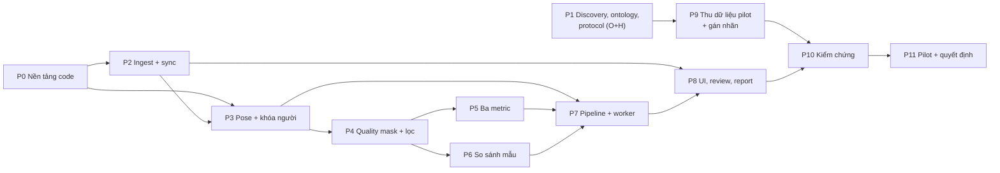

# Kế hoạch thực hiện và kiểm thử — Taiji AI MVP

**Phiên bản:** 1.0 · **Ngày:** 13/11/2026
**Đối tượng đọc:** người thực hiện dự án — A (ML/CV), B (full-stack), O (chủ dự án), H (HLV)
**Thay đổi:** 14/11/2026: P8 lập lại cho React + Vite + FastAPI (DEC-0008, task X.04); thêm test `T-API-*`, `T-WEB-*`, `T-E2E-*`; tổng ≈ 54 ngày công.
**Căn cứ:**

- `WUSHU_TAIJIQUAN_MASTER_PLAN_V3.md`: phạm vi, gate G00–G05, ngân sách dữ liệu và giờ HLV.
- `TECH_WORKFLOW_V1.md`: workflow W0–W9, stack, hợp đồng dữ liệu, công thức metric.
- `taiji_ai/`: code base đã dựng ngày 13/11/2026.

Tài liệu này chia MVP thành **12 phase** và **100 task nhỏ**. Mỗi task 0,5–2 ngày, có đầu ra và cách kiểm tra rõ ràng. Phần 14–16 là kế hoạch kiểm thử. Ước lượng thời gian là đề xuất, phải cập nhật sau Phase 3 (pose trên video thật) và sau 20 đoạn annotation đầu tiên.

---

## Mục lục

1. Nguyên tắc chia việc
2. Hiện trạng
3. Lộ trình tổng thể
4. Phase 0 — Nền tảng code
5. Phase 1 — Discovery, ontology, protocol
6. Phase 2 — Ingest và đồng bộ camera
7. Phase 3 — Pose và khóa người tập
8. Phase 4 — Quality mask và lọc
9. Phase 5 — Ba metric
10. Phase 6 — So sánh với mẫu
11. Phase 7 — Pipeline, worker, run manifest
12. Phase 8 — Giao diện, review, báo cáo
13. Phase 9 — Thu dữ liệu pilot và gán nhãn · Phase 10 — Kiểm chứng · Phase 11 — Pilot và quyết định
14. Kế hoạch kiểm thử: chiến lược và dữ liệu test
15. Danh mục test case theo module
16. Nghiệm thu theo gate, quản lý lỗi, chạy test
17. Lịch thực hiện và phân công
18. Rủi ro thực thi
19. Checklist làm việc hằng ngày và hằng tuần

---

## 1. Nguyên tắc chia việc

| Quy tắc | Nội dung |
|---|---|
| Kích thước task | 0,5–2 ngày công. Lớn hơn thì tách tiếp |
| Mỗi task phải có | Đầu ra (file/module/tài liệu), test hoặc bằng chứng chạy, người làm, phụ thuộc |
| Mã task | `P<phase>.<số>`, ví dụ `P4.03`. Test case có mã `T-<module>-<số>` (mục 15) |
| Trạng thái | Theo `AGENTS.md` §2: `TODO` → `ANALYZING` → `PLAN_READY` → `IN_PROGRESS` → `IN_REVIEW` → `DONE`; `BLOCKED` kèm lý do. Trạng thái sống nằm ở `Docs/tracking/TASK_STATUS.md` (cập nhật 2026-11-13) |
| Quy trình mỗi task | Phân tích → viết plan vào `Docs/tasks/<ID>.md` → đọc lại plan → code → tự review → ghi bug (`Docs/tracking/BUGS.md`) → đóng task + `CHANGELOG.md` |
| Thứ tự trong phase | Làm theo thứ tự số, trừ khi bảng ghi "song song" |
| Code mới | Viết kèm test cùng PR. Không merge code chưa có test với module có logic tính toán |
| Dữ liệu người tham gia | Không commit vào git. Chỉ dùng ID giả danh trong code, test và log |
| Quyết định chuyên môn | Ngưỡng, rubric và nhận xét mẫu phải có H duyệt. Kỹ sư không tự đặt |

**Definition of Done (mọi task):**

- [ ] Code chạy được, có test, `tools/check.ps1` (P0.05) pass.
- [ ] Artifact và manifest có version. Không có NaN bị điền giả, không có ngưỡng "tạm" không ghi lại.
- [ ] README hoặc docstring ghi đơn vị, quy ước tọa độ và điều kiện áp dụng.
- [ ] Cập nhật `Docs/tracking/TASK_STATUS.md` và `Docs/tracking/CHANGELOG.md`. Checklist đầy đủ nằm ở `AGENTS.md` §2 Step 5.

**Ký hiệu cột:**

- **Ai:** A, B, O, H, hoặc ghép (A+H).
- **Ngày:** ngày công ước lượng.
- **Phụ thuộc:** mã task phải xong trước.
- **Kiểm tra:** mã test case hoặc tiêu chí nghiệm thu.

---

## 2. Hiện trạng (13/11/2026)

| Hạng mục | Trạng thái | Bằng chứng |
|---|---|---|
| Môi trường | Python 3.12.10, uv 0.13.8, `.venv` khóa bằng `uv.lock` | `Docs/hardware_inventory.md` |
| GPU | RTX 3060 12 GB, onnxruntime-gpu 1.32 (CUDA 13 + cuDNN 9 qua pip) | GPU smoke test |
| Model | YOLOX-m HumanArt + RTMPose-m HALPE_26 trong `models/`, SHA-256 ở `registry.json` | `tools/fetch_models.py --verify` |
| Code đã có | `io/probe.py`, `io/frames.py`, `pose/skeleton.py`, `pose/registry.py`, `pose/rtm.py`, `store/artifacts.py`, `store/db.py`, `migrations/0001_init.sql`, `app/Home.py` | 12 test pass, ruff sạch |
| Chưa có | `track/`, `quality/`, `metrics/`, `compare/`, `pipeline/`, `report/`, các trang UI | — |
| Git | Repo đặt ở thư mục gốc `wushu/`, nhánh `main` (task X.02); chưa có commit | `.gitignore` gốc |
| Dữ liệu | UMONS-TAICHI (Kinect), tiêu chí TaiForm; chưa có video Thái cực quyền tự quay | `datasets/taiji/README.md` |
| Phụ thuộc bên ngoài | Chưa phỏng vấn HLV, chưa có ontology, chưa xin PSU-TMM100 / TaiChi-AQA / TaiChi-24 | `Docs/DATASET_REGISTRY_TAIJI.md` |

---

## 3. Lộ trình tổng thể



| Phase | Tên | Ngày công | Người chính | Phụ thuộc | Gate v3 |
|---|---|---:|---|---|---|
| P0 | Nền tảng code | 2 (còn lại) | A+B | — | — |
| P1 | Discovery, ontology, protocol | 2,5 kỹ thuật (+ khoảng 2,5 của O, giờ H) | O, H, A | — | **G00** |
| P2 | Ingest và đồng bộ camera | 4 | B, A | P0 | — |
| P3 | Pose và khóa người tập | 5 | A | P0, P2.03 | **G01** (cùng P1.10) |
| P4 | Quality mask và lọc | 4 | A | P3 | — |
| P5 | Ba metric | 5 | A | P4 | — |
| P6 | So sánh với mẫu | 4 | A | P4 | — |
| P7 | Pipeline, worker, manifest | 3 | B | P3–P6 | — |
| P8 | UI (React + FastAPI), review, báo cáo | 14 | B | P2, P7 | **G04** |
| P9 | Thu dữ liệu pilot, gán nhãn | 3,5 kỹ thuật + giờ H/annotator | A, O, H | P1 | **G02** |
| P10 | Kiểm chứng metric và so sánh | 4 (+1–2 nếu có PSU) | A+H | P5, P6, P9 | **G03** |
| P11 | Pilot giá trị và quyết định | 3 | O, H, A, B | P8, P10 | **G05** |
| | **Tổng kỹ thuật (A+B)** | **≈ 54** | | | |

Con số này cao hơn 30–44 ngày công của v3 vì có thêm phần dựng code nền, công cụ dữ liệu, kiểm thử và giao diện React + FastAPI (DEC-0008: P8 tăng từ 9,5 lên 14 ngày). Có thể giảm khoảng 1,5 ngày nếu dùng import Kinovea/ELAN (P8.05b) thay video player đánh dấu frame (P8.05) và chỉ làm một biến thể metric hông. Muốn giảm nhiều hơn thì phải cắt phạm vi, ví dụ hoãn trang so sánh (P8.13), dải bình thường (P6.06) và E2E (P8.15).

---

## 4. Phase 0 — Nền tảng code (còn lại)

**Mục tiêu:** code base sẵn sàng cho nhiều người cùng làm.

| Mã | Task | Ai | Ngày | Phụ thuộc | Đầu ra | Kiểm tra |
|---|---|---|---:|---|---|---|
| P0.01 | ✅ Dựng cấu trúc package, `pyproject.toml`, `uv.lock` | A | — | — | `taiji_ai/` | Đã xong |
| P0.02 | ✅ Tải và đăng ký model, GPU smoke test | A | — | — | `models/registry.json` | T-POSE-01..03 |
| P0.03 | ✅ `io/probe`, `io/frames`, `store/*`, migration 0001 | A | — | — | module + test | T-IO-01..05, T-STORE-01..03 |
| P0.04 | Commit đầu tiên; quy ước nhánh và PR; file `CONTRIBUTING.md` ngắn | B | 0,25 | — | commit, `CONTRIBUTING.md` | `git log` |
| P0.05 | Script kiểm tra một lệnh `tools/check.ps1`: ruff check + format check + pytest (bỏ qua test `gpu` nếu `-NoGpu`) | B | 0,25 | P0.04 | `tools/check.ps1` | Chạy pass |
| P0.06 | Logging thống nhất (`logging` + file log theo run), không log đường dẫn chứa tên thật | A | 0,5 | — | `taiji_ai/logging.py` | T-CORE-01 |
| P0.07 | Bộ sinh skeleton tổng hợp cho test (mục 14.3) | A | 1 | — | `tests/helpers/synth.py` | T-SYN-01..03 |

**Nghiệm thu P0:** `tools/check.ps1` pass trên máy A và B. Bộ sinh skeleton tổng hợp tạo đủ các kịch bản ở mục 14.3.

---

## 5. Phase 1 — Discovery, ontology, protocol (v3 P00)

**Mục tiêu:** khóa phạm vi chuyên môn trước khi thu dữ liệu. Phần lớn việc do O và H làm, A hỗ trợ kỹ thuật.

| Mã | Task | Ai | Ngày | Phụ thuộc | Đầu ra | Kiểm tra |
|---|---|---|---:|---|---|---|
| P1.01 | Soạn kịch bản phỏng vấn: hỏi câu mở trước, rồi mới cho xem 3 bản phác metric | O | 0,5 | — | `discovery/interview_guide.md` | H đọc thử |
| P1.02 | Phỏng vấn 3–5 HLV, ghi workflow hiện tại và thời gian | O+H | (giờ H) | P1.01 | `discovery/notes/*.md` | ≥ 3 biên bản |
| P1.03 | Tổng hợp nhu cầu: top 3 vấn đề, metric nào giữ hoặc thay | O | 0,5 | P1.02 | `discovery/summary.md` | O + H ký |
| P1.04 | Ontology v0: bài 24 thức (variant HLV xác nhận), action, side, occurrence, view_category, cờ | A+H | 1 | P1.02 | `config/ontology_v0.yaml` | T-DATA-01 (schema) |
| P1.05 | Protocol quay 2 camera: vị trí theo trục bài, app khóa FPS, vỗ tay + flash đầu/cuối, đoạn đứng tham chiếu, checkerboard | A | 0,5 | — | `docs/capture_protocol.md` | Quay thử P1.09 |
| P1.06 | Mẫu consent: phân tích / huấn luyện / chia sẻ, thời hạn lưu, rút lại; quy trình cho người chưa thành niên | O | 0,5 | — | `docs/consent_form.md` | O duyệt pháp lý |
| P1.07 | Định nghĩa sơ bộ 3 metric và điều kiện view (từ Phụ lục B của TECH_WORKFLOW), H góp ý | A+H | 0,5 | P1.03 | `docs/metric_definitions_v0.md` | H ký |
| P1.08 | Điền nhân sự thật, lịch HLV, đơn giá; khóa mục tiêu pilot (thời gian / chất lượng review) | O | 0,5 | P1.03 | `docs/pilot_targets.md` | — |
| P1.09 | Quay thử 1 take trọn bài bằng 2 camera theo protocol | A+H | 0,5 | P1.05 | 2 video thử + metadata | Dùng cho P2 và P3 |
| P1.10 | Gửi yêu cầu dữ liệu PSU-TMM100, TaiChi-AQA, TaiChi-24 (do O quyết định gửi) | O | 0,25 | — | Email/form đã gửi, ghi ngày | `DATASET_REGISTRY` cập nhật |

**Gate G00:**

- Có nhu cầu cụ thể (P1.03), ontology v0 (P1.04), protocol (P1.05) và video thử (P1.09).
- Có lịch chuyên gia khả thi (P1.08).
- Nếu chưa có 2 HLV đồng hành thì thu nhỏ về POC đo hình học.

---

## 6. Phase 2 — Ingest và đồng bộ camera (W1, W2)

**Mục tiêu:** đưa video từ điện thoại vào hệ thống với timestamp chính xác, rồi đồng bộ được hai camera.

| Mã | Task | Ai | Ngày | Phụ thuộc | Đầu ra | Kiểm tra |
|---|---|---|---:|---|---|---|
| P2.01 | Schema Pydantic `RecordingManifest`, `SyncManifest` (`schemas/`) | B | 0,5 | P0 | `schemas/recording.py` | T-SCH-01 |
| P2.02 | `ingest_recording(path, meta)`: copy read-only, SHA-256, probe, `pts.parquet`, cờ VFR, ghi DB | B | 1 | P2.01 | `io/ingest.py`, CLI `taiji ingest` | T-IO-06..09 |
| P2.03 | Tạo proxy H.264 720p, giữ timestamp nguồn; kiểm tra sai lệch proxy ↔ nguồn ≤ 1 frame tại 10 điểm | B | 0,5 | P2.02 | `io/proxy.py` | T-IO-10, T-IO-11 |
| P2.04 | Tách audio mono 16 kHz; tìm offset bằng tương quan chéo envelope ở cửa sổ đầu và cuối take; tính drift | A | 1 | P2.02 | `io/audio_sync.py` | T-SYNC-01..03 |
| P2.05 | Kiểm chứng bằng mốc flash: dò frame có độ sáng nhảy vọt; tính residual (ms, frame) | A | 0,5 | P2.04 | `io/flash.py` | T-SYNC-04 |
| P2.06 | Quy tắc dùng sync: residual ≤ 1 frame thì cho ghép metric, lớn hơn thì chỉ hiển thị song song | A | 0,25 | P2.05 | `sync.json.usable_for_metrics` | T-SYNC-05 |
| P2.07 | Chạy ingest + sync trên 2 video thử của P1.09; ghi báo cáo ngắn | A+B | 0,25 | P2.03, P2.06, P1.09 | `reports/p2_ingest_trial.md` | Residual thực tế |

**Nghiệm thu P2:**

- Ingest không làm thay đổi file gốc (SHA trước = sau).
- Video VFR được nhận diện đúng.
- Proxy ↔ nguồn lệch ≤ 1 frame.
- Hai video thử có `sync.json` với residual đo được.

---

## 7. Phase 3 — Pose và khóa người tập (W4, W5)

**Mục tiêu:** từ một đoạn video, tạo chuỗi pose thô của **đúng một người tập**, kèm timestamp thật.

| Mã | Task | Ai | Ngày | Phụ thuộc | Đầu ra | Kiểm tra |
|---|---|---|---:|---|---|---|
| P3.01 | Kiểm chứng thứ tự 26 khớp trên output thật: vẽ chỉ số lên 5 frame, đối chiếu tên | A | 0,25 | P0 | ảnh kiểm tra + xác nhận `halpe26/1` | T-POSE-04 |
| P3.02 | `run_pose(segment)`: đọc frame theo PTS trong `[start−1s, end+1s]`, detector chạy mỗi N frame, giữa các lần đó lấy bbox từ keypoint frame trước (nới 10–15%) | A | 1 | P3.01, P2.02 | `pose/runner.py` | T-POSE-05..07 |
| P3.03 | Lưu `pose_raw.npz`: mọi người phát hiện được (bbox, kp, score, t_sec, frame_index) | A | 0,5 | P3.02 | artifact + schema | T-POSE-08 |
| P3.04 | Chọn người mục tiêu ở frame đầu: mặc định bbox lớn nhất gần tâm, cho phép chỉ định bbox | A | 0,5 | P3.03 | `track/target.py` | T-TRK-01 |
| P3.05 | Ghép frame-to-frame bằng Hungarian (`1−IoU` + khoảng cách keypoint chuẩn hóa) | A | 1 | P3.04 | `track/target.py` | T-TRK-02..03 |
| P3.06 | Trạng thái mất dấu: quá `max_lost` thì `target_lost`, không nhảy sang người khác; nối lại có ngưỡng | A | 0,5 | P3.05 | `track.parquet` có `status` | T-TRK-04..05 |
| P3.07 | Benchmark trên 5 clip thật (P1.09): RTF, peak VRAM, N = 1/5/10, ảnh hưởng của N tới keypoint | A | 0,5 | P3.06 | `reports/p3_pose_benchmark.md` | Số đo thật |
| P3.08 | Rà lỗi pose trên clip thật: tay che thân, xoay thân, đứng một chân, quay lưng; ghi failure cases | A+H | 0,5 | P3.07 | `reports/p3_failure_cases.md` | Danh sách có ảnh |
| P3.09 | So sánh nhanh detector YOLOX vs YOLO11 (chỉ đo, không đổi stack): recall, độ ổn định bbox, tốc độ | A | 0,5 | P3.07 | phụ lục của P3.07 | Quyết định ghi lại |

**Gate G01** (cùng với P1):

- Ít nhất một nhóm metric tạo được giá trị quan sát trên đoạn HLV chọn (kiểm tra sơ bộ ở P5).
- Pose chạy lặp lại được, có RTF và VRAM.
- Nếu pose lỗi nặng ở một view, ghi giới hạn và chỉnh protocol quay.

---

## 8. Phase 4 — Quality mask và lọc (W6)

**Mục tiêu:** tạo ba lớp `raw`, `mask` và `filtered`, không bao giờ "bịa" dữ liệu.

| Mã | Task | Ai | Ngày | Phụ thuộc | Đầu ra | Kiểm tra |
|---|---|---|---:|---|---|---|
| P4.01 | `apply_mask`: score < τ thì NaN, lý do `low_conf`; frame thiếu khớp thiết yếu thì `frame_invalid` | A | 0,5 | P3.06 | `quality/mask.py` | T-QLT-01..02 |
| P4.02 | Nội suy gap ngắn (≤ 150 ms theo thời gian thật, không theo số frame), cờ `interpolated`; gap dài giữ NaN | A | 0,5 | P4.01 | `quality/gaps.py` | T-QLT-03..05 |
| P4.03 | Hampel (cửa sổ 7, 3·MAD), cờ `outlier` | A | 0,5 | P4.01 | `quality/filters.py` | T-QLT-06 |
| P4.04 | Resample lưới đều cho video VFR (để lọc), giữ ánh xạ về timestamp gốc | A | 0,5 | P4.02 | `quality/resample.py` | T-QLT-07 |
| P4.05 | Butterworth bậc 4 zero-phase, chạy riêng từng đoạn liên tục hợp lệ; đoạn ngắn hơn padlen thì không lọc, gắn cờ | A | 0,5 | P4.04 | `quality/filters.py` | T-QLT-08..09 |
| P4.06 | Phát hiện nghi tráo trái/phải (cặp L/R nhảy chéo đồng thời), cờ `lr_swap_suspect` | A | 0,5 | P4.01 | `quality/lr_swap.py` | T-QLT-10 |
| P4.07 | Coverage theo khớp, theo segment và theo lý do loại; `quality.json` | A | 0,5 | P4.05 | `quality/coverage.py` | T-QLT-11 |
| P4.08 | Kiểm thử trên UMONS Kinect (dữ liệu thật 30 Hz): mask, gap và lọc không vỡ trên chuỗi dài | A | 0,5 | P4.07 | `tools/umons_adapter.py` + báo cáo | T-QLT-12 |

**Nghiệm thu P4:**

- Golden test của bộ sinh tổng hợp pass: gap dài vẫn NaN, pause giả không xuất hiện.
- Lọc không lan qua NaN.
- Coverage khớp với số đếm tay trên fixture.

---

## 9. Phase 5 — Ba metric (W7)

**Mục tiêu:** cài đặt 3 metric theo Phụ lục B của TECH_WORKFLOW. Mỗi metric có giá trị, đơn vị, interval hợp lệ, coverage và lý do thiếu.

| Mã | Task | Ai | Ngày | Phụ thuộc | Đầu ra | Kiểm tra |
|---|---|---|---:|---|---|---|
| P5.01 | Kiểu dữ liệu `MetricSeries` / `MetricSummary` (version, units, valid_intervals, coverage, missing_reason) | A | 0,5 | P4 | `schemas/metric.py` | T-SCH-02 |
| P5.02 | Hỗ trợ hình học: mid-hip, mid-shoulder, độ dài thân, scale Λ (median), sửa roll camera | A | 0,5 | P5.01 | `metrics/geometry.py` | T-MET-01..02 |
| P5.03 | Độ cao hông, biến thể A (scale cố định từ đoạn đứng tham chiếu) | A | 0,5 | P5.02 | `metrics/hip_height.py` | T-MET-03 |
| P5.04 | Độ cao hông, biến thể B (so với điểm thấp nhất mắt cá/gót, chia Λ) | A | 0,5 | P5.03 | `metrics/hip_height.py` | T-MET-04..05 |
| P5.05 | Độ nghiêng thân trong mặt phẳng ảnh; chỉ tính trong interval có view phù hợp | A | 0,5 | P5.02 | `metrics/trunk_lean.py` | T-MET-06..07 |
| P5.06 | Tốc độ nhóm khớp theo thời gian thật (sai phân trung tâm), đơn vị thân/giây | A | 0,5 | P5.02 | `metrics/tempo.py` | T-MET-08 |
| P5.07 | Pause: `V < τ` kéo dài ≥ `d_min`; τ và d_min nhận từ config (chưa có thì chỉ xuất profile) | A | 0,5 | P5.06 | `metrics/tempo.py` | T-MET-09..10 |
| P5.08 | Ablation tần số cắt 4/6/8 Hz cho số pause và biên độ hông | A | 0,5 | P5.07 | `reports/p5_filter_ablation.md` | Số liệu |
| P5.09 | Bảng `metric_record` và hàm tải record; metric chưa có record thì trạng thái `experimental`, không kết luận | A | 0,5 | P5.01 | `metrics/records.py` | T-MET-11 |
| P5.10 | Chạy 3 metric trên đoạn thật của P1.09, H xem có hợp lý không (sơ bộ cho G01) | A+H | 0,5 | P5.08, P3.08 | `reports/p5_first_look.md` | H nhận xét |

**Nghiệm thu P5:**

- Mọi golden test với skeleton tổng hợp pass trong tolerance (mục 14.3).
- Metric không đủ điều kiện trả `insufficient_evidence`, không trả 0.

---

## 10. Phase 6 — So sánh với mẫu (W8)

| Mã | Task | Ai | Ngày | Phụ thuộc | Đầu ra | Kiểm tra |
|---|---|---|---:|---|---|---|
| P6.01 | Đặc trưng frame: tọa độ chuẩn hóa (mid-hip, Λ) + sin/cos góc đoạn chi; mask theo khớp | A | 0,5 | P5.02 | `compare/features.py` | T-CMP-01 |
| P6.02 | Ma trận chi phí có mask (`min_visible`, trọng số khớp) | A | 0,5 | P6.01 | `compare/dtw.py` | T-CMP-02 |
| P6.03 | DTW có band Sakoe-Chiba và step pattern giới hạn độ dốc; trả path, khoảng cách chuẩn hóa | A | 1 | P6.02 | `compare/dtw.py` | T-CMP-03..05 |
| P6.04 | Tốc độ cục bộ dọc path so với thời gian thật; đường cong lệch từng khớp trên timeline mẫu | A | 0,5 | P6.03 | `compare/tempo_ratio.py` | T-CMP-06 |
| P6.05 | Quy tắc từ chối: khác action/side/view, coverage thấp | A | 0,25 | P6.03 | `compare/guards.py` | T-CMP-07 |
| P6.06 | "Dải bình thường" từ nhiều take reference; báo vị trí của người tập so với dải này | A | 0,5 | P6.04 | `compare/reference_band.py` | T-CMP-08 |
| P6.07 | Kiểm tra trên UMONS: cùng lớp gần hơn khác lớp; chuyển ranh giới đoạn qua warping path, so với `.lab` | A | 0,75 | P6.03, P4.08 | `reports/p6_umons_check.md` | T-CMP-09 |

**Nghiệm thu P6:**

- Chuỗi giống hệt cho khoảng cách 0.
- Chuỗi kéo giãn thời gian cho hình dạng giống và tỷ lệ tốc độ đúng.
- Khác action bị từ chối.
- Trên UMONS, khoảng cách cùng lớp nhỏ hơn khác lớp với đa số lớp.

---

## 11. Phase 7 — Pipeline, worker, run manifest

| Mã | Task | Ai | Ngày | Phụ thuộc | Đầu ra | Kiểm tra |
|---|---|---|---:|---|---|---|
| P7.01 | Schema `RunManifest`, cache key (TECH_WORKFLOW §4.3) | B | 0,5 | P0 | `schemas/run.py` | T-PIPE-01 |
| P7.02 | Stage runner: mỗi stage nhận manifest vào, trả manifest ra; bỏ qua stage đã xong (checksum hợp lệ) | B | 1 | P7.01, P3–P6 | `pipeline/stages.py` | T-PIPE-02..03 |
| P7.03 | Worker subprocess `python -m taiji_ai.pipeline.worker job.json`; file lock một job GPU; ghi tiến độ | B | 0,5 | P7.02 | `pipeline/worker.py` | T-PIPE-04..05 |
| P7.04 | Xử lý lỗi: stage fail thì `failed` + thông báo; chạy lại từ stage hỏng; hủy job an toàn | B | 0,5 | P7.03 | — | T-PIPE-06..07 |
| P7.05 | Test tích hợp end-to-end trên fixture: ingest → pose → quality → metric → compare | A+B | 0,5 | P7.04 | `tests/integration/` | T-INT-01 |

---

## 12. Phase 8 — Giao diện, review, báo cáo (W3, W9)

**Stack (DEC-0008, 14/11/2026):** React + Vite + TypeScript (`taiji_ai/web/`) cho giao diện, FastAPI (`taiji_ai/src/taiji_ai/api/`) cho API và phục vụ file build. Việc nặng vẫn chạy trong worker (P7). Bảng dưới thay bảng P8 dùng Streamlit trước đây (13 task, 9,5 ngày).

| Mã | Task | Ai | Ngày | Phụ thuộc | Đầu ra | Kiểm tra |
|---|---|---|---:|---|---|---|
| P8.01 | Khung FastAPI: app factory, settings, `/api/health`, định dạng lỗi, phục vụ `web/dist`, `python -m taiji_ai.api` (chỉ `127.0.0.1`); bỏ Streamlit | B | 0,5 | P0 | `api/app.py`, `api/__main__.py`, `api/routers/health.py` | T-API-01..04 |
| P8.02 | Khung web: Vite + React + TS, React Router, TanStack Query, client API có kiểu, proxy `/api` khi dev, layout, trang trạng thái; ESLint + `tsc` + Vitest; `check.ps1` gọi thêm web | B | 0,75 | P8.01 | `web/` | T-WEB-01 |
| P8.03 | API + trang participants/recordings: danh sách, nạp video (gọi `io.ingest`), hiển thị cảnh báo VFR/rotation/thiếu audio | B | 1 | P8.02, P2.02 | `api/routers/recordings.py`, `web/src/pages/Recordings*` | T-API-05, T-UI-01..02 |
| P8.04 | Media API: phục vụ `proxy.mp4` với HTTP Range, bảng PTS dạng JSON; chặn path traversal | B | 0,5 | P8.01, P2.03 | `api/routers/media.py` | T-API-06..07 |
| P8.05 | Video player: `requestVideoFrameCallback`, ±1 frame theo bảng PTS, đổi thời gian proxy ↔ PTS nguồn | B | 1,5 | P8.04 | `web/src/components/VideoPlayer/` | T-WEB-02..03, T-UI-03..04 |
| P8.05b | Phương án dự phòng: import đoạn từ CSV Kinovea/ELAN | B | 0,5 | P8.03 | `io/import_segments.py` + API | T-UI-05 |
| P8.06 | Form đoạn + API: action/side/occurrence/view/cờ, chọn reference; mỗi lần sửa là một revision | B | 1 | P8.05 | `store/segments.py`, `api/routers/segments.py`, trang Video | T-API-08, T-WEB-05, T-UI-06, T-STORE-04 |
| P8.07 | Runs API: tạo job, tiến độ (polling hoặc SSE), hủy; nối với worker; giao diện tiến độ và lỗi | B | 1 | P7.03, P8.06 | `api/routers/runs.py` | T-API-09, T-UI-07 |
| P8.08 | Trang Số đo: biểu đồ time-series đồng bộ con trỏ video (chọn thư viện, ứng viên uPlot), vùng NaN và vùng không hợp lệ, coverage | B | 1,5 | P8.07, P5 | `web/src/pages/Metrics*` | T-WEB-04, T-UI-08 |
| P8.09 | Video overlay skeleton render sẵn bằng FFmpeg/OpenCV (proxy + skeleton) | A | 0,5 | P3 | `report/overlay.py` | T-REP-01 |
| P8.10 | Template nhận xét từ metric đủ điều kiện; H duyệt câu chữ | B+H | 0,5 | P5.09 | `report/findings.py`, `config/finding_templates.yaml` | T-REP-02 |
| P8.11 | Trang Báo cáo + API review: xác nhận / bác bỏ / sửa / `insufficient_evidence`, lưu revision và audit log | B | 1 | P8.10 | `api/routers/findings.py`, `web/src/pages/Review*` | T-API-10, T-UI-09, T-STORE-05 |
| P8.12 | Export JSON/CSV/HTML (Jinja2 + Plotly offline) và clip bằng chứng; snapshot bất biến | B | 1 | P8.11 | `report/render.py`, `report/clips.py`, `api/routers/reports.py` | T-REP-03..05 |
| P8.13 | So sánh cạnh nhau: 2 video đồng bộ và đường cong lệch theo timeline mẫu | B | 1 | P6, P8.08 | `web/src/pages/Compare*` | T-UI-10 |
| P8.14 | Backup/restore DB và artifact; xóa dữ liệu một participant | B | 0,5 | P8.12 | `tools/backup.py`, `tools/delete_participant.py` | T-STORE-06..07 |
| P8.15 | E2E Playwright cho luồng G04 (nạp → chọn đoạn → chạy → xem → xác nhận → xuất; mở lại) | B | 1 | P8.03–P8.14 | `web/e2e/` | T-E2E-01..02 |

**Gate G04:** một HLV làm trọn workflow (nạp → chọn đoạn → chạy → xem → xác nhận → xuất báo cáo) và mở lại được chính xác nhận xét đã duyệt.

---

## 13. Phase 9–11

### Phase 9 — Thu dữ liệu pilot và gán nhãn (v3 P02)

| Mã | Task | Ai | Ngày | Phụ thuộc | Đầu ra | Kiểm tra |
|---|---|---|---:|---|---|---|
| P9.01 | Tuyển 6 người tập, lấy consent, gán ID giả danh | O | (lịch) | P1.06 | danh sách + consent | T-DATA-02 |
| P9.02 | 6 buổi nhóm: 36 performance, 72 file (2 camera) theo protocol | A+O+H | (lịch) | P9.01 | video + metadata | Checklist buổi quay |
| P9.03 | Ingest hàng loạt, kiểm tra hash, consent, sync | A | 0,5 | P2, P9.02 | DB + báo cáo | T-DATA-03..04 |
| P9.04 | HLV chia 120 đoạn (20 đoạn đầu do 2 HLV chia độc lập) | H | (giờ H) | P8.06 | segments | T-AGR-01 |
| P9.05 | Chọn 200 frame audit phân tầng (view × occlusion × động tác); xuất cho CVAT | A | 0,5 | P9.03, P3 | `audit/frames_manifest.csv` | T-DATA-05 |
| P9.06 | Cài CVAT (Docker) hoặc tool nội bộ; template HALPE_26; gán 200 frame, 50 frame gán đôi | A + annotator | 1 + giờ annotator | P9.05 | COCO keypoints export | T-AGR-02 |
| P9.07 | Hai HLV chấm độc lập theo rubric (ẩn kết quả hệ thống và người kia) | H | (giờ H) | P9.04 | bảng chấm | T-AGR-03 |
| P9.08 | Script đo độ thống nhất: ranh giới, kappa, weighted kappa, ICC, Bland–Altman, sai lệch keypoint | A | 1 | P9.06, P9.07 | `tools/agreement.py` | T-AGR-04..06 |
| P9.09 | Adjudication; chốt error budget; khóa holdout theo participant + `split_manifest.csv` (hash) | A+H | 0,5 | P9.08 | `split_manifest.csv` | T-DATA-06 |

**Gate G02:** nhãn, quyền dữ liệu, quality mask và tiêu chí nghiệm thu đều truy vết được. Holdout đã khóa.

### Phase 10 — Kiểm chứng metric và so sánh (v3 P03 / G03)

| Mã | Task | Ai | Ngày | Phụ thuộc | Đầu ra | Kiểm tra |
|---|---|---|---:|---|---|---|
| P10.01 | Pose: PCK@0,1 so với audit, theo khớp × view; so với độ lệch giữa 2 annotator | A | 0,5 | P9.08 | `reports/p10_pose.md` | B-POSE-01 |
| P10.02 | Metric vs đo tay trên 20–30 đoạn (hông A/B, nghiêng thân) | A | 1 | P5, P9 | `reports/p10_metrics.md` | B-MET-01 |
| P10.03 | Độ lặp lại: cùng người, nhiều take; trong người so với giữa người | A | 0,5 | P10.02 | — | B-MET-02 |
| P10.04 | Coverage 3 tỷ lệ cho từng metric × camera; trên các đoạn HLV cần sửa | A | 0,5 | P4.07 | — | B-COV-01 |
| P10.05 | So sánh mẫu: Spearman giữa khoảng cách DTW và xếp hạng HLV, leave-one-person-out | A | 0,5 | P6, P9.07 | — | B-CMP-01 |
| P10.06 | Chọn biến thể hông A/B; ký `metric_record` cho từng metric (bật hoặc giữ `experimental`) | A+H | 0,5 | P10.02–05 | `metric_record` rows | T-MET-11 |
| P10.07 | (Nếu có PSU-TMM100) Chiếu 3D Vicon vào camera, so với metric 2D | A | 1–2 | dữ liệu PSU | `reports/p10_psu.md` | B-MET-03 |

**Gate G03:** mỗi metric được bật có sai số phù hợp mục đích dùng, nhãn đúng mặt phẳng quan sát và xử lý thiếu dữ liệu rõ ràng. Metric chưa đạt giữ `experimental`.

### Phase 11 — Pilot giá trị và quyết định (v3 P05 / G05)

| Mã | Task | Ai | Ngày | Phụ thuộc | Đầu ra | Kiểm tra |
|---|---|---|---:|---|---|---|
| P11.01 | Thiết kế phiên pilot: cặp clip tương đương, đảo thứ tự công cụ, kịch bản cho HLV | O+A | 0,5 | G04, G03 | `pilot/protocol.md` | H đọc thử |
| P11.02 | Chạy pilot: 2 HLV × ≥ 6 đoạn; ghi thời gian, nhận xét hữu ích, lỗi phải sửa, độ tin cậy | O+H | (giờ H) | P11.01 | dữ liệu pilot | UAT-01..05 |
| P11.03 | Đo lỗi kỹ thuật trong pilot: error, coverage, nhận xét sai theo người/view; thời gian xử lý | A+B | 0,5 | P11.02 | `reports/p11_pilot.md` | — |
| P11.04 | Sửa 3 vấn đề gây mất giá trị lớn nhất | A+B | 1,5 | P11.03 | PR | Test hồi quy |
| P11.05 | Báo cáo quyết định: tiếp tục, sửa phạm vi hay dừng một metric; đề xuất extension E01–E07 | O | 0,5 | P11.04 | `reports/p11_decision.md` | **G05** |

---

## 14. Kế hoạch kiểm thử: chiến lược và dữ liệu test

### 14.1 Mục tiêu kiểm thử

1. **Không sai bằng chứng:** đúng người, đúng timestamp, đúng khớp. Không có dữ liệu bị điền giả.
2. **Không mất dữ liệu:** file gốc, review của HLV, revision và report cũ.
3. **Metric đúng định nghĩa:** đã kiểm bằng dữ liệu biết trước đáp án (tổng hợp) và bằng đo tay.
4. **Giới hạn được nói rõ:** hệ thống abstain đúng lúc và báo coverage.
5. **Hữu ích cho HLV:** pilot đạt tiêu chí đã khóa ở P1.08.

### 14.2 Các tầng kiểm thử

| Tầng | Phạm vi | Công cụ | Khi chạy | Ai |
|---|---|---|---|---|
| Unit | Hàm thuần: hình học, mask, lọc, DTW, schema | pytest | Mỗi commit (`tools/check.ps1`) | A, B |
| Contract | Module ↔ file/thư viện ngoài: FFmpeg, PyAV, ONNX, SQLite, schema artifact | pytest + fixture FFmpeg | Mỗi commit | A, B |
| Golden | Metric/compare trên skeleton tổng hợp và một bộ video cố định, so giá trị kỳ vọng ± tolerance | pytest | Mỗi commit; bắt buộc khi đổi model/config | A |
| GPU | Pose thật trên GPU (marker `gpu`) | pytest `-m gpu` | Hằng ngày trên máy GPU | A |
| Integration | End-to-end trên fixture: ingest → report | pytest `tests/integration` | Trước merge vào `main` | A+B |
| Data validation | Manifest, split, consent, nhãn hợp lệ | pytest + `tools/validate_dataset.py` | Sau mỗi đợt nhập dữ liệu | A |
| Benchmark | Độ chính xác so với gold, độ lặp lại, coverage, hiệu năng | script trong `tools/bench_*.py` | Cuối P3, P10; khi đổi model | A |
| API contract | FastAPI `TestClient`: schema, mã lỗi, HTTP Range, không lộ stack trace | pytest `tests/api` | Mỗi commit | B |
| Web unit | Vitest: component, hàm thời gian/PTS, xử lý NaN trên biểu đồ | `pnpm test` (trong `web/`) | Mỗi commit | B |
| E2E | Playwright: luồng G04 trên app chạy thật (fixture video) | `pnpm e2e` | Trước G04 và trước merge lớn | B |
| UI manual | Kịch bản thao tác trên web app (Chromium) | checklist (mục 15.10) | Cuối mỗi task UI, trước G04 | B |
| UAT / pilot | HLV dùng thật | kịch bản pilot | P11 | O+H |

### 14.3 Dữ liệu test

| Bộ | Nội dung | Nơi tạo/lưu | Dùng cho |
|---|---|---|---|
| **F-VID** | Video tổng hợp FFmpeg: CFR 30 fps, VFR, xoay 90°, file hỏng, file 0 byte, không audio, có audio click và flash ở thời điểm biết trước | `tests/conftest.py` (sinh lúc chạy test) | io, sync |
| **F-SYN** | Skeleton tổng hợp HALPE_26, có đáp án (xem dưới) | `tests/helpers/synth.py` | quality, metrics, compare |
| **F-UMONS** | UMONS Kinect thật (25 khớp, 30 Hz) + nhãn `.lab` | `datasets/taiji/umons/` (CC BY-NC-SA) | quality trên chuỗi dài, DTW, chuyển nhãn |
| **F-TRIAL** | 2 video thử của P1.09 | `data/` (không commit) | Benchmark sơ bộ P3, P5 |
| **G-AUDIT** | 200 frame keypoint gold (50 frame gán đôi) | từ P9.06 | PCK, error budget |
| **G-MANUAL** | 20–30 đoạn đo tay (độ cao hông, góc thân) | từ P10.02 | Kiểm chứng metric |
| **G-COACH** | Chấm độc lập của 2 HLV trên 120 đoạn | từ P9.07 | Agreement, so sánh mẫu |
| **H-PILOT** | Holdout theo participant | `split_manifest.csv` | Chỉ mở ở P11 |
| **PSU** (nếu được cấp) | Video 2 góc + Vicon + áp lực chân | ngoài repo | Kiểm chứng metric 2D |

**Bộ sinh skeleton tổng hợp F-SYN (P0.07).** Hàm `make_sequence(...)` trả về `kp (T,26,2)`, `score (T,26)`, `t_sec (T,)` và một dict đáp án. Các kịch bản:

| Mã | Kịch bản | Tham số | Đáp án kiểm tra |
|---|---|---|---|
| SYN-01 | Đứng yên + nhiễu | σ px | Biên độ hông ≈ 0; không có pause giả do nhiễu ở 6 Hz |
| SYN-02 | Hông dao động sin | biên độ A (theo Λ), tần số f | `range ≈ 2A` (tolerance 5%) |
| SYN-03 | Thân nghiêng cố định / đổi dần | θ(t) | median θ sai ≤ 0,5° |
| SYN-04 | Roll camera | xoay toàn ảnh β | Sau sửa roll, θ đúng ± 0,5° |
| SYN-05 | Chuyển động + pause | các interval dừng | Phát hiện đúng số pause; ranh giới sai ≤ 1 frame |
| SYN-06 | Gap ngắn / dài | độ dài gap | Ngắn → nội suy + cờ; dài → NaN, không pause giả |
| SYN-07 | Timestamp VFR | dt thay đổi | Tốc độ tính theo thời gian thật, không theo index |
| SYN-08 | Tráo L/R | frame tráo | Cờ `lr_swap_suspect` đúng frame |
| SYN-09 | Di chuyển theo chiều sâu | scale(t) | Biến thể A lệch, B ổn định hơn (định lượng) |
| SYN-10 | Kéo giãn thời gian | hệ số k(t) | DTW: hình dạng ≈ 0, tỷ lệ tốc độ ≈ k(t) |
| SYN-11 | Hai động tác khác nhau | 2 quỹ đạo | Khoảng cách lớn hơn cùng động tác |
| SYN-12 | Nhiều người + người mục tiêu đi ra rồi vào | bbox | Tracking không nhảy người; `target_lost` đúng |

Tolerance chốt ở P0.07. Mọi thay đổi tolerance phải ghi lý do trong PR.

---

## 15. Danh mục test case theo module

Cột **Loại**: U = unit, C = contract, G = golden, I = integration, M = manual. ✅ = đã có trong code.

### 15.1 Core và schema

| Mã | Loại | Mô tả | Task |
|---|---|---|---|
| T-CORE-01 | U | Log không chứa tên thật hoặc đường dẫn có tên; có `run_id` | P0.06 |
| T-SCH-01 | U | `RecordingManifest`/`SyncManifest` từ chối trường thiếu, sai kiểu; có `schema_version` | P2.01 |
| T-SCH-02 | U | `MetricSeries` bắt buộc units, valid_intervals, coverage | P5.01 |
| T-SYN-01..03 | U | Bộ sinh F-SYN: shape, đáp án đúng, seed cố định cho kết quả lặp lại | P0.07 |

### 15.2 IO và ingest

| Mã | Loại | Mô tả | Task |
|---|---|---|---|
| T-IO-01 ✅ | C | Probe CFR: kích thước, codec, audio, rotation 0, fps | P0.03 |
| T-IO-02 ✅ | C | `scan_pts` CFR: 60 frame, đều, không VFR | P0.03 |
| T-IO-03 ✅ | C | `scan_pts` phát hiện VFR, dt đúng | P0.03 |
| T-IO-04 ✅ | C | `iter_frames` khớp PTS; cửa sổ `[t0,t1]` đúng | P0.03 |
| T-IO-05 ✅ | C | Rotation 90°: hướng ảnh khớp FFmpeg tự xoay | P0.03 |
| T-IO-06 | C | Ingest: SHA file gốc không đổi; file gốc chỉ đọc | P2.02 |
| T-IO-07 | C | Ingest cùng file hai lần: không tạo bản ghi trùng (SHA unique) | P2.02 |
| T-IO-08 | C | File hỏng và file 0 byte: báo lỗi rõ, không tạo bản ghi dở | P2.02 |
| T-IO-09 | C | `pts.parquet` khớp `scan_pts`; cờ VFR lưu đúng | P2.02 |
| T-IO-10 | C | Proxy: số frame và timestamp khớp nguồn (≤ 1 frame tại 10 điểm) | P2.03 |
| T-IO-11 | C | Proxy từ video xoay: hiển thị đúng chiều, map thời gian không đổi | P2.03 |

### 15.3 Đồng bộ

| Mã | Loại | Mô tả | Task |
|---|---|---|---|
| T-SYNC-01 | C | Hai fixture có click ở thời điểm biết trước, lệch Δ: offset tìm được ≈ Δ (± 1 ms ở 16 kHz) | P2.04 |
| T-SYNC-02 | C | Drift tổng hợp (kéo giãn audio 0,01%): drift ước lượng đúng dấu và độ lớn | P2.04 |
| T-SYNC-03 | C | Không có click: báo "không tìm được", không trả offset bịa | P2.04 |
| T-SYNC-04 | C | Flash ở frame biết trước: phát hiện đúng frame | P2.05 |
| T-SYNC-05 | U | Residual > 1 frame thì `usable_for_metrics = false` | P2.06 |

### 15.4 Pose và tracking

| Mã | Loại | Mô tả | Task |
|---|---|---|---|
| T-POSE-01 ✅ | C | Registry: hash đúng thì load; file bị sửa thì từ chối | P0.02 |
| T-POSE-02 ✅ | C | Registry: thiếu file thì báo lỗi | P0.02 |
| T-POSE-03 ✅ | C/GPU | Session dùng CUDA; shape output (N,26,2); bbox rỗng trả mảng rỗng | P0.02 |
| T-POSE-04 | M | Thứ tự khớp trên ảnh thật khớp `halpe26/1` | P3.01 |
| T-POSE-05 | C/GPU | Detector mỗi N frame: frame giữa dùng bbox từ keypoint; khi không thấy người thì chạy detector ngay | P3.02 |
| T-POSE-06 | C | `run_pose` chỉ đọc frame trong `[start−1s, end+1s]`, timestamp tăng dần | P3.02 |
| T-POSE-07 | G/GPU | Video người thật cố định (1 clip ngắn trong fixture riêng, có quyền dùng): số người, keypoint ổn định so với lần chạy trước (± ngưỡng) | P3.02 |
| T-POSE-08 | C | `pose_raw.npz` đúng schema; lưu và đọc lại giống hệt | P3.03 |
| T-TRK-01 | U | Chọn mặc định: bbox lớn nhất gần tâm; chỉ định bbox thì theo người đó | P3.04 |
| T-TRK-02 | U | SYN-12: 2 người đi gần nhau, không tráo ID | P3.05 |
| T-TRK-03 | U | Hungarian với số người thay đổi giữa các frame | P3.05 |
| T-TRK-04 | U | Người mục tiêu ra khỏi khung lâu hơn `max_lost`: `target_lost`, không nhảy sang người khác | P3.06 |
| T-TRK-05 | U | Quay lại trong ngưỡng chi phí: nối lại; ngoài ngưỡng: yêu cầu chọn lại | P3.06 |

### 15.5 Quality

| Mã | Loại | Mô tả | Task |
|---|---|---|---|
| T-QLT-01 | U | score < τ thì NaN, có lý do `low_conf`; score ≥ τ giữ nguyên | P4.01 |
| T-QLT-02 | U | Frame thiếu > 50% khớp thiết yếu thì `frame_invalid` | P4.01 |
| T-QLT-03 | U | Gap ≤ 150 ms (thời gian thật) được nội suy và có cờ | P4.02 |
| T-QLT-04 | U | Gap > 150 ms giữ NaN; **không** có giá trị nào bằng giá trị cuối trước gap | P4.02 |
| T-QLT-05 | U | Video VFR: ngưỡng gap tính theo giây, không theo số frame | P4.02 |
| T-QLT-06 | U | Hampel loại spike tổng hợp, không loại chuyển động thật biên độ lớn nhưng mượt | P4.03 |
| T-QLT-07 | U | Resample VFR rồi trả về lưới gốc: sai số nội suy nhỏ hơn tolerance | P4.04 |
| T-QLT-08 | U | Butterworth: đoạn liên tục được lọc; NaN không lan sang đoạn khác | P4.05 |
| T-QLT-09 | U | Đoạn ngắn hơn padlen: không lọc, có cờ | P4.05 |
| T-QLT-10 | U | SYN-08: cờ tráo L/R đúng frame; chuyển động thường không bị gắn cờ | P4.06 |
| T-QLT-11 | U | Coverage khớp với số đếm tay trên fixture | P4.07 |
| T-QLT-12 | C | UMONS Kinect: chuỗi 4.000+ frame chạy hết pipeline quality không lỗi, coverage hợp lý | P4.08 |

### 15.6 Metric

| Mã | Loại | Mô tả | Task |
|---|---|---|---|
| T-MET-01 | U | Mid-hip, mid-shoulder, Λ = median, bỏ qua NaN | P5.02 |
| T-MET-02 | U | SYN-04: sửa roll đúng | P5.02 |
| T-MET-03 | G | SYN-02: biến thể A, `range ≈ 2A` (± 5%) | P5.03 |
| T-MET-04 | G | SYN-02: biến thể B, `range ≈ 2A` (± 5%) | P5.04 |
| T-MET-05 | G | SYN-09: B ổn định hơn A khi di chuyển chiều sâu; ghi số liệu | P5.04 |
| T-MET-06 | G | SYN-03: θ sai ≤ 0,5° | P5.05 |
| T-MET-07 | U | View không phù hợp thì metric `insufficient_evidence`, không trả số | P5.05 |
| T-MET-08 | G | SYN-07: tốc độ theo thời gian thật trên VFR | P5.06 |
| T-MET-09 | G | SYN-05: đúng số pause, ranh giới ≤ 1 frame | P5.07 |
| T-MET-10 | G | SYN-01 và SYN-06: không có pause giả do nhiễu hoặc gap | P5.07 |
| T-MET-11 | U | Metric không có `metric_record` đã ký: trạng thái `experimental`, report không kết luận | P5.09 |

### 15.7 So sánh

| Mã | Loại | Mô tả | Task |
|---|---|---|---|
| T-CMP-01 | U | Đặc trưng bất biến với tịnh tiến và scale; góc wrap đúng (359° vs 1°) | P6.01 |
| T-CMP-02 | U | Khớp bị mask không tham gia chi phí; quá ít khớp hợp lệ thì ô = ∞ | P6.02 |
| T-CMP-03 | U | Chuỗi giống hệt: khoảng cách 0, path chéo | P6.03 |
| T-CMP-04 | G | SYN-10: hình dạng ≈ 0 khi kéo giãn; path tôn trọng band | P6.03 |
| T-CMP-05 | U | Đối chiếu kết quả với `dtaidistance` trên dữ liệu không có mask (cùng band) | P6.03 |
| T-CMP-06 | G | SYN-10: tỷ lệ tốc độ cục bộ ≈ k(t) | P6.04 |
| T-CMP-07 | U | Khác action/side/view hoặc coverage thấp thì từ chối, có lý do | P6.05 |
| T-CMP-08 | U | Dải bình thường từ ≥ 2 reference; một reference thì báo "không đủ" | P6.06 |
| T-CMP-09 | C | UMONS: cùng lớp gần hơn khác lớp (đa số lớp); chuyển ranh giới, báo temporal IoU và sai số giây | P6.07 |

### 15.8 Pipeline và lưu trữ

| Mã | Loại | Mô tả | Task |
|---|---|---|---|
| T-STORE-01..03 ✅ | U | Ghi atomic không để lại `.tmp`; NaN giữ nguyên; migration chạy một lần, ràng buộc FK/CHECK | P0.03 |
| T-STORE-04 | U | Sửa segment tạo revision mới, revision cũ không đổi | P8.06 |
| T-STORE-05 | U | Mọi quyết định review ghi `audit_log` | P8.11 |
| T-STORE-06 | C | Backup rồi restore: DB và artifact khớp checksum | P8.14 |
| T-STORE-07 | C | Xóa participant: xóa recording, proxy, run, clip, report liên quan; không còn tham chiếu | P8.14 |
| T-PIPE-01 | U | Cache key đổi khi đổi model, config, segment revision hoặc code major | P7.01 |
| T-PIPE-02 | C | Chạy lại cùng cấu hình bỏ qua stage đã xong (checksum khớp) | P7.02 |
| T-PIPE-03 | C | Artifact stage bị sửa tay (checksum sai) thì chạy lại stage đó | P7.02 |
| T-PIPE-04 | C | Hai job đồng thời: job thứ hai chờ, không chạy song song trên GPU | P7.03 |
| T-PIPE-05 | C | Tiến độ ghi vào manifest, UI đọc được | P7.03 |
| T-PIPE-06 | C | Stage lỗi: trạng thái `failed`, có thông báo; chạy lại từ stage lỗi | P7.04 |
| T-PIPE-07 | C | Hủy job: không để file dở, manifest trạng thái `cancelled` | P7.04 |
| T-INT-01 | I | End-to-end trên fixture: ingest → pose (GPU hoặc mock) → quality → metric → compare → report | P7.05 |

### 15.9 Report

| Mã | Loại | Mô tả | Task |
|---|---|---|---|
| T-REP-01 | C | Overlay: skeleton vẽ đúng frame (kiểm tra frame có mốc biết trước) | P8.09 |
| T-REP-02 | U | Template chỉ sinh nhận xét từ metric đủ điều kiện; mỗi nhận xét có `metric_ids` + `evidence_interval` | P8.10 |
| T-REP-03 | C | Report snapshot không đổi khi review mới; review mới tạo report mới | P8.12 |
| T-REP-04 | C | Nhận xét chưa duyệt không xuất hiện trong bản "đã duyệt" | P8.12 |
| T-REP-05 | C | Clip bằng chứng cắt đúng interval (± 1 frame), có lề 1 s | P8.12 |

### 15.10 UI (kịch bản thao tác)

| Mã | Kịch bản | Kết quả mong đợi | Task |
|---|---|---|---|
| T-UI-01 | Mở app, chọn participant và recording | Danh sách đúng, không lỗi | P8.03 |
| T-UI-02 | Nạp video VFR và video xoay | Hiện cảnh báo VFR; video hiển thị đúng chiều | P8.03 |
| T-UI-03 | Đánh dấu start/end bằng ±1 frame | Timestamp đổi đúng 1 frame mỗi lần bấm | P8.05 |
| T-UI-04 | Đánh dấu trên proxy, xem frame nguồn tương ứng | Cùng hình (lệch ≤ 1 frame) | P8.05 |
| T-UI-05 | Import CSV Kinovea/ELAN | Đoạn tạo đúng thời gian | P8.05b |
| T-UI-06 | Sửa đoạn 2 lần | Có 3 revision, xem được lịch sử | P8.06 |
| T-UI-07 | Chạy phân tích rồi hủy giữa chừng | Trạng thái `cancelled`, chạy lại được | P8.07 |
| T-UI-08 | Xem số đo khi có vùng NaN | Vùng NaN hiển thị rõ, không vẽ nối qua | P8.08 |
| T-UI-09 | Xác nhận / bác bỏ nhận xét, đóng app, mở lại | Quyết định giữ nguyên, có audit log | P8.11 |
| T-UI-10 | So sánh đoạn khác action | Bị từ chối, có lý do | P8.13 |

### 15.10b API, web và E2E

| Mã | Loại | Mô tả | Task |
|---|---|---|---|
| T-API-01 | C | `/api/health` trả version, trạng thái model registry, migration DB | P8.01 |
| T-API-02 | C | Lỗi trả JSON `{error: {code, message}}`; không lộ stack trace hay đường dẫn nội bộ | P8.01 |
| T-API-03 | C | Có `web/dist` thì `/` trả `index.html`; `/api/*` không bị SPA fallback nuốt; không có `web/dist` thì báo rõ | P8.01 |
| T-API-04 | C | Mặc định chỉ bind `127.0.0.1` | P8.01 |
| T-API-05 | C | Danh sách/nạp recording: validate đầu vào; nạp trùng SHA trả 409 | P8.03 |
| T-API-06 | C | Media: request có `Range` trả 206 + `Content-Range` đúng; path traversal (`..`, đường dẫn tuyệt đối) bị chặn | P8.04 |
| T-API-07 | C | Bảng PTS JSON khớp `pts.parquet` | P8.04 |
| T-API-08 | C | Sửa segment qua API tạo revision mới, revision cũ không đổi | P8.06 |
| T-API-09 | C | Runs: tạo, đọc tiến độ, hủy; job thứ hai chờ, không chạy song song GPU | P8.07 |
| T-API-10 | C | Quyết định review qua API ghi `audit_log` | P8.11 |
| T-WEB-01 | U | App render; trang trạng thái hiển thị dữ liệu `/api/health` (API mock) | P8.02 |
| T-WEB-02 | U | Đổi thời gian proxy → PTS nguồn chọn frame gần nhất; ±1 frame đi đúng 1 frame | P8.05 |
| T-WEB-03 | U | Video VFR: bước frame dùng bảng PTS, không dùng `1/fps` | P8.05 |
| T-WEB-04 | U | Biểu đồ: NaN tạo khoảng trống, không vẽ nối qua | P8.08 |
| T-WEB-05 | U | Form đoạn: `end > start`, action thuộc ontology, thông báo lỗi rõ | P8.06 |
| T-E2E-01 | E2E | Luồng G04 đầy đủ trên fixture video | P8.15 |
| T-E2E-02 | E2E | Đóng trình duyệt rồi mở lại: segment, review, report còn nguyên | P8.15 |

### 15.11 Dữ liệu, độ thống nhất, benchmark

| Mã | Loại | Mô tả | Task |
|---|---|---|---|
| T-DATA-01 | U | `ontology_v0.yaml` đúng schema; action không trùng; mọi segment dùng nhãn có trong ontology | P1.04 |
| T-DATA-02 | U | Mọi recording có participant với consent hợp lệ | P9.01 |
| T-DATA-03 | C | Ingest hàng loạt: đủ 72 file, không trùng SHA, đủ metadata | P9.03 |
| T-DATA-04 | U | Recording không có `consent_train` thì bị loại khỏi mọi tập train | P9.03 |
| T-DATA-05 | U | Frame audit phân tầng đủ các ô view × occlusion | P9.05 |
| T-DATA-06 | U | Split theo participant: không participant nào nằm ở 2 tập; hash manifest khớp | P9.09 |
| T-AGR-01..03 | C | Định dạng đầu vào agreement hợp lệ (đoạn, keypoint, chấm) | P9.04–P9.07 |
| T-AGR-04 | U | Kappa / weighted kappa khớp `sklearn` trên ví dụ biết trước | P9.08 |
| T-AGR-05 | U | ICC(2,1) khớp ví dụ chuẩn trong tài liệu (Shrout & Fleiss) | P9.08 |
| T-AGR-06 | U | Bland–Altman: bias và limits đúng trên dữ liệu tổng hợp | P9.08 |
| B-POSE-01 | Bench | PCK@0,1 theo khớp × view; so với sai lệch giữa người gán | P10.01 |
| B-MET-01 | Bench | Sai số metric so với đo tay; so với smallest useful change | P10.02 |
| B-MET-02 | Bench | Độ lặp lại trong người so với giữa người | P10.03 |
| B-MET-03 | Bench | (PSU) metric 2D so với Vicon chiếu 2D | P10.07 |
| B-COV-01 | Bench | 3 tỷ lệ coverage theo metric × camera | P10.04 |
| B-CMP-01 | Bench | Spearman DTW vs xếp hạng HLV, leave-one-person-out | P10.05 |
| B-PERF-01 | Bench | RTF (p50/p95), peak VRAM, thời gian end-to-end một đoạn 30 s | P3.07, P11.03 |

### 15.12 UAT / pilot

| Mã | Kịch bản HLV | Đo |
|---|---|---|
| UAT-01 | Nạp 2 video của một take, chọn 3 đoạn cần sửa | Thời gian, số lần tua |
| UAT-02 | Xem số đo, chọn reference, so sánh | HLV có hiểu đường cong lệch không (thang 1–5) |
| UAT-03 | Xác nhận hoặc bác bỏ nhận xét | Số nhận xét hữu ích, số phải sửa |
| UAT-04 | Xuất báo cáo, gửi cho học viên (giả lập) | Báo cáo đọc được không cần giải thích thêm |
| UAT-05 | So với workflow cũ hoặc Kinovea trên cặp clip tương đương | Chênh lệch thời gian, độ tin cậy |

---

## 16. Nghiệm thu theo gate, quản lý lỗi, chạy test

### 16.1 Tiêu chí theo gate

| Gate | Điều kiện bắt buộc | Test/benchmark liên quan |
|---|---|---|
| **G00** | Nhu cầu, ontology v0, protocol, consent, video thử, lịch HLV | T-DATA-01 |
| **G01** | Pose chạy lặp lại trên máy đích; RTF/VRAM đo được; ít nhất 1 metric có giá trị quan sát | T-POSE-*, T-TRK-*, B-PERF-01, P5.10 |
| **G02** | Dữ liệu pilot đủ quyền và truy vết; agreement đo xong; holdout khóa | T-DATA-*, T-AGR-* |
| **G03** | Mỗi metric bật có `metric_record` ký; sai số < smallest useful change; coverage báo đủ | T-MET-*, B-MET-*, B-COV-01 |
| **G04** | HLV làm trọn workflow; mở lại đúng review; report snapshot | T-API-*, T-WEB-*, T-E2E-*, T-UI-*, T-REP-*, T-STORE-*, T-INT-01 |
| **G05** | Pilot có bằng chứng giá trị theo tiêu chí P1.08; báo cáo quyết định | UAT-01..05, B-PERF-01 |

Nếu một gate không đạt thì **không** chuyển phase. Ghi lý do, chọn: thu hẹp phạm vi, sửa protocol, hoặc giữ metric ở trạng thái `experimental`.

### 16.2 Quản lý lỗi

| Mức | Định nghĩa | Xử lý |
|---|---|---|
| S1 — nghiêm trọng | Sai người, sai timestamp, mất dữ liệu/review, dữ liệu bị điền giả, lộ dữ liệu cá nhân | Dừng merge; sửa ngay; thêm test hồi quy bắt buộc |
| S2 — lớn | Metric sai trong một điều kiện, abstain sai, UI không lưu | Sửa trong sprint; thêm test hồi quy |
| S3 — nhỏ | Hiển thị, thông báo, hiệu năng chưa tốt | Backlog |

Mỗi lỗi S1/S2 có: cách tái hiện, dữ liệu tối thiểu (fixture tổng hợp nếu có thể), test hồi quy đi kèm bản sửa.

### 16.3 Cách chạy test

```powershell
cd taiji_ai
.venv\Scripts\python.exe -m pytest                       # toàn bộ (gồm GPU nếu có)
.venv\Scripts\python.exe -m pytest -m "not gpu"          # máy không có GPU
.venv\Scripts\python.exe -m pytest tests\golden          # golden test
.venv\Scripts\python.exe -m pytest tests\integration     # trước khi merge vào main
.venv\Scripts\python.exe tools\env_check.py --gpu-smoke  # kiểm tra môi trường
powershell -File tools\check.ps1                         # lint + format + test (P0.05)
```

Chưa có CI từ xa. `tools/check.ps1` là cổng bắt buộc trước mỗi PR. Khi có remote (GitHub/GitLab), chuyển script này thành CI, chạy `-m "not gpu"`. Test GPU chạy hằng ngày trên máy có GPU.

---

## 17. Lịch thực hiện và phân công

Giả định 2 kỹ sư (A, B) toàn thời gian. Có 3 điểm chờ lịch bên ngoài: phỏng vấn HLV (P1.02), buổi quay (P9.02) và giờ chấm của HLV (P9.07).

| Tuần | A (ML/CV) | B (full-stack) | O / H |
|---|---|---|---|
| 1 | P0.06–07, P1.05, P1.07, P3.01–03 | P0.04–05, P2.01–03 | P1.01–03, P1.06, P1.08, P1.10 |
| 2 | P2.04–06, P3.04–06, P1.09 (quay thử), P3.07–09 | P2.07, P7.01, P8.01–02 (khung FastAPI + React) | P1.04 với A; **G00** |
| 3 | P4.01–08 | P8.03, P8.04, P8.05 (video player) | Tuyển người tập (P9.01); **G01** cuối tuần |
| 4 | P5.01–10 | P8.05b (nếu cần), P8.06, P7.02–04 | Buổi quay pilot (P9.02) |
| 5 | P6.01–07, P9.03, P9.05, P8.09 | P7.05, P8.07, P8.08 | H chia đoạn (P9.04) |
| 6 | P9.06, P9.08 | P8.10, P8.11, P8.12 | H chấm độc lập (P9.07) |
| 7 | P9.09, P10.01–06 | P8.13, P8.14, P8.15 (E2E); **G04** | **G02**, **G03** |
| 8 | P11.03–04 | Sửa lỗi UI, P11.03–04 | P11.01–02, P11.05; **G05** |
| 9 (dự phòng) | Trễ tuyển người, trễ annotation, sửa lỗi | | |

**Điểm đồng bộ hằng tuần:** 30 phút, xem bảng task, rủi ro và quyết định cần O/H.

**Nếu chỉ có một kỹ sư:**

- Làm theo thứ tự P0 → P2 → P3 → P4 → P5 → P7 → P8 (bản tối giản: P8.01–04, P8.05b import CSV thay video player, P8.06–P8.12; hoãn P8.13 so sánh và P8.15 E2E) → P6 → P9–P11.
- Dự kiến 13–15 tuần.

---

## 18. Rủi ro thực thi

| Rủi ro | Dấu hiệu sớm | Phương án |
|---|---|---|
| Video player đánh dấu frame tốn hơn dự kiến (codec, trình duyệt) | P8.05 quá 2 ngày | Chuyển sang P8.05b (import Kinovea/ELAN); chỉ hỗ trợ Chromium |
| Thêm stack Node/React làm tăng bảo trì | Build web lỗi, lệch phiên bản Node/pnpm | Khóa `pnpm-lock.yaml`, ghi Node ≥ 24 trong README, `check.ps1` chạy cả lint/typecheck/test của web |
| Pose lỗi nhiều khi xoay thân / tay che | P3.08 có nhiều failure | Giới hạn view hỗ trợ; chỉnh vị trí camera; ghi giới hạn vào metric record |
| Video điện thoại VFR nặng hoặc mất audio | P2.07 | Dùng app khóa FPS; flash làm mốc chính |
| Sync residual > 1 frame | P2.07, P9.03 | Chỉ hiển thị song song; không ghép metric theo thời gian |
| Thiếu người tập / giờ HLV | P9.01, P9.04 trễ | Giữ feasibility scope; giảm số đoạn hoặc số metric |
| Agreement giữa HLV thấp | P9.08 | Làm rõ rubric; giữ nhận xét mô tả, không bật ngưỡng |
| Metric sai số ≥ smallest useful change | P10.02 | Giữ `experimental`; đổi cách quay hoặc phạm vi đoạn |
| Dependency vỡ khi cập nhật (rtmlib, ORT, OpenCV 5) | T-POSE-03 fail sau `uv lock --upgrade` | Không upgrade trong sprint; upgrade có chủ đích, chạy toàn bộ test GPU và golden |
| Rò dữ liệu cá nhân | Log/file có tên thật | Test T-CORE-01, T-DATA-02; review PR |

---

## 19. Checklist làm việc

**Mỗi task:**

- [ ] Tạo nhánh `feat/P4.02-short-gaps` (hoặc `fix/…`).
- [ ] Viết test trước hoặc cùng code; với metric/compare có golden test từ F-SYN.
- [ ] `tools/check.ps1` pass; với task GPU chạy thêm `-m gpu`.
- [ ] PR mô tả: task, thay đổi, bằng chứng (output test, ảnh, số liệu), rủi ro.
- [ ] Review chéo A ↔ B; nội dung chuyên môn có H xem.
- [ ] Cập nhật trạng thái task và README (bảng Status).

**Mỗi tuần:**

- [ ] Cập nhật bảng phase/task, ghi task `BLOCKED` và lý do.
- [ ] Chạy toàn bộ test GPU + golden + integration.
- [ ] Rà rủi ro mục 18; báo O quyết định cần đưa ra.
- [ ] Backup `data/` (khi đã có dữ liệu thật) và kiểm tra restore mỗi 2 tuần.

**Trước mỗi gate:**

- [ ] Tất cả test liên quan (mục 16.1) pass.
- [ ] Báo cáo ngắn: đạt / không đạt / giới hạn; O và H ký.
