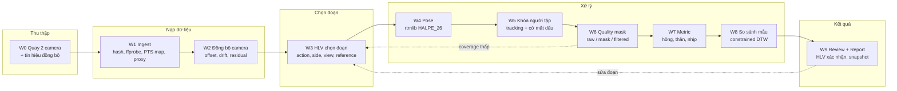

# Workflow và công nghệ — Thái Cực Quyền AI (MVP v3)

**Phiên bản:** 1.1 · **Ngày:** 13/11/2026 · **Cập nhật:** 14/11/2026 (UI chuyển sang React + Vite + FastAPI, DEC-0008, task X.04)
**Đối tượng đọc:** kỹ sư ML/CV (A), kỹ sư full-stack (B), chủ dự án (O)
**Quan hệ với kế hoạch:** triển khai kỹ thuật cho `WUSHU_TAIJIQUAN_MASTER_PLAN_V3.md`, Phase 00–05.

Tài liệu này **thay hai quyết định của v3**:

1. Không dùng Sports2D làm thư viện. Thay vào đó gọi trực tiếp rtmlib và tự viết phần đọc video, mask, lọc và metric (DEC-0001).
2. **UI không dùng Streamlit** mà dùng React + Vite + TypeScript, với backend FastAPI (DEC-0008, 14/11/2026).

Lý do nằm ở mục 1.2, `repos/taolu/REPOS.md` và `Docs/tracking/DECISIONS.md`.

> Đây là thiết kế, chưa phải hệ thống đã chạy. Mọi phiên bản thư viện, ngưỡng và tham số đều phải chốt sau P00.05 (kiểm kê phần cứng) và P01 (chạy trên video thật).

---

## Mục lục

1. Quyết định công nghệ
2. Workflow tổng thể
3. Chi tiết từng bước (W0–W9)
4. Hợp đồng dữ liệu và lưu trữ
5. Kiến trúc code
6. Môi trường, model và tái lập
7. Workflow dữ liệu và gán nhãn
8. Workflow đánh giá và nghiệm thu
9. Quy trình phát triển
10. Bảo mật, quyền dữ liệu và license
11. Công nghệ cho các phase mở rộng
12. Quyết định còn mở

Phụ lục A: skeleton HALPE_26 · Phụ lục B: công thức metric · Phụ lục C: thuật toán so sánh mẫu

---

## 1. Quyết định công nghệ

### 1.1 Stack MVP

| Lớp | Công nghệ | License | Vai trò | Ghi chú |
|---|---|---|---|---|
| Ngôn ngữ | Python 3.12 | PSF | Toàn bộ pipeline và API | Đã chốt (DEC-0002): PyAV 19 yêu cầu ≥ 3.12 |
| Quản lý môi trường | `uv` + `uv.lock` | MIT/Apache | Cài và khóa dependency | Mỗi stack nặng một môi trường riêng (mục 6) |
| Video I/O | FFmpeg / ffprobe | LGPL/GPL tùy build | Metadata, proxy, cắt clip, tách audio | Gọi dạng CLI, không link thư viện |
| Đọc frame + PTS | PyAV | BSD-3 | Đọc frame kèm presentation timestamp | Không dùng `round(CAP_PROP_FPS)` |
| Pose | rtmlib + RTMPose-m HALPE_26 (ONNX) | rtmlib: Apache-2.0; weights: xem 10.3 | Keypoint 2D 26 điểm, có bàn chân | Weights lưu local, pin SHA-256 |
| Inference runtime | onnxruntime-gpu (fallback: onnxruntime CPU) | MIT | Chạy ONNX | Chọn bản khớp CUDA/cuDNN của máy |
| Tính toán | NumPy, SciPy | BSD | Mask, lọc, metric, DTW | Numba tùy chọn để tăng tốc DTW |
| Schema | Pydantic v2 | MIT | Manifest, config, dữ liệu trao đổi | Có version trong mọi file |
| Metadata | SQLite (stdlib `sqlite3`) | Public domain | Video, đoạn, run, review | Một file DB, có backup |
| Artifact | Thư mục theo UUID + Parquet/NPZ/JSON | — | Pose, metric, report | Ghi atomic (mục 4.4) |
| API | FastAPI + uvicorn | MIT / BSD-3 | REST `/api/*`, phục vụ video proxy (HTTP Range) và file build của web | Chỉ lắng nghe `127.0.0.1`; không chạy việc nặng trong process API |
| UI | React + Vite + TypeScript (SPA) | MIT | Các màn Video / Số đo / So sánh / Báo cáo | `<video>` + `requestVideoFrameCallback` cho đánh dấu chính xác từng frame (mục 3, W3) |
| UI: dữ liệu | TanStack Query, React Router | MIT | Gọi API, cache, điều hướng | Client API có kiểu (TypeScript) |
| UI: biểu đồ | Thư viện time-series nhẹ (ứng viên uPlot, MIT), chốt ở P8.08 | MIT | Đường cong metric đồng bộ với video | Plotly chỉ dùng cho report HTML tĩnh |
| Kiểm thử UI | Vitest (unit), Playwright (E2E) | MIT / Apache-2.0 | Component, luồng G04 | Vitest chạy trong `tools/check.ps1`; Playwright thêm ở P8.15 |
| Node toolchain | Node.js ≥ 24, pnpm | MIT | Build/dev frontend | Chỉ cần lúc phát triển và build |
| Biểu đồ report | Plotly | MIT | Biểu đồ trong report HTML tĩnh | Không dùng cho UI tương tác (xem "UI: biểu đồ") |
| Report | Jinja2 → HTML; JSON/CSV | BSD | Báo cáo có bằng chứng | Snapshot bất biến |
| Kiểm thử | pytest, hypothesis (tùy chọn) | MIT/MPL | Unit, contract, golden test | Fixture video sinh bằng FFmpeg |
| Gán nhãn keypoint | CVAT (self-host) hoặc tool nội bộ tối giản | MIT | Audit 200 frame | Chỉ cần export COCO keypoints |

### 1.2 Những gì không dùng, và lý do

| Thành phần | Lý do không dùng ở MVP | Dùng thay |
|---|---|---|
| Sports2D làm thư viện | Mặc định điền gap bằng `last_value` (tạo pause giả); chỉ lưu dữ liệu đã lọc; thời gian tính bằng `frame/round(fps)`; import là tắt SSL toàn process; kéo theo OpenSim/Qt | rtmlib trực tiếp + code tự viết. Tham khảo thuật toán tracking của Sports2D/Pose2Sim |
| Ultralytics YOLO | AGPL-3.0 | YOLOX/RTMDet trong rtmlib |
| Code QAQA, Motion Embedding, Pang/Zhang | Có lỗi hoặc không có license | Tự viết constrained DTW (Phụ lục C) |
| Streamlit | `st.video` không trả thời điểm đang phát; so sánh 2 video đồng bộ và biểu đồ chạy theo video đều phải viết custom component JS (DEC-0008) | React + Vite + FastAPI |
| Next.js | Cần thêm server Node; SSR/SEO/routing phía server không cần cho app nội bộ một máy; API routes dễ trùng với FastAPI (DEC-0008) | React SPA build tĩnh, FastAPI phục vụ |
| PostgreSQL/hàng đợi phân tán | Chưa cần ở MVP một người dùng | Để dành cho E02 (FastAPI đã có từ MVP) |
| LLM coach | Không cần cho 3 metric; rủi ro bịa nhận xét | Nhận xét theo template, HLV duyệt |

---

## 2. Workflow tổng thể



| Bước | Đầu vào | Đầu ra | Công cụ | Người làm | Điểm dừng |
|---|---|---|---|---|---|
| W0 | Protocol quay | 2 file video gốc / take | Điện thoại, giá đỡ | A + O | Thiếu tín hiệu đồng bộ → quay lại take |
| W1 | Video gốc | `recording.json`, `pts.parquet`, proxy | ffprobe, PyAV, FFmpeg | Tự động | Video hỏng, quay xoay chưa xử lý |
| W2 | 2 recording cùng take | `sync.json` | FFmpeg (audio), SciPy | Tự động + A duyệt | Residual vượt ngưỡng → chỉ cho review song song |
| W3 | Proxy video | `segment` (revision) | React video player + FastAPI | HLV | Đoạn không ghi view/action |
| W4 | Video gốc + segment | `pose_raw.npz` | rtmlib, onnxruntime | Tự động | Model checksum sai |
| W5 | Pose raw (nhiều người) | `track.parquet` (1 người) | Code nội bộ | Tự động + người dùng chọn | Mất dấu > ngưỡng → cờ |
| W6 | Track | `pose_masked.npz`, `pose_filtered.npz`, `quality.json` | NumPy/SciPy | Tự động | Coverage dưới ngưỡng metric |
| W7 | Pose filtered + mask | `metrics.parquet`, `metric_summary.json` | NumPy | Tự động | Metric không đủ điều kiện → `insufficient_evidence` |
| W8 | 2 đoạn cùng động tác | `alignment.npz`, `comparison.json` | Code DTW nội bộ | Tự động | Khác action/view → từ chối |
| W9 | Metric + so sánh + nhận xét | `report/` snapshot | Jinja2, Plotly, FFmpeg | HLV | Nhận xét chưa duyệt không vào bản cuối |

---

## 3. Chi tiết từng bước

### W0 — Quay hai camera

**Cấu hình:**
- Đặt 2 camera theo **trục hướng chính của bài**: một chính diện, một ngang (lệch 90°). Không đặt góc tùy ý.
- Các thức đi chéo góc được ghi trước là vùng có coverage thấp.
- 1080p, khóa ở 30 fps hoặc 60 fps. Khóa zoom, phơi sáng và lấy nét.
- Dùng ứng dụng quay cho phép **cố định frame rate** (ví dụ Blackmagic Camera, Open Camera) để hạn chế video VFR.

**Đồng bộ:** vỗ tay hai lần kèm đèn/flash nhìn thấy được ở **đầu và cuối** mỗi take.

**Tham chiếu:**
- Quay 3–5 s người tập đứng thẳng ở vị trí xuất phát. Đoạn này cho scale và góc đứng.
- Nếu có thể, quay bảng checkerboard để giữ khả năng hiệu chuẩn 3D về sau.

**Metadata ghi tay** (form trong app hoặc CSV): `session_id`, `participant_id` (giả danh), `take_id`, `camera_id`, vị trí máy, chiều cao máy, hướng bài, consent reference.

**Thời gian một buổi:** mỗi buổi nhóm cần khoảng 1,5–2 giờ (setup, đồng bộ, 3 lần × 6 phút/người, nghỉ).

### W1 — Ingest

1. Copy file gốc vào `data/recordings/<recording_uuid>/source.<ext>`, chỉ đọc. Tính SHA-256.
2. Chạy `ffprobe -show_streams -show_format -of json` để lấy codec, kích thước, rotation metadata, `r_frame_rate`, `avg_frame_rate`, `time_base`, duration và audio stream.
3. Đọc toàn bộ PTS bằng PyAV để tạo `pts.parquet` (`frame_index`, `pts`, `t_sec = pts × time_base`).
   - Tính `dt` và đánh dấu VFR nếu `std(dt)/median(dt)` vượt ngưỡng (đề xuất 1%).
   - Chỉ đếm frame mà decoder thật sự xuất ra: packet gắn cờ *discard* không phải frame. Clip cắt trên điện thoại (stream copy
     bắt đầu giữa hai keyframe) có edit list; các packet trước điểm bắt đầu vẫn nằm trong file với pts âm và bị decoder bỏ.
     Đếm chúng làm dòng *i* của `pts.parquet` không còn là frame *i* đã decode (BUG-0052, DEC-0030).
4. Xử lý rotation: lưu `display_rotation`. Hoặc áp xoay một lần khi tạo proxy, hoặc xoay frame trước khi chạy pose. Ghi transform vào manifest.
5. Tạo proxy H.264 cho playback trên trình duyệt:
   `ffmpeg -i source -map 0:v:0 -vf "scale=-2:'min(720,ih)'" -c:v libx264 -preset veryfast -crf 23 -g 30 -pix_fmt yuv420p -fps_mode passthrough -an -movflags +faststart -map_metadata -1 proxy.mp4`
   - Map thời gian proxy ↔ nguồn bằng PTS (proxy giữ timestamp nguồn, không phóng to nguồn nhỏ).
   - Xóa metadata vị trí/thiết bị (`-map_metadata -1`).
   - Kiểm tra sai lệch ≤ 1 frame trên các điểm mẫu (tối đa 10 điểm), ghi `proxy.json` (`proxy/1`).
   - Proxy không đạt kiểm tra vẫn được giữ và đánh dấu `passed = false` (UI không dùng nó cho thao tác chính xác từng frame);
     lệnh `taiji proxy` và `taiji ingest --proxy` thoát với mã 1 và vẫn in recording ID (DEC-0030). Điều không đo được thì
     báo lỗi, không ghi số bịa.
6. Ghi `recording.json` (mục 4.2).

**Kiểm thử cần có:** fixture VFR, fixture có rotate 90°, file hỏng, file 0 byte, video không có audio.

### W2 — Đồng bộ camera

1. Tách audio mono 16 kHz cho từng camera: `ffmpeg -i source -vn -ac 1 -ar 16000 audio.wav`
2. Lấy envelope (trị tuyệt đối → lọc thông thấp). Dùng `scipy.signal.correlate` trong cửa sổ đầu take để có `offset_start`, cửa sổ cuối take để có `offset_end`.
   - Cửa sổ cuối là `window_s` giây cuối của đoạn **cả hai camera cùng ghi** (không phải của riêng A), và ở camera B được tìm
     đúng chỗ `offset_start` dự đoán, trong một lát B rộng hơn cửa sổ của A một biên ở hai phía (cắt trong vùng B đã ghi, không
     đệm số 0), biên = `end_margin_s` 3,5 s cộng phần drift cho phép (`max_drift` 500 ppm); như vậy kết
     quả không phụ thuộc máy nào dừng trước (BUG-0058). Biên 3,5 s phải rộng hơn khoảng cách giữa hai tiếng vỗ (khoảng 1 s,
     tối đa 2 s) để khớp thật của một drift vô lý vẫn là đỉnh tốt nhất rồi bị giới hạn drift loại, thay vì một tiếng vỗ lẻ
     khớp nhầm trong dải hợp lý. Không tìm được đầu thì không tìm cuối.
   - Một cửa sổ được tìm rộng hơn mức được chấp nhận (cửa sổ đầu: `max_lag_s` 15 s + vùng đệm 3,5 s; cửa sổ cuối: biên trên), để
     khớp thật nằm sát mép vẫn là đỉnh tốt nhất rồi bị loại, thay vì một tiếng vỗ lẻ khớp nhầm ngay trong dải. Đỉnh thứ hai được tìm
     ngoài 0,2 s quanh đỉnh tốt nhất (nhỏ hơn khoảng cách hai tiếng vỗ của một cặp, ≥ 0,3 s).
   - Drift vượt `max_drift` (500 ppm) không phải là đồng hồ: cửa sổ cuối bị loại, trạng thái `start_only`. `max_drift` cũng là phép
     kiểm chứng chéo giữa hai phép đo (lỗi E ở một cửa sổ hiện ra thành drift E/dt): một tiếng vỗ khớp nhầm ở một đầu bị loại, với
     lỗi 1 s thì đến take 2000 s. Lỗi giống hệt ở cả hai đầu (cặp bị hỏng như nhau) âm thanh không phát hiện được: flash ở cả hai đầu
     (bước 4) mới quyết định dùng được (BUG-0063).
   - Track audio bị mất mẫu (PTS nhảy quá 2 ms) bị từ chối khi tách audio, không tự vá (BUG-0058..0062, DEC-0033).
3. `drift = (offset_end − offset_start) / (t_ref_end − t_ref_start)`, với `t_ref` là thời điểm của tiếng vỗ tay đã khớp trên trục video
   của camera A, không phải tâm cửa sổ tìm kiếm (BUG-0059). Mapping: `t_cam2 = t_cam1 + offset_start + drift × (t_cam1 − t_ref)`.
4. Kiểm chứng bằng mốc nhìn thấy (frame flash). `residual` = sai lệch giữa mốc audio và mốc hình, tính theo ms và theo frame.
   Flash đi theo cặp (cách nhau khoảng 1 s) như tiếng vỗ tay, nên mỗi cửa sổ được ghép **một-một theo thứ tự thời gian**: hai
   camera phải thấy **cùng số flash, ít nhất hai**; flash thứ i của A so với flash thứ i của B; `residual` của cửa sổ là khoảng
   cách **lớn nhất**, không phải trung bình. Số flash khác nhau hoặc ít hơn hai thì cửa sổ không kết luận được (không có
   residual, take không dùng được cho metric). Ghép theo flash gần nhất, bỏ flash không có cặp và lấy trung bình từng để lọt
   một mapping lệch đúng một khoảng cách cặp (1 s) khi một camera không thấy một flash của cặp (BUG-0064, DEC-0034).
5. Ghi `sync.json`: `method`, `offset`, `drift`, `residual_ms`, `validated_by`.
6. Quy tắc dùng:
   - Residual ≤ 1 frame: cho ghép metric theo thời gian.
   - Lớn hơn: chỉ hiển thị song song, mốc do HLV xác nhận (C05 trong v3).

### W3 — HLV chọn đoạn

Giao diện tab **Video**:
- Phát proxy, tua từng frame, đánh dấu start/end.
- Chọn `action` (theo ontology v0), `side`, `occurrence`, `camera_id`, `view_category` (front/side/oblique/back), cờ `orientation_change`, `occlusion`, `perspective_shift`.
- Chọn reference cùng action/variant/view.

Mỗi lần sửa tạo `segment_revision` mới. Không ghi đè revision cũ.

**Video player (React):**
- FastAPI phục vụ `proxy.mp4` có hỗ trợ HTTP Range (để tua) và bảng PTS dạng JSON.
- Component dùng `requestVideoFrameCallback()` để lấy `mediaTime` của frame đang hiển thị; có nút ±1 frame.
- Timestamp nhận được là thời gian **proxy**. Đổi sang PTS nguồn qua bảng PTS, chọn frame nguồn gần nhất; gửi về API khi lưu segment.
- Trình duyệt mục tiêu: Chromium (Chrome/Edge) bản hiện hành, vì `requestVideoFrameCallback` cần được hỗ trợ đầy đủ.

Phương án dự phòng (P8.05b): HLV đánh dấu trong Kinovea hoặc ELAN rồi import CSV.

### W4 — Pose

- **Model:** `BodyWithFeet` của rtmlib, chế độ `balanced` (YOLOX-m HumanArt + RTMPose-m body7-halpe26).
  - Trước P01 phải tải ONNX thủ công một lần, tính SHA-256 và ghi vào `models/registry.json`.
  - Khi chạy, truyền **đường dẫn local** cho model detector và pose (kiểm tra tham số API tại commit rtmlib đã pin).
  - Pipeline **không được** tự tải model lúc chạy.
- **Đọc frame:** dùng PyAV theo PTS trong khoảng `[start, end]` của segment, thêm lề 1 s hai đầu để bộ lọc ổn định.
- **Output thô:** cho mọi người phát hiện được trong từng frame, lưu bbox, 26 keypoint (x, y theo pixel ảnh đã xoay đúng chiều), score và `t_sec`.
  - Lưu `pose_raw.npz`. Mảng có độ dài biến đổi thì lưu dạng ragged hoặc padded kèm `n_persons`.
- **Backend:** `onnxruntime` với `CUDAExecutionProvider`, fallback CPU. Ghi provider thực dùng vào run manifest.
- **Hiệu năng:** đo `processing_seconds / video_seconds` và peak VRAM ở P01. Batch không bắt buộc ở MVP.
  Đã đo ở P3.07 (`Docs/reports/p3_pose_benchmark.md`; clip D20, không phải clip điện thoại của P1.09; RTX 3060 12 GB dùng chung với màn hình; 5 clip 30 s, 3 lượt đo): RTF 1,23 (N = 1), 0,335 (N = 5), 0,259 (N = 10) trên video 24 và 30 fps; ở 30 fps là 1,47 / 0,40 / 0,31.
  Detector chiếm 73 % thời gian ở N = 1 (khoảng 36 ms mỗi lần gọi), pose khoảng 8 ms mỗi frame một người, decode 5 đến 21 %. VRAM đỉnh 1,8 đến 2,0 GB tổng (0,6 đến 0,8 GB trên mức các chương trình khác đang giữ), còn trống khoảng 10 GB.
  Một đoạn 30 s qua cả tầng pose (đến khi lưu `track.parquet`): 37 đến 46 s (N = 1), 10 đến 13 s (N = 5). Luật chọn N viết trước khi đo khuyến nghị **N = 1** (N = 5 lệch khỏi N = 1 trên keypoint người tập: trung vị 2,0 px, p95 9,7 px, p99 21,7 px); P3.08 so hai cadence trên các frame đã gán nhãn và không thấy bằng chứng N = 1 ít lỗi hơn (61 lỗi: 36 ở cả hai, 10 chỉ ở N = 1, 5 chỉ ở N = 5, 10 chưa rõ), nên **maintainer giữ N = 5** (DEC-0042, 2026-11-16); xem lại khi có clip của mình (X.27, X.28).

**Định dạng `pose_raw.npz` (schema `pose_raw/1`, P3.03, `pose/raw_io.py`, `schemas/pose.py`).** Chín mảng tên và kiểu cố định: `frame_index` (F,) int32 (dòng của frame trong `pts.parquet`, tăng ngặt);
`t_sec` (F,) float64 (PTS thật, tăng ngặt); `person_offsets` (F + 1,) int64 (người của frame `i` là dòng `[i]:[i + 1]`; bắt đầu từ 0, không giảm, kết thúc ở D); `bboxes` (D, 4) float32 xyxy [px];
`keypoints` (D, 26, 2) float32 (pixel ảnh đã xoay đúng chiều, y xuống, đúng như mô hình trả về); `scores` (D, 26) float32; `from_detector` (D,) bool; `schema_version` (chuỗi 0-d, `"pose_raw/1"`);
`meta_json` (chuỗi 0-d: `PoseRawMeta` gồm `skeleton`, `recording_id`, `image_size`, `display_rotation`, `segment_s`, `params`, `model_fingerprint`, `providers` và các số đếm xác định). Frame không có người có 0 dòng.
Keypoint và score không bị kiểm khoảng giá trị, cắt hay điền; NaN giữ nguyên. Thời gian chạy thật (wall clock) không nằm trong file mà nằm trong `run_manifest.json` (`runtime`). Đọc nghiêm ngặt: thiếu hay thừa mảng, sai kiểu hay shape,
số đếm lệch, khác phiên bản hay skeleton đều là `PoseRawError` nêu tên trường; mỗi phiên bản có một bộ đọc (`_READERS`), file cũ không bao giờ bị nâng cấp ngầm. Byte của `.npz` không xác định (timestamp trong zip):
so sánh theo nội dung (`PoseRaw.equals`), còn run manifest ghi SHA-256 của file đã ghi (`save_pose_raw` trả về).

Không lật gương ảnh. Người quay lưng vẫn giữ nhãn trái/phải do model trả về và được kiểm tra ở W6.

### W5 — Khóa người tập

1. Ở frame đầu segment (hoặc frame do người dùng chọn), hiển thị bbox các người phát hiện được. Người dùng chọn người tập. Mặc định chọn bbox lớn nhất gần tâm.
   Quy tắc cụ thể (P3.04, `track/target.py`, giá trị tạm): chỉ xét người đủ điều kiện (đủ `min_valid_keypoints` keypoint hợp lệ, bbox có diện tích); điểm = `diện tích bbox / diện tích ảnh × độ gần tâm` với
   `độ gần tâm = 1 − min(1, d / nửa đường chéo ảnh)`, `d` là khoảng cách từ tâm bbox đến tâm ảnh; điểm bằng nhau lấy dòng thấp hơn. Frame đầu segment không có ai đủ điều kiện thì tìm tiếp về phía sau tối đa 2 s
   (không bao giờ về trước điểm bắt đầu), không có thì báo lỗi, không đoán. Hai người có điểm gần nhau (điểm thứ hai / điểm tốt nhất ≥ 0,6) thì kết quả mang cờ `ambiguous` để UI hỏi lại. Khi người dùng chỉ định bbox:
   chọn người có IoU lớn nhất (≥ 0,3, kể cả người yếu, có cờ `weak`); bbox không khớp ai, hoặc bao hai người (IoU tốt nhất chưa gấp 1,5 lần IoU thứ hai) thì báo lỗi, không chọn người gần nhất. Lựa chọn (`bbox`, `at_t_sec`)
   nằm trong yêu cầu chạy và khóa cache của P7; `pose_raw.npz` không phụ thuộc người được chọn.
2. Ghép frame-to-frame bằng Hungarian trên chi phí kết hợp `1 − IoU(bbox)` và khoảng cách keypoint trung bình (chuẩn hóa theo chiều cao bbox).
   - Tham khảo `sort_people_sports2d` (Pose2Sim, BSD-3; giữ thông báo bản quyền nếu chép).
   - Cài đặt (P3.05, `track/associate.py`, giá trị tạm đã đo): chi phí = `(w_iou × (1 − IoU) + w_kp × min(1, khoảng cách keypoint trung bình / chiều cao hull)) / (w_iou + w_kp)` thuộc [0, 1], `w_iou = w_kp = 1`; hull là bao hộp của các keypoint hợp lệ
     (khi hai bên có ≥ 4 keypoint chung thì hull tính trên các keypoint chung), không dùng bbox detector đã lưu vì nó đổi theo nhịp detector; ít hơn 4 keypoint chung thì chỉ dùng số hạng IoU. Gán Hungarian toàn cục từng frame, cặp có chi phí > `max_cost = 0,3`
     không bao giờ được ghép. Track không được ghép sống thêm `max_gap_s = 0,1` s theo `t_sec` thật rồi đóng. Mọi người đủ điều kiện (đủ `min_valid_keypoints`) đều có track; người yếu có `track_id = −1`. `match_margin` đo độ tranh chấp của phép ghép: gần 0 chỗ hai người
     trùng nhau (không có đặc trưng hình dạng bề ngoài, hai thân hình giống hệt ở cùng chỗ không phân biệt được: giới hạn của phương pháp), ≥ 0,6 ở chỗ khác trên clip thật. Dự đoán chuyển động đã được đo và không được dùng (không giảm tráo ID, làm chi phí thật lớn hơn).
3. Mất dấu quá `max_lost` (đề xuất 0,5 s): đánh dấu `target_lost`, không tự nhảy sang người khác. Khi thấy lại, chỉ nối nếu chi phí dưới ngưỡng; nếu không thì báo người dùng chọn lại.
   Cài đặt (P3.06, `track/state.py`, giá trị tạm đã đo): mỗi frame của `pose_raw` có đúng một dòng với trạng thái `tracked` (có keypoint của người tập), `lost` (vắng ≤ `max_lost_s = 0,5` s theo `t_sec` thật, dự kiến quay lại),
   `target_lost` (vắng lâu hơn) hoặc `before_target` (trước frame đầu của track người tập). Keypoint và score của dòng không phải `tracked` là NaN: không điền, không nội suy (P4 nội suy gap ≤ 150 ms theo thời gian).
   Track của P3.05 đóng sau 0,1 s nên người quay lại sau một lúc vắng là một track **mới**; chỉ track **bắt đầu sau frame cuối của người tập, trong lúc người tập vắng** mới là ứng viên (người luôn có mặt, như người đi ngang qua người tập, không bao giờ là ứng viên).
   Chi phí của P3.05 (`person_cost`) giữa pose đầu của ứng viên và **pose cuối** của người tập: ≤ `reattach_cost = 0,5` thì nối (`reattached`); hai ứng viên cùng dưới ngưỡng và chi phí gần nhau (tốt nhất / thứ hai ≥ 0,6, hoặc cả hai bằng 0) thì `ambiguous`;
   trên ngưỡng hoặc vắng quá `max_reattach_s = 5` s thì `refused`. Không nối thì không đoán: giữ NaN và đặt `needs_reselect` kèm `reselect_reason` (`reattach_ambiguous`, `reattach_refused`, `target_lost_at_end`, `default_choice_ambiguous`, lý do đầu tiên trong
   danh sách này mà thỏa) để UI (P8) hỏi người dùng chọn lại. Người được chọn là người yếu (`track_id = −1`) thì báo lỗi `TargetStateError`.
   Số đo (Docs/tasks/P3.06.md mục 4): quay lại cùng chỗ trên SYN-12 (lệch ≤ 100 px) chi phí ≤ 0,44; trên clip thật D20 (bỏ các dòng của người dẫn 0,3 đến 7 s) ≤ 0,5 ở 83 đến 100 % vị trí; người lạ trong clip ≥ 0,65 (clip 660 s: 0,737 và 0,738, so với
   0,035 của chính người dẫn khi quay lại). Chưa có clip thật mà người tập thật sự rời khung (P1.09): ngưỡng là tạm, đo lại ở các take thật đầu tiên. Giới hạn: người lạ đứng đúng chỗ người tập vừa đứng có chi phí như người quay lại (không có đặc trưng bề ngoài,
   cùng giới hạn như P3.05); chỉ bắt được khi hai người cùng xuất hiện một lúc (`ambiguous`).
4. Ghi `track.parquet` (P3.06, `track/track_io.py`, schema `track/1`): mỗi frame của `pose_raw` một dòng: `frame_index`, `t_sec`, `in_segment` (frame nằm trong segment, không phải phần đệm 1 s), `status` (chuỗi), `track_id`, `person_row` (−1 khi không `tracked`),
   `keypoints` (list cố định 52 float32 x0, y0, x1, y1, …, px ảnh đã xoay thẳng, y xuống), `scores` (26 float32), `match_cost`, `match_margin`, `reattach_cost` (chi phí đã cho phép nối, chỉ ở frame nối). Metadata JSON `taiji_track_meta` trong schema Parquet:
   phiên bản, `recording_id`, lựa chọn người tập, tham số (cả của P3.05), số đếm từng trạng thái, `needs_reselect` và `reselect_reason`, các sự kiện (`lost`, `target_lost`, `recovered`, `reattached`, `refused`, `ambiguous` kèm frame, thời gian, chi phí). Không có đường dẫn hay tên file.
   Ghi nguyên tử, thư mục phải có sẵn; `save_track` trả SHA-256 cho manifest của run (P7); đọc nghiêm ngặt (cột, kiểu, null, tên trạng thái, số đếm và sự kiện phải khớp các dòng; phiên bản qua bảng reader).

### W6 — Quality mask, nội suy, lọc

Lưu **ba lớp riêng**: `raw` (từ W5), `mask` và `filtered`.

| Quy tắc | Giá trị đề xuất | Ghi chú |
|---|---|---|
| Keypoint score < τ_kp | τ_kp = 0,3 (chốt ở P01) | Đặt NaN, ghi lý do `low_conf` |
| Frame có < 50% khớp thiết yếu hợp lệ | Khớp thiết yếu: vai, hông, gối, mắt cá, gót | Cả frame `frame_invalid` |
| Nội suy gap ngắn | ≤ 150 ms, tuyến tính | Cờ `interpolated`. Không nội suy qua điểm đổi hướng nghi ngờ |
| Gap dài | > 150 ms | Giữ NaN. **Không** ffill, không điền 0 |
| Outlier | Hampel, cửa sổ 7, 3σ (MAD) | Cờ `outlier`, đặt NaN trước khi lọc. Mặc định thêm sàn σ ≥ 2 px (P4.03, DEC-0046) |
| Lọc | Butterworth bậc 4, 6 Hz, `filtfilt`, chạy riêng từng đoạn liên tục hợp lệ | Ablation 4/6/8 Hz cho metric nhịp (P5.08). Cài đặt bằng `sosfiltfilt`, độ lợi tại 6 Hz là 0,5 (P4.05, DEC-0048) |
| Tráo trái/phải | Phát hiện bước nhảy đồng thời của cặp L/R | Cờ `lr_swap_suspect`. MVP không tự sửa, chỉ cảnh báo. Cài đặt: cú nhảy chéo của từng cặp, đọc lớp mask, `blocked` cho lớp gap (P4.06, DEC-0049) |

**Cài đặt mask (P4.01, `quality/mask.py`; giá trị là của bảng trên, chưa kiểm bằng clip của ta):** `apply_mask(keypoints, scores, tracked, params)` trả lớp mask **mới** (không sửa lớp raw): mỗi ô khớp là giá trị đầu vào hoặc NaN, và mỗi NaN có một lý do (`reason`, uint8): `low_conf` (score hữu hạn dưới τ_kp; score **bằng** τ_kp được giữ, so sánh theo độ chính xác của score), `non_finite` (toạ độ hay score không hữu hạn), `not_tracked` (frame không phải frame của người tập: `lost`, `target_lost` hay `before_target`, cái nào thì ở `status`), `frame_invalid` (khớp còn dùng được nhưng frame thiếu khớp thiết yếu). Một khớp lấy lý do **đầu tiên** theo thứ tự `not_tracked`, `non_finite`, `low_conf`, `frame_invalid`, nên khớp đã bị loại ở frame không hợp lệ giữ lý do riêng của nó. "Dùng được" là đúng `valid_keypoint_mask` của tầng pose (tracker và P3.08 dùng cùng luật). Frame **tracked** có **ít hơn một nửa** khớp thiết yếu dùng được (5 trên 10 vẫn hợp lệ, 4 trên 10 thì không) là `frame_invalid`: cả 26 khớp là NaN. `mask_track(track)` giữ nguyên các frame đệm 1 s (`in_segment`) cho P4.03 và P4.05. Tham số (`MaskParams`) nằm trong kết quả để manifest và `quality.json` ghi lại. Chưa có định dạng file `pose_masked.npz`: một quyết định chung cho ba lớp sau P4.07 (DEC-0040).

**Số đo trên clip thật (M-QLT-01; 4 video D20, track của người tập theo luật của P3.08, τ_kp = 0,3):** trong 157 366 frame của các đoạn, 86 303 là `tracked` (54,8 %); phần còn lại là `before_target` (20 đến 37 % tuỳ video) và `target_lost` (17 đến 19 %) vì video web có cắt cảnh và người tập rời khung: đó là việc của tracker, không phải của mask. Trong các frame `tracked` mask chỉ loại 0,00 đến 0,18 % ô khớp (nhiều nhất là ngón chân và cổ tay) và **không frame nào là `frame_invalid`** (ít nhất 5 trên 10 khớp thiết yếu dùng được, chỉ 4 frame ở đúng 5). Trên video web này score của người tập gần như luôn từ 0,3 trở lên, nên mask theo score ở 0,3 gần như không loại gì; việc score có cảnh báo được các lỗi thật hay không là câu hỏi của P3.08, không phải của task này.

**Kết quả P3.08 (`Docs/reports/p3_failure_cases.md`; 250 frame, nhãn do agent gán và người xác nhận):** trong 34 lỗi pose ở frame bình thường có nêu khớp, **không lỗi nào** bị mask ở τ_kp = 0,3 loại: ở mọi lỗi có ít nhất một khớp sai có score từ 0,3 trở lên (điểm cao nhất của khớp sai có trung vị 0,67). Mask là cần (loại những gì không quan sát được) nhưng không phải bộ lọc chất lượng; cờ tráo trái/phải (P4.06) và kiểm tra theo nhãn phải làm việc đó. Giá trị τ_kp và danh sách khớp thiết yếu giữ nguyên; đổi là quyết định của maintainer.

**Cài đặt nội suy gap (P4.02, `quality/gaps.py`; giá trị là của bảng trên, đã đo trên clip D20, chưa kiểm bằng clip của ta):** `interpolate_gaps(keypoints, reason, t_sec, params, blocked)` đọc lớp mask (không sửa) và trả lớp mới. Một *gap* là đoạn frame liên tiếp mà một khớp không quan sát được (`reason != ok`). Độ dài gap là **khoảng giữa hai điểm neo** `t[sau] − t[trước]` (từ frame cuối còn quan sát được trước gap đến frame đầu quan sát được sau gap), tính bằng giây thật và nối nếu ≤ 0,150 s (+1e-9 s): ở 30 fps tối đa 3 frame thiếu, ở 24 và 25 fps tối đa 2, ở 60 fps tối đa 8; đúng 150 ms vẫn nối. Nối tuyến tính theo thời gian thật, x và y riêng, mỗi ô nối có cờ `interpolated`; không giữ giá trị cũ, không điền 0, không ngoại suy. Không nối (theo thứ tự này, kết cục ghi ở bảng gap) khi: thiếu điểm neo ở một hay cả hai đầu (`open_start`, `open_end`, `open_both`), gap có ô thuộc `never_fill` (mặc định `not_tracked`: frame không phải của người tập), gap hay một điểm neo nằm trong mặt nạ `blocked` tùy chọn, hoặc gap quá dài (`too_long`). `low_conf`, `non_finite` và `frame_invalid` được nối nếu ngắn. Câu "không nội suy qua điểm đổi hướng nghi ngờ" ở bảng trên được thực hiện bằng đầu vào `blocked`: bộ phát hiện là của P4.06, P4.07 nối hai bên, vì phát hiện ở đây cần một ngưỡng tốc độ chưa ai đo (DEC-0045). `reason` của mask giữ nguyên ở mọi ô, kể cả ô đã nối (P4.07 cần nó để báo coverage theo lý do); ô nối không có score. Một đoạn nối chỉ đúng khi hai điểm neo đúng: cờ `interpolated` nói "không quan sát được", không nói "đúng".

**Số đo trên clip thật (M-QLT-02; 4 video D20, N = 1, τ_kp = 0,3, 86 303 frame tracked, 24 fps ở ba video và 30 fps ở một video):** trong các frame tracked, mask để 1 787 trên 2 243 878 ô không quan sát được (0,080 %). Lớp gap nối 219 gap (phần lớn 1 hoặc 2 frame: 304 ô, 17 % số ô thiếu) và từ chối 82 gap quá dài (đa số trên 8 frame; 12 gap 3 frame ở 24 fps có khoảng 167 ms; 5 gap 4 frame ở 30 fps), nên còn 0,066 % ô là NaN; mọi lần mất người tập bị từ chối (`never_fill`). "Ẩn rồi nối lại" (ô đã quan sát bị ẩn ở đoạn theo dõi tốt, nối bằng hàm thật, so với giá trị đã quan sát): với g = 1 / 2 / 3 / 4 / 8 frame thiếu, sai số p95 là 5,9 / 6,4 / 6,8 / 7,1 / 9,4 px (2,6 / 2,9 / 3,1 / 3,3 / 4,4 % độ dài thân; thân ≈ 197 px), trung vị 1,4 đến 2,0 px; giữ giá trị cuối thay cho nối cho p95 từ 4,4 đến 15,6 %. Tay là nhóm khó nhất (p95 4,2 đến 4,8 % khi g ≤ 3), đầu, thân và chân 2,0 đến 2,6 %, bàn chân 2,9 đến 3,7 %. Giới hạn 150 ms giữ nguyên. Giới hạn của phép đo: ô bị ẩn nằm ở đoạn theo dõi tốt còn gap thật xảy ra khi model gặp khó (che khuất, chuyển động nhanh), nên sai số thật có thể lớn hơn; giá trị tham chiếu là giá trị quan sát, có nhiễu và có lỗi riêng; chỉ có clip bài giảng 24 đến 30 fps và động tác chậm.

**Cài đặt Hampel (P4.03, `quality/filters.py`; cửa sổ 7 và 3σ là của bảng trên, sàn 2 px chọn bằng số đo M-QLT-03, DEC-0046):** `hampel_outliers(keypoints, reason, t_sec, params)` đọc lớp mask (không sửa) và trả lớp mới. Với mỗi ô đã quan sát, cửa sổ là **7 frame** quanh nó; một frame trong cửa sổ chỉ được tính nếu ô của nó quan sát được và cách frame giữa không quá 0,25 s (+1e-9 s) theo thời gian thật, nên chỗ đứng hình hay mất người tập cắt cửa sổ và không giả định fps. Ô được *xét* nếu có ít nhất 5 ô được tính (kể cả chính nó); ô không được xét không bao giờ bị cờ (frame đầu và cuối có cửa sổ ngắn). σ = max(1,4826 × MAD, `scale_floor_px`); ô là outlier nếu |giá trị − trung vị| > 3σ (chặt: bằng thì giữ) ở x **hoặc** y, hai toạ độ xét riêng, một lượt trên giá trị gốc của cửa sổ. Outlier thành NaN với lý do mới `outlier` (mã 5 trong `mask.py`; `apply_mask` không bao giờ tạo mã này) và không có gì khác bị đổi: không làm mượt, không cắt, không bịa giá trị. Một spike dài đến 3 frame trong cửa sổ 7 vẫn tìm được nếu đủ lớn so với độ lệch của các frame tốt; lỗi kéo dài (khớp sai nhiều frame, tráo trái/phải) **không** là outlier vì mọi mẫu trong cửa sổ đều thấy nó (đó là việc của P4.06). Thứ tự các bước: mask → Hampel → gap → resample → lọc: lỗ do outlier để lại được P4.02 nối nếu ngắn (`outlier` không thuộc `never_fill`), có cờ `interpolated` và giữ lý do `outlier`, và Hampel không bao giờ thấy giá trị đã nối (P4.07 nối các bước). `hampel_track(masked)` chạy trên `MaskedTrack` và giữ nguyên các frame đệm. `torso_length_px(keypoints, reason)` đo độ dài thân (trung vị khoảng cách giữa trung điểm hai vai và trung điểm hai hông trên các frame đủ 4 khớp, NaN nếu không frame nào đủ) để quy sàn px cho camera hay độ phân giải khác; cách P4.07 truyền sàn theo đơn vị thân do P4.07 quyết định.

**Số đo trên clip thật (M-QLT-03; 4 video D20, N = 1, τ_kp = 0,3, 22 đoạn; 170 frame người đã xác nhận đúng với 4 394 ô quan sát, 118 ô được gọi tên là sai trong 34 lỗi pose ở frame bình thường của P3.08; thân ≈ 197 px):** luật đúng như bảng (3σ, không sàn) gắn cờ **7,06 %** số ô được xét (158 083 ô) và 6,87 % số ô của 170 frame đúng, vì MAD của 7 số là một ước lượng nhiễu (mô phỏng nhiễu Gauss thuần: 4,8 % số toạ độ; bỏ hệ số 1,4826 thì 10,8 %) và một khớp đứng yên vài frame có MAD gần 0 nên mọi dao động đều bị tính; nó thay 7 % ô tốt bằng ô nối. Với **sàn 2 px** (≈ 1 % thân): **0,49 %** (11 074 ô), 1,14 % trong frame đúng, độ nhạy trên khớp bị gọi tên sai 34,8 % (luật gốc 39,8 %; trong ±2 frame 44,9 % và 52,5 %), số ô NaN thêm sau Hampel và nối gap +313 (luật gốc +5 780; không Hampel: 1 483). Các mức khác: 3,5σ 5,67 %; 4σ 4,68 %; sàn 1 px 1,61 %; sàn 3 px 0,25 %. Theo loại lỗi (sàn 2 px): `lr_swap` 26 trên 58 ô, `joint_off` 13 trên 37, `foot_error` 1 trên 13, `flicker` 1 trên 10 — Hampel là lưới an toàn rẻ, **không** là bộ phát hiện các lỗi mà P3.08 tìm thấy. Giới hạn: độ nhạy dựa trên 118 ô ở frame được chọn vì luật xếp là đáng ngờ; frame "đúng" do người nhìn cả khung xương nên một số trong 50 ô bị cờ có thể là bước nhảy thật; chỉ có clip bài giảng 24 đến 30 fps. Sàn là tham số về tính hợp lệ của dữ liệu (cái gì tính là nhiễu của model), không phải ngưỡng cho một động tác (AGENTS.md mục 5.5).

**Cài đặt lưới đều (P4.04, `quality/resample.py`; DEC-0047, bước/pha/dung sai sửa bởi DEC-0052, X.31):** `resample_layer(keypoints, reason, interpolated, t_sec, params)` đọc lớp gap (không sửa) và trả lớp mới trên lưới đều; `GridMap` giữ ánh xạ lưới ↔ frame gốc (`to_source`). **Timeline quyết định, không phải cờ VFR:** khớp đường thẳng bình phương tối thiểu qua thời điểm các frame; nếu mọi frame nằm trong 1 ms (+1e-9 s) của đường đó thì timeline là *đều* và bước này là **phép đồng nhất** (lưới là chính các frame, không giá trị nào bị đụng, `resampled` = false): mọi video tốc độ khung hình cố định, kể cả 29,97 fps ở time base 1 ms (làm tròn tối đa 0,5 ms). Ngược lại lưới đều là mạng mà các thời điểm frame đi theo (**DEC-0052, X.31: bước và pha được khớp**, xem đoạn "Sau X.31" dưới; `1/grid_hz` neo ở frame đầu nếu được yêu cầu rõ; nếu không khớp được thì khoảng frame trung vị neo ở frame đầu, như DEC-0047), chỉ gồm các thời điểm trong `[t_đầu − dung sai, t_cuối + dung sai]` (không ngoại suy quá dung sai). Một thời điểm lưới mà frame gần nhất (frame trước nếu hoà) nằm trong dung sai `min(uniform_tol_s, bước/4) + 1e-9` s (1 ms) là bản sao nguyên bit của frame đó (giá trị lệch thời gian tối đa bằng dung sai); nằm giữa hai frame thì mỗi ô là hỗn hợp tuyến tính `a + w (b − a)` của hai ô dùng được (đã quan sát hoặc đã nối), `interpolated` là OR của hai ô gốc, lý do là `ok` nếu cả hai ok, ngược lại là lý do của ô không ok (ô gần hơn nếu cả hai; bên trái nếu hoà), và hàng được cờ `mixed`. Ô cạnh một ô không dùng được là NaN, **không bao giờ điền**, mang lý do của ô không dùng được (không bao giờ nối qua chỗ mất người tập). Khoảng dừng của timestamp dài hơn 0,150 s (cùng giới hạn của P4.02, tham số `max_step_s`) không được nối: các ô là NaN với lý do mới `no_frame` (mã 6). `to_source` đưa giá trị trên lưới về frame gốc (bản sao nếu frame nằm trong dung sai của một thời điểm lưới, hỗn hợp tuyến tính nếu cả hai ô lưới quanh nó hữu hạn, ngược lại NaN; frame trước thời điểm lưới đầu (`before`) hoặc sau thời điểm lưới cuối (`beyond`) và không nằm trong dung sai của một thời điểm lưới cũng NaN); `GridLayer.to_source` còn không cho giá trị với ô gốc không dùng được. Trên clip VFR mỗi lỗ làm mất các frame trong khoảng một bước quanh nó khi đưa về frame gốc; phép đồng nhất không mất gì. Việc lớp đã lọc lưu trên lưới hay trên frame gốc do P4.07 quyết định (đã quyết: trên lưới, DEC-0050).

**Số đo trên clip thật (M-QLT-04; 4 video D20, N = 1, τ_kp = 0,3, 22 đoạn; thân trung vị 191 px theo `torso_length_px`):** (A) bước này là **phép đồng nhất ở 22 trên 22 đoạn** (24 fps ở 13 đoạn, 30 fps ở 9 đoạn; lệch lớn nhất của một frame khỏi đường thẳng 3 × 10⁻⁹ s), nên trên footage hiện có nó không đổi gì. (B) Vòng đi-về trên chuyển động thật ở mọi pha của lưới (lớp gap sau mask, Hampel mặc định và nối gap, đặt lên lưới có tốc độ lệch 1 % trên và dưới tốc độ gốc, rồi đưa về frame gốc; so với chính ô đã quan sát; 4 458 884 ô): sai số p50 0,43 px, p95 2,21 px (0,94 % thân), p99 4,30 px (1,78 %); theo nhóm p95 đầu 1,79, thân trên 1,84, chân 1,88, bàn chân 2,39, tay 3,37 px (1,40 % thân); theo pha p95 từ 0,66 px (frame gần một thời điểm lưới) đến **2,93 px (1,23 % thân; p99 5,47 px) ở pha xấu nhất**, tức một vòng đi-về ở pha xấu nhất tốn cỡ một đoạn nối 1 frame của P4.02 nhưng nhỏ hơn (một khoảng thay vì hai); mất 1 575 trên 2 242 082 ô nguồn dùng được (0,070 %) ở rìa các lỗ. Sai số lớn nhất 175 px (74 % thân) có lẽ là ô ở một bước nhảy hay lỗi kéo dài mà Hampel không bắt (chưa xem). (C) SYN-07 với jitter 30 %, 5 seed: sai số vòng đi-về lớn nhất 0,21 đến 0,35 px so với cận giải tích `a (d² + s²) / 8` là 2,35 đến 2,41 px. Giới hạn: các video D20 đều CFR nên nhánh không đồng nhất chỉ được đo qua lưới lệch tốc độ 1 % và dữ liệu tổng hợp, chưa có clip VFR thật; chỉ clip bài giảng 24 đến 30 fps.

**Cài đặt bộ lọc Butterworth (P4.05, `quality/filters.py`; bậc 4 và 6 Hz là của bảng trên, không chỉnh ở đây, DEC-0048):** `lowpass_layer(keypoints, reason, interpolated, step_s, params)` và `lowpass_grid(layer)` đọc lớp lưới của P4.04 (không sửa) và trả lớp mới. Một *đoạn liên tục* của một khớp là dãy hàng liên tiếp mà khớp đó có giá trị (đã quan sát hoặc đã nối); x và y là một ô. **Mỗi đoạn được lọc riêng** bằng `scipy.signal.sosfiltfilt` (cùng phương pháp xuôi-ngược của `filtfilt`, ở dạng các đoạn bậc hai cho ổn định số, như `io/audio_sync.py`; padding mặc định của scipy: nối lẻ `padlen` hàng, 15 ở bậc 4), nên NaN không bao giờ là đầu vào của bộ lọc, không có gì bị lọc qua một lỗ, một lần mất người tập hay một khoảng dừng, và một bước nhảy ở đoạn này không với tới đoạn kia. Lọc xuôi rồi ngược thì biên độ được bình phương: **độ lợi tại 6 Hz là 0,5 (−6 dB)** và điểm −3 dB của kết quả là 5,4 đến 5,6 Hz; pha triệt tiêu nên chuyển động không bị trễ. Đoạn có **nhiều hơn `padlen` hàng** (từ 16 hàng) được lọc; đoạn **≤ `padlen` hàng không được lọc, giữ nguyên giá trị đầu vào, gắn cờ `filtered = False`** và bảng đoạn ghi `too_short` (không đặt NaN). Nếu tần số cắt không nhỏ hơn Nyquist (clip ≤ 12 fps ở 6 Hz) thì không thiết kế được bộ lọc: **không lọc gì, mọi đoạn ghi `above_nyquist`, không tự hạ tần số cắt**. `reason` và `interpolated` được sao từng ô: ô đã nối được lọc vẫn là giá trị đã nối; ô của hàng `mixed` là dữ liệu như mọi ô. Kết quả có `filtered`, bảng đoạn (khớp, hàng đầu, hàng cuối, độ dài, kết cục), tham số và `sampling_hz = 1/step_s` của lưới. Không có mã lý do mới.

**Số đo trên clip thật và trên SYN-05 (M-QLT-05; 4 video D20, N = 1, 22 đoạn):** 965 đoạn liên tục, 2 249 882 ô dùng được; chỉ **231 ô (0,010 %)** nằm trong đoạn quá ngắn. Ở 6 Hz một ô được lọc dịch p50 0,83 px, p95 3,76 px (1,53 % thân), p99 7,54 px (tay p95 5,77 px, 2,32 %); jitter (căn bậc hai trung bình bình phương của sai phân bậc hai) còn 0,316 và tốc độ p99 còn 0,769 so với trước; ở 4 và 8 Hz: p95 4,48 và 3,23 px, jitter 0,167 và 0,507, tốc độ p99 0,717 và 0,836. Trên SYN-05 có chân lý: bộ lọc làm lệch chuyển động không nhiễu tối đa 0,046 px; với nhiễu 1 px và 2 px sai số rms còn 0,605 lần; **trong các đoạn dừng (chân lý 0 px/s)** tốc độ do nhiễu 1 px giảm từ p50 48,8 / p95 101,5 / p99 126,8 px/s xuống **13,4 / 28,1 / 34,9 px/s** (thấp hơn khoảng 3,6 lần, không về 0 — P5.07 phải tính đến). **Chi phí ở rìa chỉ là một ô cho mỗi đầu của đoạn** (ô ở đầu mút không được cải thiện, các ô sau đó có sai số như phần trong: 0,82 đến 0,92 px so với 0,85), nên độ dịch lớn ở rìa đoạn D20 (p95 11,7 px) là tình trạng dữ liệu ở đó (đoạn kết thúc ở chỗ mất hoặc sau một glitch), không phải do bộ lọc. Một spike mà Hampel loại bỏ không để lại dấu vết (0,0 px); nhưng **một bước nhảy kéo dài mà Hampel không bắt (60 px trong 6 hàng) bị làm nhoè** (sai số đến 66,8 px, bộ lọc dội khoảng 11 % bước nhảy). Giới hạn: giá trị 6 Hz và bậc 4 là của W6, chưa kiểm bằng metric (P5.08 làm ablation 4/6/8 Hz); chưa có clip VFR thật; chỉ clip bài giảng 24 đến 30 fps.

**Cài đặt cờ tráo trái/phải (P4.06, `quality/lr_swap.py`; DEC-0049):** `detect_lr_swaps(keypoints, reason, t_sec, params, torso_px=None)` đọc **lớp mask** (ô đã quan sát, trước Hampel; không sửa) và trả cảnh báo: **không đổi giá trị, lý do hay nhãn nào** (MVP chỉ cảnh báo; hoán đổi nhãn lại sẽ đổi ý nghĩa của phép đo). *Sự kiện* là một **cú nhảy chéo** của một cặp trong `LR_PAIRS` giữa hai hàng đã quan sát cách nhau không quá 0,25 s (PTS thật): cả hai nhãn dịch ít nhất **0,2 thân** và mỗi nhãn đáp xuống trong **0,5 lần** độ dịch của chính nó quanh vị trí trước đó của nhãn kia (cận tính cả điểm biên; khoảng cách theo độ dài thân, thân là `torso_px` hoặc thân trung vị của lớp). Một chi nhanh một mình, hai chi bắt chéo mượt, một nhãn nhảy một mình (flicker, việc của Hampel) và hai nhãn nhảy tới chỗ khác đều không phải sự kiện; tráo hai khớp gần nhau hơn 0,2 thân (mắt nhìn chính diện) không thấy được và cũng không bị gắn cờ. **Ghép cặp** tham lam theo thời gian: một sự kiện có sự kiện kế tiếp của cùng cặp trong 0,5 s là *vào*, sự kiện đó là *ra* (dùng hết cả hai), các hàng từ vào (gồm) đến ra (không gồm) là `suspect` cho hai khớp của cặp; sự kiện không có bạn đồng hành là *unpaired* và không đánh dấu khoảng. Hàng của chính sự kiện cũng được đánh dấu: `events` (theo cặp), `blocked` = `suspect` cộng hai khớp của mọi hàng sự kiện (kể cả hàng ra), `frame_suspect` = các hàng có ô `suspect`. `blocked` là đầu vào của `interpolate_gaps(blocked=...)` (DEC-0045). Kết quả có bảng sự kiện (cặp, hàng, thời gian, độ nhảy theo thân, kết cục), thang đo và tham số, **không chứa giá trị nào của đầu vào**; không có mã lý do mới.

**Số đo trên clip thật và SYN-08 (M-QLT-06; 4 video D20, N = 1, 22 đoạn, 158 326 hàng):** **270 sự kiện (17,1 trên 10 000 hàng), tất cả ở `d20-v4`** (bước chân nghiêng nhìn từ bên), 205 sự kiện ở chuỗi chân (gối 53, cổ chân 56, gót 52, ngón nhỏ 30, ngón cái 14), hông 38, mắt 0; gần như không phụ thuộc ngưỡng (278 sự kiện ở 0,1 thân đến 217 ở 0,5); kết cục 68 vào, 68 ra, **134 unpaired**; 0,086 % số hàng có ô `suspect`, 0,064 % có sự kiện, **0,124 % có ô `blocked`**; thân mỗi đoạn 141 đến 307 px (trung vị 184). Trong **11 frame tráo đã gán nhãn (8 bình thường)** có sự kiện của đúng cặp trong ±2 hàng ở **9 frame (6 bình thường)**; ô được gán nhãn nằm trong `suspect` ở 4 frame và trong `blocked` ở **7 frame (6 bình thường)**; hai frame không có sự kiện (`fc-014`, chân ở `d20-v1`, và `fc-056`, một cổ chân ở `d20-v2`) không có cú nhảy nào của cặp đó trong cả đoạn: **một tráo không phải cú nhảy giữa hai hàng liên tiếp thì không thấy được**; trong **172 frame người đã xác nhận đúng** có 2 frame có sự kiện trong ±2 hàng và ô `blocked`. **Đây không phải recall độc lập:** các frame review được chọn bằng các luật, trong đó có `swap_pair` là bản xem trước của chính sự kiện này; chín trong mười một frame đã gán nhãn cách một sự kiện 0 đến 0,07 s vì lúc review người ta nhìn đúng các cú nhảy đó. SYN-08 (hai tráo dài 3 frame, nhiễu 0, 1, 2 px): các hàng có ô `suspect` **đúng bằng mặt nạ tráo**, sự kiện ở hàng 20, 23, 50, 53, mọi cặp đều bị gắn cờ trừ mắt (tách 0,12 thân); tráo dài 1, 3, 8, 15 frame (đến 0,5 s) được gắn cờ chính xác, tráo 16 frame (0,53 s) hay 24 frame (0,80 s) chỉ thấy ở hai cú nhảy (unpaired, 2 hàng bị chặn, không có khoảng). Trên lớp gap của D20 (sau mask và Hampel): trong 9 272 gap được nối (trên 10 523 gap) có **278 gap (3,0 %) sẽ bị `blocked` từ chối**. Giới hạn: chưa biết độ nhạy (mẫu thiên lệch, 8 frame bình thường); trạng thái tráo không quan sát được, chỉ thấy các cú nhảy, nên một cú nhảy bị bỏ sót hay bịa ra làm đảo cách ghép cặp của phần còn lại của chuỗi, và một nửa số sự kiện là unpaired; tráo toàn thân không phân biệt được với người quay lưng; hai chi bắt chéo thật nhanh hơn khoảng 0,2 thân mỗi hàng có thể giống một cú nhảy (khoảng 900 px/s ở 24 fps trên D20); tráo vắt qua một lỗ không thấy được; mọi sự kiện nằm ở một video; chỉ clip bài giảng 24 đến 30 fps.

**Cài đặt chuỗi quality và coverage (P4.07, `quality/chain.py`, `quality/coverage.py`, `schemas/quality.py`, `quality/quality_io.py`; DEC-0050):** `run_quality_arrays(keypoints, scores, t_sec, tracked, in_segment, params, intervals)` và `run_quality(track, params, intervals)` nối sáu bước theo thứ tự đã chốt: **mask → thân của lớp mask → cờ tráo (đọc lớp mask) → Hampel (đọc lớp mask, không phải lớp sau cờ tráo: tráo 1 đến 3 hàng sẽ bị Hampel biến thành lỗ và không còn thấy) → lớp gap trên lớp Hampel với `blocked` = mặt nạ của cờ tráo → lưới đều → Butterworth**. Kết quả của một bước không bao giờ quay lại bước trước; mọi lớp được giữ riêng và chỉ đọc; `QualityError` của một bước được ném lại kèm tên bước (`mask`, `torso`, `lr_swap`, `hampel`, `gaps`, `resample`, `filter`). **Sàn Hampel là 1 % thân của lớp mask** (`hampel_floor_fraction` = 0,01: 2 px ở thân 197 px mà DEC-0046 đã chọn 2 px); `None` dùng `scale_floor_px` như đã cho; lớp không đo được thân dùng sàn cố định đó và có cảnh báo `torso_unmeasured`. **Lớp đã lọc nằm trên lưới** (chính các frame khi tốc độ khung hình cố định, tức mọi clip hiện có); `QualityResult.filtered_on_source()` đưa về frame gốc cho lớp phủ của giao diện. **Coverage chỉ là số đếm kèm mẫu số, không có phân số** — cho *segment* (từ hàng đầu đến hàng cuối có `in_segment`, đóng hai đầu, bỏ phần đệm 1 s) và cho từng *khoảng đặt tên* (`[start, end)` tính bằng giây, dung sai 1e-9 s hai đầu, tên `^[A-Za-z0-9_.-]{1,64}$`, `segment` dành riêng; các khoảng có thể chồng nhau và vượt ngoài clip): số hàng, số ô (hàng × 26), **ba lớp ô rời nhau: đã quan sát, đã nối (cờ `interpolated`, một lớp riêng) và thiếu (NaN)**; lý do **hai lần** (mọi ô có lý do khác `ok`, kể cả ô đã nối; và các ô NaN; sáu tên `low_conf`, `non_finite`, `not_tracked`, `frame_invalid`, `outlier`, `no_frame`); số frame (*dùng được*: ít nhất tỉ lệ khớp thiết yếu của mask có giá trị ở lớp cuối; *không tracked*: cả 26 ô là `not_tracked`; hai loại độc lập); cờ lọc (`filtered`, `unfiltered`), cờ tráo (`suspect`, `blocked`), `mixed_rows`, các gap theo kết cục và 26 khớp. **Hai lưới, nói rõ:** ô, lý do, frame và cờ lọc đếm trên lưới; bảng gap và cờ tráo đếm trên các hàng gốc (`source_rows` là mẫu số của chúng); một gap tính vào một khoảng **theo số ô của nó nằm trong khoảng** (gap bắt đầu ở phần đệm và kéo vào segment vẫn thuộc segment bằng các ô đó), nên trên đồng hồ đều số ô của gap `filled` đúng bằng số ô `bridged` và số ô của các kết cục khác đúng bằng số ô `missing`. **`quality.json` là schema `quality/1`** (Pydantic, `extra="forbid"`, bất biến, `schema_version`, số nguyên chặt, không NaN): ghi nguyên tử, cùng báo cáo cho cùng số byte (`save_quality` trả SHA-256 cho run manifest), đọc chặt (`load_quality`) và **tự nhất quán: validator kiểm tra phân hoạch và các tổng**, nên file sửa tay mâu thuẫn với chính nó bị từ chối; chỉ có số đếm, thời gian, tên khớp, khoảng và lý do, tham số mọi bước như đã dùng (sàn Hampel tính bằng px và tỉ lệ đã xin) và cảnh báo, **không có giá trị keypoint, tên người hay đường dẫn**; hai mảng `pose_masked.npz`, `pose_filtered.npz` do X.29 viết (đoạn "Định dạng hai lớp mảng" dưới). **Cảnh báo** có bốn dạng cố định: `lr_swap_suspect@12.40-12.73` (mỗi dãy hàng gốc cực đại của segment có ô `blocked`, cắt theo segment; `@12.40` cho một hàng; theo thời gian, đứng trước), rồi `torso_unmeasured`, `grid_resampled`, `filter_skipped_above_nyquist`. Coverage không phán xét: "quá thấp" là ngưỡng của một metric (AGENTS.md mục 5.5); ba tỷ lệ theo metric × camera của v3 mục 8.3 là phép chia của P10.04 trên các số đếm này.

**Định dạng hai lớp mảng của W6 (X.29, `quality/layers_io.py`, `schemas/quality_layers.py`; DEC-0053):** `pose_masked.npz` (schema `pose_masked/1`) và `pose_filtered.npz` (schema `pose_filtered/1`) theo kiểu `pose_raw/1`: mảng có tên và kiểu cố định, `schema_version` và `meta_json` là chuỗi 0-d, mỗi phiên bản một bộ đọc, không pickle, không nâng cấp ngầm, ghi nguyên tử và trả SHA-256 (byte của `.npz` không xác định: so sánh bằng `equals`). Hai lớp nằm ở hai file riêng (raw, mask, filtered tách nhau). **`pose_masked.npz`** là lớp mask trên `T` hàng của track kèm cờ tráo đọc từ nó: `frame_index` (T,) int32, `t_sec` (T,) float64, `in_segment` và `tracked` (T,) bool, `keypoints` (T, 26, 2) float32 (giá trị hoặc NaN), `scores` (T, 26) float32, `reason` (T, 26) uint8 (0 đến 4), `n_essential_valid` (T,) int8, `frame_invalid` (T,) bool, `swap_suspect` và `swap_blocked` (T, 26) bool. **`pose_filtered.npz`** là lớp cuối trên lưới (`G` hàng; chính các frame khi tốc độ khung hình cố định) cùng ánh xạ về frame gốc: `t_grid` (G,) float64, `keypoints` (G, 26, 2) float32, `reason` (G, 26) uint8 (0 đến 6), `interpolated` và `filtered` (G, 26) bool, `mixed` và `grid_in_segment` (G,) bool; `frame_index`, `t_sec`, `in_segment`, `source_usable` (T, 26) bool, và ánh xạ ngược `back_left` (T,) int32, `back_weight` (T,) float64, `outside` (T,) bool. Ánh xạ ngược được **lưu**, không dựng lại từ `plan_grid` khi đọc, để một file giữ nguyên nghĩa khi luật lưới đổi (X.31 vừa đổi nó); `PoseFiltered.on_source()` đưa lớp về frame gốc và bằng từng bit `QualityResult.filtered_on_source()`. `meta_json` mang tham số đã dùng (mask và cờ tráo; toàn bộ `QualityParamsRecord` cho lớp đã lọc, sàn Hampel tính bằng pixel), hai đồng hồ (`n_rows`, `n_grid_rows`, `resampled`, `step_s`, `snap_s`), các số đếm và `data_sources`; không có đường dẫn, tên file hay tên người (chỉ `recording_id`). **`data_sources`** (AGENTS.md mục 9.4.6) là danh sách `{dataset_id, license}` do người gọi (P7) truyền; danh sách rỗng nghĩa là recording của ta và hạn chế là của `recording_id` trong store (mục 9.5); `pose_raw/1` chưa có trường này. **Bộ đọc kiểm file với chính nó, không chỉ shape:** hợp đồng của lớp mask hoặc lớp gap (`check_layer`, `check_gap_layer`), mã lý do trong khoảng của lớp (0 đến 4 hoặc 0 đến 6), hàng không tracked chỉ có `not_tracked` và ngược lại, `n_essential_valid` đếm lại từ `reason` và khớp thiết yếu của header, `frame_invalid` bằng luật frame (`mask.frame_invalid_mask`, đúng hàm của `apply_mask`), cờ tráo nằm trong cặp của header, `grid_in_segment` bằng đúng các hàng mà báo cáo đếm (`coverage.segment_grid_rows`), số đếm của header bằng mảng, và ánh xạ ngược khớp hai đồng hồ (hàng trong dung sai `snap_s` của một thời điểm lưới là bản sao, hàng khác nằm giữa hai thời điểm lưới với đúng trọng số, hàng ngoài lưới có `outside`; timeline không resample thì lưới chính là các hàng). Ghi thì kiểm cùng các luật nên không có gì được ghi mà bộ đọc từ chối; lớp float64 bị từ chối (không ép kiểu ngầm); lớp không có hàng không được lưu. **Số đo trên Kinect thật (X.29; `P08T03C01` 11 790 hàng thành 12 196 hàng lưới: `pose_masked.npz` 1 536 184 byte, `pose_filtered.npz` 1 710 569 byte, ghi 0,21 s, đọc và kiểm 0,04 s; `P02T02C09` 8 180 hàng thành 8 301 hàng lưới, 1 067 727 và 1 151 181 byte):** đọc lại bằng nhau, `on_source()` bằng từng bit `filtered_on_source()`, khoảng dừng 733 ms vẫn là `no_frame` và không được nối. Giới hạn: chưa có gì đọc hai file (P5, P7, P8 sẽ đọc); bảng gap theo kết cục và các sự kiện tráo không được lưu (số đếm nằm trong `quality.json`); lớp Hampel và lớp gap là trung gian, không lưu.

**Số đo trên clip thật (M-QLT-07; 4 video D20, N = 1, 22 đoạn, 158 326 hàng trong đó 157 366 trong segment, 4 091 516 ô):** cả chuỗi và báo cáo mất **5,2 s (0,33 s cho 10 000 hàng)**; **54,8 % số hàng là frame dùng được và 45,2 % không tracked** (người tập không có trong khung hình: tính chất của footage — cắt cảnh, cận cảnh — không phải của model pose); ô **54,61 % đã quan sát, 0,180 % đã nối, 45,21 % thiếu**; ô không quan sát theo lý do: `not_tracked` 45,158 %, `outlier` 0,188 %, `low_conf` 0,044 %; ô còn NaN theo kết cục gap: `open_start` 1 126 358 và `open_end` 710 124 (mất người tập ở đầu hoặc cuối đoạn), `never_fill` 11 993, `too_long` 878, `blocked` 404; **99,91 % số ô của các hàng không hoàn toàn `not_tracked` dùng được**; theo video 62,2 / 61,7 / 43,9 / 54,8 %; theo khớp 54,6 % (LWrist) đến 54,8 % (Head); 59 cảnh báo tráo. **Sàn Hampel bằng 1 % thân** (1,41 đến 3,07 px, trung vị 1,84; thân 141 đến 307 px) **so với 2 px cố định:** ô `outlier` 0,188 % so với 0,271 %, ô đã nối 0,180 % so với 0,262 %, gap bị từ chối `too_long` 143 so với 151, ô dùng được trong hàng đã tracked 99,91 % so với 99,90 %: chênh lệch nhỏ, theo cả hai chiều từng đoạn. `quality.json` của đoạn dài nhất (9 061 hàng): 14 082 byte chỉ có segment, 49 752 byte với ba khoảng đặt tên; đi-về bằng nhau và lưu lần hai cho cùng byte. SYN-06: gap 100 ms được nối (6 ô), gap 300 ms còn NaN (18 ô, `too_long`); SYN-08: cảnh báo `lr_swap_suspect@0,67-0,77` và `@1,67-1,77`, 120 ô `suspect` và 160 `blocked` (20 khớp: mọi cặp trừ mắt), các ô bị tráo mất đi chứ không được nối (120 ô thiếu, 40 gap `blocked`); SYN-07: `grid_resampled`, 120 hàng lưới cho 80 hàng gốc, 40 hàng `mixed`. Giới hạn: frame mà mọi giá trị đều là ô đã nối (nối 1 frame của một hàng `frame_invalid`, tối đa 150 ms) vẫn tính là frame dùng được; cờ tráo bắn nhầm vào một cú bắt chéo thật nhanh làm chặn gap quanh nó và Hampel làm các ô tráo thành NaN (mất, không sai); chưa có clip VFR thật nên nhánh lưới không đồng nhất chỉ đếm trên đồng hồ tổng hợp; chỉ clip bài giảng 24 đến 30 fps.

**Chuỗi quality trên dữ liệu Kinect thật (P4.08, `bench/umons.py`, `tools/umons_adapter.py`; DEC-0051; báo cáo `Docs/reports/p4_umons_quality.md`):** UMONS-TAICHI (D12, CC BY-NC-SA 4.0, `dev-test`; 13 kỹ thuật chứ không phải 24 thức: dữ liệu ngoài miền, không là số của sản phẩm) là bộ xương Kinect V2 30 Hz, mỗi dòng gồm timestamp (ms) và 25 khớp × (x, y, z) mm. Adapter (chỉ nằm trong `bench/`, không bao giờ nằm trên đường chạy của sản phẩm): đọc chặt (đúng 76 số hữu hạn mỗi dòng, timestamp giảm là lỗi nêu tên chuỗi và dòng); đồng hồ là của chính file, tính bằng giây từ dòng đầu, không điều hoà và không giả định fps; **timestamp bị dùng bởi nhiều hơn một dòng là hai người trong một khung hình** (một file, `P04T02C03`: 62 dòng cuối xen kẽ hai bộ xương cách nhau khoảng 650 mm, file không nói ai là người tập) nên **dòng đầu của timestamp được giữ với `tracked = False`** (chuỗi thấy `not_tracked`, không bao giờ nối, như `ambiguous` của W5) và các dòng còn lại bị bỏ và đếm; 17 trong 26 khớp HALPE có trong Kinect (bàn chân ánh xạ sang ngón cái chân, gần đúng), chín khớp còn lại (mũi, mắt, tai, ngón chân nhỏ, gót) là NaN và chuỗi báo `non_finite`; vị trí là **(y, −z) tính bằng mm đọc như pixel** (x là độ sâu, z là chiều cao; mặt phẳng giữ 97 đến 100 % độ dài thân 3D; các bước không phụ thuộc thang đo); file **không có độ tin cậy** nên khớp được báo có điểm **1,0** (quy ước "đã báo", không phải xác suất) và khớp ở đúng (0, 0, 0), dấu "không theo dõi" duy nhất của file, giữ giá trị của file với điểm 0,0 (mask làm nó NaN, `low_conf`). `find_umons` kiểm tra đúng 111 file và `License.txt` nêu CC BY-NC-SA.

**Số đo trên Kinect thật (M-QLT-08, trước X.31; 111 file, 12 người tập, 703 146 dòng, 703 115 sau khi bỏ 31 dòng lặp; chuỗi mặc định, rồi `grid_hz` = 30):** 0 lỗi; **29,7 s cho cả 111 file (0,42 s cho 10 000 hàng)**; `quality.json` của chuỗi dài nhất (11 790 dòng) 13 929 byte, đi-về bằng nhau. **Không file nào có đồng hồ đều** (không file nào nằm trong 1 ms quanh một đường thẳng) nên nhánh lưới không đồng nhất của P4.04 lần đầu chạy trên dữ liệu thật: 19 148 bước frame bị rơi, **275 quãng dừng trên 150 ms** (lớn nhất 0,733 s, 47 866 ô `no_frame` ở 54 file, không bao giờ nối), 732 766 hàng lưới cho 703 115 dòng. Frame dùng được 99,74 % (thấp nhất theo file 90,69 %, `P09T02C02`); trên **17 khớp Kinect có**: 96,80 % quan sát, 2,857 % đã nối trên lưới (1,57 % trên các dòng của file), 0,344 % thiếu (chín khớp vắng làm 34,5 % ô 26 khớp thiếu). **Hampel gắn cờ 194 214 ô của 17 khớp (1,62 % trên các dòng; theo file 0,66 đến 3,02 %; 1,06 % tổng ô 26 khớp, so với 0,19 % trên pose video D20), tập trung ở khớp xa: cổ tay và ngón cái chân khoảng 4 %, khuỷu 2,2 đến 2,4 %, gối và cổ chân 1,3 đến 1,6 %, vai 0,24 %, hông, cổ và đầu không quá 0,17 %**; không có chân lý nên không biết đó là spike hay jitter của Kinect. Cờ tráo: 9 cảnh báo ở 7 file. **Hàng lưới là hỗn hợp có cờ ở 96,51 % khi bước lưới mặc định (khoảng trung vị 33,0 ms so với 33,33 ms thật, trượt 1 %) và 77,75 % ở 33,33 ms; ở 33,33 ms có 59,7 % số hỗn hợp nằm trong 1 ms quanh một dòng** (sai số làm tròn ms): tính chất của P4.04 trên đồng hồ làm tròn ms, không đổi trong task P4.08; đã sửa trong X.31 (DEC-0052), số đo sau khi sửa ở đoạn ngay dưới. Giới hạn: một cảm biến, 30 Hz, không có nhãn tráo hay spike, điểm là hằng số, chín khớp vắng.

**Sau X.31 (lưới theo mạng của đồng hồ; DEC-0052; cùng 111 file Kinect, đo lại):** bước và pha của lưới mặc định được **khớp** vào thời điểm các frame. Một quãng được tính là `max(1, round(quãng / bước))` frame (frame rơi là thêm một frame, không phải bước dài hơn); một *đoạn đều* là chuỗi hàng nối nhau bằng các quãng không ngắn hơn một nửa khoảng trung vị và không dài hơn `max_step_s` (khoảng dừng và chuỗi hàng dày hơn đồng hồ cắt đoạn và nằm ngoài phép khớp); chỉ số frame của một hàng đếm từ đầu đoạn của nó; bước là độ dốc bình phương tối thiểu của thời điểm theo chỉ số với một pha mỗi đoạn (hai lượt); pha của lưới là pha của đoạn dài nhất. Dung sai bám là `min(uniform_tol_s, bước/4) + 1e-9` s, tức 1 ms cùng giá trị đã quyết định timeline đều: không thêm tham số, không đổi schema (`quality/1`). **Kết quả trên Kinect:** bước 33,331 đến 33,3335 ms ở mọi file (khoảng trung bình thuần túy sẽ là 34 đến 47 ms vì mỗi frame rơi thêm một bước nên chỉ cho 6,5 % bản sao); **90,98 % số hàng lưới là bản sao (trước đó 3,2 %), 8,78 % hỗn hợp (trước đó 96,51 %), 0,22 % khoảng dừng**; ô bám giữ giá trị của một frame lệch tối đa 1 ms (trung vị 0,33 ms, p95 0,80 ms), so với đường thẳng giữa hai frame lân cận khác nhau trung vị 0,013 mm, p95 0,25 mm (**0,054 % độ dài thân**), p99 0,76 mm, trong khi một vòng đi-về qua lưới tốn 0,94 % thân trên pose video; 26 frame đầu (26 file) và 11 frame cuối (11 file) trên 703 115 hàng không có giá trị khi đưa về frame gốc vì nằm ngoài mạng quá 1 ms. Chuỗi mặc định: 30,5 s cho 111 file, frame dùng được 99,78 %, trên 17 khớp 98,04 % quan sát, 1,666 % đã nối, 0,295 % thiếu, 40 794 ô `no_frame`; `grid_hz` = 30 neo ở frame đầu chỉ cho 70,2 % bản sao. **Mười một file vẫn trên 20 % hàng hỗn hợp** (đồng hồ lệch dần tới 70 ms quanh mọi mạng thẳng; 54 % tổng số hàng hỗn hợp): tính chất của cảm biến, không phải lỗi, và không lưới đều nào bám theo được.

**Tính timestamp không đều:** lọc Butterworth cần lấy mẫu đều. Nếu là video VFR, resample tuyến tính về lưới đều (ví dụ 30 Hz) để lọc, rồi giữ cả lưới gốc. Ghi `resampled = true` vào manifest.

**Output `quality.json`:** coverage theo khớp, theo segment và theo lý do loại. Đây là mẫu số 2 trong mục 8.3 của v3. Cài đặt: schema `quality/1`, `quality/coverage.py`, `quality/quality_io.py` (P4.07, ghi chú ở trên).

### W7 — Metric

Ba metric MVP, công thức chi tiết ở Phụ lục B. Nguyên tắc chung:
- Tính trên tọa độ **pixel ảnh**, đã sửa roll camera nếu có. Không dùng mét, không dùng góc sàn tự ước lượng.
- Mỗi metric có `metric_version`, `units`, `valid_intervals`, `coverage`, `missing_reason`.
- Chỉ tính trên interval mà `view_category` phù hợp với metric đó:
  - Độ nghiêng thân trước/sau: góc ngang.
  - Nghiêng trái/phải: góc chính diện.
- Không có ngưỡng chung. Ngưỡng hoặc mức thay đổi có ý nghĩa đọc từ `metric_record` do HLV ký duyệt (v3 mục 8.2). Chưa có record thì chỉ hiển thị giá trị, không kết luận.

**Kiểu dữ liệu của một metric (P5.01, `schemas/metric.py`, `metrics/series.py`; DEC-0054):** kết quả của một metric là một *chuỗi* (`MetricSeries`: mỗi hàng là một hàng lưới của lớp cuối `pose_filtered.npz` nằm trong segment, với `t_sec` thật, `values` float64 và `reason` uint8) và một *tóm tắt* (`MetricSummary`, mục của `metric_summary.json`, schema `metric_summary/1`; `MetricSummaryFile` là cả file). **`reason` là nguồn sự thật duy nhất:** 0 là đã đo và `values` hữu hạn; mã khác là NaN kèm lý do. 1 đến 6 là sáu lý do của lớp quality với đúng số đó (`low_conf`, `non_finite`, `not_tracked`, `frame_invalid`, `outlier`, `no_frame`: khớp thiết yếu đầu tiên không dùng được); 16 đến 18 là *không đủ điều kiện* (`outside_interval`, `view_not_supported`, `interval_flagged`); 19 đến 22 là pose tốt nhưng không đo được (`scale_unavailable`, `reference_missing`, `too_short`, `run_edge`). Header (units, version, interval hợp lệ, coverage, số hàng theo lý do) được *suy ra* từ `reason` và bộ kiểm tra tính lại, nên một header sửa tay hay một lỗ không có trong `reason` bị từ chối. **Coverage** là số đếm hàng lồng nhau `measured ≤ quality ≤ eligible ≤ total` (lý do 16 đến 18: không đủ điều kiện; 1 đến 6: đủ điều kiện nhưng pose không đạt; 19 đến 22: pose tốt nhưng không đo được), nên ba tỷ lệ của v3 mục 8.3 là `eligible/total`, `quality/eligible`, `measured/total` và các số đếm lý do cộng đúng `total − measured`. Mô hình lưu số đếm và `step_s` (giây = số hàng × `step_s`, như `quality.json`); tỷ lệ là phương thức trả `None` khi mẫu số bằng 0, không bao giờ 0 hay NaN, và P10.04 cộng được số đếm của nhiều segment. `valid_intervals` là các đoạn đo liên tiếp cực đại, mỗi đoạn `[t_đầu, t_cuối + step_s)`. **Bằng chứng và kết luận:** `insufficient_evidence` không có số (mọi giá trị `null`, không bao giờ 0), không có sự kiện và có lý do; `record_status` dùng từ vựng của bảng `metric_record` (`experimental`, `enabled`, `retired`) và `conclusive` chỉ đúng với kết quả đủ bằng chứng của metric đã `enabled` (T-MET-11: metric `experimental` hiện giá trị và không kết luận). Đầu ra phụ thuộc ngưỡng (đếm pause, thời lượng vượt một góc) mang `uses_threshold` và summary nêu nguồn ngưỡng: `signed_record` (cần `enabled`) hoặc `unsigned_config` (chỉ khi `experimental`, cho P5.07 và ablation P5.08). Cực trị là một thời điểm không có ngưỡng, pause là một đoạn luôn có ngưỡng, và mọi sự kiện phải nằm trong một interval hợp lệ. Chuỗi dưới hai hàng không có bước và không có hàng đo. `step_s` do người gọi đưa vào (lưới identity của đồng hồ làm tròn ms chỉ đều tới 1 ms) và chỉ được kiểm so với khoảng trung bình của `t_sec`, tới 1 % cộng 5 ms nhiễu đồng hồ chia đều trên cả đoạn (chuỗi hai hay ba hàng của lưới identity vẫn qua được).

**Hình học dùng chung của các metric (P5.02, `metrics/geometry.py`; DEC-0055):** mọi metric của Phụ lục B bắt đầu từ cùng một vài đại lượng, nên quy ước được viết một lần. Tọa độ là pixel của ảnh đã xoay đúng chiều (x sang phải, y xuống dưới), tính bằng float64, mảng trả về mới và chỉ đọc, không nhìn thời gian. **Trung điểm hông** `H = (p11 + p12) / 2` và **trung điểm vai** `S = (p5 + p6) / 2` đúng như Phụ lục B (không dùng khớp `Hip` 19 và `Neck` 18 của model); hàng là NaN khi một khớp của cặp là NaN. **Một khớp dùng được khi giá trị hữu hạn**, đã quan sát hay đã nối (gap ngắn được lớp quality nối và gắn cờ `interpolated`): `unusable_reason(keypoints, reason, joints)` cho mỗi hàng lý do (1 đến 6, đúng số của lớp quality và của `MissingReason`) của **khớp đầu tiên trong danh sách** không có giá trị, hoặc 0 (đây là quy tắc P5.01 để lại cho các task metric), và `bridged(...)` cho biết hàng nào dựa vào giá trị đã nối, để metric đếm và báo cáo hiển thị; không giấu và không điền gì. **Độ dài thân** `L(t) = |S − H|` là NaN khi một trung điểm là NaN và khi khoảng cách đúng bằng 0; **scale Λ** là trung vị của `L` trên các hàng được đưa vào (segment, đoạn đứng tham chiếu của hông biến thể A, hay đoạn của một phép so sánh) mà `L` hữu hạn và lớn hơn 0; không có hàng hợp lệ thì `Λ = NaN` với 0 hàng và người gọi gán lý do `scale_unavailable`; không có số hàng tối thiểu ở đây (`n_rows` được trả về, metric hay `metric_record` quyết định). Đây là định nghĩa của `quality.filters.torso_length_px` trên lớp mask; hàm đó không đọc được lớp cuối (ô nối là giá trị có lý do khác `ok`) nên một test giữ hai cái bằng nhau. **Góc** theo Phụ lục B2: `θ = atan2(x_S − x_H, y_H − y_S)` độ, 0 là thẳng đứng, dương khi đỉnh thân nghiêng sang phải ảnh, gói vào (−180, 180]. **Roll camera** cùng dấu: `roll_from_line(top, bottom)` là góc của đường người dùng vẽ theo một phương thẳng đứng thật, nên `θ_hiệu_chỉnh = θ_thô − roll` và `correct_roll(points, roll, origin)` là dạng tọa độ của phép trừ đó (xoay `−roll`; gốc tùy ý, chỉ hiệu số của kết quả có nghĩa). Roll giới hạn 45° (như bộ sinh): lớn hơn là video bị xoay (xoay hiển thị ở ingest), không phải roll camera cần sửa; đây là giới hạn hợp lệ của đầu vào, không phải ngưỡng trên chuyển động. `lean_angle_deg(mid_hip, mid_shoulder, roll)` cho `θ` (NaN khi thiếu trung điểm hay hai trung điểm trùng nhau: không đoán góc). **Số đo trên bộ sinh (T-MET-01d, T-MET-02d):** Λ bằng `scale_px` trong nhiễu 1 px ở SYN-01 đến SYN-07, roll từ `vertical_line` của SYN-04 bằng β đến 1e-9, trung vị sai số của θ sau hiệu chỉnh trong 0,5° ở nhiễu 1 px (không hiệu chỉnh thì lệch đúng β), phép xoay đảo ngược đúng `apply_roll` của bộ sinh, và 200 phép xoay ngẫu nhiên đổi θ đúng bằng roll và không đổi Λ. Chưa có metric nào được tính ở đây (P5.03 đến P5.07); việc cắt các hàng của segment từ `PoseFiltered` để P5.03 viết.

**Độ cao hông, biến thể A (P5.03, `metrics/hip_height.py`; phần dùng chung ở `metrics/rows.py`; DEC-0056):** `h_A(t) = y'_H(t) / Λ_take` (Phụ lục B1) cho các hàng của một segment, trong đó `y'_H` là tọa độ dọc của trung điểm hông sau khi bỏ roll camera (`correct_roll`, gốc `(0, 0)`, pixel, y xuống) và `Λ_take` là trung vị độ dài thân của **đoạn đứng tham chiếu** của take, giữ cố định. Mỗi hàng của chuỗi là một hàng của `grid_in_segment` của lớp cuối (không có phần đệm 1 s hai bên mà lượt pose đọc); `segment_rows` cắt chúng, `step_s` là bước của lưới và là `None` khi dưới hai hàng (một chuỗi một hàng không có bước, một hàng đơn lẻ không có thời lượng). **Đoạn tham chiếu là một lớp khác:** lượt pose của một segment chỉ đọc segment cộng một giây hai bên, nên đoạn đứng tham chiếu là một segment riêng với `PoseFiltered` riêng; `reference` phải cùng `recording_id` (một video đã lưu, tức một camera) và cùng `data_sources`, nếu không bị từ chối; `Λ_take` là `trunk_scale` (P5.02) trên các hàng segment của lớp đó, ô nối vẫn tính. **Lý do của một hàng, theo thứ tự P5.01:** 16 khi hàng ở ngoài mọi khoảng HLV xác nhận là "độ cao kỳ vọng ổn định" (`stable_intervals`, `[start, end)`, đối số bắt buộc, `[]` làm mọi hàng là 16), 18 khi segment có cờ `perspective_shift` (cờ duy nhất chặn độ cao hông; `occlusion` đã hiện qua lý do pose), rồi lý do pose (1 đến 6) của khớp hông đầu tiên không có giá trị, rồi 20 (không có reference) hoặc 19 (reference không cho `Λ_take`), rồi 0; một run đo ngắn hơn `min_valid_s` thành 21. View không phải điều kiện của độ cao hông nên không dùng 17. **Không đặt số:** `min_reference_s` và `min_valid_s` là đối số (`None` = không áp dụng), vì thời lượng tối thiểu thuộc `metric_record` ký duyệt (P5.09, v3 mục 8.2); summary ghi lại các tham số đã dùng và luôn là `experimental`, không kết luận. **Giá trị và thống kê:** `h_A` tăng khi hông đi xuống ảnh (sự kiện `max` là lúc hông thấp nhất), không báo mức tuyệt đối (nó phụ thuộc gốc của phép xoay và chỗ camera nhìn); `hip_height_range` là P95 − P5 (nội suy tuyến tính) của các hàng đo và cần ít nhất hai hàng; `bridged_rows` đếm hàng đo dựa vào giá trị đã nối; hai sự kiện `max` và `min` ở hàng đầu tiên của giá trị lớn nhất và nhỏ nhất. **Không đủ bằng chứng** thì không có số (không bao giờ 0): không có hàng nào là `no_frame`, một hàng đo là `too_short`, còn lại là lý do có nhiều hàng nhất (mã nhỏ hơn khi hòa). **Số đo trên bộ sinh (T-MET-03, 03i, 03j; 03k: video VFR cho chuỗi trên lưới đều của lớp cuối, 120 hàng từ 80 khung, đo đủ):** SYN-02 `range` lệch −2,1 % so với 2A ở nhiễu 0 (−0,9 % so với đáp án liên tục là do lấy mẫu 30 fps) và −0,5 % đến −1,6 % ở nhiễu 1 px (dung sai 5 %), profile khớp đáp án tới 3e-5 Λ ở nhiễu 0 và trung vị 0,0015 Λ ở nhiễu 1 px; SYN-09 `Λ_take` trong 0,3 px của đáp án và `range` lệch tối đa 0,005 Λ (dung sai 0,02); camera xoay 30°: có bỏ roll lệch −0,5 %, không bỏ roll lệch −13,7 % (đúng hệ số cos 30°). Biến thể B và so sánh A với B trên SYN-09 là P5.04.

**Độ cao hông, biến thể B (P5.04, `hip_height_b` trong `metrics/hip_height.py`; DEC-0057):** `h_B(t) = (g(t) − y'_H(t)) / Λ_segment` (Phụ lục B1), trong đó `g(t)` là điểm thấp nhất của bàn chân (ước lượng mặt sàn): `y'` lớn nhất, sau khi đã bỏ roll khỏi **từng** khớp, trong các khớp 15, 16, 24, 25 (cổ chân và gót, `GROUND_CANDIDATES`) có giá trị ở hàng đó, khớp đứng trước trong danh sách khi hòa; lấy điểm thấp nhất **sau** khi bỏ roll chứ không xoay điểm thấp nhất của ảnh thô, vì khớp thấp nhất có thể đổi khi ảnh xoay. `Λ_segment` là trung vị độ dài thân trên **mọi hàng hợp lệ của segment** (không chỉ các hàng HLV xác nhận; đúng định nghĩa Phụ lục B và đáp án SYN-09); `min_scale_s` là thời lượng tối thiểu tùy chọn của các hàng đó (`None` = không áp dụng, như `min_reference_s` của A). B không có reference nên không bao giờ cho lý do 20. **B là chiều cao thật, hướng lên là dương**: nó tăng khi hông đi **lên**, nên sự kiện `max` là lúc hông cao nhất (ngược với A), và nó không phụ thuộc gốc hay phép dịch ảnh theo chiều dọc. Lý do của chân: 0 khi ít nhất một trong bốn khớp có giá trị, nếu không thì lý do của khớp đầu tiên trong bốn khớp; hông được xét trước chân. Một hàng dựa vào giá trị đã nối khi một khớp hông **hoặc khớp chân đã cho `g`** là giá trị đã nối (một khớp chân nối nhưng không phải khớp thấp nhất thì không tính). Phần còn lại (hàng của segment, 16 và 18, run quá ngắn, range P95 − P5, sự kiện, không đủ bằng chứng, `experimental`) là của A, dùng chung một phần đuôi (`_finish`); kết quả của A không đổi (so sánh từng phần tử với bản của P5.03 trên 40 lần chạy). **Số đo trên bộ sinh (T-MET-04, 04g, T-MET-05):** SYN-02 `range` của B lệch −2,1 % so với 2A ở nhiễu 0 (−0,9 % so với đáp án liên tục là do lấy mẫu) và −0,2 % đến −1,7 % ở nhiễu 1 px (dung sai 5 %); SYN-09 trên sáu hình học (camera 0,6; 1,0; 1,3 m × độ sâu ×1,5 và ×2): `range` của B bằng đáp án đến 4 chữ số ở nhiễu 0 (0,6614 và 1,1470 Λ) và lệch tối đa 0,0018 Λ ở nhiễu 1 px, `range` của A lệch tối đa 0,0051 Λ (dung sai 0,02 Λ cho cả hai; tối đa 0,0053 Λ trên 18 lần chạy có nhiễu); range của B không phụ thuộc chiều cao camera (tính chất pinhole: `g − y_H` là hiệu độ cao); camera xoay 30°: có bỏ roll lệch −0,2 %, không bỏ roll lệch −13,7 %; video VFR cho chuỗi 120 hàng trên lưới đều từ 80 khung, đo đủ. Theo DEC-0014 không khẳng định thứ tự A/B: trên SYN-09 A ổn định hơn B ở cả sáu hình học (A 0,057 đến 0,374 Λ, B 0,661 và 1,147 Λ) vì B chia cho Λ trung vị cả đoạn nên vẫn co theo Λ(t); đó là kết quả đo, được ghi lại, và biến thể được chọn theo sai số so với đo tay (P10.02, P10.06). Cả hai biến thể đều dùng cờ `perspective_shift` làm chốt chặn: bước đi xa dần của SYN-09 là một thay đổi chiều sâu, nên trên dữ liệu thật mọi hàng của nó sẽ là 18.

**Độ nghiêng thân trong mặt phẳng ảnh (P5.05, `metrics/trunk_lean.py`; phần dùng chung ở `metrics/rows.py`; DEC-0058):** `θ(t) = atan2(x_S − x_H, y_H − y_S) − roll_cam` (Phụ lục B2) bằng độ, tính bằng `lean_angle_deg` của P5.02: 0 là thẳng đứng, dương khi đỉnh thân nghiêng sang **phải ảnh**, gói vào (−180, 180]; góc không phụ thuộc độ dài thân, phép dịch hay phóng to ảnh, nên không có scale và không có reference (không có lý do 19 và 20). **Hai metric, một hàm:** cùng một góc có hai nghĩa: ở view `front` là nghiêng trái/phải (`plane="lr"`, metric `trunk_lean_lr`), ở view `side` là nghiêng trước/sau (`plane="fb"`, metric `trunk_lean_fb`); mỗi cái có bản ghi được ký riêng (view hỗ trợ, thay đổi nhỏ nhất có ích, ngưỡng) nên có tên riêng; dấu là dấu của ảnh, việc đổi sang trái/phải của người tập hay trước/sau thuộc báo cáo vì chỉ báo cáo biết hướng mặt. **Chỉ ở view phù hợp (T-MET-07):** view là `view_category` của segment (mỗi segment một view, phải là view của ontology: tên sai bị từ chối thay vì lặng lẽ thành 17), mặc định `front` cho `lr` và `side` cho `fb` đúng B2, và `supported_views` thay bằng danh sách của bản ghi đã ký (ví dụ thêm `back`); view không phù hợp thì **mọi hàng là 17** (`view_not_supported`) và summary là `insufficient_evidence` không có số nào; người tập quay trong segment là cờ `orientation_change`, làm mọi hàng là 18 (`perspective_shift` không đổi một góc, `occlusion` đã hiện qua lý do pose). **Lý do của hàng, theo thứ tự P5.01:** 16 ngoài các khoảng HLV chọn (`intervals` tùy chọn, `None` là cả segment vì B2 chỉ đòi view chứ không đòi đoạn ổn định như B1, `[]` là không hàng nào), rồi 17, rồi 18, rồi lý do pose (1 đến 6) của khớp đầu tiên không có giá trị theo thứ tự hông (11, 12) rồi vai (5, 6), rồi `frame_invalid` (4) khi bốn khớp đều có giá trị mà hai trung điểm trùng nhau (góc không xác định, P5.02), rồi 0; một run đo ngắn hơn `min_valid_s` thành 21 (đối số, `None` = không áp dụng). **Thống kê:** trung vị có dấu của θ (chiều nghiêng thường lệ), trung vị và P95 của |θ| (nội suy tuyến tính) và `bridged_rows`; một hàng đo là đủ cho một con số, không hàng nào thì `insufficient_evidence` với thống kê null; **không có sự kiện và không có thời lượng vượt ngưỡng** (B2 chỉ cho khi có `metric_record` đã ký). P95 của |θ| có một sàn nhiễu: thân thẳng đứng đọc ở nhiễu 1 px trên 200 px cho P95 khoảng 0,24 đến 0,41°. **Số đo trên bộ sinh (T-MET-06, 06f, T-MET-07):** SYN-03 ở nhiễu 1 px: sai số trung vị từng hàng của θ tối đa 0,14° (dung sai 0,5°; từng hàng tối đa 0,55°), sai số của trung vị có dấu và của trung vị |θ| tối đa 0,25°, của P95 |θ| tối đa 0,41°; ở nhiễu 0 chính xác đến 0,0002°; SYN-04 (roll 5°, −8°, 30°): có bỏ roll sai số trung vị tối đa 0,14°, không bỏ roll thì lệch đúng bằng roll (đến 0,05°); video VFR cho chuỗi 120 hàng trên lưới đều từ 80 khung, đo đủ; một segment hoàn hảo với view không phù hợp cho `insufficient_evidence` không có số.

**Tốc độ nhóm khớp theo thời gian thật (P5.06, `metrics/tempo.py`; hàng xóm và scale ở `metrics/rows.py`; DEC-0059):** với khớp `j` ở hàng `k` của lớp cuối, `v_j(t_k) = ‖p_j(t_{k+1}) − p_j(t_{k−1})‖ / (t_{k+1} − t_{k−1}) / Λ` (Phụ lục B3): sai phân trung tâm của vị trí (pixel, y xuống) chia cho thời gian **thật** giữa hai hàng xóm (`t_grid`, không bao giờ giả định bước không đổi: trên lưới đều là hai bước, trên lưới đồng nhất của đồng hồ mili-giây nguyên là hiệu thật), chia cho `Λ` của segment (`rows.scale_of`: trung vị độ dài thân của các hàng hợp lệ, một giá trị cho cả chuỗi; `min_scale_s` là thời lượng tối thiểu tùy chọn, `None` = không áp dụng). Tốc độ của nhóm `V_G(t_k)` là trung vị của `v_j` trên các khớp **dùng được**; ba metric `speed_hands` (9, 10), `speed_hips` (11, 12), `speed_feet` (15, 16, 24, 25) từ `pose.skeleton.GROUPS`, đơn vị `body_lengths_per_s`. Chuẩn của một độ dịch không đổi khi ảnh xoay nên không có roll. **Hàng xóm là hàng của lớp, không phải của chuỗi:** chuỗi chỉ có các hàng của segment, nhưng hàng đầu và hàng cuối cần hàng trước và hàng sau, chính là phần đệm 1 s mà lượt pose đọc có chủ ý (`rows.neighbour_rows`); một hàng chỉ không có hàng xóm ở một phía khi lưới không có hàng ở đó (segment chạm đầu hoặc cuối đường), và hàng đó là `run_edge` (22); không làm sai phân một phía vì đó là một đại lượng khác. **Một khớp dùng được ở một hàng** khi ô của hàng trước và của hàng sau có giá trị (đo hoặc đã nối: ô nối là giá trị có cờ, được tính và được báo); ô của chính hàng không được công thức đọc nên một lỗ một khung không tốn gì; nhóm cần một khớp dùng được, không đặt số tối thiểu. **Lý do của hàng, theo thứ tự P5.01:** 16 ngoài các khoảng HLV chọn (`intervals` tùy chọn; `None` là cả segment vì B3 giữ thời lượng gốc của segment), rồi 18 khi có cờ `perspective_shift` (cờ duy nhất chặn: đổi chiều sâu làm méo tốc độ tính theo độ dài thân), rồi lý do pose (1 đến 6) của khớp đầu tiên của nhóm, ở ô hàng xóm thiếu đầu tiên (hàng trước rồi hàng sau), khi **không** khớp nào dùng được (hàng không có hàng xóm ở một phía không bị xét pose), rồi 19 khi không có scale, rồi 22, rồi 0; một run đo ngắn hơn `min_valid_s` thành 21; view không phải điều kiện (không có 17) và không có reference (không có 20). **Kết quả và thống kê:** profile `V_G` (chuỗi) và summary `experimental` với `segment_duration_s` (thời lượng gốc của segment trên đồng hồ thật, từ hàng đầu đến hết hàng cuối, giữ nguyên dù có hàng không đo), `speed_median`, `speed_cv` (độ lệch chuẩn tổng thể chia trung bình của các giá trị đo, null khi trung bình bằng 0) và `bridged_rows` (hàng đo dựa vào ô hàng xóm đã nối của một khớp dùng được); một hàng đo là đủ cho các số, không hàng nào thì `insufficient_evidence` với thống kê null; không có sự kiện, **không có pause** (`V_G < τ` kéo dài ≥ `d_min` là P5.07) và **không có ablation tần số cắt** (P5.08 chạy lại trên các lớp làm với tần số cắt khác); không lọc thêm ở đây (lớp cuối đã qua lọc thông thấp của W6). **Số đo trên bộ sinh (T-MET-08, 08f; `speed_at` cho đáp án tại các thời điểm của lưới):** SYN-07 và SYN-05 ở nhiễu 0, sai số tương đối trung vị của tốc độ nhóm trên các frame hợp lệ 0,00085 (lưới 120 hàng từ 80 khung của video VFR) và 0,00025 đến 0,00027 (dung sai 5 %), trong đoạn dừng tay đọc tối đa 0,0063 Λ/s và chân (đứng yên) đọc đúng 0; ở nhiễu 1 px tay lệch trung vị 0,039 đến 0,074 và hông 0,56 đến 0,81 (tốc độ thật của hông khoảng 0,04 Λ/s, nhỏ như nhiễu), còn một khớp đứng yên đọc một **sàn nhiễu 0,063 đến 0,070 Λ/s** (tối đa 0,147). Sàn nhiễu này là điều P5.07 phải tính: ngưỡng pause phải nằm trên sàn của chính video thật, việc chỉ pilot (P9, P10) đo được.

**Pause của nhóm khớp (P5.07, `find_pauses` và hai đối số tùy chọn của `group_speed` trong `metrics/tempo.py`; DEC-0060):** theo Phụ lục B3, pause là đoạn có `V_G < τ` kéo dài ít nhất `d_min`; `τ` (thân/giây) và `d_min` (giây) là đối số `pause_tau` và `pause_min_s`, **đưa cùng nhau hoặc không đưa gì, không có giá trị mặc định** (chúng học từ nhãn HLV cho cùng loại động tác và sẽ do `metric_record` đã ký cấp, P5.09); không đưa thì kết quả chỉ là profile của P5.06. **Một pause** là một run tối đa các hàng liên tiếp của chuỗi **đã đo** (lý do 0) có `V < τ` (nghiêm ngặt, đúng B3) và kéo dài `n × bước ≥ d_min` (dung sai 1e-9 s): khoảng nửa mở `[t_đầu, t_cuối + bước)` như các valid interval nên luôn nằm trong một valid interval. **Hàng không đo không chậm cũng không nhanh:** nó kết thúc run, không bao giờ được nối qua. Một pause bị **cắt** khi hàng ngay trước hoặc ngay sau nó tồn tại và là hàng pose bị mất (lý do 1 đến 6: pause có thể còn tiếp ra ngoài); mép của segment, hàng ngoài khoảng HLV (16), hàng bị cờ (18), cuối đường (22) và các lý do còn lại là ranh giới của quy trình hay của đường, không cắt. Một đoạn chậm mà một lỗ cắt xuống dưới `d_min` **không được đếm** (pause nhìn thấy là cận dưới của cái đã xảy ra). **Kết quả:** mỗi pause một event `pause` (`value` null, `uses_threshold`) và bốn thống kê `pause_count`, `pause_total_s`, `pause_longest_s`, `pause_cut_count`, đều là đầu ra có ngưỡng nên `threshold_source` là `unsigned_config` (kết quả vẫn `experimental`, không kết luận); chúng null khi không run hàng đo nào kéo dài `d_min` (khi đó không thể thấy một pause, nên 0 sẽ là số không ai đo) và khi `insufficient_evidence`; một số đếm bằng 0 ở các trường hợp còn lại là 0 đã đo. Profile và bốn thống kê của P5.06 không phụ thuộc hai đối số (so sánh với module P5.06 trên 1200 lần chạy: giống hệt, trừ hai khóa `None` mới trong `parameters`). **Số đo trên bộ sinh (T-MET-09, 09e, T-MET-10; `slow_intervals` cho đáp án là các đoạn mà tốc độ giải tích dưới `τ`, không phải các pause đúng của bộ sinh):** ở nhiễu 0, `τ` bằng 10 % đỉnh thật của nhóm và `d_min` 0,3 s, SYN-05 cho 2 pause và SYN-07 (VFR) cho 1, biên lệch tối đa 0,51 và 0,53 bước lưới so với điểm cắt thật (dung sai 1 frame); ở `τ` = 5 % đỉnh biên lệch 1,05 và 1,07 bước (đoạn dốc là cosine nên gần 0 nó phẳng và một sai số nhỏ của `V` đẩy biên đi xa). **Điểm quay đầu của chuyển động là một đoạn chậm:** ở `d_min` 0,2 s SYN-05 có thêm pause thứ ba 0,23 s ở đỉnh động tác (tốc độ thật bằng 0 ở đó), chỉ `d_min` loại nó; ở `τ` = 20 % đỉnh nó nhập vào pause sau, (2,30 đến 3,57 s) thay vì (2,8 đến 3,4 s): số pause phụ thuộc mạnh vào `τ` và `d_min`. **Nhiễu 1 px (trụ 200 px):** khớp đứng yên đọc 0,06 đến 0,18 Λ/s, nên `τ` = 0,3 Λ/s cho đúng một pause trên clip đứng yên SYN-01 ở cả 3 seed và 3 nhóm, còn `τ` = 0,2 cũng một pause, `τ` = 0,1 vỡ thành 1 đến 4 mảnh và `τ` = 0,05 không thấy pause nào; trên SYN-05 và SYN-06 ở `τ` = 0,3 số pause đúng với đáp án (2) ở mọi seed, biên lệch tới 1,5 bước (SYN-07 tới 2,4), còn ở `τ` = 0,1 số pause có thể đúng nhưng biên lệch tới 17 bước (pause bị ngắn đi), nên số pause đúng chưa đủ: biên phải được đo. Ở nhiễu 0 một lỗ 300 ms và một chỗ nối 100 ms ở cổ tay không để lại dấu vết trên pause của tay (cùng thời gian với SYN-05). **Lỗ nằm trong một pause thật cắt nó:** pause 0,7 s với lỗ 300 ms từ 1,2 s cho hai mảnh bị cắt (0,97 đến 1,17 s và 1,53 đến 1,67 s) ở `d_min` 0,1 s, một mảnh ở 0,2 s, và **biến mất không dấu vết** ở 0,3 s (giới hạn đã ghi, Q14 của task).

### W8 — So sánh với mẫu

- Chỉ chạy khi hai đoạn cùng `action`, `side`, `variant`, cùng `view_category`, và coverage của cả hai ≥ ngưỡng.
- Chuẩn hóa: căn theo mid-hip, chia cho scale = **median** độ dài thân của từng đoạn. Không chuẩn hóa từng frame.
- Đặc trưng: tọa độ chuẩn hóa của các khớp được chọn, cộng `sin/cos` của góc đoạn chi.
- DTW có ràng buộc (Sakoe-Chiba band, step pattern có giới hạn độ dốc), chi phí có mask (Phụ lục C).
- Output:
  - Đường căn (warping path).
  - Khoảng cách hình dạng đã chuẩn hóa.
  - Đường cong lệch từng khớp theo timeline của mẫu.
  - **Tỷ lệ tốc độ cục bộ** lấy từ độ dốc đường căn so với thời gian thật.
- Nhịp **luôn** báo trên trục thời gian gốc. DTW chỉ dùng để so hình dạng.
- So sánh với độ biến thiên giữa các lần quay mẫu của chính HLV: dùng từ 2 take reference trở lên để có "dải bình thường".

### W9 — Review và report

- Tab **Số đo**:
  - Biểu đồ profile theo thời gian, đồng bộ với video.
  - Overlay skeleton render sẵn bằng FFmpeg (filter vẽ) hoặc Plotly.
  - Đánh dấu vùng NaN và vùng không đủ điều kiện.
- Tab **Báo cáo**: danh sách nhận xét.
  - Mỗi nhận xét có `criterion_version`, `evidence_interval`, `metric_ids` và trạng thái `ai_suggested` / `coach_confirmed` / `coach_rejected` / `insufficient_evidence`.
  - Nhận xét tạo từ template (không LLM). HLV sửa, thêm hoặc xác nhận.
- Export:
  - `report.json` (đầy đủ ID và version).
  - `metrics.csv`.
  - `report.html` (Jinja2 + Plotly offline).
  - Clip bằng chứng cắt bằng `ffmpeg -ss <t0−1s> -to <t1+1s> -c:v libx264` (re-encode để cắt chính xác).
- Report là **snapshot bất biến**. Review mới thì tạo revision report mới.

---

## 4. Hợp đồng dữ liệu và lưu trữ

### 4.1 Cấu trúc thư mục

```
data/
├── app.sqlite3
├── recordings/<recording_uuid>/
│   ├── source.mp4            # bản gốc, read-only
│   ├── recording.json
│   ├── pts.parquet
│   ├── proxy.mp4
│   ├── proxy.json            # kết quả kiểm tra timestamp của proxy (proxy/1, P2.01)
│   └── audio.wav
├── takes/<take_id>/sync.json
├── runs/<run_id>/            # run_id = hash(cache key, mục 4.3)
│   ├── run_manifest.json
│   ├── run.log               # log chạy của riêng run này (P0.06), ghi nối nếu chạy lại
│   ├── pose_raw.npz
│   ├── track.parquet
│   ├── pose_masked.npz
│   ├── pose_filtered.npz
│   ├── quality.json
│   ├── metrics.parquet
│   └── metric_summary.json
├── comparisons/<comparison_id>/{alignment.npz, comparison.json}
├── reports/<report_id>/{report.json, metrics.csv, report.html, clips/}
└── models/
    ├── registry.json
    └── *.onnx
```

### 4.2 Manifest mẫu

`recording.json` (schema `recording/1`, `schemas/recording.py`, chốt ở P2.01). Giá trị chưa biết là `null`, không bao giờ là 0
(một frame thì không có khoảng thời gian giữa các frame); không có tên file gốc và không có đường dẫn: file nguồn luôn là
`recordings/<recording_id>/source<source_ext>` tính từ thư mục dữ liệu. Số thực không được là NaN hay vô cực.

```json
{
  "schema_version": "recording/1",
  "recording_id": "3f2b8c1e-5d4a-4e7b-9c1a-0b2d3e4f5a6b",
  "sha256": "…",
  "participant_id": "P03", "session_id": "S01", "take_id": "S01-P03-T02", "camera_id": "camA",
  "consent_ref": "CONSENT-2026-011",
  "source_ext": ".mp4", "size_bytes": 812345678, "container": "mov,mp4,m4a,3gp,3g2,mj2", "codec": "h264",
  "width": 1920, "height": 1080, "display_rotation": 0,
  "time_base": "1/90000", "start_pts": 0, "n_frames": 11172,
  "pts_span_s": 372.4, "duration_s": 372.43,
  "nominal_fps": 30.0, "r_frame_rate": 30.0, "measured_fps": 30.0, "median_dt_s": 0.0333333, "dt_rel_std": 0.0,
  "n_duplicate_pts": 0, "vfr": false,
  "vfr_rule": {"name": "tick_median", "version": 1, "rel_tol": 0.01, "tick_tol": 1, "max_share": 0.01},
  "audio": {"codec": "aac", "sample_rate": 48000, "channels": 2, "start_offset_s": 0.0},
  "capture": {"camera_role": "main_axis", "height_m": 1.1, "distance_m": 4.5, "fps_setting": 30.0},
  "ingested_at": "2026-11-20T09:12:00+07:00",
  "tools": {"ffprobe": "9.0.1", "pyav": "19.0.2", "taiji_ai": "0.1.0"}
}
```

`proxy.json` (schema `proxy/1`): `recording_id`, `source_sha256`, `proxy_sha256`, `height`, `rotation_applied`, `ffmpeg`,
`args` (có placeholder, không có đường dẫn thật), `n_frames_source`, `n_frames_proxy` và `check` (`points`, `max_abs_dt_s`,
`max_abs_dt_frames`, `passed`). `passed = true` chỉ khi số frame bằng nhau và sai lệch lớn nhất ≤ 1 frame (P2.03).

`sync.json` (schema `sync/1`, `schemas/sync.py`), một file cho mỗi take và cặp camera. **Quy ước thời gian** (chốt ở P2.01,
DEC-0026; bản W2 trước đó không nói `t0` là gì): mọi thời gian là giây trên trục thời gian **video** của từng camera (giây
kể từ PTS đầu tiên, như `io/frames.py`). Camera A (`cam_a`, xếp trước theo tên) là mốc. Với một khoảnh khắc camera A thấy ở `t_a`:

```text
t_b = t_a + offset_s + drift × (t_a − t_ref_s)
t_a = (t_b − offset_s + drift × t_ref_s) / (1 + drift)
```

`t_ref_s` là thời điểm, trên trục video của camera A, của tiếng vỗ tay đã khớp ở đầu take (BUG-0059; trước đó là tâm cửa sổ); `drift` không có đơn vị (1e-4 = 100 ppm); `offset_s > 0` nghĩa là B
thấy cùng khoảnh khắc đó muộn hơn trên trục của B. Giá trị chưa biết là `null`: `status = ok` chỉ khi khớp tiếng vỗ tay ở cả đầu và
cuối; `start_only` thì chưa biết `drift`; `not_found` (kèm `not_found_reason` là `no_audio` hoặc `clap_not_found`) thì chưa biết
cả `offset_s`. Chỉ `ok` mới có phép ánh xạ (`a_to_b`, `b_to_a`; còn lại báo `SyncUnavailable`), để không ngầm coi drift là 0.
`usable_for_metrics = true` chỉ khi `status = ok`, có kiểm chứng bằng flash ở **cả hai đầu** và sai lệch lớn nhất ≤ 1 frame (P2.06).

```json
{
  "schema_version": "sync/1", "take_id": "S01-P03-T02", "cam_a": "camA", "cam_b": "camB",
  "recording_id_a": "…", "recording_id_b": "…", "method": "audio_xcorr/1",
  "params": {"sample_rate_hz": 16000, "window_s": 30.0, "max_lag_s": 15.0},
  "start": {"window_a_s": [0.0, 30.0], "lag_s": 0.737, "peak": 0.93, "peak_ratio": 3.1, "found": true},
  "end": {"window_a_s": [340.0, 370.0], "lag_s": 0.7371, "peak": 0.91, "peak_ratio": 2.8, "found": true},
  "status": "ok", "not_found_reason": null, "offset_s": 0.737, "drift": 3.0e-6, "t_ref_s": 15.0,
  "validation": {"method": "flash", "flash_a_s": [3.2, 4.2], "flash_b_s": [3.9373, 4.9373],
                 "residual_start_ms": 12.0, "residual_end_ms": 9.0, "residual_ms": 12.0,
                 "residual_frames": 0.36, "frame_dt_s": 0.0333333},
  "usable_for_metrics": true, "usable_reason": "usable",
  "created_at": "2026-11-20T09:20:00+07:00",
  "tools": {"ffprobe": "9.0.1", "pyav": "19.0.2", "taiji_ai": "0.1.0"}
}
```

`run_manifest.json`:
```json
{
  "schema_version": "run/1",
  "run_id": "…",
  "recording_id": "…",
  "segment_id": "…", "segment_revision": 3,
  "code_version": "git:abc1234",
  "models": {
    "det": {"name": "yolox_m_humanart", "sha256": "…"},
    "pose": {"name": "rtmpose_m_body7_halpe26", "sha256": "…"}
  },
  "provider": "CUDAExecutionProvider",
  "skeleton": "halpe26/1",
  "config_hash": "…",
  "stages": {"pose": "done", "track": "done", "quality": "done", "metrics": "failed"},
  "warnings": ["lr_swap_suspect@12.40-12.73"],
  "runtime": {"pose_rtf": 0.8, "peak_vram_mb": 2100}
}
```

### 4.3 Cache key và chạy lại

`run_id = sha256(video_sha256 ‖ segment_revision ‖ det_sha ‖ pose_sha ‖ config_hash ‖ skeleton_version ‖ code_version_major)`

- Thay bất kỳ thành phần nào thì tạo run mới. Run cũ giữ nguyên để report cũ còn truy vết được.
- Chạy lại theo stage: nếu `pose_raw.npz` hợp lệ (checksum trong manifest) thì bỏ qua W4.
- Review của HLV lưu trong SQLite, **không** nằm trong thư mục run. Vì vậy chạy lại không làm mất review.

### 4.4 Ghi atomic

Mọi file ghi vào `<name>.tmp` cùng thư mục → `fsync` → `os.replace()`. Manifest ghi cuối cùng. Thiếu manifest nghĩa là stage chưa hoàn tất.

### 4.5 Bảng SQLite chính

| Bảng | Khóa | Trường chính |
|---|---|---|
| `participant` | `participant_id` | pseudonym, level_self, level_coach, consent_ref, consent_scope (analysis/train/share), retention_until |
| `recording` | `recording_id` | take_id, camera_id, sha256, path, fps, vfr, rotation |
| `sync` | `take_id, cam_a, cam_b` | offset, drift, residual_ms, method, validated_by |
| `segment` | `segment_id, revision` | recording_id, start_pts, end_pts, action, side, occurrence, view_category, flags, reference_of, created_by, created_at |
| `run` | `run_id` | segment_id, revision, manifest_path, status |
| `metric_record` | `metric_name, version` | intended_use, supported_views, human_variability, smallest_useful_change, measurement_error, min_valid_duration, threshold, signed_by, signed_at |
| `finding` | `finding_id, revision` | run_id, criterion_version, t0, t1, metric_ids, status, coach_note, decided_by |
| `report` | `report_id` | run_ids, finding_revisions, snapshot_path, created_at |
| `audit_log` | autoincrement | actor, action, entity, before, after, at |

Migration viết bằng file SQL đánh số (`migrations/0001_init.sql` …), áp khi khởi động.

---

## 5. Kiến trúc code

### 5.1 Cấu trúc package

```
taiji_ai/
├── pyproject.toml / uv.lock
├── src/taiji_ai/
│   ├── config.py            # Pydantic settings, đọc TOML
│   ├── logs.py              # logging thống nhất, per-run file log, lọc đường dẫn tuyệt đối (P0.06)
│   ├── schemas/             # recording, segment, run, metric, finding (Pydantic)
│   ├── io/
│   │   ├── probe.py         # ffprobe → RecordingMeta
│   │   ├── frames.py        # PyAV: iter_frames(path, t0, t1) → (t_sec, frame)
│   │   ├── proxy.py         # FFmpeg proxy + kiểm tra PTS
│   │   └── audio_sync.py    # offset/drift/residual
│   ├── pose/
│   │   ├── registry.py      # đọc models/registry.json, kiểm SHA
│   │   ├── rtm.py           # wrapper rtmlib BodyWithFeet, model local
│   │   └── skeleton.py      # HALPE_26: tên, chỉ số, cặp L/R, cây chi
│   ├── track/target.py      # chọn người tập ở frame đầu (P3.04)
│   ├── track/associate.py   # gán id track bằng Hungarian giữa các frame (P3.05)
│   ├── track/geometry.py    # hull keypoint, IoU, bbox dùng được (dùng chung)
│   ├── track/state.py       # người mục tiêu theo thời gian: tracked/lost/target_lost, nối lại có ngưỡng (P3.06)
│   ├── track/track_io.py    # ghi/đọc `track.parquet` (track/1), nguyên tử và nghiêm ngặt (P3.06)
│   │                        # schemas/track.py: `TrackMeta` (metadata của `track.parquet`)
│   ├── quality/
│   │   ├── mask.py          # NaN theo score, frame_invalid, lý do
│   │   ├── gaps.py          # nội suy gap ngắn có cờ
│   │   ├── filters.py       # Hampel, Butterworth theo đoạn liên tục
│   │   └── coverage.py
│   ├── metrics/
│   │   ├── hip_height.py
│   │   ├── trunk_lean.py
│   │   └── tempo.py
│   ├── compare/
│   │   ├── features.py
│   │   └── dtw.py           # constrained, masked DTW (+ Numba tùy chọn)
│   ├── pipeline/
│   │   ├── stages.py        # mỗi stage: input manifest → output manifest
│   │   └── worker.py        # chạy job từ CLI: python -m taiji_ai.pipeline.worker <job.json>
│   ├── store/
│   │   ├── db.py            # sqlite3 + migrations
│   │   └── artifacts.py     # đường dẫn, ghi atomic, checksum
│   ├── report/
│   │   ├── findings.py      # template nhận xét
│   │   ├── render.py        # Jinja2 + Plotly
│   │   └── clips.py         # FFmpeg cắt clip bằng chứng
│   └── api/
│       ├── app.py           # FastAPI app factory, phục vụ /api và web/dist
│       ├── __main__.py      # python -m taiji_ai.api (uvicorn, 127.0.0.1)
│       └── routers/         # health, recordings, media, segments, runs, findings, reports
├── web/                     # React + Vite + TypeScript (pnpm)
│   ├── src/{pages,components,api,lib}/
│   ├── src/components/VideoPlayer/   # requestVideoFrameCallback, ±1 frame
│   ├── tests/               # Vitest; e2e/ cho Playwright
│   └── dist/                # build, FastAPI phục vụ (không commit)
├── migrations/
├── tests/{unit, contract, golden, fixtures}
└── tools/                   # script dataset UMONS/PSU, audit keypoint, agreement
```

### 5.2 Mô hình tiến trình

- **Web UI (React)** chạy trong trình duyệt, chỉ nói chuyện với **FastAPI** qua `/api/*`.
- **FastAPI** đọc/ghi SQLite, đọc artifact, phục vụ video proxy và tạo `job.json`. Không chạy pose/metric trong process API.
- Việc nặng (pose, metric) chạy bằng **subprocess worker** riêng (`python -m taiji_ai.pipeline.worker job.json`). Tiến độ ghi vào `run_manifest.json`; API trả tiến độ qua polling (1–2 s) hoặc SSE.
- Mỗi lần chỉ một job GPU (khóa bằng file lock), để tránh treo API và rò VRAM.
- Khi dùng: một lệnh chạy FastAPI (phục vụ cả `web/dist`). Khi phát triển: `pnpm dev` (Vite) proxy `/api` sang FastAPI.

### 5.3 Giao diện hàm chính

```python
# io/frames.py
def iter_frames(path: Path, t0: float, t1: float) -> Iterator[tuple[float, np.ndarray]]: ...

# pose/rtm.py
class PoseEstimator:
    def __init__(self, det_onnx: Path, pose_onnx: Path, device: str = "cuda"): ...
    def __call__(self, frame_bgr: np.ndarray) -> tuple[np.ndarray, np.ndarray, np.ndarray]:
        """→ bboxes (N,4), keypoints (N,26,2) px, scores (N,26)"""

# quality
def apply_mask(kp: np.ndarray, sc: np.ndarray, tau: float) -> tuple[np.ndarray, np.ndarray]: ...
def filter_runs(x: np.ndarray, t: np.ndarray, cutoff_hz: float, order: int = 4) -> np.ndarray: ...

# metrics
def hip_height_profile(kp: np.ndarray, t: np.ndarray, variant: Literal["A","B"]) -> MetricSeries: ...
def trunk_lean(kp: np.ndarray, t: np.ndarray, roll_deg: float) -> MetricSeries: ...
def speed_pause(kp: np.ndarray, t: np.ndarray, group: JointGroup, tau: float, d_min: float) -> MetricSeries: ...

# compare/dtw.py
def masked_dtw(fa, ma, fb, mb, band: float, min_visible: int) -> Alignment: ...
```

Mọi mảng keypoint có shape `(T, 26, 2)`, kèm `t_sec (T,)` và `mask (T, 26)`. NaN nghĩa là không quan sát được.

---

## 6. Môi trường, model và tái lập

### 6.1 Môi trường

| Môi trường | Nội dung | Khi nào |
|---|---|---|
| `env-app` | Python, PyAV, NumPy/SciPy, Pydantic, FastAPI, uvicorn, Plotly, Jinja2, rtmlib, onnxruntime-gpu | MVP |
| `web` | Node.js ≥ 24, pnpm, React, Vite, TypeScript, Vitest, Playwright (`taiji_ai/web/pnpm-lock.yaml`) | MVP |
| `env-annot` | CVAT (Docker) | Audit keypoint ở P02 |
| `env-mmaction` | torch 2.1 + CUDA 12.1, mmcv 2.1.0, mmengine < 1.0, mmaction2 1.2.0 | Chỉ khi vào E01 |

- Khóa bằng `uv.lock`. Ghi `nvidia-smi`, phiên bản driver, CUDA và cuDNN vào `hardware_inventory.md` (P00.05).
- Chọn `onnxruntime-gpu` theo bảng tương thích CUDA/cuDNN của bản đó. Chạy `ort.get_available_providers()` trong smoke test.
- FFmpeg: ghi `ffmpeg -version` vào inventory, dùng cùng một bản cho cả nhóm.

### 6.2 Model registry

```json
{
  "schema_version": "model-registry/1",
  "models": [
    {
      "name": "rtmpose_m_body7_halpe26",
      "file": "rtmpose-m_simcc-body7_pt-body7-halpe26_700e-256x192-4d3e73dd_20230605.onnx",
      "sha256": "…",
      "source_url": "…",
      "downloaded_at": "…",
      "license_note": "weights: training data body7, xem mục 10.3",
      "input_size": [192, 256],
      "skeleton": "halpe26/1"
    }
  ]
}
```

Khi khởi động, `pose/registry.py` kiểm SHA-256 và **từ chối chạy** nếu không khớp. Không tắt kiểm tra SSL ở bất kỳ đâu.

### 6.3 Tái lập

- Mỗi report chứa `run_id`. Từ `run_id` lần ngược được video hash, segment revision, model SHA, config và commit code.
- Seed cố định cho mọi phần có ngẫu nhiên (bootstrap CI, chia tập).
- Test golden: một video fixture ngắn và giá trị metric kỳ vọng với tolerance. Đổi model hay code mà metric lệch thì CI báo.

---

## 7. Workflow dữ liệu và gán nhãn

### 7.1 Nguồn dữ liệu và vai trò

| Nguồn | Trạng thái | Dùng cho |
|---|---|---|
| D08 tự quay (Taiji24-Local) | Nguồn chính | Mọi thứ: metric, reference, pilot |
| UMONS-TAICHI (Kinect, đã tải) | `datasets/taiji/umons/` | Phát triển parser, mask, lọc, DTW, phân đoạn trên skeleton 25 khớp; test thuật toán trước khi có D08 |
| TaiForm deduction criteria (đã tải) | `datasets/taiji/taiform/` | Mẫu cấu trúc rubric có ngưỡng đo được |
| OpenWushu | `repos/taolu/OpenWushu/` | Lược đồ ontology, gợi ý điểm mấu chốt (HLV duyệt) |
| PSU-TMM100 | Chờ xin | Kiểm chứng metric 2D với mocap: chiếu 3D Vicon lên camera đã hiệu chuẩn |
| TaiChi-AQA, TaiChi-24 | Chờ xin | Giai đoạn E01/E03 |

### 7.2 Quy trình gán nhãn

1. **Ontology v0:** file `ontology_v0.yaml` gồm action, side, occurrence, view_category và cờ. HLV duyệt ở P00.
2. **Chia đoạn:** HLV làm trong app (W3). 20 đoạn đầu do 2 HLV chia độc lập để đo chênh lệch ranh giới.
3. **Chấm theo rubric:** form trong tab Báo cáo hoặc bảng tính có schema cố định. Mỗi HLV chấm độc lập, ẩn kết quả của người kia và của hệ thống.
4. **Audit keypoint:**
   - Chọn 200 frame phân tầng theo view × occlusion × động tác. Trong đó 50 frame do 2 người gán.
   - Dùng CVAT với skeleton template HALPE_26 (hoặc tập con khớp thiết yếu), export COCO keypoints.
5. **Adjudication:** lưu nhãn gốc, nhãn sau thống nhất và lý do. Không ghi đè.
6. **Chia tập:**
   - Holdout theo `participant_id`. Mọi camera và session của một người nằm cùng nhóm.
   - Phát triển dùng leave-one-person-out. Khóa `split_manifest.csv` kèm hash.

### 7.3 Công cụ phân tích độ thống nhất

| Loại nhãn | Chỉ số | Công cụ |
|---|---|---|
| Ranh giới thời gian | Chênh lệch tuyệt đối (s), trung vị và P90 | NumPy |
| Nhãn loại | Cohen's kappa (2 người) | `sklearn.metrics.cohen_kappa_score` |
| Nhãn thứ bậc | Weighted kappa | `cohen_kappa_score(weights="quadratic")` |
| Điểm liên tục | ICC(2,1) / ICC(3,1), Bland–Altman | Tự viết theo công thức, hoặc `pingouin` cho phân tích offline (GPL-3.0, không đưa vào sản phẩm) |
| Keypoint | Sai lệch giữa người gán theo khớp (px, chuẩn hóa theo thân) | NumPy |

---

## 8. Workflow đánh giá và nghiệm thu

### 8.1 Benchmark từng tầng

| Tầng | Cách đo | Dữ liệu |
|---|---|---|
| Timestamp | Sai lệch proxy ↔ nguồn ≤ 1 frame trên các mốc mẫu | Fixture + video thật |
| Đồng bộ | Residual audio ↔ flash (ms, frame) | Mỗi take |
| Pose | PCK@0,1 (chuẩn hóa theo thân) so với audit; lỗi theo khớp × view | 200 frame audit |
| Metric hình học | So với đo tay trên frame (Kinovea hoặc tool nội bộ); nếu có PSU thì so với mocap chiếu 2D | 20–30 đoạn |
| Độ lặp lại | Cùng người, cùng động tác, nhiều take: biến thiên trong người so với giữa người | D08 |
| So sánh mẫu | Spearman giữa khoảng cách DTW và xếp hạng HLV; leave-one-person-out | D08 |
| Workflow | Thời gian review, số nhận xét hữu ích, lỗi phải sửa (pilot P05) | 12–20 đoạn holdout |

### 8.2 Metric record (bắt buộc trước khi bật một metric)

Mỗi metric cần một record được HLV và A ký, gồm:
- Mục đích dùng và view được hỗ trợ.
- Sai số đo so với gold.
- Biến thiên giữa người với người (human variability).
- **Smallest useful change** do HLV đặt.
- Thời lượng hợp lệ tối thiểu và ngưỡng (nếu có).

Nếu sai số đo ≥ smallest useful change thì metric giữ ở trạng thái `experimental`.

### 8.3 Coverage

Báo ba tỷ lệ cho từng metric × camera (theo v3 mục 8.3): tỷ lệ thời gian đủ điều kiện view, tỷ lệ frame pose đạt trong đoạn đủ điều kiện, và tỷ lệ thời gian thực sự có metric, kèm lý do loại.

---

## 9. Quy trình phát triển

- **Git:**
  - `main` luôn chạy được. Mỗi việc một nhánh `feat/…` / `fix/…`, PR có mô tả và bằng chứng chạy.
  - Không commit video, dữ liệu người tham gia hay model vào git. Thêm `data/` và `models/*.onnx` vào `.gitignore`.
- **Kiểm thử bắt buộc theo module:**

| Module | Test |
|---|---|
| `io` | VFR, rotate, file hỏng, không audio; PTS proxy ↔ nguồn |
| `pose` | SHA sai → từ chối; provider fallback; shape output |
| `quality` | NaN giữ nguyên; gap ngắn có cờ; gap dài không bị điền; lọc từng đoạn không lan qua NaN |
| `metrics` | Golden test với skeleton tổng hợp: biết trước biên độ dao động hông, góc nghiêng, pause |
| `compare` | Hai chuỗi giống nhau → khoảng cách 0; chuỗi bị kéo giãn thời gian → hình dạng giống, tỷ lệ tốc độ đúng; khác action → từ chối |
| `store` | Ghi atomic; chạy lại không mất review; migration từ DB rỗng |
| `report` | Mọi nhận xét có `metric_ids` và `evidence_interval`; nhận xét chưa duyệt không vào bản cuối |

- **Chất lượng code:** `ruff` (lint + format), `mypy` cho `schemas/` và `metrics/`. Docstring ghi đơn vị và quy ước tọa độ.
- **Definition of Done:**
  - Có artifact chạy thật trên video thật.
  - Manifest đủ version.
  - Test pass.
  - Tài liệu điều kiện áp dụng được cập nhật.
  - HLV duyệt mọi nội dung chuyên môn.

---

## 10. Bảo mật, quyền dữ liệu và license

### 10.1 Dữ liệu cá nhân

- Chạy local trên máy có kiểm soát truy cập. Không gửi video ra dịch vụ ngoài.
- ID giả danh. Bảng ánh xạ tên thật ↔ ID để riêng, mã hóa hoặc ngoài máy phân tích.
- `consent_scope` tách riêng phân tích, huấn luyện và chia sẻ. Pipeline kiểm `consent_scope` trước khi đưa recording vào tập train.
- Xóa theo yêu cầu: xóa recording, proxy, audio, mọi run, clip và report liên quan. Ghi `audit_log`.
- Logging thống nhất: log qua thư viện chuẩn, chỉ log ID (run_id, recording_id, pseudonym), không bao giờ log tên file người dùng, đường dẫn nguồn hay văn bản tự do; mọi đường dẫn tuyệt đối dạng Windows (ổ đĩa, UNC, `\\?\`, cả dạng `repr`) bị lọc thành `<path>`, trừ tail tương đối dưới root an toàn (`<data>\…`); đường dẫn không có dấu nháy bị lọc tới hết dòng. Không phát hiện được: tên file tương đối, văn bản tự do, đường dẫn URL-encode — vì vậy quy tắc chỉ log ID là bắt buộc (P0.06, sửa 2026-11-15 theo BUG-0014/0015).
- Đối chiếu Luật 91/2025/QH15 và Nghị định 356/2025/NĐ-CP, cùng thủ tục với người chưa thành niên (v3 mục 9.2).

### 10.2 An toàn kỹ thuật

- Không tắt SSL. Không tải model hay code lúc chạy.
- Video do người dùng tải lên chỉ xử lý bằng FFmpeg/PyAV trong worker, có giới hạn thời lượng và dung lượng.
- Không chạy code từ repo nghiên cứu ngoài (`repos/`). Chỉ đọc để tham khảo.

### 10.3 Ma trận license của stack

| Thành phần | License | Rủi ro |
|---|---|---|
| rtmlib | Apache-2.0 | Thấp |
| RTMPose / YOLOX weights (body7, HumanArt) | Không ghi rõ cho weights; dữ liệu train gồm bộ chỉ cho nghiên cứu | **Cần audit trước khi thương mại**. MVP nội bộ/nghiên cứu chấp nhận được |
| onnxruntime | MIT | Thấp |
| FFmpeg | LGPL/GPL tùy build | Gọi CLI riêng; kiểm tra build nếu phân phối kèm |
| PyAV | BSD-3 (link FFmpeg) | Thấp |
| FastAPI, uvicorn, NumPy, SciPy, Pydantic, Plotly, Jinja2 | MIT/BSD | Thấp |
| React, Vite, TypeScript, TanStack Query, React Router | MIT/Apache-2.0 | Thấp; dependency npm gián tiếp audit qua `pnpm licenses list` trước khi phân phối |
| Pose2Sim (nếu chép đoạn tracking) | BSD-3 (kiểm tra lại khi chép) | Giữ thông báo bản quyền |
| QAQA (nếu tham khảo thuật toán) | Apache-2.0 | Ghi nguồn |
| OpenWushu content | CC BY-SA 4.0 | Nội dung phái sinh phải cùng license |
| UMONS-TAICHI | CC BY-NC-SA 4.0 | Không thương mại |
| pingouin | GPL-3.0 | Chỉ phân tích offline |

---

## 11. Công nghệ cho các phase mở rộng

| Phase | Công nghệ | Điều kiện / lưu ý |
|---|---|---|
| E01 Nhận diện thức | mmaction2 1.2.0: STGCN++ 2D (`layout` dạng dict cho HALPE_26, `num_person=1`), PoseC3D đối chứng; sliding window + lớp nền; chuyển nhãn qua DTW với bài mẫu (open-begin) làm baseline | Môi trường `env-mmaction` riêng. Chia tập theo người. Báo cả kết quả có và không có prior thứ tự bài |
| E02 Platform | (FastAPI đã có từ MVP) PostgreSQL, hàng đợi (RQ/Celery hoặc Postgres-based), object storage (MinIO/S3), auth theo tổ chức | Khi có nhiều người dùng hoặc nhiều job đồng thời |
| E03 Learned AQA | scikit-learn (Ridge/GBM) trên keyframe × metric sau căn DTW; SHAP để giải thích; calibration | Nhãn đủ và đạt độ thống nhất. Chia theo người. Không lấy trọng số ensemble từ dự đoán test |
| E04 Luật/trọng tài | Ruleset registry có nguồn và trang, test xung đột luật; điểm xuất phát: bảng mã lỗi IWUF 2024 dạng JSON trong `repos/taolu/tpz` (MPL-2.0) | Chuyên gia xác nhận edition luật; đối chiếu JSON với bản luật IWUF chính thức trước khi dùng làm `criterion_id` |
| E05 3D | OpenCV calibration (checkerboard) + triangulation 2 camera; cân nhắc Pose2Sim cho triangulation; GVHMR/SMPL chỉ cho nghiên cứu | License SMPL phi thương mại. Cần ground truth (PSU-TMM100) |
| E06 Theo dõi dài hạn | Lưu metric theo version; trend chỉ trên cùng camera, model và rubric | Không nối chuỗi metric qua các lần đổi model |

---

## 12. Quyết định còn mở

| # | Quyết định | Chốt ở | Phương án mặc định |
|---|---|---|---|
| 1 | Python 3.11 hay 3.12 | **Đã chốt 13/11/2026** | **3.12**, vì PyAV 19 yêu cầu ≥ 3.12 |
| 2 | Phiên bản onnxruntime-gpu theo CUDA/cuDNN máy | **Đã chốt 13/11/2026** | **onnxruntime-gpu 1.32.0 `[cuda,cudnn]`**: CUDA 13 runtime + cuDNN 9 cài qua pip, `ort.preload_dlls()`. Driver 596.49 hỗ trợ CUDA 13.2. Không cần CUDA/cuDNN hệ thống. Xem `Docs/hardware_inventory.md` |
| 3 | τ_kp, ngưỡng gap ngắn, tần số cắt Butterworth | P01 | 0,3 · 150 ms · 6 Hz, ablation trên đoạn mẫu |
| 4 | Biến thể metric độ cao hông (A: scale cố định take; B: so với mắt cá thấp nhất / median thân) | P03.07 | Tính cả hai, chọn theo sai số so với đo tay |
| 5 | Component đánh dấu thời gian: tự viết hay import từ Kinovea/ELAN | P01.05 | Tự viết, có phương án import dự phòng |
| 6 | Công cụ audit keypoint: CVAT hay tool nội bộ | P02 | CVAT nếu cài được trong 0,5 ngày |
| 7 | Có quét checkerboard ngay đợt quay đầu | P00.03 | Có, nếu thêm dưới 5 phút mỗi buổi |

---

## Phụ lục A — Skeleton HALPE_26

| Idx | Khớp | Idx | Khớp | Idx | Khớp |
|---:|---|---:|---|---:|---|
| 0 | Nose | 9 | LWrist | 18 | Neck |
| 1 | LEye | 10 | RWrist | 19 | Hip (giữa) |
| 2 | REye | 11 | LHip | 20 | LBigToe |
| 3 | LEar | 12 | RHip | 21 | RBigToe |
| 4 | REar | 13 | LKnee | 22 | LSmallToe |
| 5 | LShoulder | 14 | RKnee | 23 | RSmallToe |
| 6 | RShoulder | 15 | LAnkle | 24 | LHeel |
| 7 | LElbow | 16 | RAnkle | 25 | RHeel |
| 8 | RElbow | 17 | Head | | |

- Cặp L/R: (1,2) (3,4) (5,6) (7,8) (9,10) (11,12) (13,14) (15,16) (20,21) (22,23) (24,25).
- Thứ tự này phải được kiểm chứng trên output thật ở P01 (task S01 của v3) và lưu thành `skeleton/halpe26/1`.
- Lưu ý: Sports2D/Pose2Sim xuất cột theo thứ tự cây chi, không theo chỉ số HALPE.

## Phụ lục B — Công thức metric

Quy ước: tọa độ pixel, trục y hướng xuống. `p_j(t)` là vị trí khớp j sau lọc. `t` là thời gian thật (giây).

- Mid-hip `H(t) = (p_11 + p_12)/2`. Mid-shoulder `S(t) = (p_5 + p_6)/2`.
- Độ dài thân `L(t) = ‖S(t) − H(t)‖`. Scale đoạn `Λ = median_t L(t)` trên frame hợp lệ.

**B1. Biến thiên độ cao hông**
- Biến thể A (v3): `h_A(t) = y_H(t) / Λ_take`, trong đó `Λ_take` lấy từ đoạn đứng tham chiếu của take.
- Biến thể B: `g(t) = max{y_j(t) : j ∈ {15,16,24,25} hợp lệ}` (điểm thấp nhất trên ảnh, xấp xỉ mặt sàn); `h_B(t) = (g(t) − y_H(t)) / Λ`.
- Kết quả: `range = P95(h) − P5(h)` trên interval hợp lệ, kèm profile, coverage và thời điểm đạt cực trị.
- Điều kiện: camera cố định, đoạn HLV xác nhận là "kỳ vọng độ cao ổn định", không có thay đổi chiều sâu lớn (cờ `perspective_shift`).

**B2. Độ nghiêng thân trong mặt phẳng ảnh**
- `θ(t) = atan2(x_S − x_H, y_H − y_S) − roll_cam` (độ). 0° là thẳng đứng, dấu dương nghiêng về phía phải ảnh.
- `roll_cam` lấy từ một đường thẳng đứng do người dùng vẽ trên frame tham chiếu, mặc định 0.
- Kết quả: median, P95 của `|θ|`, và thời lượng `|θ| > ngưỡng` (chỉ khi có `metric_record`).
- Chỉ hợp lệ ở interval có view phù hợp: front cho nghiêng trái/phải, side cho nghiêng trước/sau.

**B3. Nhịp và độ liên tục**
- `v_j(t_k) = ‖p_j(t_{k+1}) − p_j(t_{k−1})‖ / (t_{k+1} − t_{k−1}) / Λ` (đơn vị: độ dài thân/giây).
- Tốc độ nhóm `V_G(t) = median_{j∈G, hợp lệ} v_j(t)`, với G là tay {9,10}, hông {11,12}, chân {15,16,24,25}.
- Pause: interval có `V_G < τ` kéo dài ≥ `d_min`. `τ` và `d_min` học từ nhãn HLV cho cùng loại động tác, không dùng giá trị chung.
- Kết quả: duration gốc của đoạn, profile `V_G`, số pause và độ dài pause, hệ số biến thiên của `V_G`.
- Bắt buộc: ablation tần số cắt bộ lọc (4/6/8 Hz) để đo độ nhạy của số pause.

## Phụ lục C — So sánh mẫu: masked constrained DTW

1. **Đặc trưng frame:**
   - `f(t) = [(p_j(t) − H(t))/Λ for j ∈ J] ⊕ [sin φ_s, cos φ_s for s ∈ segments]`.
   - J là các khớp thân và chi. Segments gồm cánh tay trên/dưới, đùi, cẳng chân, trục thân.
2. **Chi phí:**
   - `c(i,k) = mean_{j hợp lệ ở cả i và k} w_j · ‖f_j(i) − f_j(k)‖`.
   - Nếu số khớp hợp lệ chung < `min_visible` thì `c = +∞` (ô không dùng được). `w_j` do HLV và A chọn theo động tác.
3. **Ràng buộc:**
   - Sakoe-Chiba band `|i/n − k/m| ≤ r` (đề xuất r = 0,1–0,2).
   - Step pattern đối xứng có giới hạn độ dốc (ví dụ P = 1), không cho đi ngang hoặc dọc quá 2 bước liên tiếp.
   - Tùy chọn open-begin/open-end khi ranh giới đoạn không chắc chắn.
4. **Kết quả:**
   - `D = Σ c(path) / len(path)`.
   - Đường cong lệch từng khớp trên timeline mẫu.
   - Tỷ lệ tốc độ cục bộ `ρ(k) = d t_query / d t_ref` dọc path, làm mượt bằng cửa sổ 0,5 s.
5. **Hiệu chỉnh:**
   - "Dải bình thường" = phân bố `D` giữa các take reference của HLV.
   - Hiển thị `D` của người tập so với dải này. Không chuyển sang điểm 0–100.
6. **Cài đặt:** NumPy, tăng tốc bằng Numba nếu chuỗi dài hơn 2.000 frame. Đối chiếu với `dtaidistance` (Apache-2.0) trên dữ liệu không có mask để kiểm tra đúng.
