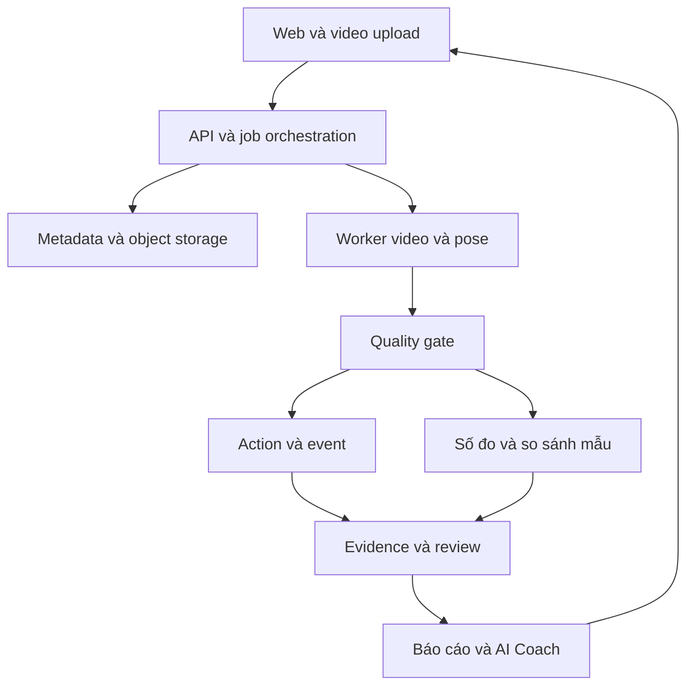

# WUSHU TAOLU — TAIJIQUAN AI MASTER IMPLEMENTATION PLAN

**Phiên bản:** 2.0 · **Ngày:** 13/11/2026  
**Phạm vi:** Hệ thống phân tích kỹ thuật, hỗ trợ huấn luyện và đánh giá Thái cực quyền; mở rộng Taolu theo giai đoạn.  
**Cơ sở:** Khung 18 AI Engine do người dùng cung cấp; sửa kế hoạch v1 từ Trường quyền sang Thái cực quyền theo yêu cầu.

**Thay đổi v2:** Thái cực quyền tay không là module đầu tiên; bài 24 thức là mặc định đề xuất cần HLV xác nhận. Ưu tiên tư thế, chuyển bước, phối hợp, độ liên tục và so sánh mẫu. TaiChi-AQA trở thành nguồn chuyên môn ưu tiên xin truy cập; dữ liệu tự quay là đường triển khai chủ động. XSQ/Long Fist chỉ còn tham khảo ngoài miền. Không dùng nhảy–tiếp đất làm nhiệm vụ lõi MVP. Giữ nền tảng đa nội dung để thêm Trường quyền sau.

> Đây là kế hoạch xây dựng, không phải báo cáo một hệ thống đã hoạt động. Repo đã được khảo sát qua trang dự án, README và một phần mã nguồn; chưa cài chạy hoặc tải kiểm kê toàn bộ dataset. Các cấu hình, số lượng dữ liệu, lịch và ngưỡng nghiệm thu bên dưới là đề xuất lập kế hoạch, phải hiệu chỉnh sau thử nghiệm. Không có checkpoint nào trong danh sách được xác nhận là có thể chấm toàn bộ Thái cực quyền ngay lập tức.

## Mục lục

1. Mục tiêu, phạm vi và quyết định nền tảng
2. Ánh xạ 18 AI Engine
3. Repo: lựa chọn, tái sử dụng và điều kiện tích hợp
4. Dataset: nguồn, cách tiếp cận và phần còn thiếu
5. Thiết kế bộ dữ liệu Thái cực quyền
6. Kiến trúc và hợp đồng dữ liệu
7. Thiết kế phân tích kỹ thuật, chất lượng và quy tắc
8. Sản phẩm, API và giao diện
9. Các phase triển khai chi tiết
10. Đánh giá, nghiệm thu và quản trị model
11. Hạ tầng, dung lượng và vận hành
12. Nhân sự, lịch, rủi ro và checklist
13. Nguồn tham khảo

## 1. Mục tiêu, phạm vi và quyết định nền tảng

### 1.1 Sản phẩm đích

Người dùng tải video Thái cực quyền, chọn VĐV, theo dõi kết quả xử lý, xem skeleton và timeline động tác, kiểm tra số đo kỹ thuật tại các thời điểm quan trọng, so sánh với mẫu cùng động tác, nhận clip bằng chứng và báo cáo. HLV có thể sửa phân đoạn, xác nhận hoặc bác bỏ nhận xét của AI. Lịch sử giúp theo dõi tiến bộ trong điều kiện đo có thể so sánh.

Đối tượng sử dụng: VĐV, HLV, người gán nhãn và người đánh giá chuyên môn. Trọng tài là nhóm mở rộng sau khi module bằng chứng và quy tắc đã được kiểm chứng.

### 1.2 Các mức sản phẩm

| Mức | Sản phẩm bàn giao | Không tuyên bố ở mức này |
|---|---|---|
| POC kỹ thuật | Video → skeleton → số đo → báo cáo; thử baseline so sánh mẫu trên Taiji24-Local | Model đã hiểu toàn bộ Thái cực quyền |
| MVP huấn luyện | Một nhóm động tác, timeline, lỗi có bằng chứng, so sánh mẫu, HLV duyệt | Điểm thi đấu chính thức; phân tích 3D chính xác từ mọi góc quay |
| V1 đánh giá | Cấu trúc bài cố định, đánh giá chất lượng có kiểm chứng, hỗ trợ trọng tài | Thay thế trọng tài; suy diễn lực/khả năng chấn thương từ video |
| V2 nâng cao | Nhiều camera, phối hợp 3D, hồ sơ chuyển động và phân tích dài hạn | Digital Twin sinh cơ học hoàn chỉnh nếu chưa có dữ liệu hiệu chuẩn |
| Mở rộng | Binh khí và các nội dung Taolu khác | Tự động dùng nguyên bộ nhãn/luật Thái cực quyền cho nội dung khác |

### 1.3 Giả định khởi đầu

- Phân tích offline video tải lên; chưa cần camera trực tiếp.
- Một VĐV chính trong vùng quay, toàn thân thấy rõ, camera ưu tiên cố định.
- Mặc định đề xuất bài Thái cực quyền 24 thức; HLV xác nhận phiên bản, cách chia thức và tên gọi trong Phase 00. POC chọn 6–8 nhóm động tác tiêu biểu trong bài, rồi mở dần tới toàn bài. Không tự chuyển sang Bafa Wubu, bài 42 thức hoặc phong cách khác chỉ vì có dữ liệu sẵn.
- GPU NVIDIA là hướng hạ tầng dự kiến; model, VRAM và máy hiện có cần được kiểm kê trước khi mua hoặc chốt cấu hình.
- Video đầu vào có quyền sử dụng và sự đồng ý phù hợp. Mặc định lưu riêng tư, không tự đưa video người dùng vào huấn luyện.
- Không xây đủ 18 microservice. Dùng backend dạng module và worker GPU, chia dịch vụ chỉ khi cần cô lập dependency hoặc tải.

### 1.4 Quyết định quan trọng

1. Pose đáng tin cậy trước, diễn giải chuyên môn sau.
2. Tách nhận diện động tác, phát hiện mốc, đo kỹ thuật, phát hiện lỗi và dự đoán điểm thành các nhiệm vụ khác nhau.
3. So sánh mẫu chỉ giữa động tác tương ứng; không ép hai bài khác nhau vào DTW.
4. Dữ liệu từ repo nghiên cứu là nguồn thử nghiệm, không thay thế dữ liệu kiểm thử thực tế của sản phẩm.
5. Cho phép trạng thái `insufficient_evidence` và `unknown_action`; không buộc mọi đoạn phải có nhận xét hoặc điểm.
6. Điểm tương đồng, điểm chất lượng học được và điểm theo luật là ba đại lượng riêng, có nhãn riêng trên UI.
7. Các module dự báo, nguy cơ chấn thương và Digital Twin chỉ mở khi dữ liệu đủ; kế hoạch có gate dừng, không cam kết bật tất cả.

## 2. Ánh xạ 18 AI Engine

Ký hiệu: **Core** bắt buộc cho MVP; **Next** sau MVP; **R&D** nghiên cứu có điều kiện; **Extension** khi đổi nội dung.

| # | Engine gốc | Vai trò cho Thái cực quyền | Đầu ra | Ưu tiên / phase |
|---|---|---|---|---|
| 1 | Video Acquisition | Upload, kiểm tra media, metadata, proxy video | Video chuẩn hóa + timestamp map | Core / 02 |
| 2 | Multi-Camera Synchronization | Đồng bộ timestamp và hiệu chuẩn các camera | Sync manifest + camera calibration | Next / 12 |
| 3 | Object Detection | Xác định người mục tiêu | Bounding box + confidence | Core / 03 |
| 4 | Multi-Object Tracking | Giữ ID người được chọn, xử lý người nền | Track ID + cờ mất theo dõi | Core đơn giản / 03 |
| 5 | Pose Estimation | Keypoint 2D, sau đó 3D | Pose sequence + quality mask | Core / 03; Next / 12 |
| 6 | Action Recognition | Nhận diện nhóm động tác theo ontology | Label + khoảng thời gian + confidence | Core giới hạn / 06 |
| 7 | Ball / Equipment Tracking | Không cần với tay không; theo dõi binh khí khi mở rộng | Quỹ đạo binh khí | Extension / 14 |
| 8 | Precision / Stability | Ổn định khi chuyển bước, chuyển tư thế và đứng một chân | Chỉ số ổn định có điều kiện quan sát | Core / 05, 07 |
| 9 | Tactical Analysis | Đổi thành phân tích cấu trúc bài: trình tự, nhịp, chuyển tiếp, không gian | Routine graph + timing | Next / 10 |
| 10 | Biomechanics | Góc, biên độ, vận tốc hình học và phối hợp | Feature series + đơn vị + độ tin cậy | Core 2D / 05; Next 3D / 12 |
| 11 | Performance Prediction | Theo dõi và dự báo tiến bộ cá nhân | Trend + khoảng bất định | R&D / 13 |
| 12 | Injury Risk Assessment | Chỉ nghiên cứu tín hiệu vận động cần chuyên gia xem lại | Review flag; không chẩn đoán | R&D / 13 |
| 13 | Event Detection | Bắt đầu chuyển bước, đặt chân quan sát được, đổi hướng tay, mốc tư thế | Event timestamp + uncertainty | Core giới hạn / 07 |
| 14 | AI Referee Assistance | Ghép tiêu chí, lỗi nghi ngờ, bằng chứng và người duyệt | Reviewable finding; điểm chỉ sau gate | Next / 10 |
| 15 | Highlight Generation | Cắt clip cần chỉnh, chuyển tiếp và tiến bộ | Clip + thumbnail + provenance | Core / 08 |
| 16 | Athlete Digital Twin | Hồ sơ dọc và avatar 3D trước; mô phỏng cá nhân hóa sau | Profile + motion history | R&D / 13 |
| 17 | Knowledge Graph & Analytics | Động tác → tiêu chí → lỗi → bài tập → nguồn | Kho kiến thức có phiên bản | Core dữ liệu quan hệ / 08 |
| 18 | AI Coach / Agent | Giải thích dữ liệu đã đo và được duyệt | Nhận xét kèm evidence ID | Core giới hạn / 08 |

Không đồng nhất proxy trọng tâm từ vài keypoint với trọng tâm cơ thể đo chính xác; không đồng nhất avatar 3D với Digital Twin dự báo cơ sinh học.

## 3. Repo: lựa chọn, tái sử dụng và điều kiện tích hợp

### 3.1 Danh mục quyết định

| ID | Repo | Công dụng đã thấy | Quyết định cho Thái cực quyền |
|---|---|---|---|
| R01 | [Sports2D](https://github.com/davidpagnon/Sports2D) | Video → keypoint, góc và quỹ đạo 2D | Ưu tiên POC pose/measurement |
| R02 | [MMPose](https://github.com/open-mmlab/mmpose) | Framework pose và model zoo | Đối chứng/fine-tune khi cần |
| R03 | [MMAction2](https://github.com/open-mmlab/mmaction2) | STGCN++, PoseC3D và train/test/inference | Nhận diện động tác sau khi có nhãn; không có scorer Taiji được xác minh |
| R04 | [Intelligent Scoring Long Fist](https://github.com/pyqpyqpyqpyq789/Intelligent-Scoring-the-Long-Fist-Routine-Movements) | XSQ feature/score và regression | Tham khảo ngoài miền; không là model Thái cực quyền |
| R05 | [Wushu Action Recognition](https://github.com/pyqpyqpyqpyq789/Action-Recognition-and-Temporal-Localization-for-Wushu-Routine-Competition) | Nghiên cứu Long Fist Routine v3 | Để nhánh mở rộng Trường quyền |
| R06 | [QAQA](https://github.com/waHAHJIAHAO/QAQA) | Skeleton, DTW, dữ liệu khí công | Ứng viên so sánh mẫu; phải thử trên Taiji24-Local |
| R07 | [GVHMR](https://github.com/zju3dv/GVHMR) | Tái dựng chuyển động người từ video | R&D 3D sau MVP |
| R08 | [KungFuAthleteBot](https://github.com/NPCLEI/KungFuAthleteBot) | Chuyển động võ thuật người/robot | Optional dữ liệu người; cần lọc đúng nội dung |
| R09 | [FineDiving](https://github.com/xujinglin/FineDiving) | AQA theo bước | Chỉ tham khảo nghiên cứu, không bắt buộc |
| R10 | [TaiChi-AQA](https://github.com/mlxger/TaiChi-AQA) | Trang yêu cầu dataset 24-form và đơn đăng ký | Ưu tiên kiểm tra quyền truy cập; không phải ứng dụng/model chạy sẵn |

**Stack khởi đầu:** Sports2D + adapter đo kỹ thuật + constrained DTW + reference do HLV duyệt + Taiji24-Local. MMAction2 thêm khi dữ liệu nhận diện đủ; quality regression chỉ thêm khi có nhãn đáng tin. Việc chọn một bài cố định giúp thu hẹp phạm vi nhưng không bảo đảm segmentation dễ hơn vì động tác nối liên tục.

### 3.2 Cách dùng R01–R03

**Sports2D [S1]:** Tái sử dụng xử lý video, pose và số đo 2D; tự xây adapter sang schema chung, quản lý job, tracking mục tiêu, quality gate và UI. Tài liệu cảnh báo chất lượng góc phụ thuộc pose và mặt phẳng quay; chỉ áp dụng số đo vào các đoạn quan sát phù hợp. Không lấy góc chiếu 2D làm góc khớp 3D thật.

**MMPose [S2]:** Thử một cấu hình RTMPose hoặc cấu hình phù hợp trong model zoo tại thời điểm cài. Lưu chính xác config, checkpoint và thứ tự khớp. Đây là lựa chọn thử nghiệm, chưa khẳng định hơn Sports2D trên Thái cực quyền. Chỉ chuyển nếu benchmark cho thấy cải thiện đáng kể hoặc cần fine-tune với dữ liệu riêng.

**MMAction2 [S3]:** Thử STGCN++ làm baseline skeleton và PoseC3D làm đối chứng. Dữ liệu phải chuyển đúng joint layout/heatmap yêu cầu; pretrained trên miền khác không tạo sẵn nhãn Thái cực quyền. Với MVP, phân loại clip trước; nhận diện liên tục dùng cửa sổ thời gian và smoothing, sau đó mới nâng cấp temporal segmentation/localization. Không coi clip classification là đã giải quyết segmentation.

### 3.3 Cách dùng R04–R06

**R04 [S4]:** Repo Long Fist có `XingShenQuan.npy`, `QualityScore.npy` và mã ML. Chỉ học cách tổ chức đặc trưng/căn chỉnh/đánh giá; không dùng score hay nhãn XSQ làm nhãn Thái cực quyền. Nếu tái lập nghiên cứu, chạy trong benchmark ngoài miền riêng và không đưa kết quả đó vào báo cáo accuracy của sản phẩm Taiji.

**R05 [S5]:** Repo nghiên cứu bài Trường quyền quốc tế v3, giữ cho extension. Không dành sprint đầu để hoàn thiện repo này.

**R06 [S6]:** Thử thuật toán căn chỉnh skeleton trên hai clip Thái cực quyền cùng động tác và góc phù hợp. Dữ liệu gốc là khí công; cần đổi template và kiểm chứng. Giới hạn độ co giãn DTW, giữ thời gian thực để đánh giá nhịp. Độ chậm, mềm hay liên tục không được mặc định bằng một ngưỡng vận tốc chung. Không suy ra chất lượng nội lực từ khoảng cách skeleton.

### 3.4 Cách dùng R07–R10

**R07 [S7]:** Chạy checkpoint/demo 3D trên chuyển bước, quay thân và đứng một chân; benchmark độ ổn định của bàn chân và root. Không coi 3D model suy ra là ground truth; chuyển động chậm vẫn có thể có drift hoặc smoothing che mất chi tiết.

**R08 [S8]:** Chỉ cân nhắc phần motion người GVHMR/SMPL nếu có các mẫu Taiji đúng nội dung và quyền dùng phù hợp. Không dùng `qpos` robot như skeleton người. Không đưa RL robot vào MVP.

**R09 [S9]:** FineDiving ngoài miền, không là dependency.

**R10 [S12]:** README mô tả dataset Thái cực quyền 24 thức và yêu cầu điền form gửi tác giả; listing kiểm tra có README và form. Chưa thấy bằng chứng là repo cung cấp code train/inference và checkpoint đầy đủ. Việc có tên bài 24 thức chưa xác nhận khớp phong cách, phiên bản, taxonomy và rubric của sản phẩm. Khi được cấp, kiểm kê video, score, timestamps, athlete IDs, camera và license trước khi tích hợp. Plan không tự gửi email/đơn thay người dùng.

### 3.5 Kiểm tra bắt buộc trước khi chọn repo

- [ ] Ghi URL, commit SHA, ngày lấy, license code, license weights và điều kiện dữ liệu riêng.
- [ ] Tạo môi trường/container tách biệt; ghi Python, CUDA, driver, PyTorch, dependency lock đã thực sự chạy được.
- [ ] Chạy example tác giả, sau đó chạy video của dự án.
- [ ] Ghi input/output, tensor shape, joint order, units, FPS và coordinate system.
- [ ] Ghi peak VRAM, RAM, thời gian end-to-end, lỗi và checkpoint checksum.
- [ ] Phân loại: adopt / adapt / research-only / blocked / reject; giải thích lựa chọn.
- [ ] Nếu không thấy license hoặc quyền dùng dữ liệu, đánh dấu unresolved; không suy ra quyền thương mại từ trạng thái repo public.

Không ghép tất cả requirements vào một virtualenv. Adapter xuất file chuẩn cho phép thay model mà không phải sửa toàn bộ sản phẩm.

## 4. Dataset: nguồn, cách tiếp cận và phần còn thiếu

### 4.1 Danh mục có thể dùng

Giữ ID nguồn cũ để truy vết, nhưng thay đổi thứ tự ưu tiên.

| ID | Dataset / nguồn | Dạng và truy cập | Quyết định cho Taiji MVP |
|---|---|---|---|
| D08 | **Taiji24-Local v0/v1** | Tự quay, HLV duyệt, metadata theo mục 5 | Nguồn chủ động bắt buộc; train/validation/pilot trong miền |
| D06 | **TaiChi-AQA** [S12] | Dataset 24-form, form xin dữ liệu trong R10 | Ưu tiên xin truy cập; chưa tải, chưa kiểm kê; không chờ để bắt đầu D08 |
| D09 | **TaiForm / Bafa Wubu sample** [S15] | Zenodo, mẫu video 6 góc và annotation | Khảo sát schema/multiview; không đồng nhất với bài 24 thức |
| D05 | QAQA Qigong [S6] | Theo thủ tục tác giả và link Drive | Benchmark phương pháp DTW, ngoài miền Taiji24 |
| D02 | KungfuAthlete [S8] | Download Dataset trong repo gốc | Optional motion 3D; lọc mẫu Taiji, kiểm tra quyền nghiên cứu |
| D01 | XSQ / XingShenQuan [S4] | Feature/score `.npy` của Long Fist | Tham khảo scorer ngoài miền; không train nhãn Taiji |
| D03 | Wushu 324C+1D [S10] | XLSX ba VĐV | Không cần cho MVP Thái cực quyền 24 thức |
| D04 | FineGym [S11] | Annotation/video theo tác giả | Optional transfer learning; không có nhãn Taiji24 |
| D07 | FineDiving [S9] | Yêu cầu theo thỏa thuận tác giả | R&D, không đưa vào đường găng |

**D06:** Có quy trình yêu cầu truy cập, chưa có dữ liệu sẵn trong môi trường. Không khẳng định số video, score fields, model hoặc license nếu chưa được cung cấp.

**D09 [S15]:** Record `19656906` mô tả mẫu tạm cho phản biện gồm 5 người, video RGB đồng bộ 6 góc, annotation và scoring references; trang hiển thị khoảng 17.4 GB. Tác giả nói rõ đây không phải bộ đầy đủ hoặc bản phát hành công khai cuối cùng; bộ đầy đủ truy cập có kiểm soát. Chỉ dùng sau khi làm rõ phạm vi sử dụng. Bafa Wubu là routine riêng, không gộp nhãn trực tiếp vào 24 thức.

**D02:** Số lượng trong README có chỗ không thống nhất; kiểm kê bản tải và số mẫu Taiji thực tế. Dữ liệu robot, pseudo-3D và video người phải phân loại riêng; không lấy tổng mẫu võ thuật làm số mẫu Thái cực quyền.

### 4.2 Nguồn không có thì làm gì?

| Tình huống | Hành động |
|---|---|
| Chưa được cấp TaiChi-AQA | Tiếp tục D08, baseline so sánh mẫu; chưa bật supervised score |
| Chỉ nhận được score toàn bài | Không tự coi là nhãn lỗi/frame; bổ sung annotation riêng |
| Chỉ có Bafa Wubu | Benchmark riêng; muốn đổi sản phẩm sang bài này phải chốt scope riêng |
| Link không tải được | Ghi blocked, không tự lấy mirror không rõ quyền |
| Không có athlete ID | Không tuyên bố cross-athlete; hỏi metadata hoặc giới hạn benchmark |
| Chỉ có mẫu biểu diễn chuẩn | Dùng reference đã duyệt; bổ sung người tập và chất lượng khác nhau |
| Chưa có boundary động tác | Gán đoạn bằng HLV, ghi khoảng bất định; dùng manual-assisted MVP |
| Chỉ có pseudo-3D | Lưu provenance; không làm ground truth kiểm chứng chính model |

Đầu tư dữ liệu theo thứ tự: D08 → kiểm tra quyền D06 → baseline R06 → D09 cho nghiên cứu đa góc. Các nguồn ngoài miền chỉ được thêm khi có giả thuyết cải thiện và phép thử đối chứng.

### 4.3 Dataset registry

Mỗi nguồn phải có `dataset_id`, version, source URL, ngày tải, checksum, owner/contact, license/terms, research/commercial scope, video count, clip count, athlete count (nếu biết), labels, joint layout, fps, coordinate convention, known issues và split policy. Quyền code không thay thế quyền video, người biểu diễn hoặc trọng số.

Các nguồn bổ trợ chỉ được tải khi có mục đích rõ: tái lập baseline, pretraining, benchmark hoặc reference. Không tăng khối lượng dữ liệu chỉ để tạo cảm giác đầy đủ.

## 5. Thiết kế bộ dữ liệu Thái cực quyền

### 5.1 Ontology v0 cần HLV duyệt

Phạm vi mặc định đề xuất: bài Thái cực quyền 24 thức, một phiên bản mẫu do HLV xác nhận. Không coi mọi phong cách Thái cực quyền dùng chung trình tự và tiêu chí. Phase 00 chọn 6–8 nhóm đại diện để POC; danh sách tên/thứ tự 24 thức được nhập từ tài liệu và reference đã duyệt, không tự tạo taxonomy thi đấu.

Mỗi động tác lưu `movement_family`, `side`, `occurrence_index`, `routine_position`, `start/end`, `boundary_uncertainty`, `style_version`. Các lần lặp trái/phải có thể giống hình nhưng khác vị trí trong bài; model phải phân biệt hình thức động tác với số thứ tự trong bài.

| Lớp | Ví dụ mã nội bộ minh họa | Quy tắc |
|---|---|---|
| Discipline | `taijiquan` | Module đầu tiên; `changquan` là extension |
| Routine | `taiji24_coach_v1` | Phiên bản do HLV duyệt, không là mã chính thức |
| Action family | `movement_01`, `movement_02` | Tên thực và phạm vi frame được chốt trong ontology |
| Instance | `movement_01_left_occ02` | Bên thực hiện, lần lặp, vị trí trong bài |
| Phase | `entry`, `continuation`, `transition` | Không buộc người tập dừng ở ranh giới thức |
| Event | `step_start`, `foot_placement_visible`, `hand_direction_change` | Mốc hình học nhìn thấy; không là lực/chuyển trọng lượng đã đo |
| Quality | `acceptable`, `review`, `unobservable` | Thiếu nhãn lỗi không đồng nghĩa đúng |
| Error | `taiji_coach_error_001` | Rubric huấn luyện riêng, không giả mã lỗi luật |

Boundary được gán theo quy ước thao tác (ví dụ bắt đầu chuyển động dẫn sang thức tiếp), có khoảng chấp nhận được. Với đoạn liên tục, dùng soft/uncertain boundary và event anchors; không đòi mọi HLV chọn đúng một frame tuyệt đối. Không dùng mirror augmentation nếu chưa đổi side labels và kiểm tra ý nghĩa trình tự.

### 5.2 Quy mô lập kế hoạch

Các mức dưới đây là ngân sách thu thập ban đầu, không phải bảo đảm đủ để đạt accuracy.

| Mốc | Mục tiêu đề xuất | Mục đích |
|---|---|---|
| POC pose | 20–30 video ngắn, khoảng 5–10 người nếu khả thi | Kiểm tra tay chồng nhau, quay thân, chuyển bước, đứng một chân và tracking |
| Gold pose audit | 300–500 frame phân tầng từ tập POC | Gán keypoint nhìn thấy được để kiểm tra pose |
| Recognition seed | 6–8 nhóm động tác POC, khoảng 50–100 clip/nhóm; mở rộng nhãn toàn bài sau, nhiều người/buổi | Học baseline và vẽ learning curve |
| Quality seed | Khoảng 200–400 đoạn, ít nhất hai HLV đánh giá một phần chồng lặp | Kiểm tra độ thống nhất và khả năng phát hiện lỗi |
| Pilot | 20–30 bài hoàn chỉnh từ người/buổi chưa có trong train | Kiểm thử trải nghiệm và lỗi ngoài dự kiến |

Nếu chỉ có ít VĐV, thu nhỏ phạm vi và trình bày kết quả là feasibility. Không tăng số clip bằng cắt vụn cùng bài rồi coi là tăng số người độc lập.

### 5.3 Hướng dẫn quay

- Mặc định thử 1080p, 25/30 fps cho POC chuyển động chậm; dùng 50/60 fps khi cần nghiên cứu mốc chân/tay tinh hơn và kiểm tra lợi ích thực. Lưu FPS thật, không tăng FPS giả để tạo độ chính xác.
- Toàn thân và khoảng di chuyển nằm trong khung hình; tránh chân bị cắt hoặc mặt sàn khó thấy.
- Ánh sáng đủ, camera ổn định; tránh slow-motion, cut cảnh và replay trong tập chuẩn đầu tiên.
- Ghi vị trí/góc camera, độ cao, tiêu cự nếu biết, hướng biểu diễn, ánh sáng, quần áo, session và người thực hiện.
- Quay góc trước và bên trong các buổi thu thập có chủ đích; chưa gọi là đa góc đồng bộ nếu không có timestamp đồng bộ.
- Thu thập chất lượng tự nhiên ở nhiều trình độ. Không yêu cầu người tập cố thực hiện tư thế hoặc mất thăng bằng nguy hiểm để tạo nhãn.

### 5.4 Quy trình gán nhãn

1. Viết handbook với clip đúng, clip dễ nhầm, định nghĩa boundary và trường hợp không quan sát được.
2. Hai người gán thử cùng 30–50 clip; HLV giải quyết bất đồng.
3. Sửa ontology trước khi mở rộng annotation.
4. Gán action segments và event trước; quality/error chỉ trên đoạn và góc có đủ bằng chứng.
5. Tách người gán nhãn tham chiếu khỏi dự đoán AI trong gold test để giảm thiên lệch.
6. Double-label tối thiểu khoảng 20% tập seed như mục tiêu khởi đầu; tăng nếu bất đồng cao.
7. Ghi lỗi, mức độ theo rubric nội bộ, vùng cơ thể, lý do, timestamp, khả năng quan sát và người duyệt.
8. Không dùng pseudo-label chưa duyệt làm ground truth kiểm thử.

### 5.5 Split chống rò rỉ

- Chia nhóm trước khi tạo clip/augmentation: athlete → session → source video; toàn bộ góc quay cùng lần thực hiện nằm cùng split.
- Đề xuất train/validation/test 70/15/15 theo nhóm nếu số người đủ; tập nhỏ dùng grouped cross-validation và giữ pilot ngoài tập.
- Nếu người/video liên thông giữa nhiều nguồn, gom connected groups để không lọt qua split.
- Bài mẫu chọn từ train/reference pool hợp lệ, không lấy nhãn hoặc đoạn từ test làm template tối ưu.
- Scaler, feature selection, threshold, ensemble weights và calibration chỉ fit trên train/validation phù hợp.
- Khóa test manifest và hash. Mở test khi có release candidate; lỗi test được ghi lại, không tune lặp vô hạn trên cùng test.
- Công bố per-athlete, per-action, per-camera, confidence interval theo nhóm; không chỉ báo accuracy gộp.

## 6. Kiến trúc và hợp đồng dữ liệu

### 6.1 Kiến trúc đề xuất

Backend Python dạng module, API quản lý job, worker GPU tách process/container. Frontend web có video player và timeline. PostgreSQL lưu metadata/annotation; object storage lưu video, pose và report. Hàng đợi xử lý nền; một GPU xử lý tuần tự ban đầu. Đây là lựa chọn thiết kế, phiên bản thư viện được chốt sau Phase 01.



Quality gate có thể dừng một metric nhưng vẫn cho xem video. Engine hỏng không được làm mất upload hoặc annotation đã có.

### 6.2 Quy tắc xử lý thời gian và tọa độ

- Timestamp gốc dùng presentation timestamp; lưu map khi re-encode hoặc resample. Không suy ra mọi timestamp bằng frame/FPS với video variable-frame-rate.
- Lưu pixel pose gốc và tọa độ chuẩn hóa; ghi width, height, crop, resize, rotation, mirror transform.
- 2D normalized không có đơn vị mét. Vận tốc theo pixel/giây hoặc body-length/giây phải ghi rõ.
- Dữ liệu 3D phải chỉ rõ camera/world coordinates, trục, handedness, unit, scale source và calibration.
- Skeleton chuẩn có version và mapping; khớp không có không được tự điền 0 như một quan sát thật.
- Lưu raw, filtered và mask riêng; nội suy gap ngắn có cờ, gap dài đánh dấu missing. Không smoothing quá mức làm mất điểm đổi hướng tay, chuyển bước hoặc che giấu jitter của model.
- Model output, human correction và final reviewed record lưu tách biệt, không ghi đè mất provenance.

### 6.3 Entity chính

| Entity | Trường bắt buộc hoặc quan trọng |
|---|---|
| Athlete | id nội bộ, tên hiển thị tùy chọn, consent, tổ chức |
| Session | athlete_id, thời gian, bài, điều kiện quay, fatigue tự báo nếu có |
| Video | object_key, sha256, duration, dimensions, fps/timebase, source_id, camera_id |
| AnalysisJob | discipline_id, routine_id, module_version, state, stage, progress, pipeline_version, input_hash, model/config hashes, error |
| PoseArtifact | skeleton_version, coordinates, units, timestamps, raw/filtered URIs, visibility/confidence masks |
| ActionSegment | action_id, family, side, occurrence_index, routine_position, start/end, boundary_uncertainty, confidence, source, reviewer |
| Event | type, timestamp/range, uncertainty, evidence_frames |
| Metric | name, value/series, unit, valid_range, observation_quality, method_version |
| Finding | criterion_id, evidence_ids, status, severity nếu xác định được, review history |
| Reference | action/routine, athlete/session, accepted_view, reviewer, version |
| Ruleset | namespace, edition, event applicability, source locator, approval |
| Report | analysis version, findings version, language, immutable artifact URI |

### 6.4 Ví dụ finding — dữ liệu minh họa, không phải luật

```json
{
  "finding_id": "finding_example_001",
  "analysis_id": "analysis_example",
  "criterion_id": "coach_stability_v1",
  "ruleset_kind": "training_rubric",
  "action_segment_id": "segment_example",
  "time_range_s": [12.4, 13.1],
  "status": "needs_review",
  "observation_quality": "partial",
  "evidence_ids": ["metric_example", "clip_example"],
  "official_deduction": null,
  "reviewer_decision": null
}
```

### 6.5 Adapter contract

Mỗi adapter nhận manifest input, config và output directory; trả manifest output có schema version, artifacts, metrics runtime, warnings. Hợp đồng logic:

- Pose adapter: video + selected target → pose raw, tracks, timestamp map.
- Feature adapter: pose + masks → feature series + units + valid masks.
- Action adapter: pose/features/video tùy model → candidates và confidence.
- Alignment adapter: hai đoạn tương ứng + masks → alignment path, distance, rejected reasons.
- Quality adapter: features + action + rubric → findings, không tự thêm luật.
- Report adapter: reviewed/unreviewed findings → report có trạng thái phân biệt.

Mỗi hợp đồng có một fixture video/pose nhỏ để kiểm tra tương thích. Cache key bao gồm input hash, config, model, skeleton và preprocessing version; thay bất kỳ yếu tố nào phải tránh dùng cache cũ.

### 6.6 Module nội dung và routing

Nền tảng gồm shared video/pose/storage/UI và các gói phân tích theo nội dung. Mỗi gói có `discipline_id`, `routine_id`, ontology, reference library, feature config, recognition checkpoint, rubric/ruleset, supported_views và model version. `taijiquan/taiji24_coach_v1` là gói mặc định đề xuất; Trường quyền chưa được bật chuyên môn.

Upload phải chọn nội dung và bài; chọn “khác/chưa xác định” vẫn cho xem video và pose cơ bản nếu phù hợp. Unsupported routine không tự đi vào scorer Taiji24. Nhận diện nội dung tự động chỉ là gợi ý để người dùng xác nhận. Cache, DB, report và model registry đều chứa module version. Thêm Trường quyền sau này phải có dataset và rubric riêng, không đổi tên nhãn Taiji để dùng lại model.

## 7. Thiết kế phân tích kỹ thuật, chất lượng và quy tắc

### 7.1 Feature set theo khả năng quan sát

| Nhóm | Feature đề xuất | Giới hạn bắt buộc |
|---|---|---|
| Tư thế chân | Góc gối/hông chiếu 2D, khoảng chân chuẩn hóa, độ cao hông | View-dependent; HLV quyết định tiêu chí theo thức và người tập |
| Trục thân | Độ nghiêng thân hình chiếu, biến thiên vai–hông | Không suy góc xoay 3D thật từ 2D |
| Quỹ đạo tay | Đường đi cổ tay, độ cao, biên độ, mốc đổi hướng | Tay chồng/che phải mask; skeleton cơ thể không đánh giá được chi tiết ngón/bàn tay |
| Phối hợp | Độ lệch thời gian giữa mốc tay, thân, bước trong cùng thức | So với reference/rubric, không mặc định đồng thời hoàn toàn mới đúng |
| Liên tục | Vận tốc, pause, thay đổi vận tốc; độ nhạy theo smoothing | Chậm không mặc định tốt; đạo hàm bậc cao dễ nhiễu và cần ablation |
| Ổn định | Biến thiên trục thân và chân trong đoạn phù hợp; điều chỉnh bước | Phân biệt chuyển động có chủ đích với dao động lỗi |
| Chuyển bước | Thời điểm nhấc chân/đặt chân nhìn thấy, chuyển vị hông tương đối | Không suy tỷ lệ trọng lượng hai chân, lực nền hay CoP từ RGB đơn góc |
| Trình tự | Thức, bên, lần lặp, transition và duration | Không ép mọi bài vào 24 thức; duration khác mẫu không mặc định lỗi |

Không đánh giá “khí”, nội lực, hô hấp, mức thư giãn cơ hoặc phân bố lực dựa trên skeleton. Muốn nghiên cứu lực/trọng lượng cần protocol và cảm biến tham chiếu riêng. Không mặc định độ duỗi tối đa là mục tiêu kỹ thuật Thái cực quyền.

### 7.2 Tầng phân tích chất lượng

1. **Measurement:** số đo và valid mask.
2. **Reference comparison:** chênh lệch với mẫu cùng động tác và view hợp lệ; báo khoảng biến thiên, không yêu cầu mọi người có cùng tỷ lệ cơ thể.
3. **Coach rubric:** điều kiện có thể quan sát, tiêu chí được HLV duyệt; tạo finding.
4. **Learned quality:** baseline regression/ranking có nhãn và đánh giá độc lập.
5. **Rule assistance:** ánh xạ finding với phiên bản luật được xác nhận; cho trọng tài duyệt.

Mỗi tầng vẫn dùng được độc lập. Chưa đủ dữ liệu cho regression thì báo số đo và nhận xét HLV; không tạo điểm 0–100 tùy ý để lấp khoảng trống.

### 7.3 Baseline chất lượng Thái cực quyền

- Bắt đầu với reference comparison trên D08; score tương đồng chỉ là metric nghiên cứu, không là điểm thi đấu.
- Nếu được cấp D06, kiểm tra version/routine/scale/annotation, tái lập phương pháp tác giả chỉ khi có đủ code và config; không tuyên bố R10 cung cấp sẵn training pipeline.
- Nếu D06 chỉ có điểm toàn bài, không train lỗi từng đoạn bằng cách gán cùng điểm cho tất cả thức mà không kiểm chứng.
- D09 Bafa Wubu, D05 Qigong và D01 XSQ là benchmark ngoài routine/ngoài miền riêng; không gộp điểm hoặc label vào Taiji24.
- So sánh baseline median, feature regression và template distance; split theo người/buổi.
- Fit scaler, alignment template, threshold và ensemble weights trên train/validation; outer test chưa đụng tới.
- Nếu chưa có nhãn quality đủ tin cậy, phát hành metrics + HLV review, hoãn learned score.
- Đánh giá ranh giới không chắc chắn và việc dùng trình tự bài: cần báo cả recognition không có prior và có prior để không che model yếu bằng vị trí trong bài.

### 7.4 Ruleset và hỗ trợ trọng tài

Nguồn khởi đầu tổng quát: tài liệu Wushu Taolu 2024 [S13], chỉ đọc phần thực sự áp dụng sau khi xác nhận với chuyên gia. Không dùng tài liệu Trường quyền/Côn thuật làm rubric Thái cực quyền. Bài 24 thức dùng cho huấn luyện không tự động đồng nghĩa nội dung thi đấu theo một ruleset nhất định. Phase 10 phải xác nhận bài, phong cách/phiên bản, loại giải, nhóm tuổi và hiệu lực luật. Tài liệu scoring trong D09 chỉ được xem xét cho Bafa Wubu sau xác minh, không áp sang bài 24 thức.

Tách `training_rubric` và `competition_ruleset`. Mỗi criterion có nguồn, trang/mục, điều kiện áp dụng, bằng chứng cần, mức trừ nếu có, điều kiện loại trừ, người duyệt và ngày duyệt. Chưa xác minh thì không điền điểm trừ. Tránh đếm lặp cùng lỗi qua nhiều frame; có temporal grouping, precedence và rule conflict tests.

Nhận xét về thần thái, sức mạnh biểu diễn hoặc tổng thể không được suy từ một góc khớp. Các tiêu chí chưa đo được để người có chuyên môn đánh giá.

### 7.5 AI Coach

Đầu vào chỉ gồm metric/finding được phép, trạng thái review, đoạn video và tri thức có nguồn. Đầu ra gồm quan sát, bằng chứng, gợi ý đã duyệt, mức chắc chắn và giới hạn. Không để LLM tự tính góc, tự chấm điểm từ mô tả hoặc bịa mã luật. Có bản template không LLM để hệ thống vẫn hoạt động khi dịch vụ ngôn ngữ không sẵn sàng.

Knowledge graph ban đầu triển khai bằng bảng quan hệ `actions`, `criteria`, `errors`, `drills`, `references`, `relations`; chỉ dùng graph database khi query thực tế chứng minh cần. Mọi bài tập sửa lỗi phải có HLV duyệt trước khi xuất cho người tập.

## 8. Sản phẩm, API và giao diện

### 8.1 Màn hình

1. Dashboard: buổi tập, trạng thái job, báo cáo gần đây.
2. Upload: chọn Thái cực quyền → bài 24 thức/phiên bản được hỗ trợ; lựa chọn bài khác đi vào chế độ cơ bản, không chấm tự động. Khai báo góc, consent và xem cảnh báo chất lượng.
3. Chọn VĐV: bounding box/track, cho sửa khi model nhầm.
4. Analysis viewer: video, skeleton bật/tắt, playback chậm, timeline, event markers, metric tại timestamp.
5. Compare: hai clip, đồng bộ bằng alignment, cho chuyển giữa thời gian thực và thời gian căn chỉnh.
6. Review: finding, bằng chứng, chấp nhận/bác bỏ/chỉnh sửa/lý do chưa quan sát được.
7. Report: kết quả có trạng thái, clip bằng chứng, dữ liệu thiếu và giới hạn.
8. History: so sánh cùng động tác, rubric và điều kiện đo; ghi model version thay đổi.
9. Admin: ontology, reference, rubric, dataset/model registry, không sửa ngầm phiên bản cũ.

### 8.2 API đề xuất

| Method / path | Vai trò |
|---|---|
| POST `/videos/uploads` | Tạo phiên upload và metadata |
| POST `/videos/{id}/complete` | Xác nhận bytes, checksum và enqueue validation |
| POST `/analyses` | Tạo job theo video, target và pipeline |
| GET `/analyses/{id}` | Trạng thái, tiến độ, warnings |
| POST `/analyses/{id}/cancel` | Hủy an toàn giữa các stage |
| GET `/analyses/{id}/timeline` | Segments, events và revision |
| GET `/analyses/{id}/metrics` | Metric series theo thời gian |
| PATCH `/segments/{id}` | Sửa nhãn/boundary, giữ audit |
| POST `/findings/{id}/reviews` | Quyết định HLV, không ghi đè dự đoán gốc |
| POST `/comparisons` | So sánh hai đoạn/reference hợp lệ |
| POST `/reports` | Snapshot report cho analysis revision |
| GET `/athletes/{id}/progress` | Chỉ số qua các buổi có thể so sánh |

Job states: `uploaded → validating → queued → processing → awaiting_review → completed`; có `failed`, `cancelled`, `partial`. Retry theo stage, idempotency key, timeout và giới hạn tài nguyên. Report cũ là snapshot; review mới tạo revision mới.

### 8.3 Bảo vệ dữ liệu trong triển khai

Phân quyền theo tổ chức/người sở hữu; URL video có thời hạn; kiểm tra loại media bằng decode thực, giới hạn dung lượng/duration; xử lý video trong worker giới hạn tài nguyên. API không nhận URL tùy ý để backend truy cập nội bộ. Xóa theo chính sách phải bao gồm proxy, pose, clips và report liên quan; log không chứa video/token nhạy cảm. Upload không đồng nghĩa đồng ý train.

## 9. Các phase triển khai chi tiết

### Quy ước task

Mỗi task có trạng thái TODO / DOING / BLOCKED / REVIEW / DONE; người phụ trách; input; artifact bàn giao; bằng chứng chạy; dependency. Một task kỹ thuật nên nằm trong 0.5–2 ngày nếu có thể, tách tiếp khi lớn hơn. Thời gian phase là ước lượng với đội nhỏ, không là cam kết. Không chờ hết một phase mới ghi rủi ro.

### Phase 00 — Khóa phạm vi và tiêu chí (2–3 ngày)

**Phụ thuộc:** Không. **Chủ trì:** Product/Tech lead + HLV.

- [ ] P00.01 Xác nhận mặc định bài 24 thức với HLV; chọn 6–8 nhóm POC, định nghĩa variant và nhãn trái/phải/lần lặp; ghi rõ nội dung ngoài phạm vi.
- [ ] P00.02 Chọn người dùng chính và luồng upload–review–report.
- [ ] P00.03 Chốt điều kiện quay được hỗ trợ và trường hợp từ chối.
- [ ] P00.04 Lập ontology v0 và phân biệt action/phase/event/error.
- [ ] P00.05 Kiểm kê GPU, VRAM, RAM, OS, dung lượng và video thực có sẵn.
- [ ] P00.06 Chốt tiêu chí POC: skeleton, số đo có điều kiện, runtime và báo cáo lỗi.
- [ ] P00.07 Lập decision log, registry nguồn và mục chưa biết.

**Bàn giao:** `scope.md`, `ontology_v0.yaml`, `capture_protocol.md`, `acceptance_v0.md`, `hardware_inventory.md`.

**Gate G00:** HLV và kỹ thuật hiểu giống nhau về tập động tác và đầu ra. Nếu chưa có HLV, chỉ triển khai số đo và demo, chưa gắn nhãn đúng/sai chuyên môn.

### Phase 01A — Kiểm chứng repo pose và môi trường (3–5 ngày)

**Phụ thuộc:** P00. **Chủ trì:** ML engineer.

- [ ] P01A.01 Lấy R01 ở commit cố định, đọc license/code/weights và tạo môi trường riêng.
- [ ] P01A.02 Chạy example; lưu command, log, output checksum.
- [ ] P01A.03 Chạy 5–10 clip Thái cực quyền: tay chồng, quay thân, bước tới/lùi, đứng một chân, chuyển động chậm và che khuất.
- [ ] P01A.04 Ghi joint layout, thời gian, peak VRAM và khung bị lỗi.
- [ ] P01A.05 Thử R02 trên cùng clip nếu R01 có lỗi pose đáng kể; không so hai cấu hình trên hai tập khác nhau.
- [ ] P01A.06 Chọn pose baseline bằng evidence và tạo adapter tối thiểu.

**Bàn giao:** `pose_repo_audit.md`, `environment.lock`, `pose_smoke_test/`, `repo_registry.csv`.

**Gate G01A:** Một pipeline chạy lặp lại được trên máy mục tiêu, output có timestamp/pose schema rõ. Nếu tấn hoặc xoay liên tục lỗi, thu hẹp view/động tác hoặc lên kế hoạch fine-tune trước các chức năng đánh giá.

### Phase 01B — Dataset Thái cực quyền và baseline mẫu (3–5 ngày, xen kẽ 01A)

**Phụ thuộc:** P00. **Chủ trì:** ML/data engineer + HLV.

- [ ] P01B.01 Kiểm tra R10/D06, chuẩn bị thông tin yêu cầu dữ liệu để người dùng/tổ chức gửi khi quyết định; không coi đơn là quyền truy cập đã có.
- [ ] P01B.02 Lập D08 seed với reference được HLV duyệt, tối thiểu đủ để thử 2–3 nhóm động tác trước.
- [ ] P01B.03 Chạy baseline DTW trên pose cùng action; khảo sát R06 trong timebox, ghi dependency và license.
- [ ] P01B.04 Lập feature dictionary và benchmark reference comparison không leakage.
- [ ] P01B.05 Khi D06 được cấp, kiểm kê video, actor IDs, nhãn, score scale, views, license và tính khớp routine; nếu chưa có thì tiếp tục D08.
- [ ] P01B.06 Đọc metadata D09 để đánh giá khả năng tham khảo schema; chưa tải 17.4 GB chỉ vì có link, xác nhận mục đích/quyền trước.
- [ ] P01B.07 Đánh dấu R04/R05/D01 là ngoài miền hoặc extension; loại khỏi đường găng Taiji MVP.

**Bàn giao:** `dataset_registry.csv`, `taiji_reference_baseline.md`, `feature_dictionary.md`, `license_matrix.md`, `dataset_access_status.md`.

**Gate G01B:** Có reference/clip Taiji hợp lệ để thử hoặc ghi blocker thiếu video thực. D06 có thể ở trạng thái pending; không bịa code/checkpoint hoặc số mẫu. Nếu thiếu toàn bộ video Thái cực quyền, chỉ tiếp tục nền tảng, chưa tuyên bố đã chứng minh feasibility.

### Phase 02 — Nền tảng video, storage và job (4–6 ngày)

**Phụ thuộc:** P00; không cần đợi model cuối cùng. **Chủ trì:** Backend.

- [ ] P02.01 Tạo shared core và registry module nội dung; scaffold frontend/API/worker, khai báo taijiquan/taiji24_coach_v1.
- [ ] P02.02 Upload, checksum, metadata và validation video.
- [ ] P02.03 Tạo proxy playback, timestamp map, thumbnail.
- [ ] P02.04 Thiết kế job state, retry, cancel, stage artifact và cache key.
- [ ] P02.05 Tạo DB migrations và object storage layout.
- [ ] P02.06 Thêm access control và video fixtures: VFR, rotate metadata, corrupt file, zero-length.
- [ ] P02.07 Tạo trang xem video và trạng thái job tối thiểu.

**Bàn giao:** Upload–queue–worker–result chạy xuyên suốt với mock engine.

**Gate G02:** Upload trùng không tạo xử lý trùng ngoài ý muốn; retry không mất dữ liệu; timestamp proxy liên kết chính xác với video gốc theo tolerance đặt trong test.

### Phase 03 — Detection, tracking, pose và quality gate (5–8 ngày)

**Phụ thuộc:** G01A, G02. **Chủ trì:** ML + Backend.

- [ ] P03.01 Tích hợp adapter pose, lưu raw keypoints và confidence.
- [ ] P03.02 Cho chọn target và giữ ID; phát hiện mất target/đổi người.
- [ ] P03.03 Định nghĩa skeleton chuẩn và mapping từ model.
- [ ] P03.04 Lưu masks cho missing/occluded/interpolated; smoothing có cấu hình.
- [ ] P03.05 Kiểm tra coverage theo khớp quan trọng và cảnh cắt/replay nếu có.
- [ ] P03.06 Tạo overlay skeleton, confidence và đoạn không quan sát được.
- [ ] P03.07 Audit 300–500 frame seed; nhóm lỗi theo che tay/quay thân/chuyển bước/đứng một chân/view.
- [ ] P03.08 Chốt supported-condition policy, fallback và cảnh báo thu lại video.

**Bàn giao:** Pose engine có quality report và benchmark failure cases.

**Gate G03:** Không im lặng sinh số đo từ pose thiếu; không đổi người mà vẫn đánh giá. Nếu không đạt gate pose ở mục 10, tạm ngưng scoring và sửa pose/data.

### Phase 04 — Annotation và dữ liệu sản phẩm (1–3 tuần ban đầu; tiếp tục xuyên dự án)

**Phụ thuộc:** G00; dùng G03 để pre-label khi có. **Chủ trì:** HLV + data curator.

- [ ] P04.01 Quay/thu thập seed theo protocol, consent và source IDs.
- [ ] P04.02 Làm annotation UI đơn giản hoặc chọn công cụ sẵn có sau kiểm tra khả năng export.
- [ ] P04.03 Gán thử, đo bất đồng, sửa handbook.
- [ ] P04.04 Gán family, side, occurrence, routine position, interval có boundary uncertainty, event, error và unobservable riêng.
- [ ] P04.05 Double-label và adjudication, lưu lý do thay đổi.
- [ ] P04.06 Chia grouped train/val/test trước augment và reference selection.
- [ ] P04.07 Viết dataset validation: nhãn hợp lệ, timestamp trong bounds, không cross-split trùng.
- [ ] P04.08 Phát hành dataset v0; chỉ nâng version khi có thay đổi được mô tả.

**Bàn giao:** `dataset_card.md`, `annotations_v0.jsonl`, `split_manifest_v0.csv`, `labeling_handbook.md`.

**Gate G04:** Có tập kiểm thử độc lập và chất lượng nhãn được ghi nhận. Không đủ mẫu một lớp thì giảm scope, không gộp nhãn khác nghĩa để tăng accuracy.

### Phase 05 — Số đo và so sánh mẫu (5–8 ngày)

**Phụ thuộc:** G03; reference do HLV duyệt. **Chủ trì:** ML + HLV.

- [ ] P05.01 Implement góc hình học với units, confidence mask và degenerate-case handling.
- [ ] P05.02 Chuẩn hóa tỷ lệ cơ thể; giữ trái/phải, occurrence và orientation; không tự mirror để che thực hiện sai bên.
- [ ] P05.03 Tạo reference registry có action/view/phiên bản.
- [ ] P05.04 Baseline căn chỉnh tuyến tính và DTW giới hạn; thử R06 khi phù hợp.
- [ ] P05.05 Tách metric nhịp thực khỏi metric sau căn chỉnh.
- [ ] P05.06 So sánh với phép đo thủ công trên frame quan sát được.
- [ ] P05.07 Build compare UI, reject khi khác action/view hoặc quá ít coverage.

**Bàn giao:** Feature extractor, alignment adapter, bảng metric có ngữ nghĩa và comparison viewer.

**Gate G05:** So sánh cùng đoạn lặp lại ổn định; đoạn khác động tác bị từ chối; metric không có đơn vị thật không hiển thị là mét/giây.

### Phase 06 — Nhận diện và phân đoạn động tác (1–2 tuần)

**Phụ thuộc:** G03, G04. **Chủ trì:** ML.

- [ ] P06.01 Convert dataset sang format model, test joint order và label mapping.
- [ ] P06.02 Train baseline nhẹ từ feature; làm mốc trước deep model.
- [ ] P06.03 Fine-tune STGCN++ hoặc PoseC3D trong R03; giới hạn số cấu hình thử có ngân sách.
- [ ] P06.04 Đánh giá per-class và confusion matrix; kiểm tra lỗi gần nhau.
- [ ] P06.05 Xử lý unknown/transition, confidence calibration.
- [ ] P06.06 Sliding-window + temporal postprocessing cho video dài; thêm routine prior có chế độ bật/tắt để kiểm tra không che lỗi thiếu/lặp/sai thứ tự.
- [ ] P06.07 Nếu boundary kém, dùng manual-assisted segmentation trước; nghiên cứu temporal model sau.
- [ ] P06.08 Đưa timeline vào UI, cho HLV sửa và lưu revision.

**Bàn giao:** Model card, checkpoint manifest, training config, timeline có thể chỉnh.

**Gate G06:** Đạt metric mục tiêu trên lớp được hỗ trợ; báo lớp chưa đạt; không dùng kết quả train làm kết quả sản phẩm.

### Phase 07 — Event, stability và lỗi kỹ thuật có bằng chứng (1–2 tuần)

**Phụ thuộc:** G04, G05; dùng G06 hoặc segment thủ công. **Chủ trì:** ML + HLV.

- [ ] P07.01 Chọn 3–5 event Thái cực quyền: bắt đầu bước, đặt chân nhìn thấy, đổi hướng tay, mốc tư thế, chuyển tiếp; định nghĩa với HLV.
- [ ] P07.02 Tạo heuristic baseline từ pose và temporal features, có uncertainty.
- [ ] P07.03 Đánh giá foot placement/hand direction change theo FPS và khoảng bất định của nhãn; không kết luận lực/chuyển trọng lượng nếu chỉ thấy chuyển vị.
- [ ] P07.04 Định nghĩa 3–5 tiêu chí kỹ thuật đầu tiên với HLV và điều kiện view.
- [ ] P07.05 Tạo finding engine; thresholds học/chọn trên validation.
- [ ] P07.06 Gộp finding trùng trong cùng episode, thêm minimum evidence coverage.
- [ ] P07.07 Chọn hard negatives: đổi nhịp hợp lệ, chuyển thân có chủ đích, động tác mềm liên tục, pause theo bài; tránh phạt mọi thay đổi vận tốc.
- [ ] P07.08 Đánh giá precision/recall và tỷ lệ false alarm theo bài; bổ sung abstention.

**Bàn giao:** Event detector, stability metrics, rubric v1 và evidence findings.

**Gate G07:** HLV có thể kiểm tra từng finding từ clip/metric. Chưa đạt precision thì chỉ hiển thị ở chế độ review thử nghiệm, không tự khẳng định người tập sai.

### Phase 08 — Báo cáo, highlight và AI Coach (5–8 ngày)

**Phụ thuộc:** G05, G07. **Chủ trì:** Full-stack + HLV.

- [ ] P08.01 Sinh clip bằng chứng có context trước/sau, giữ mapping timestamp gốc.
- [ ] P08.02 Lưu criterion–error–drill–reference trong kho có version.
- [ ] P08.03 Tạo report template: phạm vi, chất lượng video, số đo, findings, giới hạn.
- [ ] P08.04 Tách rõ AI suggestion và HLV confirmed trên UI/report.
- [ ] P08.05 Tạo AI Coach bằng template trước; optional LLM chỉ diễn đạt facts đã có.
- [ ] P08.06 Thêm kiểm tra output có evidence IDs và không bịa điểm/mã luật.
- [ ] P08.07 Cho tải report và clips, kiểm tra quyền truy cập.
- [ ] P08.08 Test trường hợp không có finding hoặc không đủ bằng chứng; không ép tạo lời khuyên.

**Bàn giao:** Báo cáo hoàn chỉnh từ một video và review workflow.

**Gate G08:** Mọi nhận xét kỹ thuật truy nguyên được; không có khẳng định vượt dữ liệu; báo cáo phản ánh đúng revision được duyệt.

### Phase 09 — Pilot MVP và đóng gói triển khai (1–2 tuần)

**Phụ thuộc:** G02–G08. **Chủ trì:** QA + Product + HLV.

- [ ] P09.01 Chạy pilot với VĐV/buổi quay ngoài train.
- [ ] P09.02 Đo thời gian người dùng từ upload tới hiểu được kết quả, thời gian HLV sửa.
- [ ] P09.03 Kiểm tra robustness, queue, OOM, restart và cancelled jobs.
- [ ] P09.04 Sửa lỗi nghiêm trọng; giữ regression set riêng cho pipeline.
- [ ] P09.05 Đóng gói container đã pin, deployment config và migration.
- [ ] P09.06 Kiểm tra backup/restore, deletion flow, access control và rollback model.
- [ ] P09.07 Viết runbook, hạn chế model và hướng dẫn quay.
- [ ] P09.08 Review go/no-go với HLV và kỹ thuật.

**Bàn giao:** MVP v0.1 triển khai riêng tư, model/data cards, pilot report, runbook.

**Gate G09:** Chỉ bật những động tác/metric đạt điều kiện hỗ trợ. Chưa đạt thì phát hành bản công cụ đo có HLV duyệt thay vì scorer tự động.

### Phase 10 — Cấu trúc bài và hỗ trợ trọng tài (2–4 tuần sau MVP)

**Phụ thuộc:** G09 + chuyên gia luật. **Chủ trì:** HLV/trọng tài + ML.

- [ ] P10.01 Xác nhận bài, loại giải và edition luật áp dụng từ nguồn chính thức.
- [ ] P10.02 Tạo ruleset registry; mỗi điều có nguồn/trang và reviewer.
- [ ] P10.03 Mô hình trình tự bài cố định; cho phép biến thể hợp lệ theo phạm vi.
- [ ] P10.04 Phát hiện thiếu/thừa/sai thứ tự dưới dạng candidate, HLV xác nhận.
- [ ] P10.05 Ánh xạ findings sang tiêu chí; không tự trừ điểm khi tiêu chí chưa quan sát được.
- [ ] P10.06 Kiểm tra precedence, duplicate penalties và những phần phải chấm thủ công.
- [ ] P10.07 Tạo UI trọng tài hỗ trợ với review trail và phản biện.
- [ ] P10.08 Kiểm thử độc lập với nhiều người đánh giá; không công bố tương đương trọng tài từ vài video.

**Bàn giao:** Routine analysis và referee assistance bản giới hạn theo ruleset.

**Gate G10:** Tất cả phép tính điểm có nguồn và test; phần không tự động hóa được hiển thị rõ. Không cộng một phần điểm rồi đặt tên là tổng điểm chính thức.

### Phase 11 — Learned quality scoring trong miền Thái cực quyền (2–4 tuần, phụ thuộc dữ liệu)

**Phụ thuộc:** G04, G07, đủ nhãn quality. Có thể bắt đầu trước G10 nếu chỉ dùng training rubric.

- [ ] P11.01 Chốt target: score, ranking hay từng tiêu chí; xác nhận độ nhất quán giữa HLV.
- [ ] P11.02 Xây feature adapter Taiji từ số đo/rubric đã duyệt; chỉ tham khảo R04 về phương pháp nếu có ích, không dùng trực tiếp nhãn/weights Long Fist.
- [ ] P11.03 Train baseline đơn giản, template distance và model mở rộng.
- [ ] P11.04 Nested/grouped evaluation, fit ensemble weights không rò test.
- [ ] P11.05 Calibrate uncertainty và ngưỡng từ chối ngoài phân phối.
- [ ] P11.06 Đánh giá MAE theo thang điểm, Spearman, bias theo người/view/trình độ.
- [ ] P11.07 Kiểm tra score giải thích được tới feature/criterion; không suy diễn feature importance thành nguyên nhân chắc chắn.
- [ ] P11.08 Shadow mode trước khi hiển thị score cho người dùng.

**Bàn giao:** Quality model với phạm vi hẹp, model card và benchmark độc lập.

**Gate G11:** Tốt hơn baseline có ý nghĩa và không vượt quá độ tin cậy nhãn; nếu chưa đạt tiếp tục dùng findings/metrics, không bật score.

### Phase 12 — Đa camera và 3D (3–6 tuần R&D)

**Phụ thuộc:** G09; không cản đường MVP. **Chủ trì:** CV/ML.

- [ ] P12.01 Chạy R07 trên chuyển bước, quay thân, đứng một chân và tay che thân; phân loại drift, foot sliding và sai scale.
- [ ] P12.02 Ưu tiên dữ liệu Thái cực quyền tự quay đa góc; D09 chỉ khảo sát đồng bộ/schema với quyền phù hợp, D02 optional phần người Taiji đã lọc.
- [ ] P12.03 Chuẩn bị bộ quay đồng thời 2–3 camera; calibration intrinsics/extrinsics.
- [ ] P12.04 Đồng bộ bằng tín hiệu chung/timestamp; đo offset, drift, frame loss.
- [ ] P12.05 Tái dựng đa góc với visibility constraints; so với mốc/đo tham chiếu phù hợp.
- [ ] P12.06 Đánh giá reprojection, sai số vị trí/góc khi có ground truth và bất định.
- [ ] P12.07 Tích hợp 3D viewer; ghi rõ estimated single-view và calibrated multi-view.
- [ ] P12.08 Chỉ bật metric 3D mới khi chứng minh thêm giá trị so với 2D.

**Bàn giao:** POC 3D và sync engine; policy metric nào dùng được.

**Gate G12:** Không coi hình avatar đẹp là bằng chứng đúng. Chưa có ground truth phù hợp thì chỉ báo tính khả thi và lỗi quan sát, không công bố độ chính xác sinh cơ học.

### Phase 13 — Phân tích dài hạn, dự báo và Digital Twin (4–8 tuần R&D, sau khi đủ dữ liệu)

**Phụ thuộc:** Lịch sử nhiều buổi, consent, G09; G12 cho 3D.

- [ ] P13.01 Xây hồ sơ VĐV với session và version-aware metrics.
- [ ] P13.02 Kiểm tra khả năng so sánh giữa camera/model/rubric trước khi vẽ trend.
- [ ] P13.03 Dự báo baseline last-value/linear trend; kiểm thử theo thời gian, không random split tương lai vào train.
- [ ] P13.04 Chỉ bật prediction khi vượt baseline và có interval bất định.
- [ ] P13.05 Tạo avatar/hồ sơ chuyển động cá nhân; gọi đúng là motion profile khi chưa mô phỏng được.
- [ ] P13.06 Nếu nghiên cứu nguy cơ chấn thương, thiết kế protocol riêng với chuyên gia, nhãn outcome và dữ liệu cần thiết.
- [ ] P13.07 Không triển khai injury prediction nếu chỉ có video không có nhãn outcome; giữ review flag kỹ thuật.
- [ ] P13.08 Đánh giá giá trị thực: HLV ra quyết định nhanh/chính xác hơn hay không.

**Bàn giao:** Longitudinal analytics; các module dự báo chỉ khi vượt gate riêng.

**Gate G13:** Có thể kết thúc phase với kết luận “chưa đủ dữ liệu để bật prediction”; đó là quyết định hợp lệ, không là lý do tạo score giả.

### Phase 14 — Mở rộng nội dung Taolu và binh khí (backlog riêng)

**Phụ thuộc:** MVP ổn định, nguồn lực và nhu cầu xác nhận.

- [ ] P14.01 Chọn bài Thái cực quyền khác, Trường quyền hoặc binh khí; tạo module/ontology/rubric/dataset card riêng, không dùng scorer Taiji24 mặc định.
- [ ] P14.02 Với binh khí, thu thập bounding box/keypoint/segmentation thích hợp và occlusion labels.
- [ ] P14.03 Tách quỹ đạo binh khí khỏi bàn tay; không giả định cổ tay bằng đầu vũ khí.
- [ ] P14.04 Xây detector/tracker theo thử nghiệm; chưa có repo chuyên dụng đã xác minh trong khảo sát này.
- [ ] P14.05 Chạy lại pipeline validation cho từng nội dung, không dùng accuracy Thái cực quyền để đại diện.
- [ ] P14.06 Nếu làm Sanda, tạo dự án/phạm vi riêng cho hai đối thủ, đòn, tương tác và luật đối kháng.

**Bàn giao:** Một extension có kiểm chứng, không mở đồng loạt mọi môn.

## 10. Đánh giá, nghiệm thu và quản trị model

### 10.1 Ngưỡng khởi đầu để chốt sau POC

Các số sau là mục tiêu kỹ thuật đề xuất, không là kết quả hiện có hoặc chuẩn IWUF. HLV và ML phải chỉnh theo dataset, FPS và điều kiện quay trước khi khóa test.

| Thành phần | Metric | Mục tiêu ban đầu / gate |
|---|---|---|
| Pose | PCK với khoảng cách chuẩn hóa theo kích thước thân trên keypoint nhìn thấy | Mục tiêu PCK@0.1 ≥ 90% trên gold set hỗ trợ; ghi rõ định nghĩa scale |
| Pose coverage | Khớp thiết yếu đủ chất lượng trong đoạn cần đo | Mục tiêu ≥ 90%; vẫn báo riêng từng action/view |
| Tracking | Đổi người ngoài ý muốn trong clip hỗ trợ | Không chấp nhận đổi người im lặng; phải flag/reselect |
| Góc 2D | MAE so với landmark annotation trên cùng hình chiếu | Mục tiêu khoảng ≤ 8° ở mặt phẳng hợp lệ; không là sai số góc 3D |
| Action clips | Macro-F1 và per-class recall | Macro-F1 mục tiêu ≥ 0.85; không bỏ qua lớp hiếm |
| Segments | Segment F1 theo IoU; boundary MAE | Mục tiêu F1@0.5 ≥ 0.75; boundary MAE mục tiêu ≤ 0.5 s với ranh giới rõ; đoạn mơ hồ đánh giá trong khoảng HLV chấp nhận, chốt sau agreement audit |
| Events | Precision/recall trong tolerance đã chốt | Mục tiêu F1 ≥ 0.85; tolerance ví dụ 0.3 s với mốc rõ, tùy event/FPS và độ thống nhất giữa HLV |
| Findings | Precision, recall, false alarms/routine, coverage | Ưu tiên precision ≥ 0.90 trước bật tự gợi ý; báo cả recall/abstention |
| Quality score | MAE/normalized MAE, Spearman, calibration | Phải vượt baseline trên test; chốt MAE theo scale thực và độ thống nhất HLV |
| Coach | Evidence traceability và unsupported claims | 100% nhận xét kỹ thuật có nguồn evidence; không có claim nghiêm trọng bịa |
| Runtime | Processing seconds / video seconds, p50/p95, peak VRAM | Mục tiêu thử RTF ≤ 2 cho pipeline 2D trên máy đã chọn, phải benchmark |

Abstention không được làm đẹp precision bằng cách chỉ xử lý vài clip dễ: báo coverage và selective risk cùng nhau. Benchmark không đủ nhóm thì trình bày khoảng tin cậy lớn và thu thập thêm, không làm tròn thành kết luận chắc chắn.

### 10.2 Test có giá trị cần ưu tiên

- Unit: góc với điểm trùng, NaN, vector gần 0; joint mapping; mirror và timestamp transforms.
- Contract: adapter output đúng schema, units và mask; report chỉ dùng revision hợp lệ.
- Integration: upload → worker → artifact → review → report; retry/cancel/resume.
- Data: duplicate/cross-split leak, thiếu nhãn, outside bounds, class mapping drift.
- Model: per-class confusion, OOD/unknown, stress test view/blur/occlusion.
- Rules: conflict, duplicate deductions, unsupported criterion, edition mismatch.
- Security: tenant isolation, expired video URL, file deletion và resource exhaustion.

Không viết test chỉ chép lại implementation; ưu tiên lỗi có thể làm sai bằng chứng hoặc mất dữ liệu.

### 10.3 Model registry và rollout

Registry lưu model ID/version, checkpoint checksum, dataset/split hashes, code SHA, preprocessing, skeleton, metrics, supported conditions và known failures. Triển khai shadow mode, sau đó bật trên nhóm nhỏ. Cho rollback về model trước; artifact và report đã phát hành giữ provenance của phiên bản cũ. Update model không tự biến lịch sử metric thành một chuỗi so sánh đồng nhất.

## 11. Hạ tầng, dung lượng và vận hành

### 11.1 Cấu hình tham khảo để benchmark

| Mức | GPU đề xuất lập kế hoạch | RAM / disk | Phạm vi |
|---|---|---|---|
| POC 2D | NVIDIA 8–12 GB VRAM, batch nhỏ | 32 GB RAM, SSD khoảng 1 TB | Một job, inference và baseline nhẹ |
| MVP + fine-tune | NVIDIA 16–24 GB VRAM | 64 GB RAM, SSD khoảng 2 TB | Offline jobs, thử action model nhỏ |
| 3D / nghiên cứu nặng | 24 GB VRAM trở lên tùy cấu hình | 64–128 GB RAM, dung lượng theo dữ liệu | GVHMR/multiview thử nghiệm; không bảo đảm fit mọi model |

Đây không phải yêu cầu tối thiểu chính thức của repo. Ưu tiên benchmark phần cứng hiện có, giảm batch/resolution/clip length hoặc chọn model nhỏ trước khi quyết định nâng cấp. Không chạy song song train và inference trên GPU ít VRAM khi chưa có cơ chế phân bổ.

### 11.2 Công thức dung lượng

Dung lượng video theo GB thập phân ≈ tổng giây × bitrate Mbps / 8 / 1000.

Ví dụ giả định: 1.000 video × 6 phút × 10 Mbps ≈ **450 GB** video gốc. Hai camera cùng số lần thực hiện ≈ 900 GB. Sáu phút là giả định lập ngân sách, không phải thời lượng chuẩn bắt buộc của bài 24 thức. Proxy, clips, reports và checkpoints cộng thêm theo tỷ lệ thực đo; dự trù working storage gấp 2–3 lần raw ở đầu kỳ, backup tính riêng. Đây là ví dụ tính toán, không là quy mô đã chốt của dự án.

Pose float32 thô: T × K × C × 4 bytes. Ví dụ 360 s × 30 fps × 17 joints × 3 channels × 4 ≈ 2.20 MB trước metadata; layout nhiều khớp/3D/mesh lớn hơn. Không giữ toàn bộ frame JPEG dài hạn nếu có thể decode lại; cache frame có TTL.

### 11.3 Deployment MVP

Một máy GPU: reverse proxy + frontend + API + DB + queue + GPU worker + object storage hoặc thư mục artifact được quản lý. Đóng gói mỗi dependency stack nặng riêng. Định nghĩa health/readiness, queue depth, GPU memory, job failures, duration và storage free. Hàng đợi cho phép một GPU worker job tại một thời điểm trước khi đo đủ headroom.

Giới hạn đầu vào cấu hình được: duration, resolution, file size, số upload đồng thời. Có quota, cleaning policy và backup DB/artifacts quan trọng. Test restore trước pilot; runbook có rollback code/model/schema, không giả định model rollback tự rollback DB.

## 12. Nhân sự, lịch, rủi ro và checklist

### 12.1 Vai trò và lịch dự kiến

Đội tối thiểu đề xuất: 1 ML/CV engineer, 1 full-stack/backend engineer, HLV cộng tác định kỳ, hỗ trợ annotation/QA. Một người có thể kiêm nhiệm nhưng tổng thời gian sẽ dài hơn. Annotation và quyền dữ liệu thường là đường găng ngang với code.

| Chặng | Phase | Ước lượng lịch với đội nhỏ |
|---|---|---|
| Chứng minh khả thi | 00–01 | Khoảng 1–2 tuần |
| Nền tảng và pose | 02–03; bắt đầu 04 | Khoảng 2–3 tuần tiếp theo |
| Số đo, nhận diện, events | 04–07 | Khoảng 3–5 tuần, phụ thuộc nhãn |
| Report, pilot, deploy | 08–09 | Khoảng 2–3 tuần |
| MVP tổng | 00–09 | Khoảng 8–13 tuần nếu có data/HLV đúng lúc; không cộng máy móc vì có phần chồng lấp |
| Scoring và referee | 10–11 | Thêm khoảng 4–8 tuần hoặc lâu hơn nếu thiếu nhãn |
| 3D, dự báo, extension | 12–14 | Các nhánh R&D riêng; dự toán sau gate |

Nếu chỉ có một lập trình viên, dùng mục tiêu POC 2–4 tuần trước; lên lại lịch sau G01. Không cam kết cả 18 engine hoàn thiện trong một sprint.

### 12.2 Dependency và đường găng

POC pose → quality gate → dữ liệu đã duyệt → features/action/event → findings → report → pilot. Xin truy cập TaiChi-AQA đi song song với D08, không được chặn upload/pose hoặc baseline mẫu. XSQ không nằm trên đường găng. Nhánh 3D và ruleset thi đấu không chặn MVP huấn luyện.

### 12.3 Risk register

| Rủi ro | Dấu hiệu | Phương án |
|---|---|---|
| Pose lỗi khi xoay/tấn thấp | Khớp đổi bên, chân xuyên sàn, góc nhảy | Quality masks, giới hạn view, thêm nhãn pose, thử model khác |
| Dataset không truy cập được | Link chết, yêu cầu chưa được duyệt | D08 làm nguồn chủ động; không chờ vô hạn |
| Data/license chưa rõ | Repo public nhưng thiếu quyền | Tách research branch; xin làm rõ, không đưa vào commercial release |
| Domain shift | Reference/D06 tốt nhưng video thực hoặc variant khác kém | Pilot riêng, fine-tune data thực, abstention |
| Nhãn HLV bất đồng | Rubric khó áp dụng | Làm rõ tiêu chí, adjudication; không train score trên nhãn mơ hồ |
| Leakage | Cùng VĐV/bài có trong train/test | Grouped splits và audit source IDs |
| Sai score do alignment | Co giãn che lỗi nhịp | Lưu duration gốc, DTW constraints, đánh giá riêng timing |
| LLM bịa lời khuyên | Không có metric/criterion tương ứng | Structured inputs, evidence validation, template fallback |
| Scope quá lớn | Làm 3D/agent trước pose | Stage gates và backlog; core trước |
| Không đủ VRAM | OOM, worker chết | Chunking đúng timestamp, batch nhỏ, resource queue |
| Điểm bị hiểu là chính thức | UI ghi tổng điểm không đủ thành phần | Nhãn rõ training/research, human review, ruleset version |
| Báo cáo không tái lập | Model hoặc annotations đổi ngầm | Immutable manifests và report revision |

### 12.4 Definition of Done dùng chung

- [ ] Input/output và điều kiện áp dụng được mô tả.
- [ ] Có artifact chạy thực hoặc evidence kiểm thử phù hợp.
- [ ] Source/model/dataset/config được pin và lưu provenance.
- [ ] Trường hợp thiếu dữ liệu và thất bại có hành vi rõ.
- [ ] Số đo có units; confidence/uncertainty không bị đánh đồng.
- [ ] HLV duyệt những nội dung nhận xét chuyên môn.
- [ ] Không còn bug nghiêm trọng làm sai người, sai timestamp hoặc sai bằng chứng.
- [ ] Có quyền dùng những thành phần của release theo phạm vi triển khai.
- [ ] Documentation và supported conditions cập nhật theo kết quả thực.

### 12.5 Sprint đầu tiên — checklist thực thi

**Ngày 1–2:** chốt scope, ontology, protocol quay, kiểm kê máy và chọn 5 clip thực.  
**Ngày 3–4:** chạy Sports2D, lưu pose overlay, đo runtime/VRAM, phân loại lỗi.  
**Ngày 5:** kiểm tra trạng thái TaiChi-AQA, chuẩn bị reference D08 và chạy baseline DTW; không chờ dữ liệu được cấp.  
**Ngày 6–7:** dựng upload/job/storage và pose adapter.  
**Ngày 8:** chuẩn hóa timestamp/skeleton, quality masks.  
**Ngày 9:** HLV xem kết quả, chọn 3 metric và nhóm động tác có thể quan sát.  
**Ngày 10:** demo video → skeleton → số đo; quyết định go/no-go cho phạm vi MVP, lập backlog sửa lỗi.

Lịch trên là phân bổ đề xuất 10 ngày làm việc, phụ thuộc khả năng tiếp cận video và HLV. Kết quả quan trọng nhất của sprint đầu là quyết định dựa trên video thực, không phải số lượng repo đã clone.

### 12.6 Những việc chưa được thực hiện khi bàn giao kế hoạch này

- Chưa cài và chạy repo/model trên máy người dùng.
- Chưa được cấp/tải kiểm kê TaiChi-AQA; chưa tải mẫu TaiForm hoặc kiểm kê Taiji trong KungfuAthlete. Chưa có checkpoint chấm Thái cực quyền đã được xác minh.
- Bài 24 thức mới là mặc định đề xuất; chưa xác nhận variant và taxonomy với HLV, chưa có rubric được duyệt.
- Chưa xác minh edition luật áp dụng cho giải mục tiêu.
- Chưa đo accuracy, VRAM, tốc độ hay xác nhận khả năng tái lập kết quả nghiên cứu.
- Chưa xác định tất cả điều kiện sử dụng code/weights/video cho thương mại.

Các mục này đã được biến thành task trong Phase 00–01, 04 và 10; chúng không bị coi là đã hoàn tất chỉ vì đã đưa nguồn vào plan.

## 13. Nguồn tham khảo

Nguồn được khảo sát trong cuộc trao đổi và kiểm tra bổ sung ngày 13/11/2026. Link phục vụ truy xuất; phiên bản/commit và khả năng tải phải được ghi lại khi triển khai. Các nhận định kiến trúc, task, ngân sách dữ liệu và ngưỡng nghiệm thu trong plan là đề xuất của dự án.

- **[S1] Sports2D:** https://github.com/davidpagnon/Sports2D — pose/góc 2D, giới hạn mặt phẳng quay.
- **[S2] MMPose:** https://github.com/open-mmlab/mmpose — framework pose, cấu hình và model zoo.
- **[S3] MMAction2:** https://github.com/open-mmlab/mmaction2 — action recognition, skeleton models, train/test/inference.
- **[S4] Intelligent Scoring Long Fist:** https://github.com/pyqpyqpyqpyq789/Intelligent-Scoring-the-Long-Fist-Routine-Movements — file feature/score và mã ML.
- **[S4a] Script XSQ:** https://github.com/pyqpyqpyqpyq789/Intelligent-Scoring-the-Long-Fist-Routine-Movements/blob/main/multi_machine_learning_XSQ.py — chú thích 176 mẫu và phương pháp đánh giá cần audit.
- **[S4b] Bài báo liên quan:** https://pmc.ncbi.nlm.nih.gov/articles/PMC11697023/ — Explainable quality assessment of effective aligned skeletal representations for martial arts movements by multi-machine learning decisions, DOI 10.1038/s41598-024-83475-4.
- **[S5] Wushu Action Recognition:** https://github.com/pyqpyqpyqpyq789/Action-Recognition-and-Temporal-Localization-for-Wushu-Routine-Competition — tham khảo bài Trường quyền quốc tế v3; tính đầy đủ chưa xác minh.
- **[S6] QAQA:** https://github.com/waHAHJIAHAO/QAQA — skeleton/DTW và dữ liệu khí công theo hướng dẫn tác giả.
- **[S7] GVHMR:** https://github.com/zju3dv/GVHMR — demo và pipeline 3D.
- **[S8] KungFuAthleteBot, repo gốc:** https://github.com/NPCLEI/KungFuAthleteBot — Download Dataset, GVHMR và dữ liệu robot, phạm vi nghiên cứu.
- **[S8a] Trang dự án:** https://kungfuathletebot.github.io/ — bối cảnh thu thập và công bố dữ liệu.
- **[S9] FineDiving:** https://github.com/xujinglin/FineDiving — dataset AQA theo bước và thủ tục yêu cầu dữ liệu.
- **[S10] Dryad 324C+1D:** https://datadryad.org/dataset/doi:10.5061/dryad.7pvmcvf28 — dữ liệu động học XLSX ba VĐV.
- **[S11] FineGym:** https://sdolivia.github.io/FineGym/ — dữ liệu thể dục dụng cụ phân cấp.
- **[S12] TaiChi-AQA:** https://github.com/mlxger/TaiChi-AQA — đơn yêu cầu dữ liệu Thái cực quyền.
- **[S13] Wushu Taolu Competition Rules 2024, nguồn hiệp hội Trung Quốc:** https://wushu-api.wushu.com.cn/upload/20241012/172869841671028.pdf — nguồn ứng viên, cần kiểm tra toàn văn và hiệu lực giải mục tiêu trước mã hóa luật.
- **[S14] Nguồn Trường quyền/Côn thuật từ bản v1:** không dùng làm căn cứ chuyên môn trong bản Thái cực quyền; giữ các nguồn Long Fist [S4–S5] chỉ cho tham khảo/extension.
- **[S15] TaiForm/Bafa Wubu, mẫu tạm phản biện:** https://zenodo.org/records/19656906 — kiểm tra metadata ngày 13/11/2026; mẫu 5 người/6 góc, không phải full release và không phải bài 24 thức.

---

**Quyết định triển khai đề xuất:** Xây nền tảng Wushu Taolu với Thái cực quyền là module đầu tiên, mặc định đề xuất bài 24 thức. Bắt đầu Phase 00–01 ngay; chỉ chốt stack và phạm vi MVP sau khi chạy video thực. Ưu tiên nền video/pose, dữ liệu có HLV duyệt, số đo và báo cáo trước. Tích hợp repo theo adapter có schema chung; mở scoring, referee, 3D và dự báo theo gate dữ liệu và kiểm chứng riêng.
